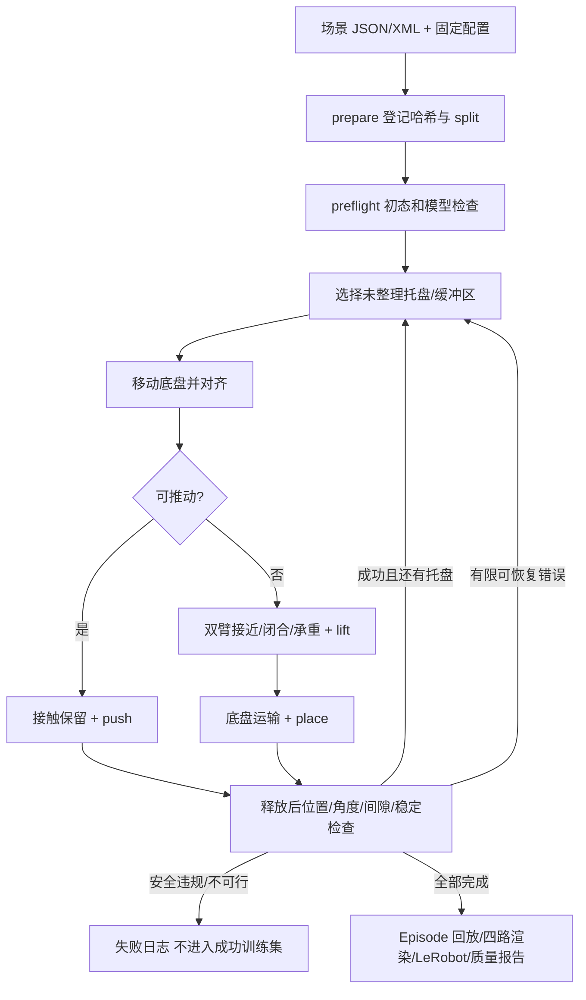

# 模块与执行流程

权威流程说明与状态/事件字典见 [SCENE_TASK_SPEC.md](SCENE_TASK_SPEC.md)，此处为模块导航。

本文后续多托盘循环图描述历史基线；当前三桌单盘、三动作、独立数据/训练/评测与诊断模块请先看 [模块地图](project/MODULE_MAP.md) 和 [文档索引](INDEX.md)。不得据旧循环恢复三个托盘或旧槽位训练文本。

| 文件 | 职责和修改入口 |
|---|---|
| airport_fsm/contracts.py | Config、状态枚举、相机/动作契约、Fault；新增参数先在这里校验 |
| airport_fsm/geometry.py | 履带坐标、槽位、托盘几何、可操作边与任务调度 |
| airport_fsm/machine.py | 状态转移、抓放衔接、有限恢复、完整任务验收 |
| airport_fsm/primitives.py | lift/place/push 的参数化连续路径和硬时间预算 |
| airport_fsm/trajectory.py | 连续插值、时间参数化、速度/加速度/jerk 计算 |
| airport_fsm/runtime.py | IK、逆动力学可行性、接触/碰撞检查；tick 是执行入口 |
| airport_fsm/camera_guard.py | 手腕相机的几何可见性与姿态约束 |
| airport_fsm/trace.py | 同步记录控制、状态、事件和半开片段 |
| airport_fsm/registry.py、batch.py | 不可变来源登记、进程管理、资源/依赖哈希、覆盖统计 |
| airport_fsm/exporter.py、loading.py | 官方 LeRobot 导出与加载、视频、分段视图、质量验收 |
| airport_scenes.py、airport_mobile.py | 三桌场景生成、移动底盘仿真模型 |
| core.py | MuJoCo 仿真封装与旧接口兼容 |

状态标签：SEARCH_TARGET、ALIGN_BASE、APPROACH_TRAY、ADJUST_TRAY、GRASP_TRAY、TRANSPORT_TRAY、PLACE_TRAY、VERIFY_PLACEMENT、RECOVER、TASK_COMPLETE。技能包含导航、推调、抓抬、搬运、放置释放和检查恢复。实际事件/segments 是标签来源，不根据脚本名称猜成功。

运行输出通常为 collection 下 scenes、attempts、views、quality、datasets、logs、splits。attempt 内 result/trace/events 等为原始证据；dataset 下 source_manifest 记录回放与视频来源。字段以版本化 JSON 为准，不能手工把失败状态改成成功。

修改顺序：配置→几何可行性→小场景物理执行→接触/相机检查→完整 Episode→官方 loader/质量检查→新 collection 批处理。调参前保留失败证据，不能只调整成功阈值。诊断脚本 probe_fixed_primitives 可以恢复快照定位问题，但不能代替从头运行的成功 Episode。
