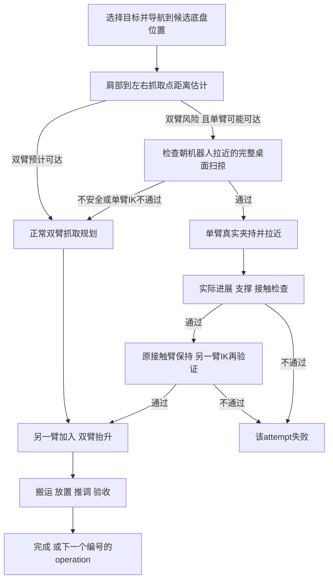

# 场景生成与托盘整理统一规范

规范版本：1.181；人工核对日期：2026-10-19；历史控制基线：primitives3_v50_20260923；当前实验流程见9.1节；新增控制候选须经独立服务器完整物理回归。

### 2026-10-19 真实步进与异步推理优化（1.181）

用户要求优化物理和同步推理、复用真机限制并同room/checkpoint对照。新增runtimeProfile baseline/realtime：两者均可绑定robot_limits（原真机配置max_step0.1rad、max_velocity1.5rad/s、tracking_error0.25rad、feedback_age0.5s、gripper0..80mm；机械限位取同源XML），权重不变；模型服务保留raw/bounded，执行前逐帧速度/步长限制，跟踪和陈旧反馈仍拒绝。该protected诊断排除纯模型成功，不进训练。等待推理时主线程每0.1秒只读真实关节，刷新反馈时间，不推进/重置物理。

realtime单房间使用CPU PhysX避免GPU逐子步同步/与模型竞争，渲染与模型仍GPU；使用官方Fabric状态同步，保留PhysX dt0.002及25子步、碰撞和全部接触采样；不改solver或接触门。后台最多一个在途推理，与当前chunk剩余预测执行重叠；消费时按观测帧对齐跳过已过期预测，超过20帧有效期不得重放。Pick/Place切换清空跨任务缓冲。初始化预热不执行动作，单列预热/初始化耗时，两种profile同样预热。同room/checkpoint/时长/限制对照，分别报告纯步进、接触、等待、渲染与总墙钟，保留原生影片及wall timeline，不能拿仿真时间视频冒充实时。

### 2026-10-19 停止原因与性能计时（1.180）

用户在明确两种方案后选择“最快的解决修复方法”，本轮采用可选且显式标注clip_diagnostic；默认strict不变。诊断将有限19维完整动作的双臂/夹爪按已有机械范围限幅（夹爪总开口对应两指范围交集×2），保持底盘mask，不补缺失夹爪、不IK、不改限位/接触/成功门。记录原始chunk、应用chunk及每项修正。诊断报告pureModelSuccessEligible=false、successRate=null、passedPairs=0，另列diagnosticPassedPairs；不进入训练，不覆盖严格旧结果。

单策略网页终态显式显示Ended、停止原因和最终姿态，不将completed或历史reply_received当正在执行/任务成功。严格模式关节越限保留拒绝，新增chunk步号、目标及上下限数值证据，不裁剪或修改旧标签。离线发布周期0.1秒、浏览器拉取0.25秒；不插值或增加虚构帧。原生policy模式复用初始化/上一物理步后已渲染的同一状态，去除物理步前重复render；每步后仍render、保存全部原生相机/接触/25子步物理。新增physics_step、contact_read、post_render、live_publish分项耗时，用实测判断瓶颈，不宣称实时达标。

### 2026-10-19 单策略网页实时评测（1.179）

用户纠正：不是示例下载，而是任意登记room/检查点的独立策略评测。主要限制机器人执行的仿真时长（1–120秒，20Hz，即总执行帧数），模型等待不扣仿真时间；高级设置单请求超时1–300秒、整次墙钟保护10–3600秒，初始化计墙钟，媒体闭合另计。保留Pick→Place和固定底盘、真实物理门；达到预算报告simulation_time_budget_reached，不当成功。物理/模型失败可提前结束。原批量评测合同不改。

新增evaluation.live作业：单room不可变request、登记checkpoint绑定、新run、共同GPU任务锁、GPU0资源检查；可复用身份/检查点/心跳核实的既有模型服务，只停止本作业自有ROS网关和原生进程。ROS命名空间使用/r1pro_sim/job_<id>保证数字开头UUID也符合topic规则；ROS请求保留original_room_id，按run隔离有状态模型上下文。无隐式夹爪/IK/教师补救；G0.5缺夹爪仍停。

原生每帧只读RigidPrim实测body位姿与相机，原子发布frame/time/state/pose/image；3D以网站源几何绑定实测位姿，不声称几何与USD完全等同，原生相机是渲染证据。等待推理期间冻结，显示采样年龄，不插值制造动作。媒体按run在实际编码器闭合后校验ffprobe、SHA并发布，视频明确仿真时间轴；无执行帧则无动作视频，保留失败。发布失败不改变物理结果或标签。诊断不进训练、不改已有数据/checkpoint。

### 2026-10-19 实际模型服务与仿真闭环录像（1.178）

用户新增要求实际运行检查点服务，仿真以机器人当前相机/状态查询模型，返回动作立即在模拟器执行，导出本次视频及启动说明。授权本次仿真视频同步，不扩大为真机控制或改变训练/验收。单房间新run、checkpoint身份冻结，ROS2 domain86，GPU0选定复用已有空闲资源，不停止GPU1无关服务。原模型关节/夹爪/物理门不变；不裁剪、不教师、不IK补救。

新增显式externalService模式供自有监督器维持检查点服务；服务先加载并发布就绪，仿真完成可保持服务在线，实际退出/身份/心跳独立记录。实时pacing仅防止快于20Hz，不跳物理帧、不通过追赶加速隐藏等待；同步推理时仿真等待回包。记录每次真实推理延迟、相机SHA、状态、动作SHA及每原生帧墙钟/仿真时间。必须报告是否达到20Hz墙钟速度；原20Hz视频是仿真时间轴，墙钟版保留等待，不拿视频播放帧率冒充实际实时性能。

失败初始化保留v1现场，新v2修正检查点contentBindings冻结；模型越机械限位仍拒绝执行并报告真实失败，不能将服务就绪视为动作执行/完整PickPlace成功。证据runs/realtime_inference_20261019_v1，结果以服务器报告为准。

### 2026-10-19 离线工作站、ROS 2模型适配与来源可视化（1.177）

用户要求源码导出、workstation离线免登录、ROS 2 topic模拟模型运行、π0.5/Galaxea AI G0.5/GR00T适配、路径配置、每批32房间数据归属、网站Help、Data & training故障修复及完整reset。离线Node24/SQLite服务使用本地身份，云站原身份边界保持；不新增真机执行。无凭据/数据/检查点/原视频进入源码包；已有模型资源由绝对路径登记。

ROS 2仿真隔离domain86、localhost发现、/r1pro_sim/<job>/room_<original_id>命名空间；Image RGB8三相机、JointState mobile19、String请求/动作JSON。header.frame_id=requestId，须同时匹配roomId/checkpointId；使用真实发布时ROS时钟，不伪造仿真时间。DDS订阅就绪才发首观测；不匹配/重复忽略、超时/非有限/shape异常失败，不自动教师回退。Python模型与ROS ABI分进程；原生物理执行、固定底盘mask、接触/放手/支撑/边界门不变。π0.5 H20每5帧重推理；外部适配按登记1–40步horizon检查，每次最多执行min(5,H)步，完整保留raw/submitted。G0.5单步WebSocket回复不复制成H20。

用户指定G0.5 last.pt路径并授权路径可配置；邻近Hydra/归一化/tokenizer/processor和关节7+1+7+1元信息校验，run冻结登记项。用户确认100=100%=80mm全开，percent80映射观测m×1250、动作÷1250；rad关节不变。用户批准该模型30Hz训练/20Hz诊断明确标注，不能当等时序公平比较；无重训或隐式重采样。GR00T必须提供joint_absolute检查点和显式模态/单位/horizon配置，预训练EEF输出不做隐式IK，不冒充已验证。外部模型不自动纳入现有固定π0.5离线MSE协议。

批次表只读原progress_manifest与frozen_simulation来源键，分列请求房间/合格来源/冻结训练/动作片段/合格溢出，映射dataset版本与split；不把32请求房间等同32合格数据，不改变冻结300对、旧标签或父split，诊断不自动入训练。Reset selected/all从每个房间自身基线恢复双对象位姿/颜色及视图，保留undo，显式Save新版本；颜色恢复仍仅改色。VLA失败reason对象转可读文本，保留原始报告；局部错误边界避免整个站点崩溃。

新增失败：model_action_layout_mismatch、invalid_ros2_action_chunk、stale_policy_action、ROS2 action timeout、checkpoint metadata/units missing、checkpoint changed since registration、external model EEF rejected。状态分注册/加载/ROS就绪/实际推理/实际物理/流程结束与模型成功，接口测试或路径存在不替代实测。原生媒体仍留服务器。本轮变更证据目录runs/web_offline_ros2_20261019_v1，结果以实际回执为准。

### 2026-10-19 MSE科学图表与网站导出（1.176）

用户指定test_last参考图型：逐关节MSE rad²/deg²、RMSE deg，以及每episode 4×4首步预测/真实值曲线；参考目录旧模型数值不并入当前评测。自动评测及手动MSE完成后，独立CPU派生作业只读原report/episode NPZ，在runs/web_mse_figures_20261019_v1/<jobId>生成5类汇总图（另含夹爪mm²/mm）、全部episode曲线、per_joint_mse.csv、provenance.json与mse_figures.zip。GPU原推理、数据、检查点、报告和标签不变；生成图不再次加载模型。

出图前校验protocol、全部truth/valid SHA、帧数/有效目标分母、逐channel MSE与原报告一致；保留全部有限值和异常值，不裁剪。手臂原channel0..6/8..14，夹爪7/15由m转换mm；排除base16..18与尾部padding。关节MSE deg²=rad²×(180/pi)²，RMSE取平方根；不混合角度和夹爪单位。4×4曲线按原20Hz首步预测，14关节rad、2夹爪mm；各channel纵轴独立并标注，所有比较checkpoint共用该channel尺度及真实值。MSE仍非机器人成功率。

派生状态pending/rendering/uploading/completed/failed独立于模型评测状态，真实child wait与退出码落盘。生成或上传失败不修改MSE、不阻断GPU队列；保留错误，单文件最多3次退避。PNG/CSV/ZIP按SHA不可变上传Sites R2，worker token校验写权限，读取限已登录项目owner；原始NPZ/视频仍留GPU。网站只列已确认上传文件，可单图原分辨率查看、下载PNG/CSV/ZIP；关闭页面仍执行，后续快照显示结果。失败规则plot_array_contract/plot_episode_coverage/plot_source_hash_mismatch/plot_denominator_mismatch/plot_protocol_mismatch/plot_nonfinite_output或原MSE不一致时拒绝出图，不伪造曲线。

### 2026-10-19 英文网站与最新最终检查点自动评测（1.175）

用户要求先交付英文网站，再在训练完成后自动使用最新检查点运行VLA和MSE并展示成功率/比较结果。界面、系统回执和模型回复采用英文；历史记录在显示层翻译，不改原始数据/失败记录，中文明确指令仍兼容。当前训练10k已完成时允许立即登记自动评测；新training.create默认autoEvaluate=true且可显式关闭，不扩大训练数据或真机执行范围。

evaluation.auto持久登记trainingRun=current或已登记的training.create ID；浏览器仅可提交current，禁止用户路径/任意命令。调度锁内检查actual_completed_updates达到该run的target、该run最新闭合checkpoint达到target、训练child actual wait returncode=0；三者齐备才冻结选择。只完成中间checkpoint不能提前验证。checkpoint ID、更新次数、norm/metadata指纹、比较基线和两个确定性子任务ID落盘；重启/重复轮询不重复任务、不改已冻结选择。当前与未来任务独立目录，保留旧100步评测。GPU已有负载则排队，不停止无关进程。

自动VLA使用原登记32房间、每动作200帧/20Hz（10秒仿真预算）、H20每5帧重推理；沿用1.174纯模型/显式固定底盘mask及所有真实物理门。原生启动继承既有工作入口OMNI_KIT_ACCEPT_EULA=YES与PYTHONUNBUFFERED=1，模型/引擎初始化显示initializing/initializing_native；实际推进才native_policy。该配置修复旧job在EULA bootstrap EOF、frames0的基础设施失败，不重标旧结果。模型服务/Isaac真实wait、媒体及trace审计保持。

自动MSE比较该最终checkpoint与已登记纯真机10000步baseline，固定原Test19、全部20Hz/H20、相同noise/valid mask/目标SHA，沿用1.174协议。页面显示关节rad²、夹爪mm²、首步误差与相对baseline百分比变化，负值为误差下降；不能将不同协议或训练loss混入。自动结果随GPU桥接10秒刷新，关闭网页仍执行。

成功率定义为passedPairs/(passedPairs+modelFailures)，显示实际分子/分母；基础设施失败单独显示且不进入模型成功率分母，同时显示evaluatedRooms/totalRooms覆盖率。无可评模型房间显示Not measured，不显示0%；任务流程completed不代表模型通过。32房间是training_scene_native_closed_loop_diagnostic，不报告held-out泛化，不自动入训练。新增状态waiting_training；失败invalid_automatic_evaluation_contract/automatic_training_run_not_registered/invalid_automatic_training_id/automatic_real_baseline_not_registered及训练异常时拒绝partial checkpoint。证据目录runs/web_english_autoeval_20261019_v1。

### 2026-10-17 网页训练配置、实时进度与配对评测（1.174）

用户批准真机/仿真0–100%自选配比、登记数据集和步数；新任务独立排队，不覆盖健康训练；VLA为Isaac纯模型闭环，MSE固定真机Val/Test。此项替代1.172/DEC-WEB-002中仅固定50/50关联的网页范围，不修改正在运行的新300对50/50 release、输入或检查点，无真机控制授权。

每10秒回传训练器实际更新、阶段、checkpoint回执、loss和心跳；监督器只补pipeline阶段。总进度=实际梯度更新/请求总步数。ETA使用同进程相邻采样步速窗口，样本不足用训练器里程碑EMA，分别报告里程碑及总剩余梯度计算的估计范围/采样时间，排除后续初始化、保存和评测。桥接45秒过期或训练心跳/进程不符后停止实时ETA宣称。loss不能作为模型成功证据。

training.create/evaluation.mse/evaluation.vla仅接收登记ID、数值配比/预算/房间，不接路径或shell；GPU写操作由平台注入身份和服务器所有者配置复核。请求冻结、用户隔离、单实例调度/GPU作业锁、PID/start ticks/command/cwd、日志、逐阶段实际child wait退出码和心跳保留。健康既有训练或GPU仍有模型负载时waiting_gpu，不停止原进程；每任务新目录，失败保留现场，不自动改方案。

训练按累计期望数量分配域槽位，任意整数百分比与目标全序列误差不超过1个draw；各域内Pick/Place累计均衡。来源权重仍为各动作轨迹时长median/T的clip[0.5,2]，源内均匀选帧。0%域不参与采样/归一化；只用train实际抽样算norm。新300保持原冻结300，不扩大成生产313；窄30/宽29独立train来源，合并拒重复source_room及与登记父split冲突。真机Train102/Val13/Test19保持。登记父权重+新优化器，精确训练到请求步数，warmup=min(500,floor(steps/20))适配短任务且10k仍500，每1000和最终步实际保存；未执行RL/DAgger。

MSE协议real_all_frames_h20_noise42000_v1：固定原真机Val或Test、全部20Hz观测、H20、模型间相同sample keys/truth/valid mask和seed=42000+global index的float32(20,32) noise；尾部padding不评分。每检查点使用自身spec/params/assets/norm，绑定receipt及norm/metadata指纹；只登记已闭合检查点。14关节rad²与2夹爪m²/mm²分别报告，base三维排除；另报首步、分动作、分episode和通道误差。协议或目标SHA不同拒比较；离线MSE不表示闭环或真机执行通过。

Isaac入口显式execution_mode=policy，teacher默认保持。纯策略路径不加载教师/IK/逆动力学；只输入原生head_left/left_wrist/right_wrist等比224 RGB、实测state19和精确Pick/Place文本，base观测减episode首帧真实反馈。H20每次最多执行5帧后重推理，raw19完整保留；双臂夹爪finite/机械范围不符即失败、不clip，base后三维使用显式fixed_episode_base执行掩码并保存raw/submitted。初态只初始化一次；Pick实际双侧相对长边接触均>0.5N、抬升>=2cm、桌接触<=0.01N后才切Place，真实末态连续，不插教师Pick/reset。Place首次实际失夹时gap<=2cm；末尾连续10帧桌支撑>0.01N、速度<0.01m/s、夹爪接触<=0.5N，原5cm边界、15度朝向、桌前/底盘漂移与2cm穿透门保持。独立trace审计N+1状态、25真实子步和四相机实际编码退出。每动作20–1200帧显式预算，不沿用教师固定60帧/松手28帧作为模型要求；不改变物理成功门，不承诺所有动作3秒。

当前32房间来自train父场景，结果scope=training_scene_native_closed_loop_diagnostic、training_eligible=false、heldOutGeneralization=false。分别报告完整Pick/Place通过、model_failure、infrastructure_failure；completed不等于模型通过，不自动进训练。视频/轨迹留GPU，仅同步JSON/TXT。状态新增planned/waiting_gpu/preparing/initializing/training/saving_checkpoint/inference/native_policy/completed；失败新增unregistered_dataset、invalid_training_config、checkpoint_not_closed_or_registered、invalid_MSE_protocol、paired_MSE_protocol_or_targets_changed、simulation_parent_split_conflict、job_request_conflict、policy_checkpoint_identity_mismatch、privileged_policy_input_rejected、policy_inference_response_timeout、policy_action_outside_mechanical_joint_range、policy_release_above_authorized_2cm、policy_action_budget_exhausted、native_evaluation_wall_budget_exceeded。未实测评测必须显示待运行/排队，服务器/发布证据见runs/web_training_console_20261017_v1。

### 2026-10-17 网页初始实验室原材质（1.173）

用户给出实验室截图，要求默认显示实验室与机器人原有着色。网页保留原来源房间背景（地面、墙面、门、显示器、座椅）与机器人黑银分区；托盘为原酒红主体和浅色标识，默认关闭辅助网格。默认颜色色板由源线性材质转换sRGB，机器人`#CDD0D3`、托盘`#A15E6D`；这些默认值恢复每个网格的原材质，不能统一涂掉分区或标识。改色仍只覆盖白名单银色外壳/托盘主体，夹爪、关节、相机与托盘标识保持。恢复原色按所选房间或全部房间生成可保存的新草稿，旧版本/服务器输入不改。视点与中性室内反射仅用于浏览器静态展示；不能把参考图的抓取姿态或多托盘复制为当前任务，也不宣称浏览器与Isaac光照/物理像素等价。加载失败明确提示，既有状态/失败字典与训练门不变。

### 2026-10-17 ChatGPT Sites 网页与GPU主动连接（1.172）

用户授权创建项目并部署，明确ChatGPT Sites托管网页、GPU服务器负责仿真/训练，替代DEC-WEB-001的“本轮仅导出”边界；不扩展真机控制、训练配方或动作容差授权。实现`apps/scene-agent`，平台私有登录与用户隔离D1；底盘XY/Yaw、托盘XYZ/Yaw及白名单纯视觉颜色草稿；房间0–31或全部。WebGL使用原项目CAD和登记初态，静态关节/原场景来源不能当实时USD或相机物理等价已验证。GPT API未连接时必须显示基础指令模式；任何模型输出经有限数值/字段/房间验证，无任意shell、自由文件路径或实时机器人入口。

流程：平台登录→读用户草稿/来源快照→明确对话或参数编辑→revision比较保存新版本→scene.sync排队→GPU主动HTTPS轮询→独立新目录配置与颜色侧文件→draft_synced。native_config.draft同时写initial_base_world与fixed_base_world、tray转wxyz，继承登记父split/seed/门；旧预检结果移除。此同步不启动仿真、不修改现有采集，仍需原生视觉适配、物理/相机指纹及完整episode验收后另版本入库。当前没有物理验证的草稿一律training_eligible=false。撤销/恢复只生成新网页版本。

训练只复用DEC-055新300完整对+真机50/50耗时加权BC。新300/真机134/历史窄30宽29分别标来源与作用域，真机val/test和sim父train保持。training.plan冻结选择；非登记配方blocked。training.attach复核既有监督器PID/start ticks/命令/cwd/落盘心跳，健康则attached_existing，身份或心跳不符blocked；不重复启动或注入新数据。来源门和实际梯度/检查点由原服务器证据决定，网页不以数量、连接或loss代替成功。

新增scope状态：queued/claimed/draft_synced/attached_existing/waiting_for_data/ready_for_server_revalidation/blocked/failed；这些是网页任务回执，不能替代物理或训练状态。GPU服务有单实例锁、身份、阶段心跳、实际退出码、日志与不可变request收据；断网最多3次逐次退避，最后快照过期显示离线/快照。领取后的任务重启可恢复，已有receipt先复核请求SHA而不重复执行。错误包括身份拒绝、跨站请求、版本冲突、未知字段、非有限pose、request_id_conflict、invalid_room_selection、baseline_config_missing、unapproved_training_recipe、unsupported_operation。secret仅平台secret及服务器项目.secrets，源码/浏览器/交互档案不得含token。发布、服务器连接与端到端结果见`runs/web_scene_agent_deploy_20261017/`，不能以此规范文字代替最终实测。

### 2026-10-17 网页场景 Agent 第一阶段导出（1.171）

用户要求先导出网页agent的prompt模板与执行指令代码，并明确选择最新Isaac32房间Pick/Place。交付位于`exports/web_scene_agent_v1`，本轮只导出/测试，不启动网页、物理或训练，不替代DEC-055的新300对混合路线。LLM协议仅scene.describe / scene.patch / datasets.list / training.plan，严格字段、有限数值、房间0–31、不可变request_id收据；不接收任意shell/文件路径或机器人实时控制。输出独立`runs/web_scene_agent/<request_id>`，旧collection/release/清单/checkpoint不变。

流程为读取已登记快照→场景房间局部初态/颜色草稿→独立新配置→待原生适配/预检→真实物理与媒体闭合。当前执行器只到草稿/计划；场景草稿不能计为已应用或合格来源。底盘[x,y,yaw]米/弧度同时映射initial_base_world和fixed_base_world，tray[x,y,z,yaw]转换wxyz；旧预检证明失效，不允许动作内pose重置，Place继承真实Pick。颜色侧文件需新入口显式接线，只作用白名单纯视觉mesh，保留夹爪/手指/相机、碰撞/质量惯量/朝向。单房间材质不污染共享房间；session layer前后物理相机指纹及实际帧图另须服务器核验。导出函数存在不算原生测试通过。

状态字典新增本导出scope：snapshot_only=本机历史元数据；draft_saved=新草稿落盘；requires_native_adapter_and_preflight=配置转换但不能启动；blocked=训练选择缺资格/接口；rejected=输入/身份拒绝。training_started始终false、actual_completed_updates=0。错误包括invalid_command_fields/invalid_room_selection/invalid_finite_vector/unsupported_operation、request_id_conflict/saved_artifact_changed、parent_split_leakage/selected_parent_split_leakage、ineligible_source_metadata、visual_patch_modified_physics_or_original_cameras；无自动改门、重试或成功回退。

两份2026-10-16历史sim元数据仅59完整对/118段/472个四相机片段文件，全train且同父；仅选择这些快照的纯sim计划因缺合法val/test、服务器来源媒体复核、网页启动适配未接通而blocked。现有三动作trainer不能用于两动作。DEC-055独立新300对+真机50/50耗时加权BC已有专用模块，后续网页应复用并核验实际证据；该路线保留真机val/test、sim仅train，不要求制造sim holdout。网页本轮不改变其授权、采样或运行状态。20项初始本地测试通过；最终收据见`runs/web_scene_agent_export_20261017_v1/validation.json`，不代表USD/完整episode/训练实测。

### 2026-10-17 新增300完整对与混合耗时加权BC（1.170）

按DEC-055新增300个完整成功固定底盘Pick/Place来源，导出600动作片段，不混此前59源或4房间重复验证源计数。批次仍32房间、单engine/共享物理时钟、双GPU渲染，不改帧率、物理步长、相机及真实验收。每批新随机种子/不同tray与桌前初始base，动作期间固定base；失败保留且不入训练，尝试有上限，不改变困难场景标签。完成300资格源后冻结唯一manifest与来源SHA，后续版本独立。

本次混合训练只含Pick up the tray和Place the tray，真机/Isaac样本各50%，原真机train/val/test隔离；当前Isaac父scene为train，仅作train扩增，不制造sim val/test。耗时加权BC经用户明确选择，暂不执行RL。根据train来源、动作分组内真实完整片段耗时设计有界相对权重；不能使用val/test估计权重或norm，不能给loss加无梯度常数当优化。全部准备/稳定过程保留，不时序加速，不改变目标动作和任务门。具体采样：每个来源域/动作以完整片段时长中位数T_med计算源权重clip(T_med/T,0.5,2)，先按源权重抽来源，再均匀抽该来源中的帧（等价每帧权重source_weight/frame_count），避免较长片段因帧数多而抵消速度偏好。每8样本固定real4/sim4，各域Pick2/Place2；归一化仅用冻结训练抽样表。固定3秒核心本身没有时长差异，不能保证加权后执行变快。保存权重分布、采样表、真实来源比例及检查点身份，报告仿真核心/准备耗时与模型闭环耗时的区别。

阶段区分candidate_precheck/collecting/exporting/waiting_for_data/data_ready/preparing_cache/initializing/training/checkpoint_saved/evaluating/complete/blocked。300来源、实际媒体/trace/退出/manifest检验未通过时不得进入训练；训练初始化与真实梯度更新分报。双卡使用已有验证的BF16/FP32冻结视觉PEFT与兼容通信环境，已验证父权重仅初始化、新optimizer；同run异常才恢复相同数据/配置/optimizer。代码错误有限恢复，资格失败不强行通过。

### 2026-10-16 方案C真实共享时钟采集（1.169）

用户要求停止串行采集，改为32房间、单engine/单PhysicsScene、双GPU渲染；每房间不同登记初始tray位姿，所有动作底盘命令固定。独立私有运动学规划器只读各房间原生反馈，线程提交各自19维目标，主线程等待活跃房间目标齐备后一次推进共享25个2ms子步，禁止逐房间推进物理或重放旧控制。规划墙钟等待不计动作时间、不新增超时门。已完成/失败房间不再接纳训练帧，仍保持最后控制参与真实共享物理；全局总览持续同一时间轴，不能拼接不同时间伪并行。

新状态initializing / planning_shared_clock_barrier / running_independent_feedback_shared_clock / physical_batch_closed_pending_media / parallel_batch_closed / failed区分初始化、规划、物理执行、媒体闭合和实现失败。房间独立物理失败保留原始日志/接触/视频，不阻塞其他房间；原穿透、长边、支撑、释放及5cm门不变。每房间实际Pick末态承接Place；只四相机/控制N与状态N+1/25真实子步、共享进程真实exit0及旧独立验收闭合的完整pair导出。旧split原样继承，当前train-only不冒称训练就绪。单房间失败不伪造进程退出；共享进程正常关闭和任务成功分报。运行使用新release/run，旧数据不改。全局视频与分房间数据留服务器，吞吐报告真实墙钟/加载/规划/物理/渲染/导出及合格来源数；双GPU配置与实际设备证据分报。

### 2026-10-16 可达生产与大角度调盘研究分线

用户要求先生成已能跑通的泛化场景，调盘问题不阻塞生产。新生产分支只尝试直接双臂可达的多样初态，直接路径失败保留证据并跳过，不在该case进入单臂调盘；不把有限覆盖宣传成大角度鲁棒性完成。独立研究分支继续调盘/释放/待机复位。生产全过程保持初始底盘命令，真实Pick末态续接Place，只真实成功且视频状态动作闭合的来源导出；父scene split不改变。旧冻结BC沿原数据继续，新合格批次另建版本，不注入正在训练清单。

### 2026-10-16 用户授权调盘松手后双臂复位、全动作固定底盘（1.168）

当前多姿态Pick/Place专项：episode初始就位在桌前、靠近并面对桌子；所有动作及单臂准备/松手/复位期间保持同一底盘命令，不再执行片段内或准备阶段底盘navigate。每episode初始站位写入初始化证据，首次物理步前一次性设定，之后不得修改实时机器人或托盘pose；原真实底盘5cm漂移容差不变。此更新替代本专项此前录制阶段navigate步骤，不重标旧数据、不中断原冻结三盘BC。

用户已明确复位含义：调盘后张开夹爪、确认桌面稳定支撑、撤离接触，双臂通过真实关节控制回到本轮初始待机姿态，夹爪张开；不复位底盘或托盘。复位及单臂准备全部纳入同一Pick片段；重新按实际tray pose检查对向长边双臂拿取/放下全路径。Place仍承接真实Pick末态，Pick与Place之间不新增复位。状态事件released_arm_reset_begin/complete记录实际盘位、关节和不变底盘命令。持盘时拒绝复位；支撑、碰撞、边界保留原门。调盘目标可以在实际盘轴达到既有15度Place门且同站位完整双臂路径已通过后结束，不额外强求0度；随后松手/复位后再次预检，预检不是物理成功。

代码候选尚待服务器实测，不能声称已通过。旧v5在左臂路径求解阶段失败，未执行到松手；仅增加复位不足以证明旧阻塞已解决。固定底盘初始化和复位都需要新运行目录的完整验证。

### 2026-10-16 单臂中心反馈耦合修复候选

v4实际在约73度趋于停滞，中心纠偏沿桌长方向约−1.5cm，与转动切向参考相反；这提示控制耦合，仍待物理因果验证。下一有限候选沿桌较长轴采用当前真实中心，避免无任务要求的精确原中心回拉；窄轴保持中心反馈，参考及叠加纠偏后的完整真实碰撞轮廓均投影到原5cm允许区，不增加位姿复位、外力、焊接或验收宽容。实际轮廓/支撑/夹持门保持；失败不入训练。仍保持原桌前固定动作站位和单双臂流程。

BC v5实际10与100步均正常退出并保存，CPU独立比对10步checkpoint与父模型的20个LoRA数组全部变化且有限。按既有独占验证资源授权，健康train_100不发signal、正常保存100；仅停止协调续跑，独立有锁恢复进程等待当前最后登记原生候选actual wait后重启原协调器，从已有优化器/同数据同配置继续1000等。初始化显示0与已保存100分报，监控读取持久checkpoint，不把原正式三盘BC称新多姿态训练。

### 2026-10-16 后续同要求修复候选

v3单臂参考提前0.01rad时实际yaw持续约75度，尚无有效转动；新候选参考提前从0.01逐帧增加至最多0.12rad，以实际yaw为基准、不累计超过上限，不改物理摩擦、手指或验收。末态角误差小于提前量时不越过目标；真实反馈及轮廓约束保持。只在新目录执行，不改健康运行代码。

BC v4禁P2P后首步返回异常全零指标，下一批device_put触发CUDA stream WaitFor fatal/actual wait−6；1步计数不能当有效训练、没有checkpoint。核对旧已工作BC发现新Isaac入口漏传原有完整GPU兼容环境（Socket、禁P2P/SHM/IB/CUMEM_HOST，XLA禁memcpy_p2p/nccl_user_buffers/command_buffer/triton_gemm）。新配置显式复用该既有环境，不改依赖/vendor/数据/训练数学；每步完整state/info同步后要求模型参数范数正且有限，才报告更新。旧失败计数及产物保留，派生报告明确未验证。新运行不得恢复损坏/未保存状态。

### 2026-10-16 调盘轮廓路径与训练初始化诊断（1.167）

v2/case_000保持平面后仍在75→49度旋转时因真实边界失败。新控制参考不再把中心强制搬到base前55cm，优先原中心；按原生碰撞顶点/当前桌方向/原5cm门投影完整旋转轮廓的可行中心。原生75→0度151点几何检查可行不是IK或物理通过。实际yaw驱动每帧最多0.01rad参考前进，避免时间圆弧跑在真实托盘前；平面有界反馈和固定夹持pitch保持。有限控制迭代记录真实yaw/中心，失败仍按原门保留，不算训练。旧双臂Pick/Place不改，单臂准备仍全部纳入Pick。

原BC两小时0更新的作业经PID/birth/argv/cwd核验后，仅停止本项目guard/coordinator/train并保留实际wait及旧输出。新v3/code50同父权重/冻结数据/样本顺序/精度/PEFT/双卡，加阶段落盘与60秒调用栈以定位初始化；不改变训练数学或把阶段心跳称梯度进度。外部ptrace被系统拒绝，不改系统权限；新输出避免覆盖初始化残留。未完成新数据不会混入旧正式三盘BC。

诊断v3已确认模型state初始化完成，阻塞在首步gradient_dispatch的JAX execute_sharded；独立同配置4096元素双卡求和默认P2P 35秒未返回，NCCL_P2P_DISABLE=1走SHM后3.3秒exit0且结果8386560正确。新v4/code52仅在该训练配置disable_nccl_p2p=true时设置进程环境，保持原双卡/数据/算法/优化器，不改系统或vendor；原v3零更新失败现场保留。正式梯度及保存仍须真实检查，不以通信测试替代训练。证据runs/isaacsim_training_transport_diagnostic_20261016_v1/results.json，NVIDIA说明https://docs.nvidia.com/deeplearning/nccl/user-guide/docs/env.html#nccl-p2p-disable。

### 2026-10-16 单臂平面调盘控制修复候选（1.166）

用户要求继续修复，保持当前初态覆盖与验收。case_006候选登记明确夹持期间腕pitch从0到−30度，实际末态roll约−18度/抬升6.3cm；XY积分累积约14cm。上述是已确认的控制行为，机械因果贡献仍待原生验证。新候选固定单臂夹持时的腕pitch，调盘仅改变水平yaw，释放后重新规划原双臂抓姿；取消夹紧调盘中的无必要pitch变化。平面纠偏采用0.9泄漏、0.35误差增益及2cm向量幅值上限，Z纠偏为0；这是控制量防积分饱和，不是新增或收紧验收容差。原5cm边界/底盘及支持、抓边、失败门不变，未改旧结果。新run独立真实物理验证，通过前不导出数据；状态仍private_precheck→native_preadjustment→full_pair_audit。旧成功双臂Pick/Place核心保持。

### 2026-10-16 用户批准跨episode桌前站位变化（1.165）

用户明确选择包括桌前底盘初始位置和朝向，替代1.164及DEC-050中“仍待澄清”的限制。新配置显式search_front_stations=true、fixed_base_world=null：沿用旧桌前距离/横移搜索，增加沿托盘长轴及原15度朝向误差范围的候选。位置始终按原桌子正面区域过滤，不随机器人yaw重新定义桌前；逐候选检查原双臂相对长边接近、抬升、放下路径。有限私有IK候选耗尽只报本次候选耗尽，不能称全局不可达。必要时复用旧抓取站位搜索进入已授权单臂准备；实际碰撞/接触和原生验收不省略。

case_005实际wait1，直接搜索失败后旧fallback仍要求双臂可达，错误阻断单臂准备。新版本准备站位只预检单臂接近与受支撑调盘路径；私有阶段不移动真实对象或底盘。选定后才导航、实际单臂调整，再重新检查双臂。保留失败与候选记录，不把有限搜索失败称全局不可达。

每例在正式动作前落盘episode_station.json：选定base_world、实际tray初态、桌ID、准备前选择及动作内固定标记。进入Pick/Place后不改变底盘目标，实际平移漂移仍用原5cm门；直接路径保留机器人前向长轴目标。Place始终继承实际Pick末态，无持盘复位。显式fixed_base_world旧配置仍只检查原固定站位，默认不扩范围。新分片配置allow_episode_front_station_search仅接受对应新配置/落盘站位，保持实际目标恒定、物理续接、父split、视频状态控制对齐，失败不导出。

C32 v2的128个编码器虽写完，但Kit默认清理阶段实际wait=-11，不能宣称闭合成功。v3仅在NPZ/视频编码器实际wait与状态全部写完后使用已安装SimulationApp.close支持的skip_cleanup模式，保留真实退出码。32房间10帧关闭预检已actual wait0；257帧完整探针仍以实际收据为准，不计训练来源。BC资源恢复v3先过滤/proc命令再核身份，避免扫描内核线程重试；等待本轮原生关闭后恢复原冻结BC，不把恢复等待标作训练。

原BC恢复实际失败原因为0更新初始化遗留checkpoint目录，三次有限尝试完整保留。新恢复必须另建输出目录，复用原冻结inputs/父权重/采样/归一化、相同双卡精度/PEFT和数量级，不移动或清空旧目录；先等待当前原生候选实际wait收据后释放资源。失败候选的退出仅释放资源，不资格化新数据。初始化仍报0更新，不以guard启动冒充训练。

### 2026-10-16 大初态测量纠错与32房间资源修复（1.164）

新candidate可显式exact_collision_footprint：从验证过的同一Isaac USD中读取实际启用碰撞网格的全部body-local顶点，保持原5cm桌面并集边界，不改任何几何、碰撞、惯量、材料或旧标签。只在新run启用，旧scope默认矩形代理保持。case_003相同真实状态矩形估计5.4001cm，源与原生17个碰撞mesh/160顶点独立复算均4.4857cm；这是边界测量修正，不是控制精度提升或补写旧成功。新审核核顶点SHA/scene SHA并从trace复算边界标记。新case_004虽然使用真实足迹与实际托盘XY反馈积分，仍真实失败：yaw52.08°、roll−18.05°、中心高0.8702m、最大实际外伸5.1100cm，未完成双臂Pick/Place，不合格、不进训练。不能只增加边界门掩盖单臂准备时的抬升/倾斜。跨episode是否允许变化桌前底盘初态正在等待用户澄清，未自行改变固定站位。

大初态Pick完整分片使用end−start帧，包含单臂准备和核心夹起；核心60帧/3秒与完整动作总时间分报，Place仍实际物理续接。所有视频/状态/控制同一源帧区间，state比action多一终态；不硬裁60帧丢掉准备。仅在显式allow_supported_preadjustment新配置接受对应完整来源，失败来源在创建数据目录前即拒绝。没有新动作文本，当前两动作专项不冒充完整三动作/三盘。低清四视角保持原比例/视场/外参，展示640×360不作训练视角；旧分辨率默认不改。

32房间v1因进程RLIMIT_NOFILE软额1024耗尽，实际exit1；Vulkan共享句柄错误与此同时出现，保留失败日志。v2/code44仅提高本作业软额至65536（不改系统/其他进程），继承已闭合4/8/16审计SHA，重新启动32；房间内材质跨根引用显式重映射，RenderProduct.deviceIds按房间分配0/1，实际stage要求仅一个PhysicsScene。GPU同一原生PID在两卡均采到SM活动，是双卡参与证据，非独占吞吐跑分或物理成功。仍是命令到新PhysX的集成探针，缺少批量自适应控制/完整接触资格/相机隔离和画面审计，不进训练。

独立BC资源恢复v1读取无关用户/proc时PermissionError，已保留failed；v2只跳过无权读取的无关进程，继续严格核本项目身份，等待新32实际wait收据与本轮原生候选全部关闭后恢复原冻结BC。不得把恢复协调器或初始化说成已梯度训练。

### 2026-10-16 单engine网格采集与多样持盘初态（1.163）

DEC-050选择C：32独立房间、每房一个机器人/空tray，双GPU渲染、单GPU PhysX。4→8→16→32逐级验证；一轮控制帧全部环境共享25次2ms真实物理步，不对每环境再推进全局时钟。四视角低清头320×256、腕320×180，保持原比例/视场/外参；相机房间隔离、实际双GPU工作负载和画面合格必须另行核实，配置multi_gpu=True不等于已证明双卡吞吐。异步有界录像队列必须背压，不丢帧伪造。父场景split随来源继承，网格坐标不进入模型本地状态。独占跑分/采集前保存本项目BC实际已完成更新后暂缓，完成恢复原冻结数据/配置，不停止无关服务。

扩大tray初始XY/水平yaw的覆盖，以不改尺寸桌面内完整轮廓为几何初态条件，不把几何支撑标成可抓取。直接双臂抓姿无解时进入有界真实单臂调盘/调向，再用实际新状态重新联合检查两条相对长边路径；不是过滤掉全部难初态。单臂预调整纳入Pick，核心夹起仍争取约3秒，完整片段须包含准备并分别报告总时长，不能裁掉后称整个动作3秒。固定底盘专项只在采集前就位，片段内仍按原固定目标/5cm真实漂移。Place从真实连续Pick末态起，记录实际双臂/腕/夹爪/盘位姿及来源，无统一持盘复位；专家和实际VLA持盘源分标。

新状态字典：integration_probe → native_shared_clock_running → integration_media_closed → adaptive_collection_pending；后续独立preadjustment_pending/native_preadjustment_verified → full_pair_audit → frozen_batch。当前probe_isaac_parallel_collection仅把原专家命令提交到新PhysX房间，绝不在线重放盘pose，明确training_eligible=false，不算控制器、数据或模型成功。暂未接通的预调整、全接触资格、相机隔离及批量自适应控制不得省略。sampler记录reachability=not_checked，未合格初态不能直接进入训练。旧冻结资产、来源、标签和模型不改，新目录保留每次普通代码故障与真实wait退出。

实现补充：DiversePickPlace复用FastPickPlace双臂核心，仅在直接固定站位路径不可用时登记单臂准备；最多18个私有几何候选（双手选择、沿长边0/±12cm、腕pitch −30/0/−10度），最多保留3个可行路径，不允许无限物理重跑。使用源夹垫中心/TCP偏移，调盘圆弧可同步调整腕pitch但不改变接触点的刚体圆弧参考。候选通过私有IK不等于真实抓持成功。夹持/桌面支撑沿原0.3秒瞬时宽容，真实角点按原5cm边界；没有附着、外力或在线改盘pose。真实路径未通过时保留failure，不自动导出。准备与核心夹起之间不裁片，Pick可大于3秒；审核只在diverse_preadjustment新scope明确区分完整动作时长和原60帧核心，旧scope仍要求60帧。Place仍从真实反馈记录初态。

原BC资源恢复由独立restore_bc_after_isaac_parallel_probe等待本轮各原生子任务实际关闭后，按原冻结配置恢复原协调器，单实例核验PID/birth/argv/cwd，未启动任何新pose数据训练。正式批量采集尚未就绪时恢复原BC用于开发间隙；后续再独占仍先核验/保存新更新。监控脚本只写JSON/TXT，不发布控制或启动仿真。

### 2026-10-15 原生三盘执行与实测验收接线（1.140）

本轮用户要求先完整Isaac demo，再后台三动作采集和检查后BC；没有新增任务容差。新增NativeRuntime/NativeTeacher/ThreeTrayObserver：教师只在私有源模型中mj_forward/IK规划，实际执行、状态、接触和四路视频均来自PhysX，未调用mj_step、绑定tray或在线重置机器人/托盘。教师规划与模型执行必须显式区分；此控制器不得被模型评测当作回退。

转换检查新增源质量、质心、主惯量及两夹指identity equality。已发现导入tray质量27.733kg而源为1.2kg；新资产恢复源参数后SDK实测1.20000005kg，不是任意减轻载荷。Isaac6的被动第二夹指恢复NewtonMimicAPI，参照第一夹指，不额外增加第二执行器。桌面接触过滤使用实际桌体RigidBody路径；不能用不受支持的碰撞叶子过滤器的零值宣称无支撑。指定腕相机视觉壳去除与夹爪本体保留不变。

流程状态：initializing_native_task → full_native_task_running（Pick/Place/环境装载/Flush按tray循环）→ native_task_success_pending_media_exit_closure → 独立退出/ffprobe/SHA与trace完整性校验 → 冻结train/val/test → clips → cache → 初始化 → 实际梯度训练。waiting_for_data不是训练。native_task_success尚须实际wait0和四native视频闭合才能成为数据；任何失败都保留原目录、raw动作、提交控制、接触、日志和退出状态。

空盘Pick恢复旧成功案例的75mm rim模板；Flush使用独立推动模板，不能混用高度。邻盘妨碍双臂时复用旧成功日志已有的桌面单臂分离再另一手加入，全部纳入Pick，真正抬升仍须两手相对长边实际接触。记录分离前后tray真实位移，不用TCP意图代替；边/接触/支撑失败不得通过改历史标签消除。Place记录实际轴误差、释放与支撑；Flush逐阶段记录真实右推、左稳定夹持、右实际松开、松开后真实左移≥3cm、最终双手释放和三件载荷支撑。沿用已有0.3s瞬时失接触宽容，不把单个零力采样新增为硬停止。

Flush站位须另行检查整个右手下降路径，不能覆盖成Place站位或把固定站位失败当作全任务不可达。demo04已实际实现第一盘左接管后tray左移0.031538m、双手最终0N、桌面29.50N，但最终角点越界0.061712m，超过既有0.05m边界门，保留exit1。新候选把Place的推动预留参数从0.025调为0.042m，在既有位置容差内分配空间，不增大验收门；真实最终角点仍须重新验收。失败qualification新增incomplete_cycle/实际终态诊断便于定位，不可计作完整成功。原生trace新增payload速度/在盘/边界/轴误差/桌前标记，和实际状态同一帧对齐。

后台完整任务监督使用独立stage_runner写真实子进程wait收据；协调器按PID/birth/argv/cwd识别已有子任务和不可变输入，不重复导出或训练。外层guardian只恢复非终态的协调进程故障，最多3次10/30/90秒退避；物理终态失败不自动无限重试，也不放宽条件。隔离测试的实际子任务exit3、协调进程exit7后一次恢复及终态失败门、防重复锁均通过，不代表任务成功。val/test资产可在demo期间独立预准备，仍不是训练来源；demo验收通过后才启动正式来源采集与数据闭合。

新运行目录runs/isaacsim_three_tray_workflow_20261015_v1；demo候选、修正资产和流水线目录分开，冻结release不改。新训练仅接受同profile/rule的完整三盘原生来源，首次合法三split可冻结首批后启动，不能读取旧3425片段代替。新BC入口train_pi05_isaac_three_tray.py使用既有父权重、新优化器、双卡数据并行、冻结视觉和BF16/FP32方案，按10/100/1000/10000/100000保存；检查点存在不等于模型闭环通过。若尚未配置合格原生模型入口，状态明确model_evaluation_pending，绝不调用NativeTeacher补演示。


### 2026-10-15 旧三托盘的独立 Isaac 新流程（1.139）

用户新增迁移旧三托盘管线，明确选择合并为三个原文训练文本，并把旧推调改为新版带载交接；本分支为新增scope，不恢复旧八文本为当前合同，不覆盖单托盘分支。profile=isaac_three_tray_loaded_action3_v1，rule=20261015_three_tray_loaded_handover_left_motion3cm_v1。保留旧三桌/三盘的场景来源、调度和槽位元数据；抓放、桌前联合站位/桌间移动、长轴前向及已授权容差沿用当前合同。空盘取放后环境生成书包/外套/笔记本电脑，推动须右实际推、左稳定接管、右释放、真实tray左移至少3cm、左释放与稳定支撑；不是旧push_adjust_tray改标签。

旧数据定位：runs/vla_20261005/task_complete_actions_v1，parallel_v2 train149/val22/test22完整来源，旧八类片段2654/390/381，来自MuJoCo。原collection、旧成功/失败、导出和检查点只读保留；193是旧完整来源数，不是新Isaac成功数据。新来源必须原生完整任务验收，各托盘载荷与交接证据闭合后才进入新训练，不从旧push推断新Flush。

新场景构建r1pro_teleop/real2sim/three_tray_migration.py校验父split和选中源SHA，按joint name重建增加被动载荷DOF后的初始keyframe；三盘分别有独立载荷集，原机器人/三桌/三盘的碰撞、惯量与尺寸保持，仅复用已授权纯视觉相机壳去除（保留夹爪壳/手指/相机位姿）。原生三件外套分别转换成GPU surface deformable，不以刚体替代。多托盘新增静态资产不等于可执行完整控制器。

D6修复只恢复缺失的源position驱动：已确认旧导入缺transY，把源agent_base_y的kp6000/kv600/force600写回transY；已有X/yaw不改，不调整源增益或碰撞容差。普通转换错误修复保留v1实际exit1，独立v2原生X/Y/yaw/双臂/夹爪和三件外套预检通过、实际exit0。新增离线mj_forward对照native测量相对FK诊断，不能称为MuJoCo物理执行或给VLA提供纠正。

数据按动作三目录，而不是整个三盘任务只切三段；可重复多组Pick/Place/Flush，记录cycle_id、tray_id、父scene与源/目标槽位。每组半开时间窗不重叠、装载在Place与Flush之间，所有托盘状态保存为(N+1,3,7)。完整资格收据须绑定native trace、同rule/episode，并含各cycle的真实位移、接管顺序、空盘取放、相对长边、桌前、姿态、最终释放/载荷/支撑证据。旧与新、单盘与三盘不混成一个corpus。保持20Hz四原生视频、2ms×25真实子步、原始动作和实际控制；float32/uint8缓存H20不跨动作或装载，task id重复使用0/1/2，不能把第4段当第4种指令。首次新train/val/test合法来源完成后才能训练BC，不称DAgger，不用隐式教师/IK评测回退。

资产监督scripts/supervise_isaacsim_three_tray_assets.py只执行准备→原生导入→摩擦转换→控制/软体预检，独立session、flock、PID/birth/argv/cwd、心跳/阶段日志/实际wait退出；没有生成超时门。终态assets_preflight_complete、waiting_native_task_controller并明确training_status=waiting_for_data。不得称该资产监督已接通采集→训练→模型评测；新三托盘原生控制器、全任务观察器与自动训练监督仍待实现，当前新合格数据0。代码/资产/缓存闭合、完整demo、梯度训练及模型测试须分别报告。

变更记录1.139：新增用户授权三托盘新版载荷/交接scope与三文本、来源和重复切片合同，新增D6转换修复与资产监督边界；不改旧记录或单托盘要求。

### 2026-10-15 完整 Isaac 实验与数据迁移（补充 1.138）

用户明确迁移完整实验，包括训练数据；替代仅导入/静态预览的实施范围，不替代三动作任务合同。所有原 MuJoCo collection、split、权重与结果只读保留，不能重标成 Isaac 数据。新数据来源域仍为 simulation/program_generated，执行引擎 isaacsim/physx；参考动作来自旧 MuJoCo 时单独记录，不继承旧成功。

原生控制：19维逻辑状态/动作映射双臂14关节、两总开口与底盘世界XY/yaw；四指18标量Articulation DOF，底盘独立D6世界位移与角度单位经原生预检。保留源三自由度底盘，禁止隐式丢弃底盘或在线重置托盘代替控制。仿真源总开口0.1m不套用真机0–80mm部署限幅。源外套转换为PhysX GPU surface deformable，保留原网格/质量/弹性参数；不声称接触或软体跨引擎等价。新资产摩擦翻译将源单一滑动系数写入静/动摩擦及max合并；不任意增加系数，不覆盖旧失败资产。

原生参考重执行记录20Hz四相机原分辨率、2ms×25真实子步、原始动作、实际控制、实测状态、托盘位姿、四指接触与软体节点。初态仅启动时设置，装载仅改变载荷；装载不进训练。reference_reexecution_diagnostic不是模型执行或合格数据。状态字典：initializing_isaacsim、native_control_probe、control_probe_complete、initializing_native_reference、native_reference_running、native_reference_recorded_validation_pending、failed；正常退出与任务成功分别检查。视频闭合须实际encoder退出、ffprobe帧数/FPS/尺寸与SHA。

数据门：完整任务原生观察器收据须绑定同一trace SHA、episode及规则身份；观察器尚未实现时禁止放行。首个候选Pick未抬升，四路录完/exit0仍失败并保留，不进训练。r1pro_teleop/vla/isaac_dataset.py校验原生引擎、父scene split、实际退出码、完整收据、有限轨迹与视频；冻结清单、三个完整动作片段及精确原文，排除装载，H20不得跨动作边界。缓存float32数值/uint8图像，四路原生视频留存，模型输入仍按已有三视角配置。片段/缓存/完整来源计数分开，旧数据不能冒充新数据；数据索引就绪不等于缓存可训练。

训练接入仅在新run isaac_inputs.json绑定原生缓存、片段、完整性SHA后使用；旧默认MuJoCo配方不改。新Isaac完整来源合法train/val/test未就绪时waiting_for_data。沿用当前已验证50/50 real/native样本BC配方、父权重及新optimizer，不称DAgger；不自动替换真机服务。完整任务观察器、随机采集监督与纯模型PhysX闭环尚待实现/实测，代码入口不代表流水线闭合。验收、抓法、底盘范围和容差未变。

变更记录1.138：扩大为完整实验及数据迁移，新增原生控制/软体/材料翻译、真实失败与三动作数据门；不修改历史成功标签。

### 2026-10-15 Isaac Sim 迁移（独立 scope）

用户授权将实验接入Isaac Sim。scripts/isaacsim_scene_smoke.py在服务器已有非base env_isaaclab6中启动SimulationApp，导入V4三桌单托盘MJCF到独立USD，输出源XML SHA清单、转换差异、USD对象/相机映射及实际步进报告。原collection、MuJoCo模型、训练数据、checkpoint、真机服务不改。6.x导入使用MJCFImporter/MJCFImporterConfig，5.x仅兼容旧command API；新运行不回写既有USD。

解析兼容副本仅将MuJoCo3.13 discrete字段换成旧解析器可读implicitfast并绝对化资源路径；此副本只用于资产导入，实际执行PhysX，不声称积分器/驱动/接触等价。任务相机以具名安装body、原局部pos/quat/fovy/resolution补建USD Camera，光轴-Z/up+Y；不得拿默认编辑器相机冒充四任务相机。相机图像对齐、关节驱动、底盘多自由度、碰撞代理与原MuJoCo flex软体仍须原生验证；未闭合前migration_complete=false、training_eligible=false、task_success=null，不执行或统计模型任务成功。导入步进完成与进程实际退出码分开，退出清理崩溃也保留。没有教师或IK回退，没有重新训练。

变更记录1.137：新增迁移入口、源/目标资产身份、解析翻译、相机补建和迁移未闭合门；正式三动作合同不变。
### 2026-10-15 新模型真机/仿真50:50 BC

用户明确要求另训模型、模拟与真机各50%。新增real_sim50_pi05_20261015_v1，旧90/10、real-only、数据collection与服务不改。复用旧已闭合cache只读链接：real train102/val13/test19动作来源、sim原V4 train10完整源/30三动作片段；不扩大为新场景覆盖。每batch8固定real4+sim4，10000步共40000/40000抽样，domain内任务均衡；真机仍Pick/Place、sim还含Flush。继承原录制/父场景split，原状态/动作/video对齐不变，只train抽样重算norm，不裁剪训练GT、不使用验证/测试归一化。冻结selection、schedule、norm与numeric/manifest SHA；统计比例为实际抽样，不是文件数/来源数各半。

沿用旧90/10父sim10000参数初始化、新optimizer、冻结视觉LoRA BF16/FP32、H20、GPU0单卡；不是从real-only或90/10最终模型继续，也不是DAgger。单实例独立后台prepare→train→同19episode offline MSE，实际梯度更新前明确initializing/training_started=false；1000步保存optimizer/state，普通训练故障最多3次并从检查点恢复，准备/评测合同错误保留证据失败，不无限重试，不自动调batch或换数据。旧其他GPU作业不停止，未经新授权不部署到真机。checkpoint、norm与评测绑定该50/50 run；旧模型初始化不同于real-only官方base，跨两者比较不能声称只改变ratio的因果消融。

### 2026-10-13 控制终端重复启动修复

原v2先STOP再抢operator锁，重复启动导致状态改变及BlockingIOError。新独立keyboard_control_v3先获取锁；冲突只显示现有heartbeat PID并退出，完全不写gate/heartbeat，不杀健康终端或重启模型。获得锁后仍默认STOP，显式--stop可单独停止，临时写文件按PID隔离。原控制gate/心跳路径、E/空格/R/Q语义和1秒失联拒绝不变。PowerShell入口指向新release，旧存活operator不热改；若换终端须原终端Q后再打开。真实既有operator冲突不改变状态、隔离PTY测试armed状态保留与R/E/Q通过；不代表硬件急停能力变化，测试无机器人控制发布。

### 2026-10-13 用户批准保留停止门补SDK诊断

用户选择不做自动恢复。新增robot record兼容入口v5与vla_sdk_diagnostics，旧入口保留。TrackedBridge只观测原双臂SDK JointState回调，缓存最近2048条原生位置/velocity/effort、ROS stamp与接收unix，不按client频率下采样，不把未知effort单位当已标定力矩。publish_action记录实际传入ROS消息position与发布API返回标记，不等于电机已执行。原回调与publish调用照常，原filter0.25/限速/年龄/夹爪门不改。拒绝时写sdk_pre_fault_history，再被动观察1秒（不再发布本client命令、无保持/复位/重试），fsync落盘sdk_fault_window.json，最后关闭桥和原录像收尾。诊断流保存失败明确日志且不跳过桥清理；SDK非有限字段标记为字符串，只影响证据序列化，不转成有效控制。实际原filter超限、合成SDK回调/非有限字段/JSON收尾在robot环境通过，0控制发布；不能称真实突变根因或整任务已修复。

### 2026-10-13 独立client一键命令

用户要求自主启动，新增robot r1pro/vla，项目源scripts/galaxea_client_oneclick.sh。vla pick|place [mixed|real]显式选动作、模型默认mixed；status只读，无参数只显示帮助，不自动执行。加载原start.sh与现有Galaxea DDS XML，选择gripper80 LAN配置和诊断record_v4，写两条精确动作文本后exec原兼容入口。不改原run/scheduler/filter/config或阈值，不自动R、不自动模型切换/重试，不支持Flush硬件动作。进程锁与已有手动client检查在写任务前进行，已有client须退出再换动作，socket/配置预检失败不改任务。当前前台执行，Ctrl+C收尾录像和反馈；E/空格仍在workstation停止控制，不能替代硬件急停。帮助/status/非法模型/重复client拒绝及任务不变测试robot通过，0控制发布；测试不冒充真实动作成功。

### 2026-10-13 跟踪误差证据与直连传输诊断

实际Place mixed录像176步、67.3084秒、平均0.384619秒/步（约2.60Hz），原server处理均值65.03195ms；left_arm[3]反馈与上一条过滤目标超0.25rad被拒，模型最后目标变化约0.003rad，原记录缺故障反馈，根因未确定。新record兼容入口v4只增加原filter子类观测：原step照常执行/抛异常，joint_filter_diagnostics.jsonl每帧记录measured_state、previous_filtered_target、raw_target、差值、原limits、observation_age、accepted/rejected、filtered_action，拒绝证据fsync；accepted诊断同时入原录像JSON。finally恢复原类/桥清理/录制闭合。测试实际原filter0.325rad拒绝、异常仍传出、JSON闭合，0控制发布；不放宽0.25门、不改动作/初态。

网络探测独立run临时两地址TCP9017、12次1/16MiB合成数据、30秒限定网络测试后关闭（不是任务时间预算）。16MiB直连10.42.0.191均值约71.79ms、Tailscale100.104.0.108约183.37ms，仅证明此传输条件差异，不能等同真实RPC速率或物理根因。新lan_transport run只在10.42.0.191:8095/8096做透明TCP转发到现有100.104端点，不重启/替换模型服务，停止键/filter/夹爪0..80/norm相同；新client LAN配置只改host，原配置保留。两模型robot真实LAN握手通过，无动作推理/控制发布；尚未验证新端到端物理控制速率或完整Place。近期只读传感器探测再次无live observation，不把历史相机到帧证据当永久在线。

### 2026-10-13 用户批准真机夹爪0–80mm提交限幅

90步实际client录像已闭合，下一帧server原输出left100.462387/right95.387520mm，触发旧默认0..100夹爪范围拒绝；不改旧失败。用户明确选择server提交夹爪限幅0..80mm且记录，新增galaxea_robot_deploy_20261013_v3，不做100→80比例缩放，不改训练数据/norm/checkpoint或模型原输出。raw_action/raw_chunk保持模型m值，gripper_clipping分别记raw_mm、submitted_mm和clipped；returned_action只有夹爪两通道饱和、臂通道不变。非有限原值仍拒绝，不能饱和成伪有限值。新client TOML显式left/right_gripper.range=[0,80]，原filter源码/双臂门/原配置不变；夹爪40mm仍提交40，不变32。这是用户修改命令处理，不是模型精度改进。

v3 mixed8095/real_only8096继续共用v2 operator_control与heartbeat，因此已打开的停止终端仍有效；部署前主动锁定，旧服务核完整身份后停止，新模型server独立后台、单实例。record兼容入口v3保持，extra把gripper_clipping与实际submitted_action写入JSON。原90步历史命令和视频、此前负值/超限证据保留，不追改范围标签、不自动计训练或成功。实际新配置filter接受80/拒绝100、单位和raw不变测试通过；新真人执行须另记录，不自动发布测试控制。

### 2026-10-13 真机client录制兼容入口

用户日志证明首次模型推理完成后，原录制器np.array(list,copy=False)在NumPy2.2.6报错；原scheduler先发布再录制，首命令可能已提交。新增run_pi05_record_compat_20261013_v3.py（项目源scripts/run_galaxea_client_record_compat.py）仅在进程内把传入原录制器的动作列表转np.asarray、extra数组转JSON，并保存raw_action_before_filter及submitted_action；不改原run/scheduler/filter/recorder文件或过滤门。使用原run.main流程；finally关闭ROS桥与保存已有帧，不自动动作或重试。原imageio和ffmpeg二进制在robot均缺失，独立入口用已有OpenCV mp4v写合成RGB视频（RGB→BGR显式转换），有ffmpeg时用libx264/CRF23；两者不得混称原生四相机视频。录像fps取配置20，实际每帧unix时间保留，不能将名义fps当真实控制速率。媒体失败前先保存JSON控制证据，不伪造完整录像或剩余轨迹。机器人单帧写盘/解码及JSON、20fps实测通过，0控制发布；旧NumPy/imageio/ffmpeg失败证据保留。此修复是录制实现错误，不改任务、模型、控制或成功定义。

### 2026-10-13 独立真机双模型配置与命令停止控制

用户新增授权混合/仅真机π0.5在Galaxea真机尝试；workstation运行新独立server、robot运行原run.py与scheduler/filter，仅新增配置。原脚本、过滤阈值和原config不改，旧仿真/real2sim证据不升级为真机结果。新配置20Hz、模型H20每次执行前5步；原client15Hz配置保留。server将具名CHW RGB/state映射为既有模型向量，夹爪mm→m→mm，L7/Lgrip/R7/Rgrip顺序不变，base输入零占位、只返回臂/夹爪；不发布腰部/底盘。仅本轮Pick/Place精确文本，真实动作有限值检查，不裁剪、不二值化、不替代模型或绕过原filter。黑图协议探测和只读传感器检查不算真机任务执行。

新增operator_control状态字典：stopped（默认true、锁定）、generation（每次明确键盘控制递增）、reason、unix；独立operator_heartbeat记录时间/PID。E或空格锁定两个端点，R主动解除锁定但须重新启动client；Q/终端退出锁定，心跳过期1秒、控制文件缺失/无效、推理前后generation变化均拒绝输出并关闭会话，缺传感器等待不发布。每端点只允许一个client，重连/换文本清空动作chunk。命令停止仅阻止VLA后续命令，不替代硬件急停，无法撤回在途/已提交命令，也不能保证底层停止保持最后目标。raw chunk与返回命令分列，真实filter后命令由原client --record保存。没有硬件反馈/相机或现场初态未确认时不启动自动移动。

本轮变更记录1.129：新run galaxea_robot_deploy_20261013_v2、两模型10000最终权重、真实网络接口/键盘停止与控制终端异常检查；保留v1探测负夹爪拒绝与零控制发布证据。真实机器人任务结果尚未产生；ROS仅参数/日志话题为当前阻塞。仿真三动作合同及既有验收不变。

### 2026-10-12 独立 real2sim 真机示范回放

用户继续授权定位Place初始持盘不稳，保持原轨迹、尺寸、验收，不训练。`diagnose_real2sim_held_pose.py`只离线估计初始tray六维位姿，在原估计±3cm/roll-pitch±5°/yaw±10°内登记3个静态种子、每个最多100评估；优先内侧夹持接触方向，不能将顶沿最近距离直接当稳定夹持。每候选原命令物理探测单独保留，最多3个；拟合收敛、近接触和完整任务成功分报。无运行中状态重置、无weld、不改摩擦/驱动/尺寸或源命令。诊断接触遍历须跳过geom=-1的flex对以避免无效索引，原物理接触仍保留。方向阈值是静态候选评分参数，不是新增任务验收门。

该诊断v2补修：被选中的内侧接触凸体不得掩盖同指其他凸体穿透；残差增加所有指凸体对对应长边的最小距离、掌体距离惩罚，完整初态仍以真实contact逐对核验。v1方向候选发生9.7mm指盘穿透，已保留失败。最新完整回放`real2sim_held_contact_20261012_v2`两例exit0/视频轨迹校验，但Place起始未稳定持盘，不能算修复成功；Pick仅报告实际抬升。触桌早于松手不是独立失败条件，须结合失夹/落盘和最终释放判断；此为报告口径纠正，不改旧标签。

本轮用户明确要求先修复执行一致性、原真机Pick/Place回放，暂不重训。新增独立`real2sim_execution_alignment_20261012_v1`候选，复用v8配准与碰撞、腰servo，不改桌盘尺寸或真机命令。修复此前仅同步旋转关节而遗漏夹指：来源URDF指1为[0,.05]沿+Y，指2为[-.05,0]沿+Y；MuJoCo使用等价指2正向外张坐标[0,.05]沿−Y，总开口各半。两指origin/轴/范围与URDF一致，取消旧每指2mm下限，单驱动上限按源100N（原40N）；保留原kp/kv、等式联动、真实接触。manifest记录逐指前后值与符号变换。来源指结构或范围不符直接报错，不由数据猜限位。此为URDF执行语义修正，非验收宽容；硬件身份与驱动辨识仍未确认。原v8失败记录保留，新回放核原命令、时间、限幅、反馈及实际接触；完整性通过不等于抓放成功。

本轮候选闭合补充：v7/v8源网格四指分解为332凸体，Place静态拟合与真实动态分开记录。v8静态fit达200次迭代上限（未收敛）但几何残差很小；完整动态仍0.068s提前触桌，原开爪3.267s，故不能接受为完整Place复现。终态桌面支撑/释放和Pick抬升分报，task_success=null。静态fit三组有界候选均保留，不继续未登记的物理搜索。
tray_width_scale新增显式独立几何估计开关，默认1；只在新模型同时缩放托盘视觉/碰撞，质量固定、惯量按仿射变换重算，不改机器人惯量或旧资源。用户已授权估计尺寸；1.07（宽0.4601m）只做静态诊断，仍有8.93mm单指间隙，未完整物理执行，当前v8仍0.43m宽。该几何候选与控制精度改进分报，不作为验收宽容或已验证真实尺寸。

后续实施与用户授权：v4坐标写入曾把世界位姿当成底盘偏移，v5修复出生body的pos/quat转换，原失败保留。在完整物理之前预登记候选；同一估计位姿的v6仅将腰部servo改为空载拟合结果。fit_real2sim_torso.py只取Pick首次闭爪前110帧/3.6333秒，独立空载诊断初态与3组(kp,kv)=(250,25)/(2500,200)/(10000,400)，按无机械臂接触的最小腰部反馈MSE选用10000/400；不是硬件增益辨识、训练或任务成功。原命令、力矩限制和任务验收门不变。
用户随后明确授权仅独立模型重建四夹指碰撞。新collision.py核URDF及凸片SHA，只替换原四个指盒体；原视觉/惯量/相机、夹爪本体碰撞保持。build_real2sim_finger_collision.py读取项目内源URDF指定网格，CoACD 1.0.9/seed0/1mm几何近似参数、多凸体资源有版本与来源；1mm不是成功容差。禁止把凹网格单凸包冒称原形精确碰撞。重建模型使用已保存逐录制registration，预登记v7独立物理验证，不覆盖v6。静态拟合的URDF/资源身份错或文件哈希错直接失败。validate_real2sim.py独立核初始世界坐标/姿态、原命令、物理时钟、误差与视频；完整性通过不等于任务成功，穿透和夹持/释放问题另报。

最新配准决定（2026-10-12）：用户“这些你估计”替代此前仅实测标定限制。允许用原始关节FK、夹爪开闭事件及现有桌盘几何先验估计逐录制初态，标estimated_not_measured与scene_registration_verified=false；不将camera audit或场景尺寸称为真机标定。独立registration模块输出SI/wxyz世界位姿和来源SHA，MuJoCo适配器仅在初始化前写新模型home key，运行中仍零重置、无附着。Pick首只夹爪闭合对应长边并置盘底于桌面0.801m；Place首帧双夹指中点减0.09m估盘底，释放时刻中点对齐原front_left桌；Pick盘中心前向0.50m为欠约束先验。0.03m/10°是估计不确定范围，非验收放宽。预登记第一组解析估计仅1组，每动作1条，运行real2sim_pickplace_20261012_v4；不根据成功率反复调参。步骤增加estimate_registration→source_identity_check→materialize_registered_model，再initialize_once；记录实际指盘/桌盘接触力、盘姿、穿透、失败视频，contact_diagnostics只提供证据不构造新成功门。无来源匹配、非有限位姿、无有效夹爪开闭阶段或非平面底盘时直接失败。

用户要求优先real2sim并明确选择独立真机一致模型；新 `r1pro_teleop/real2sim/` 与 `scripts/replay_real2sim.py` 独立于旧FSM/VLA。来源为原真机Pick/Place Parquet，核SHA和录制/split，完整保留原约30Hz时间戳及L7/Lgrip/R7/Rgrip/torso4共20通道；mm总开口转m、角度rad，底盘只支持原命令全零静止合同。原训练缓存/归一化/数据清单与检查点均不修改，不产生三动作训练来源或真机执行。

新模型仅写新run：依据独立保存的GalaxeaManipSim URDF恢复4腰关节，18角关节的origin/axis/limits/effort有逐项差异记录；现有两肘下限−1.7453与来源URDF−2.0944区分，不自行由数据扩限。桌/托盘/手指/碰撞/惯量、相机局部外参与FOV保持，腰部驱动新增kp250/kv25/gravcomp1明确未辨识；完整硬件型号一致性和真实场景配准尚未确认。环境原初态含flex无名joint时按所属body与ordinal迁移，不能丢弃载荷状态。URDF来源限制更新与控制精度改进分报。

步骤：source_validate→model_build→limit_audit→initialize_once→replaying→complete/failed。一次初始化把机器人20通道设为首条实测反馈、速度零；底盘保持场景初位姿（或已登记的估计初位姿），其后仅因果零阶保持原命令、原位置执行器与真实物理推进，无IK/逆动力学/在线qpos重设/物体瞬移/绑定回退。30Hz与500Hz用累计物理tick推进，在每个源时刻之后首个tick记录，时间偏移<dt；反馈插值到实际取样时间，分别报告arm rad²、torso rad²、gripper m²，原数值不裁剪。固定manifest顺序每动作前N条，非成功挑选；最后时间戳仅端点，不复制最后命令延长动作。

状态字典：source_validate是来源校验；model_build是新模型初始化；limit_audit记录命令/反馈超限（包括零闭合命令低于仿真指限，保留引擎原生限幅）；replaying记录当前case、原frame、physics_steps与heartbeat；complete要求回放完整且实际exit0，仅代表运动回放流程；failed保留异常/部分轨迹/真实exit。task_success恒为null，未标定的桌/托盘位姿及Place初始持物状态阻止宣称接触任务成功。视频为四路640×360/30fps现场预览，非原生分辨率；PRE-step完整qpos/qvel/ctrl/target/时间与terminal、每帧接触、原示范引用、来源SHA均保留服务器。旧collection/release不改，新run独占目录作为单实例锁。

失败规则：来源SHA、时间戳非单调/非有限、通道/映射不完整、底盘有速度、源joint不匹配、场景旧joint丢失、物理非有限/时间重置/引擎warning、ffmpeg异常均真实失败，不能伪造零误差或自动改验收。IsaacSim/Genesis适配器使用具名DOF及原生位置驱动，依赖延迟导入；接口测试不代表原生引擎/资产/接触物理已通过。具体合同与迁移示例见 [REAL2SIM](project/REAL2SIM.md)。变更记录：1.125新增上述独立离线回放scope；原三桌完整任务合同不变。


### 2026-10-12 纯真机 π0.5 独立微调与离线评测
用户本轮要求覆盖10月9日混合采样方案，仅本新运行采用纯真机Pick/Place，不训练AffordVLA。新入口 scripts/run_pi05_real_only.py，新run real_only_pi05_20261012_v1，官方 resources/models/pi05_base 初始化新优化器；不继承本项目sim或mixed微调权重。只读复用已闭合真机转换缓存，保留102/13/19原录制train/val/test划分并核录制身份、Parquet内容哈希不跨split、原视频/数值SHA、连续episode边界、有限数值及静止底盘合同。原134个局部真机动作不冒称完整三动作来源，帧/单位/19维/RGB映射遵循上文真机转换合同。
训练采样只取real train，Pick/Place均衡固定seed42，batch8/H20/10000更新/每1000保存；冻结视觉的BF16/FP32 LoRA沿用已验证方案，独立空闲GPU1，不停止其他服务。仅real train抽样计算q01/q99/mean/std并随检查点绑定，不用val/test或sim统计。旧sim缓存仅在独立data_audit中做图像/动作分布诊断，绝不用于训练样本、初始化项目微调权重或归一化。官方基础模型的上游预训练数据不冒称经过本项目审计。
流程prepare→train→evaluate→complete；单实例锁、独立SSH会话外监督、真实PID/start_ticks/argv/cwd、5秒心跳与实际退出码。普通阶段最多3次15/30秒退避，训练恢复完整保存的优化器状态；校验或非有限错误保留，不自动改数据/目标/方案。完整产物且实际退出0才复用；失败态failed，训练前training_started=false，训练开始必须有真实updates。
固定10000步最终checkpoint依次评测val13/test19，同一真实录制留出；预测原单位关节MSE rad²和夹爪mm²、逐通道及逐episode、首动作误差与H20误差；每5帧推理、排除末端复制填充和base3，H20重叠窗口微平均明确标注。保存predictions/targets/valid_lengths/cache_indices以及原示范视频引用，不将示范视频当模型实机执行。另以保持当前状态baseline比较，val上0.7/1/1.3亮度因子采用相同flow噪声做配对敏感性诊断；不从test挑超参，不把离线MSE当实机成功率，不下发真机控制。不再沿用此前sim50例或混合20动作结果作为本次评测。本轮失败原因报告区分已核数据事实、关联/敏感性与未验证因果，并引用原论文/官方实现。

### 2026-10-12 纯真机/混合检查点配对闭环仿真
用户新增授权仿真模型闭环视频比较，非真机控制。新入口scripts/compare_pi05_closed_loop.py、独立run/release pi05_real_mixed_closed_loop_20261012_v1；两个10000步checkpoint和各自norm只读，不再训练。冻结现有V4 test10父场景（核训练父场景不重叠和source trace/scene/XML/result SHA），每个模型Pick/Place各10次，独立恢复记录阶段初态一次，比较初始integration SHA相同；不是完整任务串行，也不含Flush。
复用已验证restore_stage和advance_interval：直接模型absolute mobile19，20Hz/H20每次执行5interval，固定case/frame级flow噪声；只保留原MuJoCo执行器限幅，不加rate limiter或自动纠正；IK/逆动力学入口显式拒绝调用，记录实际id_calls。恢复初态来自程序生成快照，不能称为人工真机状态；初始化之后无teacher、IK、状态重置或回退。沿用50秒/1000控制帧的有限模型评测预算（不是生成超时）；成功需既有物理endpoint连续20帧。Pick实际双相对长边/双接触力/离桌抬升/无floor且桌前，Place复用place_completion目标桌支撑/声明边界/前向/桌前/实际低接触力释放与opposed_seen；不更改旧失败标签。
四相机224×224现场PRE-action预览视频明确非原生分辨率，模型使用原三路224等比补边；相机外参/FOV、壳和碰撞不改。全状态/实际子步ctrl/原始chunk/初态身份/接触与失败诊断落盘，视频轨迹留服务器，核帧数/20Hz/trace和退出状态，TXT每视频一行。成功率按每模型Pick10、Place10分报，实现故障单列但不从固定分母删除，小样本不宣整体任务成功率；两checkpoint初始化不同，不作单变量数据比例因果断言。后台锁/PID/birth/心跳/真实exit，健康作业不重启、不停止其他服务。
### 2026-10-12 两检查点逐帧对比图
用户提供test_last作为图表样例；其中8条另模型数据只参考图表形式，不混入本项目test。新scripts/compare_pi05_real_mixed_plots.py在独立run中比较纯真机与旧90/10混合π0.5最终10000更新checkpoint，训练/旧评测产物只读。共享原test19条（Pick11/Place8）3653帧，核两缓存manifest一致、录制身份不与各自train交叉；逐20Hz帧推理H20，使用42000+全局帧索引的相同flow初始noise，各checkpoint使用各自保存的norm。保留完整预测、真值、valid_horizon、episode/frame映射和checkpoint/norm身份，末尾无效时域不计；非有限直接真实报错，不裁剪异常值或伪造缺失预测。
输出每模型和叠加对比的19张16通道首步曲线，关节rad、夹爪mm；all/Pick/Place分别输出关节MSE rad²、MSE deg²、RMSE deg及夹爪MSE mm²/RMSE mm，不混单位；另逐episode及horizon对比、CSV/JSON、PNG/PDF与索引。所有平均仅有效H20微平均，曲线不把首步与全chunk指标混称。仅离线模型预测，无真机执行、无IK，无Afford训练。检查点初始化与数据比例均不同，不能将差异归因于是否含sim的严格单变量消融。
后台单实例，real_only→mixed→plots顺序执行，实际exit与产物闭合才complete；生成中如实区分评测/出图。PNG/PDF为本次用户请求交付，可同步本机；原视频/轨迹及新的预测NPZ留服务器，旧证据不动。
本文是流程、动作约束、状态字典与失败判定的统一维护入口。按实际执行顺序阅读第 1～9 节；附录从代码抽取配置与错误码，避免只描述设计意图而漏掉实现。历史验收放在 evidence/v50，不代表本地附带场景已经重跑通过。

2026-10-09用户授权离线真机数据与仿真混合训练：输入`/home/michelle/GalaxeaVLA/lerobot_data`中Pick79/Drop55个r1pro真机episode，两tar归档原件只读；新run保存独立解包/转换/来源SHA，重名根metadata分别按归档命名空间隔离，旧解包失败留证。真实关节目标/反馈取左右7关节+夹爪，用户确认夹爪为总开口mm，转换米；原30Hz按同一最近时间索引将状态、目标和三RGB统一20Hz、224等比补边，四路原件保留。14关节rad²与两夹爪m²/mm² MSE分报，不混不同单位；H20末尾填充目标排除、每5interval推理，并分Pick/Place。真机底盘是速度目标，与仿真绝对位置不可直接算MSE；仅原数据速度全部严格0时，派生相对初始原点的静止保持目标，观测用实际相对odom，基础目标不参与真机MSE；有非0速度直接阻止当前转换合同，不隐式积分/IK。躯干/末端位姿不作为此19维模型训练目标，记录适配范围，不声称wholebody覆盖。

真机按raw_file_name哈希seed42划train/val/test（80/10/10比例策略，真实条数以冻结名单为准），同一原录制文件不跨split；按episode留出，不宣未见场景泛化。sim取当前V4 train10个完整成功来源的30动作片段，保留原父split；采样固定90%真机/10%sim，domain内任务均衡，三原文本保持，real仅Pick/Place、sim保留Flush。norm仅真实train及sim train固定抽样计算，val/test不进统计/更新，单独冻结帧清单/采样表/来源域，不把real标simulation或把real局部动作标完整整体任务。先对旧π0.5和Afford仿真检查点算真机test离线MSE，再从旧π10000步权重初始化新optimizer，沿用视觉冻结BF16/FP32 LoRA、batch8、H20、10000更新/每1000保存，独立GPU1不停止GPU0服务；后测相同留出MSE。当前混合训练主模型π0.5，Afford仅旧基线MSE，未称Afford混合已训练或DAgger。

后台独立单实例pipeline：prepare→mse_pi05→mse_affordvla→train→mse_mixed_pi05→simulate→complete；每阶段PID/birth/argv/cwd、心跳/退出码与错误落盘，失败failed_preserving_sources_and_checkpoints，未闭合/检查不通过不能训练。sim后测使用原V4 test10来源的Pick与Place各自记录物理初态，直接模型20Hz/H20每次执行5interval，50秒有限模型rollout，不是生成超时；拿取按实际双长边/离桌稳定，放下调用原place_completion桌前/目标桌支撑/50mm边界/前向与双手释放并1秒稳定，记录视频、trace、raw模型chunk及真实失败；不能将独立初始化的20动作测试相加冒充完整三动作成功，初始化恢复不是教师动作执行，inverse/teacher回退0。离线MSE不是实机成功率，本轮不发送任何真机控制命令。

2026-10-09文档与memory治理：根AGENTS保留旧实施底线并补充读取顺序、用户取舍边界、后台状态与交互维护；docs/INDEX及project分类页分别组织当前要求、模块、数据与实验，memory/CURRENT与DECISIONS记录最后核验及替代关系。本机交互导出读取指定父/当前用户线程rollout，保留user及对外assistant消息、origin/来源/截点，排除工具/内部推理/系统消息/二进制及脱敏凭据；原文仅历史引用，不作为新执行要求。旧横向摆盘/推到左端/删夹爪视觉等已被后续用户决定替代；精确合同仍由本文维护。记录的π拿取50/50、Afford0/50同父位姿结果、三动作BC10步评测阻塞和free-run失败各自独立scope；不宣今天重新实测或已修复。该变更不更改物理阈值、数据、检查点或启动服务器任务。

2026-10-08 AffordVLA/π0.5 拿取对比恢复：旧独立120条拿取训练的π0.5实际完成10000更新并保存checkpoint9999；旧50次评测均在首帧因`KeyError('gripper_force')`退出，属于评测实现故障，不作为0%模型能力结论。评测改读真实`gripper_contact_force[0]`两手接触力，维持原相对长边、离桌及连续1秒稳定门，不更改物理条件；新目录重测，旧结果不改标签。AffordVLA旧PyTorch2.7.1+cu126未包含Blackwell计算架构，尚无实际梯度更新；新非base Conda克隆环境安装官方同版本cu128，先实际CUDA矩阵反向/有限梯度检查，再运行原1000区域预热+10000动作BC，数据/掩码/基模型/π0.5检查点只读复用。新`scripts/resume_afford_pi05_comparison.py`单实例锁与真实PID/启动时间/命令/工作目录、子进程实际退出码、状态心跳和失败日志记录；阶段preflight→cuda_smoke→affordvla_training→pi05_evaluation→affordvla_evaluation→complete，故障failed_preserving_checkpoints_and_evidence。新环境/代码使用新run，未重跑已完成π0.5训练。训练计数仅实际optimizer更新且GPU同步后增加；掩码预热与动作BC分报，BF16计算与FP32可训练参数/优化器保持原适配配方，仍非论文全参数复现、非DAgger。只读`scripts/watch_vla_comparison.py --run ... --watch 5`显示真实计数/百分比、进程存活、评测完成数；ETA只估当前训练阶段，按实际更新耗时EMA估算，不涵盖安装、后续阶段和评测；未运行或失败不显示ETA。这个同父场景拿取对比不等于三动作全任务训练或跨场景泛化。

2026-10-06 v22在新TOTAL50mm/真正桌左端目标/原servo下实际完整诊断执行1318个完整interval、1319条raw（终末partial）、65.902仿真秒、299.315墙钟秒；拿起/放下/装载/右推/左手稳定接管/右松/部分左推通过，task_completed=False。新的桌边50mm条件未触发失败；旧single_tray固定底盘5mm漂移守卫报single_tray_fixed_base_drift，终态base[.27741727,.04564323,-.00306624]、托盘桌接触4、floor0、左握33.024N/右0。尚未到桌左端/未左松，不算完整成功或数据来源。当时底盘容差取舍已向用户报告，未自行扩为50mm；用户随后授权见下段，原失败保持。

新增独立collect_three_table_full_source入口已准备，现阶段仅登记rear→front_left路线，不冒充所有三桌源/目标路线。完整Pick含准备、Place含carry、环境装载/settle排除、Flush含实际右推/稳定双握/真实右低力释放/左推与最终释放。原cfg158的substep_control_enabled=False保持，仅record_ctrl_substeps记录25个实际提交控制；PRE观测在tick入口冻结，守卫不覆盖它，测量开度overshoot保留，已有150ms接触停止确认规则不加新开度门。derived另建来源绑定原raw/events SHA、核物理数据及逐子步guard扁平记录；export重新资格审计须按traceSHA加载guard记录，缺失拒绝而不默默忽略。新observed native replay只复现实测初始化forcerange、核XML的gain/gear/camera未变、restore一次含warmstart且每子步forward，六连续误差与4原生视频闭合须实际通过。--no-axis-feedback只显式选择已声明原servo。上述入口/测试为准备，不等于新合格数据或训练；新三桌模型评测driver尚缺，数量级评测须明确pending，不借旧50结果。

2026-10-06用户明确授权“底盘漂移也允许至5cm”：只在新三桌loaded_push_target显式base_drift_m=.05，BridgeProfile从实际scene绑定该字段；旧scene无字段仍继承5mm。推动阶段沿选中桌前站位保持原底盘命令，允许真实受力平移偏差≤50mm，不由此新增主动桌侧移动；原yaw漂移10mrad、桌前区域/真实机器人桌碰撞与源20mm穿透条件保持。新profile记录实际原点、selected cap、实际平移peak及旧5mm严格对比；超50mm或真实离开桌前区域仍失败。已授权验收改变与控制改进分开报告，v22超5mm失败不改标签。新版本先实际完整物理demo，成功后才独立新observed来源/视频闭合/三片段/BC，不以回归测试冒充物理成功。

2026-10-06 v23授权底盘50mm版本实际1343帧/67.15仿真秒/309.128墙钟秒仍task_completed=False：完整前缀取放、装载、右推、左握接管与右松通过，部分左推后private IK拒绝left TCP[.87681861,.50656424,.87998990]。实际底盘漂移peak5.377mm、yaw5.816mrad均在选定50mm/原10mrad条件内，桌边50mm守卫未触发；不能把该固定站位参考求解失败说成整体任务不可达。新失败保持，工作空间/领先量及旧站位搜索审计进行中，新完整demo/数据/训练仍未通过。

新collect_three_table_campaign仅准备CPU生产入口，默认plan-only不产生physical status、不触发训练；显式--execute才在各独立case生成随机scene并调用完整observed collector。用户/调用者给定parent/variant_seed选择，按原400parent registry/manifest/SHA核来源与继承split，不按seed改split；一个父scene变体不跨split。状态分别记candidate全闭合/真实whole/sourcequalified三段/失败且dataset_ready保持False，供后续native4+官方loader/cache管道实际核验。worker1..64是资源执行上限，不是任务/agent数量约束，每child threads1/CUDA空，真实PID/argv/退出码与activepeak记录；失败前缀保留，不以计划或局部成功计训练来源。当前仅后桌到左前桌路线，缺别的源/目标可观察条件时不冒称全路线。13CPU测试含实际打印env的子进程，不是MuJoCo Episode或模型评测。

2026-10-06联合站位修复：V23实际158-key cfg中placement_screen_enabled=False，旧carry选anchor−.57的[.28,.05,0]且没有未来左推端点资格。冻结源求解复现上一步参考7.91mm、1/4步9.04mm、1/2步10.19mm、新完整12mm参考12.49mm（超原12mm门）；原站位更远目标私有残差40mm，不能靠增加.49mm门掩盖后续工作空间不足。新ThreeTableMachine薄carry适配在已授权桌前范围联合搜索：原候选保留，近桌.45/.40m站距候选先排序；每候选必须先未来当前真实桌左端最早允许端点的原held private IK条件通过，再原完整Place私有资格通过，随后调用原Machine.carry_place的实际导航/刷新夹持/取放原语。不能固定覆盖单个站位，不加推动中底盘移动或额外转盘；无合格候选明确有限搜索失败，不回退已知未来不合格名义站位。私有预测不代表未来载荷接触或完整任务成功，必须新目录实际Episode及原生闭合。

用户要求20分钟内后台独立运行：服务器detached bootstrap PID1612831已实测启动并在SSH退出后PPID1/SID=PID继续，status为demo/waiting_for_data、training_started=False。它只等待经源码/配置/core hash核验的新workflow入口并以exec保持PID；不是已完成demo或已训练。后续独立workflow按实际完整demo gate→随机原parent/split来源→3动作分片/native基本检查→冻结首批每split至少1真实闭合source→双卡BC→10/100/1000/10000/100000模型评测。大规模新来源另版本，不在训练读数据期间修改首批；实际train子进程身份核实后才training_started。日志/PID/status/失败prefix/可恢复阶段保留，异常不强行训练、不隐藏teacher/IK/inverse fallback；bootstrap或等待状态不冒充整个链条已验收，所有新接口后续实际core/数据/model结果分报。

2026-10-06用户再次明确修改当前完成条件（覆盖所有旧桌左端规则）：以V23已实际验证站位/空盘取放/右推/左接管/右释放为基础，新scope不采用V24导致右起始接近失败的近桌站位。新RULE_REVISION=20261006_loaded_handover_left_motion3cm_v3；loaded_push_target.target=handover_left_motion_then_release、minimum_left_tray_motion_m=.03（显式可配置）、exact_table_left_endpoint_required=False。实际右手夹持推动→左手按既有稳定接触确认→右手实际低力释放→左手带动真实tray沿记录robot-left方向的平移投影≥3cm→左松/撤手/真实稳定桌支撑与三件载荷留盘，才task_completed。不能以TCP位移、参考命令或手填goal bool冒充tray移动；起点必须在实际右释放后由真实盘位置确定，记录起点/轴/末点/实际位移与selected门槛。原TOTAL50mm位置/边界及base平移容差保持、原已授权碰撞/释放height条件保持，取消旧桌端位置/终态精准姿态门，不新增严格条件。取放双臂相对长边/长轴近似parallel actualrobotforward与桌前操作仍保持。V23/V24旧失败不重标，必须新run实际完成；这是用户任务完成定义改变，不是控制精度提升。

训练/模型评测同新rule3实测动作顺序/actualtray左移/支撑/释放门，只三个精确文本Pick up the tray、Place the tray、Flush tray to the left。准备包含在Pick、环境装载不入动作训练、交接/右松/左移/最终松手整体包含Flush；oldrule2或旧推桌端数据拒作新规则来源。首批真实完整来源按原parent split隔离，各train/val/test有合法来源、native/frame/state/action对齐与基本官方检查通过才冻结immutable batch并实际双卡BC，新来源后续另版本不改正在读的数据。纯模型输出19维动作、无teacher/IK/inverse回退，按新完成条件分报每动作和完整task成功数/实际测试数；未执行DAgger仍False。

2026-10-06新rule3 V26完整物理demo已实际通过：冻结V25_backend SHA f4c99a079e822197d615f06bcab958a599284aa0ceee17a774d423e9773b51f9、服务器232核心tests通过；新case forward_v26_left_motion_demo_00真实1374帧/68.7仿真秒/309.315墙钟秒，Pick223帧、Place609帧、载荷环境40帧，其后右推/左稳定接管/右实际松/实际tray左移30.905mm/左松与稳定支持，最终左右握力0、tablecontacts4、payload_on_tray2.05kg=total2.05kg/floor0。原base站位/旧取放原语复用，完整source诊断不等于训练合格数据，inverse104属于教师生成、不是VLA模型执行。实际stagebase driftpeak4.519mm，暂失支持max.004s，硬/软穿透peak1.785/5.587mm分别保留，不能把完成条件变更称为控制精度改进。

独立后台已从bootstrap1612831 exec为正式supervise_three_table_workflow（同PID/PPID1/SID=PID），实际开始源producer1631064、demo原生renderer1631062、training_waiter1631063；首批候选train0004/val0013/test0011各1，dataset_ready=False/training_started=False/waiting_for_data，不能提前说3条完整合格或9段已经发布。入口/CLI/协议/核心检查已连接，真实模型执行尚未验证；数据导出/原生视频/官方检查任一失败则记录停止、不强行训练。数据/首批冻结/低精度cache/双卡BC及每数量级实际checkpoint+新模型闭环视频/轨迹按独立状态报告。当前单case完整teacher demo成功不代表固定50测试成功率或70%以上。完整链交接完成比用户原20min期限多用数分钟（期间用户修改完成条件）；独立bootstrap按时实际启动不能冒称当时整个链已接通。

2026-10-06夜间加固准备与真实阻塞：第一campaign3/3物理任务均task_completed/physics_success=True（train1379帧/val与test1378帧），旧qualification全部False且报actual_recorded_gripper_commands_required；不得将campaign的sourcequalified False描述为物理任务失败。原raw目标gripper opening微超约1.3µm，MuJoCo raw data.ctrl也可能微超且含0；实际引擎按XML ctrllimited及[.002,.05]半爪范围限幅。新独立qualification依据真实XML/控制25子步/hash与恒定控制证据推导engine-effective opening=2×clipped ctrl，保留原raw/action/result False资格证据，另建带原文件哈希谱系的证书/数据版本，不rerun成功物理、不加epsilon、不改物理成功标签。数据只有重审核及原生/导出基本检查通过后才ready，仍BC等待。

用户要求独立外守护与分阶段有界恢复：PID/start_ticks/argv/cwd联合核身份、单实例锁、每阶段heartbeat/真实progress/退出码/last_error/artifact，区分CPU活跃长规划、数据等待、退出/崩溃及无进展；诊断无进展不能恢复旧3秒deadline或停止CPU活跃物理计划。普通process failure最多3次并10/30/90秒退避，已完整且校验通过artifact直接复用，未闭合trace保留新case重试；真实物理失败只用事先登记的当前rule3/可达候选最多3，不自行改任务/容差或无限回跑。生成/渲染/分片/导出/cache/训练/model评测各独立恢复，invalid case不进入训练、不阻塞其他合法候选。旧supervisor1612831和waiter1631063此时仍真实运行waiting_data，外guardian_watch_v1已在服务器真实部署，PID1657987/PPID1/SID1657987，精确监护旧supervisor1612831/start_ticks122957970/argv/cwd；0signals/0duplicate/0fault。实际LinuxCPU fixture exit17→reviewed--recover新PID→exit0、16测试通过。新分阶段恢复与资格迁移仍在实现，不能把只挂外守护称全部阶段加固完成。

资源preflight已实测：两个非base Conda可用、parent10000内容identity/资产已验证、磁盘2.3TiB可用、两GPU free>94GiB。GPU0另有ubuntu Falcon-Perception PID1492994约1776MiB，不是本项目，按最新指令不停止；BC资源门检查真实空闲VRAM/本项目owned consumers，显式评测选择空闲GPU1 UUIDc8e2826c-b460-18ba-dab5-ccd8c1da8b6c/EGL0。model微调、首checkpoint实际推理及OOM回退仍未实测。仅已有验证的batch8/双卡/frozenvision BF16+FP32PEFT可自动恢复；未经验证的梯度累积/批次策略不能静默改变或漏数据/动作。OOM保留真实log/checkpoint并有界恢复，无法在现已验证策略完成时明确阻塞，不能宣称已经用新方案解决。模型客户端路径须实际import成功（sim Conda现有websockets15.0.1/msgpack1.1.0，无需装包）；普通np.boolmask解析/初始化异常证据修复在新版本，0frame失败不能伪称已执行inverse=0或编造有效视频。

首批来源又确认普通记录语义问题：observer先过滤normal force≤.05再计桌接触，而实际LoadedBridge桌支撑计所有真实tray/table MuJoCo contact，低力接触记录为0会误报domain False。已有源只能由连续原控制重放、六状态误差闭合及逐子步实际接触重新派生独立证明，不能手工补True/放宽grace/改raw；未来observer桌接触计数与原live bridge一致，夹持force资格门不变。动作结束字段end_frame与end_frame_exclusive及双重bridge注释由结果实测span和原events哈希交叉验证后投影，不修改原events；stage1可含左approach过渡，右推须用实际right-only区间与真实tray位移证明，左移3cm仍从实际右释放后left起点计。

连续CPU重放已确认首源3626项低力桌接触计数投影修正、六状态误差全部0；仍有两真实无接触子步，right_reach_stop约5.291µm、open约23.187µm，其live push-domain实际False必须保留。资格器额外要求整个Flush缺接触时domain必须True并非用户任务规则；新资格按已授权的极小瞬时误差，以原声明1mm/.3s几何/时间微隙证明覆盖完整Flush窗口，审计分别保留phase/live-domain/实际计数与适用窗口，不能填True或增加容差。最终真实桌支撑、载荷留盘、双释放、右松后实际tray左移≥3cm不变；这是去除额外资格限制与证据对齐，不是控制改善，不修改旧资格False记录。

qualified_source_v7已在服务器实际闭合3/3来源（train/val/test各1，errors=[]，all_splits_qualified=True），原raw/result/events未改，重用v5三源连续CPU投影及六零状态误差，不重跑物理。此为来源资格通过，不等于原生视频、官方导出/训练缓存已完成，也不称正在训练。V27迁移显式哈希绑定复用旧已闭合campaign/status/prioropts/真实exit0及demo四视频，不重复生成/渲染；新run接独立catalog，另version2六variants各父1716/1800继承split、独立输出不修改dataset1。原子状态改同目录唯一临时文件/fsync/replace，旧.writing残留不删除且不阻塞；跨重启StageJournal累计最多3次，身份错误sticky阻止重启/发信号，实际LinuxCPU退出17→0、三次故障后再次进入不重启、复用退出0与artifact证明均通过。通用生成协调器/外部render中断的进一步恢复V28仍未部署，不能把V27迁移说全部加固完成。

V27于20:08服务器实际启动supervisor1677760/guardian1677761与独立continuation1677763，但trainer前置检查暴露旧parent status=checkpoint_saved字符串与新bool字段不兼容，实际无native/cache/训练更新，错误及3次有界恢复日志保留。V28兼容分支仍要求checkpoint_verified、实际params/train_state/norm与官方identity；服务器CPU实测parent a6771bf29a9c65371d771d5c0bc870bb22e03b7ccbe76592e935cd53ea386f6d通过，原父状态不改。preflight先写真实阶段/错误，不能把格式错误或数据资格拒绝当健康训练。恢复已保存且正好到数量级的optimizer状态时不重复梯度更新，以0新更新finalization独立sidecar证明结束，不伪造先前OS退出0，不改已存在milestone。

V28独立owned_command wrapper记录实际birth/argv/cwd/CPU/log/真实exit；父coordinator退出后wrapper独立session仍落盘exit。服务器真实CPU probe验证parent退出后child exit17；source coordinator被TERM exit-15后recover仅一次collector invocation，保持其真实失败标签。campaign_recovery单实例锁/不可变plan-config-reference哈希、闭合重核、健康收养，只有OS fault最多3次且10/30/90退避，未闭合新attempt保留旧trace；有物理failure结果不自动重复。新native异常同样独立attempt输出，上限3恢复，source/waiter不重复启动。跨新workflow可options.adopt_children.source_campaign_v2显式绑定旧healthy PID/birth/argv/cwd/prioroptionsSHA/sourceplanSHA/selectionSHA收养，既有V27 case/协调器不能打断；旧coordinator退出未知不填0，已闭合case依据实际child exit/artifact核验。此V28尚待整体freeze/服务器上线核验，CPU fixture成功不代表已部署全部生产恢复。

纯模型Place对齐用户流程：空盘carry正常桌间导航不套目标桌front操作约束；实际目标桌支撑操作和最终仍核front，最终实际目标桌接触/双释放/无floor/水平forward15°与旋转实际corners按已授权总50mm边界核验。不新增5mm或grippers_clear撤手限制，不使用teacher/IK；此前源更紧footprint数据质量记录保持，不能反套到用户已允许的模型完成标准。

独立maintain_three_table_server_index只读本轮run下真实JSON状态和现存视频/trace路径，每30秒落盘heartbeat及TXT；单实例锁，完全不控制物理/训练进程、不从waiter PID推断训练、不把文件存在当资格或成功。视频可含未闭合/失败证据，须查对应stage receipt/manifest再判断有效。服务器继续更新；本机离线时本地TXT为最后核验快照，重连后只同步元数据。

V28于20:21:32已实际上线，release SHA cb302458d27a698d67ef8052891a2796548f746bbd9f7f46459bf7108be3d547，服务器171核心测试及规范check通过；supervisor1689439/guardian1689440均独立session，source1677763未重启、其六个variant自然全部结束且物理/来源资格6/6通过（各split2）。首批三来源四相机native实际连续回放、六状态误差零及renderer真实exit0全部闭合；train官方导出通过，val导出因保存计划与再审计计划哈希不同而停止，未有BC更新或新checkpoint。旧guardian累计三次10/30/90恢复后blocked_process_fault_limit，旧日志、退出码、源/视频/导出证据保留，不能把守护器活着说成健康流水线或已经训练。

V29普通导出修复：实际跨SIM/VLA环境逐字段比对仅val的final_actual_yaw_error_rad差一个double末位（0.0002576073785863697与0.00025760737858636964），原因是NumPy反余弦计算的环境差异，不是轨迹/命令发生改变。朝向审计改为确定性的标量计算，再在两个实际Conda重新逐源精确核计划，独立新annotation/catalog及新run保留全部原SHA谱系；不加哈希比较epsilon、不覆写旧计划/标签、不改15°朝向或3cm实测位移门。已闭合视频只有原trace/scene/XML、相机、六零误差、全部media SHA及原renderer实际exit0重新核验才跨版本复用；导出仍重新核新计划及官方数据内容，不能把文件存在当完成。已知ValueError/AssertionError是合同阻塞，不能消耗普通OS崩溃重试并无限重启外层；累计恢复上限跨重启保持。

独立后续数据版本入口--data-only只对自己冻结的合法train/val/test来源执行native、三动作分片与官方导出，完成状态data_only_exports_verified_no_training明确cache_built=False、optimizer_initialized=False、training_started=False；不启动第二trainer，也不修改第一批。case媒体错误记failed_media_cases并继续健康case，缺合法split记waiting_missing_qualified_media_split，已冻结batch中坏case不得悄悄删除冒称完整数据。模型初始化/JIT与真实参数更新分开，只有实际training_status/更新数证明后training_started；首模型checkpoint后仍需纯VLA物理/video/trace/报告闭合才能称模型测试通过。未验证的新batch/累积策略不能自动用于OOM，真实OOM留证、复用已保存optimizer并按已验证配置有界恢复，无法恢复明确阻塞。

V29状态补充：外守护blocked_terminal_pipeline_failure_requires_new_reviewed_run绑定实际终态pipeline文件SHA和最后错误，不重启已知合同失败；活着的监督器仍优先核完整身份，不能根据缓存失败文件杀健康进程。owned子任务progress_kind分别为training_updates、artifact_progress、cpu_active_planning_or_compute、no_observed_progress，seconds_since_observed_progress只作诊断；CPU/log/frame/update任一推进记录实际证据，无观测进展不等同死锁，不自动终止长规划。跨run native导入保留旧folder/manifest/source五文件及四视频SHA、原exit0/command--output绑定与new_process_spawned=False，不能复制旧exit为新运行退出码。

独立version2采用唯一options.data_version2_watcher={options,options_sha256,training_run,watch_dir}入口，不能同时设置continuation.dataset_only_options。workflow登记source_v2_dataset_watcher的真实CLI/身份/durable退出码，普通进程故障累计最多3次10/30/90恢复；成功data_only_v2_verified_complete与data_only_watch_contract_or_fault_budget_blocked为终态不重启。主训练流水线失败时仍监督健康的数据watcher至其终态，不杀它或变成无人监管孤儿；watcher自身独立锁/冻结options及子阶段恢复同样不重跑已核产物、不启动第二trainer。

媒体故障隔离：物理来源master frozen_source_selection保持不变，另外冻结verified_media_selection.json，明确实际合格来源/split数量、源/计划/视频记录与failed_excluded_media_cases；失败媒体不能进入训练，也不能静默删掉后声称全来源闭合。健康来源的各合法split继续导出，缺split时在健康部分导出后记录waiting_missing_qualified_media_split/source_campaign_closed并禁止cache/BC。全部来源已结束而缺合法split时不永久等待；preflight、缺split等已知合同终态不当OS崩溃重试，数据2在主流程终态且实际GPU资源允许时可独立推进，仍不启动第二trainer。守护器对主流程失败优先保留并恢复仍需监督的已登记数据watcher；缺身份/状态或预算耗尽不无限恢复。

V29_r3已实际部署：archive SHA31b2e28465677a5b0ea38db2ae725d92498f0833f1cdddff48c5b88041bc74c8、服务器198核心/规范check/新冻结实际Linux CPU故障恢复均通过；supervisor2078722/guardian2078723在SSH退出后PPID1/SID=各自PID继续运行。首批完整来源3（train1/val1/test1），三个split各3片段，合计9片段/4015帧；四native相机、官方RGB/Parquet/time及cache基本检查均闭合。实际双卡trainer3185026完成10次更新、exit0，checkpoint training/9、checkpoint identity71ce8c068014e1feb629da221e5d7aec808a527cc44085831fd5b5a508dc2b95；52,153,376个FP32训练参数变化，414,803,696个视觉参数SHA不变，两个GPU实际同PID占用约54.6GiB，属于BC而非DAgger。原data2 wrapper2078731/watcher2078732在主流程失败后继续健康处理独立6来源，不停止/重复启动。

首个数量级评测真实基础故障：只attempt首个case，physical_episode_started=False、frames0、actual_inference_calls0，旧ControlProfile.validate的≤10mm限制拒绝本任务已授权的source/cfg 20mm；随后空raw渲染报invalid_substep_control_trace并三次有界恢复结束。零帧不能算模型物理失败、模型成功率或有效视频，实际10步checkpoint完整保留。新V30入口只在三桌已声明cap与实际cfg.completion_collision一致时采用现有LoadedBridgeProfile≤20mm类型契约；旧≤10mm入口不变，>20mm或source/cfg不符仍拒绝。无新碰撞容差/动作/IK回退，不能将这个兼容修复叫控制精度改进。旧失败case/result/raw保持；新评测使用新目录。未执行模型动作的初始化基础故障单列并不冒充physical/model coverage，缺视频明确unavailable，其他case仍继续；基础故障未解决不允许用假闭合receipt放行训练。

10步后续跑要求：新监督日志、阶段journal、状态和模型评测目录与旧失败目录隔离；已验证V29原训练入口/数学、spec/dataset/cache/归一化/optimizer/checkpoint不变，仅按真实保存step恢复累计更新，不重新初始化优化器、不重跑10个已完成更新。跨新监督器引用原训练run必须由原spec、checkpoint/milestone、cache、dataset、冻结训练入口和真实双卡exit0哈希绑定的显式续跑证据允许，旧失败评测标签及集合不得修改。健康data2守护收养必须绑定其原独立exit-wrapper的PID/birth/argv/cwd、原command-options及watcher optionsSHA，不能只收养内层PID而丢退出证明，也不能悄悄重开第二data2或trainer。

V30已实际部署209核心及实际CPU恢复检查通过，supervisor3206383/guardian3206384安全接管原data2；原训练10步/optimizer/旧失败目录未改。碰撞类型适配后实际三例都越过旧10mm校验，但因ThreeTableRuntime初始化render=False而获取策略图像时报renderer disabled，attempted3/covered0/actual_inference0，基础错误不能计模型失败率；按新infra规则已分别保留三case零帧证据、无伪视频，未放行训练。V31仅新增ThreeTableRuntime的render keyword，旧教师默认False不变，模型入口明确True以启用既有相机/专用模型图像，不更改native视频分辨率/FOV/方向、状态、控制或任务条件。

服务器实际SIM RGB smoke已通过exit0：已授权20mm的profile/实际LearnedThreeTable初始化成功，三路非空uint8图像、finite state19和实际布尔mask可解码；模型输入图像保持原相机水平比例与官方resize/pad步骤。qpos/qvel/time/完整integration/step计数前后完全相同、control_ticks0、real_model_inference_calls0、synthetic_transport_calls1，明确非模型动作或任务成功。source_scene与补丁SHA、实际GPU1 UUID/EGL0和进程退出已留证，V31完整实际checkpoint评测仍必须新目录执行。

## 1. 输入和顺序定义

2026-10-05用户改为照片参考单托盘任务，新增独立single_tray_lab分支；下文历史三桌/三托盘规范仍用于旧collection，不能将它套成新任务。旧action8后台已按任务替换安全停止，10次实际更新checkpoint sha256:185700c3244b27e46bc674c4252f338d06bd4c7114ae4bb38263fc0938bd5b42与缓存/partial评测保留，两卡已实核释放；不能重启旧任务或把旧193源重标为新数据。

### 1.1 当前：原三桌布局、随机单托盘、相对长边取放

2026-10-06用户最终指令覆盖下面单桌同边候选：保留原front_left/front_right/rear三桌布局和1.2×.6×.8m尺寸，只保留一个真实tray。每新episode用明确variant_seed刷新桌面XY与水平yaw，记录候选/拒绝原因、实际初态、父scene_id、源桌/目标桌；几何在桌内还必须通过私有相对长边抓取可达/路径检查，才能说存在可行抓法，静态compile不等于完整demo成功。

拿起与放下必须双臂分别夹两条相对长边（tray localY正/负），禁止同一长边和localX短边。优先复用旧Machine.prepare_pick/grasp/carry_place与primitives.lift/place、真实remember_grasp/object_motion；新scope兼容一个tray但原三tray默认流程不改。对应桌前抓/放，桌间真实planar base servo移动允许，绕桌短侧操作禁止；旧fixed-front16掩码不能当新移动底盘19动作。Place片段包含空盘桌间搬运及放下，最终tray longaxis与面对目标桌的机器人实际水平forward近似平行，按modπ记录真实角度误差，沿用15°近似角容差。取消此前robot-left/横向90°目标及强制夹持转盘；放下路径从联合站位/抓姿/朝向规划产生，不强制添加持物转盘步骤。允许≤20mm松手，但随后必须真实落桌、松开与稳定；初始随机yaw不是最终放置yaw。

第一新demo/BC采用原流程固定rear→front_left注册路由，避免同一图像与三句固定文本被随机隐藏目标赋予矛盾标签；之后别的源/目标路由须有可观察目标条件再登记，不能私下给教师随机目标而模型未知。原parent三桌位置逐项复制，rearX取父场景实际值，不能用本地别的layout冒充原server_v7。three_table_scene生成银黑机器人/照片参考房间、一个原tray、3个原table与真实载荷/flex；mobile model保留原planar servo和原生相机，collision/inertia不因多桌改变。

新profile three_table_single_tray_action3_v1只含三句精确文本：Pick up the tray / Place the tray / Flush tray to the left。empty pick/place后passenger_load/settle显式环境journal生成包/外套/电脑，不入动作训练；three_table passenger loader把原横向参考yawπ/2的布局整体旋转到实际tray水平yaw（rigid offset/quat和真实flex节点一起），不能继续使用世界Y±.13布局挤入新forward盘的短轴；包/衣/电脑形状、质量、摩擦和近静置高度不变，单次journal合并完整前后状态并保护robot/tray/time/ctrl，初始装载只属于程序生成乘客状态；push片段必须含真实右推、至少3帧双握接管、右松、左推全过程、右松后实测tray左移至少3cm及最终支持/释放（不要求桌最左端），接管可使用不同长边，不把拿取的相对长边条件错误延伸为推动必须双握。

所有随机variants继承原实际registered collection split，canonical registry是旧v64 collection300train/50val/50test，其193旧完整源对应149/22/22逐ID匹配；localformal320/40/40不能覆盖该authority。项目资源resources/single_tray_three_table_v1/source_registry保留原manifest SHA18a00bc5...003b9、canonical_split_registry SHAde6449aa...bc1cb与400父inventory SHAf02f28f2...967ca；新来源绑定parent JSON/manifest/registry/SHA及alias(validation→val)，同parent不得跨split。原旧成功不是新scope成功，单桌同边1425/1376demo及12/16旧campaign结果保留为superseded证据，不可作为新训练源。

新数据contract按真实MuJoCo finger/tray contact位置和法向转tray local，推导两手相对长边，不信任预填rim标签；拿起实际离桌及搬运/放下夹持期间，force-qualified双握必须相反sign，短边/不明确corner拒绝作最终夹持资格。抓取前若直接双臂夹持不可行，允许真实单臂调整位置或水平朝向；完整准备属于Pick up the tray，片段开始不能裁掉单臂调整，模型执行也不能由隐藏教师/IK代做。准备阶段gripper_grasp_confirmed为实际稳定接触/夹爪状态与已有confirm事件审计出的[N,2]布尔，导出必须可重推，不能按phase、手工False或新增任意tick门槛代填；缺少实际证据不称合格。准备阶段不强制持续双握，但未撤销禁止抓短边：准备夹持仍抓任意一条长边；瞬时非夹持碰擦保留实际证据、不冒充短边抓取，也不单凭轻触重复中断。准备不改变最终双臂相对长边要求。保留完整raw/qpos/qvel/19控制/子步接触/环境journal/移动base记录，最终Place实际longaxis/robotforward角误差、base-front违规观察及push_stage右推1→双握2→右松3→左推4写片段证据。所有新task完整通过且三个片段/官方dataset/native基本完整性通过后，自动双卡π0.5成功轨迹BC；DAgger未执行不得称DAgger，训练后模型演示无任何隐式教师/IK/逆动力学回退。

历史修复阶段曾未完成新规则demo；最新v26完整demo已通过、四相机视频已闭合，首3来源均真实物理完成，资格/数据检查仍在修复，训练尚未启动。随机种子、原表布局/split测试通过，不代表所有随机初态可达。旧18campaign协调器已停止继续派发，现有child允许自然闭合；旧render协调队列停止，已完成/失败素材不改。新demo需先实际通过并原生视频展示，再后台生成新source；不等待所有优化完成，但不得将数据准备报为模型训练。

原Geometry默认3tray保留，新scope显式expected_trays=1；Runtime可注入该geometry，其他物体循环按真实len(ids)，不为满足计数添加两个虚假托盘。ThreeTableMachine仅薄适配桌前base候选和相对longrim选择，实际旧prepare_pick/grasp/lift/carry_place/place执行与相机/力限守卫保持。已有97项新旧核心回归通过；首两个真实初态因未收臂即指/盘碰撞与相机守卫失败，7.57mm初穿透和167/313N读数保留，不能归因flex后屏蔽真实力。新场景在首tick前写完整teleop_home keyframe（原Runtime.tucked：joint1=-.35、joint4=-1.7、joint6=.9、两指各.05），mobile模型添加基座初态0，命令对应实际初始关节；之后不重置live机器人/盘。registered flex无刚性geom时不能用索引-1伪作末geom，scopedEvidence分别记录真实刚/软接触。

底盘搜索恢复旧流程：源/目标桌正面区域内联合选择位置、heading、双臂相对长边抓姿和托盘放置朝向，允许桌间正常移动。source_base_distance_m、target_base_standoff_m、target_robot_pose仅为声明的初态/规划提示，不覆盖carry终点，也不构成唯一站位或额外窄yaw范围；所有实际候选仍须机器人/桌真实碰撞检查。源候选复用原Machine候选表，过滤桌侧操作，不以某个固定pose的求解失败宣称任务不可达。每手longitudinal offset默认0复用旧对向夹法，相同切向坐标不等于同一长边。新规则单臂预调整已获用户授权，但当前旧原语回归不伪称该准备动作已物理验证。

新scene另将未装载外套的offstage parkY上移.25m，scene payload parked_position与flexcomp位置一致，修复旧bagY2.75/coatY2.95含radius真实12.5mm重叠；不是把该旧失败改成功，不改任何载荷形状/质量/材料，passenger journal依新的实际park注册。空载场外物品互相/floor接触不得伪计为tray/robot接触，仍真实保留，物品碰机器人/桌不能以offstage名义隐藏。放置最优私有候选baseX.47/trayX.78双手约3.1/3.8mm误差，只发现右腕link5/7约.744mm皮肤接触、非robot/table；该私有证据不是实际力稳/完整路径或成功。任何planning接触必须与该run实际配置的物理验收门一同记录，旧实际v64/v16碰撞上限20mm，不能静默换成10mm或称为精度提升。

v16服务器三个新实际empty诊断已闭合：stagger0/sourcegap.50真实双臂对向抓起427帧，桌间搬运至621帧后transport_align私有coupled IK失败（左约59.44mm/右35.79mm，右旋转.054rad）；stagger.12真实拿起但719帧无碰撞base路线拒；stagger.16未拿起426帧可达拒。都是whole task False，未生成合格新训练数据。v16旧carry仍按anchor−.57给baseX.21/.23，未采用manifest声明的.47近桌站位，是接续控制修复点，不以静态endpoint验收替代真实carry路径。实际旧cfg复制的completion collision上限20mm、held position100mm/角.20rad均在trace保存，不能误报该旧诊断用了10mm；后续优先复用旧成功案例实际158-key Config，未获新增取舍授权时不得自行改容差，不重写原结果。原始3mm/严格角门仍另报。

target_yaw_offset_rad默认0、沿用±15°近似角容差，候选goal_yaw=目标base yaw+该偏移，记录requested_robot_forward_angle_error_rad；最终根据actual robotforward和tray longaxis核验，不以名义提示pose代替实测。rule_revision/task_rule_revision=20261006_robot_forward_opposed_rims_pick_preparation_v2，final_orientation_definition=tray_long_axis_parallel_actual_horizontal_robot_forward_mod_pi；缺少或冲突的旧robot-left数据不得混入新BC。1.83的100/105°候选与v16横向目标作为历史诊断保留，已取消且不能重标为新规则成功。

状态严格分开：局部动作通过、完整demo通过、合格数据就绪、实际训练启动、模型测试通过。当前新scope实际只确认v16局部拿起通过、放下失败；恢复后的相关新旧核心116 tests通过不等于物理demo。原冻结v64新物理回归已完整通过3051帧/152.55仿真秒/299.658墙钟秒，无恢复，严格最终布局通过但strict_success=False（近似规划），说明旧取放流程可复现；它仍是旧3盘任务参考，不是新单盘完整任务。新单盘原物理适配首轮frame38因桌前候选二维/三维向量错误失败，按普通bug修复并另开新run，原失败保留。恢复后的middle单盘原物理v2已经拿起/放下通过688帧/34.4仿真秒/60.693墙钟秒，实际forward水平误差.1383°。v18照片房间/真flex/随机seed202610061615初态也已空盘取放通过609帧/30.45仿真秒/114.934墙钟秒，实际forward误差.0373°；原Config158字段使用，场景电机增益与旧模型区别仍按新模型身份记录，不冒充旧物理完全一致。二者task_completed/training_eligible=False（无载荷推动），新完整demo/新合格数据/新训练均未通过。出现阻塞先核日志、actual状态、配置/源码身份，报告失败步骤/现象、已确认原因和猜测、方案影响及推荐；普通bug自主修复，额外流程/抓取/底盘范围/容差/训练方案取舍先等用户决策，不作无界重复网格。历史实际成功案例airport_0004_20270920/a000为3操作3051帧、152.55仿真秒、563.28墙钟秒，final strict placement通过但strict_success=False（有近似planning），只作为原流程参考，不是新单tray数据。

LoadedBridge只在同一个Runtime.sim/m/d上绑定已验证推动控制，保持连续raw2/子步ctrl19/实际base。原158-key Config的substep_control_enabled=False保留，新增record_ctrl_substeps只记录每个已实际提交的ctrl、不打开子步插值/不许可新substep_targets；默认旧raw1保持，observer在首帧前明确注册录制raw2及metadata，必须实际有25条子步记录，不能复制或伪造为已执行控制。observer新增task_numeric/*不覆盖旧FSM字段，source正规化另开新目录绑定original trace SHA，实际完成端点通过正常额外控制interval记录、不能复制snapshot填片段；旧f40 long_front_goals要求长轴横向，不能据此添加90°转盘或侧面移动；薄适配采用tray localY±真实长边抓点，接管可换另一长边。新scene显式loaded_push_target区分空盘place hint与带载桌左端目标：沿实际选中站位的robotleft核桌边，沿用25mm桌边预留/30mm实际盘边误差，完整八角点与实际支撑仍须在原桌。front_left默认heading0时左目标盘边Y=.575m，新forward朝向使名义盘中心约Y=.36（宽半长.215），不能误用横盘中心Y=.295或空盘目标Y=.05当成功终点；最终以真实八角点测量，提示值须由实际站位重算。桥接右手松手的外移沿实际已夹长边法向，不沿旧横盘前向硬编码；保留先左手真实稳定夹持、再右手渐开与左握力守卫，不改变托盘/底盘方向。桥接profile明确继承原实际Config碰撞20mm及其来源，旧f40默认3mm/候选10mm不改旧来源；该参数来源转换不算控制精度提升。v19首完整候选真实到721帧/36.05仿真秒/151.33墙钟秒，取放及装载静置通过，右手接触tracking1.624mm通过后闭爪调用不存在的_set_opening而AttributeError退出；是普通实现错误，不是不可抓或物理验收失败。v20改为原父类_opening每tick2mm平滑、恢复原max_stage_steps600预算、补math导入及实际release分支测试，22回归通过；旧失败raw2/载荷journal与视频保留，不改成功标签。qualified collector/observer另有新入口准备，尚未产生合格完整来源，不阻塞首完整物理demo。v20实际1276个完成interval/63.838物理秒/285.526墙钟秒，右推、真实双握接管、右松、左推均发生，仍未到桌左端；瞬时无桌接触时八角点xmin=.5449754373，原数值边界=.545，仅超24.5627微米，目标左盘边尚差.143043m。记录真实支撑终态2/触地0与yaw偏移约4.66°，原X反馈使用实际八角点没有宽度坐标bug；可能沿长边切向滑移/偏心力矩，尚非根因隔离结论。

2026-10-06用户明确选择允许极小瞬时越界：仅新BridgeProfile显式push_transient_boundary_extra_m=1mm（旧基准5mm之外），仍使用原6帧/.3秒support grace与1mm最低角gap窗口；默认字段0保持旧来源不变，最终_on_table/真实支持/松手/当前桌左目标端点仍按原条件，持续越界或超过新1mm上限仍失败。原strict0mm几何和strict连续接触结果独立保存，实际超边峰值/时长/恢复写事件与raw子步证据。这是用户授权验收条件变化，不能当控制精度改善，v20失败绝不重标成功。训练只接受新条件下实际完整任务且数据闭合的新run；source资格需由实际子步corner excess/gap/time/contact重推授权grace，不能trust手填bool，最后端点仅原5mm数值门而无新额外1mm。

v21额外1mm新实测仍完整失败：1278完成interval/1279实际记录row/63.902仿真秒/285.54墙钟秒，extra_peak=1.00486066mm，.064秒，未到桌左端；不再提高上限。v20只读连续控制回放六误差0，实测1257→1276左TCP向桌内3.708mm，盘向外4.869mm且yaw旋转−2.408°，材料相对握点变化小，绕侧握点旋转杠杆变化8.577mm解释位移；先前“明显沿壁滑脱”只是猜测，现证据不支持该结论。

新coupled-axis候选只改原right_push/left_push内部控制参考：每手一次捕获command-FK的tray-relative材料点和toolR，保留原persistent force-lead原点与40mm/20mm领先上限；实际水平robotforward modπ为yaw参考，单次参考更新≤.5°，.10rad补偿上限仅抗积累控制参数而非新验收门；材料点位置与toolR随yaw参考耦合，桌内X仍用实际8角点，轮廓恶化时暂停新增Y领先。私有MjData对盘和载荷预测同一新增旋转/平移，实际机器人/盘/载荷只由真实servo与接触动力学推进；原关节速度/相机/碰撞/抓力/最终目标/B宽限守卫保持。不新增动作、抓取类型或底盘站位，disabled分支直接继承原方法，newscene显式开启并记录profile/源hash。当前是待物理验证候选，不能宣称已经控制改善、完整demo成功、数据或训练就绪。完整桥接候选仍用新run/server实际实验验收，没有实际完整带载通过证据；新增流程或范围/容差取舍仍先由用户决定。

计时沿用实际配置并单报控制预算、规划墙钟、环境载荷生成/静置与回放编码排除项；不承诺三秒完成。旧原语引用inverse dynamics仅用于已授权教师数据生成，模型执行无此回退。

2026-10-06用户进一步明确“不需要精确到1mm，5cm以内就可以”：覆盖上述v21微米/额外1mm推动门，仅新scene/Bridge显式supported_boundary_margin_m=.05m（相对真实桌边TOTAL5cm，不是旧5mm+50mm），真实桌接触>0且在该范围就算实际支撑；瞬时接触真的0仍沿原.3秒与gap1mm记录，不把实际有接触的5mm外轮廓伪记为长期无支撑。最终真实稳定桌支撑、全部三件载荷留盘、双松与触地0保持；左盘边相对真正桌最左边误差≤5cm，newtable_edge_margin_m=0（front_left目标边Y=.6），不用旧25mm预留再叠加5cm变75mm。放下松手最大2cm/真实碰撞原20mm/拿取相对长边与桌前区域保持。本轮优先原已验证servo、axis_feedback显式False跑首完整demo，不等coupled-axis所有优化。严格0mm与旧5mm/旧3cm左目标结果另报，旧失败不改，获授权的近似完成不称控制精度提升；原source缺新声明默认5mm/3cm照旧。新数据审计按实际选定50mm参数与物理子步证据核验，不再偷偷加严格0mm训练资格门。

### 1.1.2 固定场景单指令自由执行诊断

用户2026-10-07要求固定场景分别运行三个文本并生成VLA视频；独立入口`scripts/run_vla_fixed_scene.py`和服务器命令`scripts/vla_fixed_scene_commands.sh`，不替换正在运行的训练/监督器，也不改变正式评测规则。`--command pick|place|push`严格对应三个精确文本，默认每次300仿真秒、20Hz、6000个实际控制interval；墙钟包含模型推理、四路native编码和物理计算，允许超过5分钟，`--seconds`必须是整数帧时长。

同一`--source-case`选定一个已物理完整完成的program_generated来源；从真实`action_spans`分别取Pick/Place/Flush的起始帧，在新仿真初始化时仅恢复一次完整integration state及源记录的实际forcerange/forcelimited，并核原XML未变。Place起态含已拿起的空盘，Flush起态含已放下并装载的托盘；这是显式教师来源初始状态，不是模型已经完成了前置动作。模型输入的base三维始终相对原完整来源第0帧的joint origin，不能在阶段恢复时重新归零。记录初始source/XML/raw/result哈希、初始帧与原始状态，在线不得重置机器人/托盘，不调用教师/IK或逆动力学；`initial_restore_count=1`、`online_state_resets=0`、`inverse_solver_calls=0`。

独立循环只把VLA原始19维输出提交给现有position servo，保留XML执行器限幅、真实重力/碰撞/接触；不调用Runtime.guard、任务终止、抓边/桌面支撑/底盘漂移/相机姿态/动作预算等提前终止。每interval仍记录真实接触、支撑、碰撞、qpos/qvel、原模型动作与实际25子步ctrl；模型协议、有限数值和时钟连续性仍核验，非有限状态或真实引擎时间重置必须保存实际prefix并报错，不能填充剩余轨迹或声称执行完毕。记录PRE-action四路native RGB直接编码与同帧观测/控制一致，不依赖外部视频目录。

输出新目录`attempt/trace.h5`（schema=`airport_fixed_scene_vla_raw/1`）、`decision_*.npz`、`initial_state.npz`、`videos/{head_left,head_right,left_wrist,right_wrist}.mp4`、`viewer.html`、`VIDEO_PATHS.txt`、`status.json/result.json`。状态`starting→running→timed_free_run_complete`或`failed_preserving_actual_prefix`；`task_completed=null`、`training_eligible=false`、`diagnostic_only=true`，完成时长不等于完成任务，不计成功率、不进BC/DAgger。checkpoint由现有serve入口验证真实保存的milestone、norm及数据身份，客户端用`--identity-file`核已加载权重ID，无base模型回退。服务器示例默认最后已核100-update的`training/99`，允许显式`VLA_MILESTONE`选择另一个已保存里程碑。当前新增程序仅已做5项独立测试及规范同步，本机没有MuJoCo/PyAV完整运行依赖、SSH到期，不能宣称已部署或已生成新5分钟视频。

2026-10-07用户指定使用`training/999`：固定场景命令默认读取原训练根`milestone_001000.json`，服务器实核目录存在、checkpoint_verified=True及1000实际更新；使用独立输出根`runs/vla_free_fixed_scene_20261007_step999`，避免读取先前100步identity或覆盖旧视频。两个程序已实际上传项目scripts目录并核SHA/CLI/Bash语法，不改冻结release或当前训练进程；这不等于模型已经加载或新5分钟视频已生成。服务仍在启动时重新验证权重、norm及数据哈希。原默认100步只作为历史，1.107新增段中的“尚未部署/SSH过期”是当时记录，本段为更新状态。

2026-10-07用户要求固定场景诊断降至训练尺寸：实际train meta图像为3×224×224，新CLI默认模型RGB与四个视频均224×224。复用render_model_observation按原native宽高比低分辨率绘制（head176×220、wrist126×224），随后官方openpi-client resize_with_pad按训练同一bilinear/黑边规则输出224方图；相机pose/FOV/物理model不变，但低分辨率光栅化像素不承诺与原native下采样逐像素一致。--native-images显式保留原高清模式；更新默认只影响这个独立诊断，不修改正式训练/评测或原collection。新视频是训练尺寸preview，不冒称native原生分辨率。独立fragmented H264 writer每20帧关键帧、empty_moov/default_base_moof和flush_packets，在写入已完成fragment后可检查前缀；浏览器需要重新打开/刷新，不承诺自动直播。render/inference/encode/physics_record分项墙钟写status/result，用实测而非猜测说明速度。Ctrl+C显式interrupted_preserving_actual_prefix并关闭视频/trace，禁止填剩余帧。旧高清运行按精确PID/argv/output身份中断并保留真实prefix后，新目录复用已加载999模型；6项独立测试通过，实际部署/运行结果单独报告。

上述224诊断已在2026-10-07服务器实际验证：1秒/20帧case `pick_20261007T054147_1414674`完成、0 inverse calls，四视频ffprobe均H264/224×224/20fps/20实际帧。新完整300秒pick后台PID1415161（PPID1/SID=PID），case `pick_20261007T054217_1415161`实测running、241帧/12.05仿真秒/27.95墙钟秒，render1.440s/inference3.117s/encode1.584s/physics_record21.321s；片段MP4在写时ffprobe已读到有效224header，不再因缺moov拒绝。原高清PID1407814按精确argv/cwd/output发SIGINT，prefix与interruption receipt保留；模型服务/训练未停止。8769独立静态预览只绑定Tailscale IP100.104.0.108，目录为新free-run根。20帧运行通过与300秒运行中均不是任务成功率或BC训练数据。

### 1.1.3 独立拿取单动作训练来源（用户新增200条请求）

2026-10-07用户要求半小时内并行生成200条拿取LeRobot数据，明确建立`pickup_only_partial_task_v1`独立scope，不等待Place/Flush或完整三动作来源。它覆盖此前“仅完整三动作成功来源”在本批数据上的要求；旧scope规则不改。`scripts/generate_pickup_lerobot.py`只复用原ThreeTableMachine.prepare_pick/grasp、真实位置伺服和原force/camera/collision/lift验证；完整episode包括桌前初始姿态、接近、双手相对长边夹持与抬起，不能把单个3秒lift原语称作全部拿取。成功必须实测双手力超过原阈值、相对长边接触、离桌至少原criteria.lifted_m、无桌/地面支撑，再保持实际控制3帧。没有改原硬件力限、材料、守卫或生产作业；保留失败prefix，不焊接/传送/外加力。

首批限定已验证rear桌前初态工作空间，继承原train父scene；每seed独立随机XY±3mm/80mm和yaw±2°并核完整桌面8mm余量，base初始位置跟随tray平移，仍在桌前。必须同时修改新XML body与teleop_home实际tray freejoint keyframe，再实测初始位置；不同种子/实际位姿均记录，不能复制同一轨迹冒充200条，也不能宣称覆盖任意托盘方向或全部桌子。来源引用parent/SHA及继承split，所有首批仅train，不挪同parent到val/test。跨文件夹复制XML时包括flexcomp/mesh/texture/include资源file绝对化，仍只依赖项目内资源。

默认16个独立MuJoCo子进程、每子CPU threads1、224模型相机三路（head_left/left_wrist/right_wrist）PRE-action视频与state19/action19、实际ctrl_substeps同帧记录，主线程健康作业不停止。协调器有限target200/max_attempts300/deadline1800秒；成功完整拿取计数和尝试数分报，deadline后不新派发，健康在途试验自然闭合，故墙钟不是硬性保证。所有成功source/raw/video保留新目录，官方LeRobot v2.1单写者导出；已编码H264视频无损remux faststart到官方video路径，官方add_frame核每帧特征，只将官方sample_indices统计所需PNG落盘，沿用官方save_episode统计/metadata/时间轴。导出后用官方loader核episode计数与224 RGB，status须达到ready/200才可说达成；partial_ready或export_failed如实报告。`task_completed=null`、`pickup_success=true`仅表明本单动作完整，不能重标为三动作任务成功、真实遥操或DAgger。只有一个训练文本`Pick up the tray`，19维绝对servo与原episode base origin/20Hz不改；不自动重启或替换主线程训练数据。

上述pickup-only批次已实际完成：独立run `runs/pickup200_20261007_v1`、24子进程，223条真实拿取成功/0物理失败，选择200条官方LeRobot v2.1 episode；实际45223帧、200parquet、600个三相机H264/224×224/20fps视频，官方loader加载与文件计数/抽样ffprobe核验通过。采集+导出墙钟1117.60秒（约18分38秒），不包括之前实现/预检时间。每条完整接近/夹持/抬起11.30..11.35仿真秒；单lift预检1.95秒不能等同整条3秒。所有seed/实际位姿唯一、全部继承train父scene，只有Pick up the tray文本；narrow±2°/±3mm/80mm区域不冒称全场景覆盖。`final_delivery_audit.json`、episodes.jsonl保存实际来源哈希，根目录PICKUP200_DATA_LOCATION.txt为交付位置；不自动替换主训练数据/启动另一个训练器，其他正式三动作数据规则不变。

2026-10-07用户要求在原拿取轨迹不变的条件下去掉腕部相机外壳再生成视频。新增独立`scripts/rerender_pickup_camera_shells.py`：逐帧读取原raw的integration_state并mj_forward，只在每个临时MjvScene中将左右realsense_link的group1非碰撞visual alpha设为0；不删模型geom/body，不改变碰撞、质量、夹爪本体/外观壳/手指、camera pose/FOV。原始模型全部数值数组与source文件SHA前后相等；每帧qpos/qvel与原trace完全一致，否则拒绝。视频仍为三相机224×224/20Hz，使用新run，不覆盖原200条collection。渲染是记录状态可视化，physics_steps=0、每帧state restore，不冒称新物理控制回放或新成功评测。官方单写者重新导出与更新图像统计，所有原parquet列逐值核验相等；原结果资格仅引用原物理证据。状态rendering→exporting→ready，失败failed_preserving_originals_and_prefix保留证据；smoke仅rendered_smoke。完成新版数据后才作为此前已授权的AffordVLA/π0.5共同120条训练输入，当前不宣称已开始或完成模型对比。

上述camera-shell独立v2已实际部署；单条官方LeRobot重新导出、全部原parquet列精确一致、模型全数值数组/每帧qpos/qvel一致通过。200条/600视频已完成渲染，服务端每episode render_receipt保留原source SHA及physics_steps=0，后续官方单写者导出仍后台进行，dataset_ready以最终status=ready为准。新run `runs/pickup_camera_shells_hidden_20261007_v2`，视频预览Tailscale `http://100.104.0.108:8771/viewer.html`，VIDEO_PATHS.txt每行一个服务端视频路径；这不是VLA执行视频，AffordVLA/π0.5对比训练尚未启动。

2026-10-07用户授权在服务器后台比较AffordVLA与另一π0.5：独立`scripts/compare_pickup120.py`，输入已ready去相机外壳版200条中固定前120条；原编号120..169固定50条仅用于模型闭环评测，同父scene/原train registry谱系不重标test，不称跨场景泛化。新data root限定官方meta/episodes_stats与parquet/视频为120条，原collection不改；图像缓存uint8、19维数值float32，归一化仅120训练条统计，20Hz/H20/每次执行5interval，拿取完整前缀相同。π0.5从官方pi05_base初始化LoRA（冻结视觉）；AffordVLA使用发布框架/视觉区域池化/flow action head，改19维/3视角并在项目拥有的适配器中启用Qwen文本LoRA，是PEFT适配实验而非论文全参数复现。Afford监督采用训练来源实际MuJoCo可见tray轮廓mask，明确不是RAGNet；推理只用预测mask，无仿真mask或teacher/IK回退。两者action BC各10000更新、global batch8，Afford另有1000个区域预热更新，额外预算分报；阶段1冻结VLM/action/region projection，阶段2联合区域/action/Qwen LoRA，BF16计算/FP32可训练权重优化器（vendor不编辑）。每1000更新保存，按最终checkpoint固定50实测，各case实际三路224视频/原始Trace/模型chunk与失败保存；最多25仿真秒，按源真实双长边夹持/离桌和连续1秒稳定完成拿取，strict endpoint另外报18cm/5°而不冒称全程严格成功。独立detached supervisor在GPU1顺序训练评测、不停GPU0已有服务；非base独立Conda安装Afford依赖/下载Qwen，源码commit、子进程PID/日志保留；状态preparing→pi05_initialization_and_training→pi05_evaluation→waiting_afford_dependencies→affordvla_training→affordvla_evaluation→complete或failed_preserving_checkpoints_and_evidence。初始化/安装等待不称梯度训练，只有真实训练计数/完成checkpoint证据才能报告对应启动/完成。

上述120条对比后台已实际启动：独立supervisor PID3076413/PPID1/SID3076413，缓存/官方loader120条27135帧通过，train-only正式parquet120及视频360，固定heldout50来源ID与train无交集但仍同父场景。π0.5子进程113667已实际完成至少95个官方梯度/优化器更新（loss0.0793/grad norm0.4532为该快照），GPU1独立运行；不能把pipeline初期滞后的training_started=False当仍只等待，实际child training_status及background_start_verified.json为依据。Afford独立Conda环境及Qwen3-VL-4B权重已ready，源码870e895931896243fbc784d16d6c278bfec450cd与审阅版本一致；CPU框架/19维H20/3视角及文本LoRA挂接预检通过，CUDA前后向尚未验证，按监督器待π0.5评测后自动生成sim masks/训练/评测，不冒称已开始Afford梯度更新。根目录AFFORD_PI05_120_TRAINING.txt登记任务、状态、checkpoint/evaluations路径；两模型最终success报告仍pending，不以启动成功冒称微调效果或70%。

### 1.1.1 历史：单桌同边候选（已被当前任务替换）

**2026-10-06用户纠正长边定义，覆盖本文此前同一正面长边的过窄解释：**原托盘local X为长轴，两条local Y正/负边均可抓；双臂可分别抓两条相对长边，左右接管可换另一长边。仅禁止local X正/负短边抓取及底盘绕到桌侧。fixed_front表示底盘位置/动作维度合同，不表示只允许正面一条长边。当前已通过demo的front_long_rim_candidate是合法控制策略之一，不能将其偏好当所有数据/模型的通用限制；旧拿取、放下原语应优先复用，新增适配与其他长边候选须独立新run验证，不能阻塞已通过demo及三段数据BC流程。训练后展示必须由模型直接产生动作，无隐式教师、IK或逆动力学回退。允许近似时间/精度/声明碰撞及离桌≤20mm松手，保留真实物理、子步接触峰值/失败来源，不改成功标签。

grasp_contract声明allowed_long_rims=localY±、forbidden_short_rims=localX±、opposite/alternate handover allowed，declaration_is_actual_contact_evidence=False；learned仅把新声明写新event/result，服务可选声明存在时严格校验、旧服务缺失兼容，不给旧raw补造字段或实际抓边证据。实际teacher/runtime/数据的fixed_front仍仅固定底盘合同；数据三片段接管验收依真实右推→左夹稳定→右释放→左推时序，不要求同一rim。五个BC数量级及对应新scope评测/退出GPU证明全部闭合后流水线终态为bc_training_and_new_scope_evaluations_complete，不能仍标pending，未执行DAgger继续False。

v10新增显式wall_mid_taper抓法：依据原tray_contact004内外壁斜率设置10.21°工具倾角、TCP至指垫8.11mm偏移，rim_height=.07m夹原正面长边墙中部，拿起抓点半间距.20m。独立真实物理pickup探针在robot_x=.15、robot_y=tray_y=-.24、gripper_kp=10000、lift_clearance=.28、held_tracking_tolerance_m=.015下，20帧保持最低角离桌至少104.84mm、双手最小接触力39.59/39.50N、无桌接触，实际最大硬穿透.666mm；原电机±40N/关节±100N、摩擦与碰撞几何保留。该探针只验证拿起，task_completed/training_eligible仍False，完整拿起→放下→乘客装载→右/左交接推动须独立正式Episode验证。15mm夹持中间追踪及显式10mm软外套接触上限属于用户允许近似条件，不能称控制精度改善；硬接触3mm与完整端点守卫保留。follow_tray_pose默认False，不混入该抓法。CLI/campaign将grasp_mode/rim_height/held_tracking_tolerance和完整control_profile写scene/trace/result，重放保留实际电机增益与载荷布局来源。

桌左端判定统一为沿robot_left的实际八角点最左边缘到桌左目标边缘误差≤30mm且完整盘轮廓/真实支撑在原桌内；横向X不额外要求回到桌中心。目标边缘为nominal loaded_goal_position沿robot_left投影加名义长边半长（原桌为.575m，距左端25mm），scene goal_position仅是未旋转时的名义中心参考，实际yaw不能继续以该中心代替盘边。教师完成、learned完成/交接释放门和H5 tray_goal_reached调用同一loaded_goal_reached；纯观察完成门同义，缺八角点不得凭中心猜测。旧中心门结果不重标，新来源单独验证；这些判定测试不是实际推动成功证据。

v14显式push_lead_frame=measured_tcp要求push_command_reference，默认tray_anchor保留。每次命令对实际持物TCP左向领先至多40mm，并保留捕获X/Z预紧；相对底盘实际或参考right lateral=-.08m触发交接。交接前只将右参考Y归到真实TCP Y以消除持续推力，X/Z/工具旋转不变，再核至少3真实低速帧。左抓点候选handover_left_tangent=-.02m仍是同一正面长边；两手真实夹稳且3帧验证后才允许右松手。push_right_outward_release默认False，显式模式在每2mm开度增量同时向桌前外退5mm+开度变化一半，保持左抓力，避免开爪内指进入书包；right_outward_open_start/complete及right_push_reference_neutralization/physically_stable记录真实帧、参考和接触，不计额外第四动作。未有双手稳定、失握或外退预算耗尽独立失败，不能提前右放。

measured_tcp同时依据真实八角点向桌内请求X修正，控制目标inboard10mm、每次参考X增量≤2mm、领先实际TCP X≤20mm；旋转后两侧目标冲突时仅居中，不把不可行轮廓藏为成功。原_on_table已有5mm边缘数值容差，短暂无接触grace使用相同容差、仍须≤1mm间隙及≤6帧/0.3秒并最终真实稳定支撑。该统一不扩大全局容差，持续越桌仍失败。loaded_push_measured_tcp_reference记录真实TCP、左向与前向lead、实际轮廓；真实/参考沿长边抓点不得越名义半长减20mm，single_tray_push_long_rim_tracking_boundary单列。新部分物理探针实际完成左右交接/右外退后左推累计181mm，但盘yaw使宽度约609mm、前沿超原5mm容差约4.7微米，仍真实失败；完整任务/训练源保持0，不能把局部通过计训练或宣称成功率。

新任务评测人口准备由prepare_single_tray_evaluation_protocol.py实现，默认仅CPU打印准备清单；正式--generate要求真实完整成功result/raw2/profile一致并使用新目录。固定新50种子20261006000..049，test split，robot_x=.15、robot_y=tray_y，tray_y按-.05/0/.05/.10/.15各10；这是已验证单盘桌前工作区的新范围，原先-.26..-.22仅未发布准备人口，不能声称这些较远初态通过或替换旧失败记录。与训练种子交集拒绝，每例重新生成原桌/单盘XML及几何profile，只复制成功源非几何控制参数，scene/XML和成功来源SHA绑定canonical protocol_id与工作区定义。旧三托盘50/22不作为该新任务分母，未定义的paired strict标unavailable。报告须说明范围变更，任何70%仍须本协议50例模型闭环实测，不能以两例教师成功或较短移动冒称旧范围改善。

v14b服务器实际core141项通过，公共控制f40d30...在新tray_y=robot_y=0/.10、长边左交接切向+.08、arm_kp1000/impratio100条件两条完整任务实际通过1425/1376帧、realhandover=True。两例均pick[0,340)、place[340,637)、environment[637,677)、push[677,1425/1376)，只三个actionspan入训练；装载40tick/2秒与模型/规划/回放墙钟另计。原-.24初态两例与-.02交接点新初态两例仍真实失败（私有palm/背包约.2..34mm碰撞拒绝），不改失败、几何、载荷、力限或接触门。成功源先核raw2/每子步峰值/撤手FK/四路原生视频/官方loader才dataset_ready。新campaign18候选覆盖上述五个初态Y，预定train14/val2/test2；可接收仅实际全任务成功的来源，每split至少一个成功且campaign全部闭合才自动训练；不得把18候选数量当18成功。

按用户明确允许近似碰撞新增显式hard_penetration_limit CLI/campaign候选（0<值≤10mm），默认原3mm不变；软外套默认5mm、显式候选最高10mm。这只改变已声明的接触验收，原碰撞几何、摩擦、质量、求解动力学及actuator caps不变，不称控制精度改进，不重标旧失败。5mm独立放置诊断在同一次真实碰撞后续substep达到5.271mm仍失败；10mm自然静置仅待测候选，不能预报成功。最终完整桌面轮廓、真实支撑、真实松手、floor/finite/base和右→左交接仍保留。

实际live guard每个真实物理substep收集硬/软穿透累积峰值，private规划不计入；result与raw2两同名observed_*_penetration_peak_m数组、终态guard_penetration_peaks_json绑定，后者schema airport_single_tray_guard_penetration_peaks/1、coverage every_guarded_physics_substep及guarded_substeps须等于sum(executed_substeps)。含最后失败partial substep，不能只读frame前状态漏掉瞬态。新接触严格统计strict_contact_success定义为完整task_success且硬峰≤3mm、软峰≤5mm，同轨迹分报；它不是旧三托盘strict指标或另跑严格控制策略。缺原始峰值证据时覆盖unavailable/率None，不能信孤立result布尔值。旧raw保持来源不补造峰值。

place_inboard_slow_recipe默认False，显式新控制候选调用独立placement_recipe：place_inward_recipe先请求向桌内40mm（记录真实移动，不把请求距离当实际）；lower每次最多3mm、释放净空≤2mm，并检查当前完整轮廓及按当前yaw恢复水平后的25mm桌内余量。开爪每真实帧0.5mm，withdraw仍属于Place片段，最后至少20真实帧支撑/无手力/张开验收。empty_place_recipe_parameters、place_release_geometry_verified记录参数/峰值条件，flat_footprint_margin_not_ready/release_footprint_unsafe/lowering_budget_exhausted/opening_budget_exhausted独立失败；算法不修改碰撞阈值，10mm近似阈值由单独profile显式声明。独立无撤手诊断在该条件下真实放置平稳（bodyX=.778606、frontX=.563394、4桌接触、手力0、开度约.1、倾角约.0000198°），500Hz硬峰6.061mm而20Hz帧末仅1.762mm，严格3/5均False。带真实撤手的公共recipe及全任务仍待验证。

push_command_reference默认False，显式候选在真实grasp后捕获private command FK与实际盘初态，向左累积参考、领先实测盘最多40mm、保留X/Z电机预紧；换左手后重新捕获左参考。每段至少5个真实tick完成quintic参考提交，reference_ramp_completed只表示命令提交，实际TCP误差/strict_6mm另记，不能计动作成功；真实接触、桌支撑/载荷、左右交接及loaded_goal仍逐步核实。loaded_push_command_reference_captured/loaded_push_absolute_reference记录actual/reference/lead；参考holder不一致独立失败。旧逐段从实际TCP重置会压盘增加桌法向力约15.4N，560帧仅左移.565mm；新候选尚未实测完成带载推动，不把私有可达或参考累积称完成。

v11服务器正式完整Episode已实际闭合4034帧/100850个guarded物理substep，拿起485帧、放下含撤手864帧、乘客装载与右握持通过，推动仍只左移约2.76mm而失败single_tray_push_budget_exhausted、完整成功0。硬峰5.250mm、软峰6.543mm（显式10/10mm近似通过，原3/5mm严格接触均False）；不能训练该partial来源。只读末interval snapshot诊断误差qpos/qvel/time0，但不是原生连续视频回放；实测hand净Fy1.481N/tableN31.457N、指/盘摩擦系数1.2、14臂motor kp250/kv25、实际臂力远低原55/25/18Nm上限，手沿长rim滑移约35mm。v12新增scene arm_kp（默认250、0<值≤2000），显式1000/1500控制增益候选仅生成时写14个position actuator的kp，kv25、ctrlrange、原力限及桌/盘/手指几何和摩擦不改；不在live阶段改gain，各新配置独立run/XML/来源身份并重新物理验证。

v12的push_vertical_relief_m默认0、范围0..10mm，仅显式command_reference推动可将捕获的TCP参考抬高该量，实际盘仍free且桌支撑/抓力守卫保留。私有tray/payload随动只预测本次new_reference-last_submitted_reference增量，不能把累积40mm力领先假作盘瞬时平移；private_push_increment_prediction分别记增量和actual_force_lead。5mm上提/原kp250独立实测消除了额外压桌，tableN约30.17N，但handFy约4.1N仍未克服静摩擦，未完成交接，不计成功。数值solver/摩擦未因此改变。

新50评测execution明确绑定max_action_steps=3600、execute_steps=5、fps20，即每动作最多180仿真秒、三动作最多540秒；乘客环境40tick/2秒及模型推理/渲染墙钟另计，不保证所有任务3秒完成。批driver实际预算必须与已签名protocol一致，mismatch在打开输出/GPU前拒绝；CPU prepare调用缺预算字段时仅从协议补默认，仍不触GPU/模型，不得缺字段AttributeError中断。该预算放宽不是控制精度改进，任何未到完整物理终点仍失败。旧v12准备接口失败97pass/1fail原receipt保留，新v12b须重验。

placement_clearance统一教师recipe与learned的Place完整终态：双手真实TCP均须高于实测tray所有corner最高点至少30mm，或退到实测front轮廓之外至少80mm（含张开夹爪外伸）；仅期望pose不算，缺corner/TCP或非有限则False，不要求固定q/X。该观察门防止近rim半开即跳乘客装载，与Place已有撤手阶段一致、不添加第四动作或IK。现有真实教师no-withdraw/withdraw终态净空分别约169/266mm均通过，未知撤离的learned completion不通过；loaded/empty/table/手力/张开门仍共同要求。clearance不通过单列single_tray_empty_place_not_released；新pipeline/视频来源保留helper/recipe来源哈希，不借旧source重标。

withdrawal_audit从真实XML与raw qpos的唯一place measured_endpoint_frame构造私有MjData并mj_forward，只读取实际左右TCP/八corner并核同撤手门，0积分/0IK，不是原生视频回放。source proof绑定trace/XML/qualifier helper SHA、frame与tray body id；source identity/export重核，不从张开值猜撤手。v11 frame863只读FK验证约266mm双净空，来源未改且整任务仍失败，不因FK通过而训练partial。

v13新增数值摩擦求解profile friction_impratio，原实际为elliptic/Newton/impratio10/noslip0；默认10不变、候选100/1000（合法1..1000）。提高摩擦维度相对法向的约束阻抗以减少soft-contact慢滑，保持实际摩擦系数/condim/solref/solimp/质量/几何/力限，明确numerical_friction_solver_change_explicit及XML/配置身份，不称数值动力学身份未变。依据MuJoCo官方Modeling/Preventing slip说明，改善非零滑动需真实新Episode验证，不能承诺零滑。noslip_iterations参数默认0、非flex配置可显式1..3；MuJoCo3.13实际编译拒discrete flex+noslip（0物理帧初始化失败证据保留），coat真实flex开启时配置预拒，不暗改刚体外套。当前仿真继续保留真实软体。

v12c kp1000正式case真实pick381/place687通过，推动868帧时tablecontact瞬时0而最低角仅高桌5微米、完整轮廓在桌内、payload2.05kg仍在盘；不能据此误称明显离桌携带。新增显式push_table_contact_grace_frames默认0不改旧门，候选6=0.3秒，gap限≤1mm且完整footprint始终桌内，真实每guard记录缺失/恢复/最长持续/gap；持续超0.3秒或gap/轮廓越界独立single_tray_push_table_contact_grace_exhausted/single_tray_push_missing_support_outside_grace_geometry失败。只在实际push_loaded且teacher right_push/left_push或learned vla_push_loaded域，环境/空盘不放宽；最终release/settle仍真实桌接触支持。严格连续桌接触标志从True单调False，结果/raw记录，不把微跳容忍说控制精度改进；strict_contact_success仍只指已定义3/5mm峰值门，两指标不混。

v10正式三例均真实完成pick_empty（485帧），place_empty开爪后因table_collision_v2_004与tray_contact_000冲击硬穿透3.267/3.874/3.133mm失败（释放上限15/2/5mm，终止542/545/544帧）。完整成功仍0，不能入训练。V9五诊断和V10三失败共32个新增原生四相机视频已实际连续重积分/六误差0/完整帧数及SHA校验，GPU归属按renderer own PID实查UUID97ac。分类目录video_by_category/single_tray_lab/{failure_code|success}/{唯一case}/仅新增符号链接和来源引用，不动原视频/collection，resolve限服务器项目根内；SINGLE_TRAY_VIDEO_GROUPED_PATHS.txt每行一个已存在远端视频位置，当前96行，不拉回视频。

训练profile single_tray_action3_v1仅三句，字节文本无句号、无其他修饰：`Pick up the tray`、`Place the tray`、`Flush tray to the left`，内部动作分别pick_empty/place_empty/push_loaded。拿起与放下空盘；放下后显式passenger_load/passenger_settle生成书包、外套、电脑放好的环境状态，随后带真实负载向机器人视角桌左端推动。装载/静置及其他非动作区间不进训练dataset，完整来源/失败证据仍归档；初始化的实际机器人prep/approach须属于拿起窗口，不能额外隐藏teacher动作形成训练分布缺口。

用户确认工作桌不修改：完整复制原table可见/碰撞网格和摩擦/惯性，local尺寸1.2×0.6×0.8m，source位置[0.85,0,0]、yaw90°，不使用曾提议的2m新桌。仅一个原0.56×0.43×0.105m tray及17碰撞片，新增场景tray yaw90°。世界+X为机器人正面、+Y为左，桌左端目标考虑完整托盘轮廓及25mm边缘余量；禁止机器人绕到桌侧，未收到另一问题回答前采用固定桌前底盘，spawn为新初态参数、不能执行中瞬移底盘。

抓取允许两条相对长边：tray local+Y边为当前机器人侧、local-Y为对面长边，抓点沿localX；闭合轴跨对应墙法向，禁止localX短边。当前long_front_goals生成同一正面长边候选，不代表完整任务只能此选法；旧相对两边拿取/放下原语经长边几何与桌前可达检查可复用。载荷推动先右手真实夹持任一长边向+Y推动，达到工作区或声明reach界限停住，左手先在任一长边接触稳定后右手才松开，再左手推进桌最左端；完成须实际盘/载荷在桌、达到目标、释放且稳定，不能以TCP到位代替。教师IK仅私有规划数据，机器人执行仅真实servo/接触，不weld/直接移动盘；模型推理禁止教师/IK回退，未完成动作保持失败且不可进入训练。

Blender5.2实际建模资源独立resources/single_tray_lab_v1（.blend/OBJ/材质/照片来源SHA）；银灰盖板、黑头/关节/底盘，torso视觉面分割不改collision/inertia。室内灰地板、竖槽墙、大屏、木门柜、圆点玻璃、吊顶/灯、椅桌设备按照片近似布局，未测尺度不得称精确实景。书包/电脑为有质量被动刚体与明确碰撞代理；外套开放63顶点/96三角面使用真实MuJoCo flex，不把固定高模说成软体。MuJoCo3.13双端已核支持，新flex弹性要求discrete积分器，2ms/20Hz及求解参数写来源；不得冒称保留旧implicitfast数值身份，既有collection不改，当前不需迁Isaac Sim。

载荷初始已存在于offstage，质量/惯性/碰撞不在动作中偷改；环境load仅修改载荷qpos/qvel与视觉alpha，并验证机器人/盘/控制/时间逐位不变。变化写frame-index环境journal含索引/前后值及geom/flex视觉改变；原生视频连续重积分须重放该journal并核prefix/terminal，旧rawReplay不识别时拒绝而不能忽略。真实5秒载荷静置已测finite、tray稳定及环境未动robot/tray；这不是三动作完整成功。新服务器后台须先核心测试和物理case，只有完整成功三段/原生4/官方loader/H20/所有值哈希通过才dataset_ready或新训练；BC、latent inversion、steering训练/实际FlowDAgger各自分报。

10月6日修复基线：服务器campaign_v2的54个实际候选全部结束、完整成功0/54；碰撞、运动预算耗尽、过度穿透各18例，都未完成pick_empty，未生成合格新数据、未开始三动作训练。实际关节追踪command约7mrad，而左肩joint2被旧局部IK逼到下界，不能误判成单纯PD增益不足。新候选只调整新初态桌前站位与同一正面长边抓点：优先robot_x=.15、robot_y=tray_y=-.24、抓点半间距.20m；桌、托盘、关节范围和接触守卫不改。48组私有工作区筛查10组合格只是静态FK/碰撞证据，不计物理成功。

候选控制在私有MjData中有界多种子精确IK，再检查双臂联合关节插值51样本；不合格在提交真实命令前拒绝。合格空载参考采用quintic、名义最大关节速度.45rad/s，servo实际执行逐子步原守卫。v4从实测关节/夹爪开始预测，先暖启动再多种子；夹持运动拆为最多7.5mm的笛卡尔连续目标，仅私有影子预测盘/载荷随动，不能更改live物体或加weld。依据用户允许近似精度，夹持中间止条件采用12mm，原6mm追踪另报strict_6mm_passed；最终实际抓力、抬升净空、落桌/释放、桌左端完成守卫不变，不把止条件放宽描述为控制精度提升。每阶段最大600帧/30仿真秒、20Hz，初始40帧prep属于拿起片段；规划墙钟不计仿真动作预算，必须另报wall_seconds/sim_seconds及control_profile。状态仍为robot_prepare→approach/contact/close→lift/stabilize→lower/support/open/withdraw/settle→passenger_load/passenger_settle→right_approach/contact/close/push→right_reach_stop→left_approach/contact/close/contact_verify→right_release→left_push/open/withdraw/settle；只有各动作实测端点和最终整任务通过才完成。新增single_tray_private_joint_path_collision、single_tray_reference_budget_exhausted明确区分零提交规划拒绝和真实single_tray_illegal_collision/excess_penetration/motion_budget_exhausted。不能忽略碰撞把基线失败改成功。

右手交接候选提前在相对底盘lateral=-.08m界限停住，左手接管抓点沿同一front长边切向-.06m；拿起仍使用±.20m，两者不能混成移到短边。原固定站位左抓点+.20m的末端私有IK误差111mm，新接管抓点末端.033mm只是可达证据，完整交接仍需接触物理验证。空拿起实录383帧显示盘倾斜约26.4°、尚有桌支撑，两手垂直合力8.40N不足承受1.2kg盘，不能计拿起完成。新增显式gripper_kp参数用于新XML电机增益候选（默认原2000，测试6000/10000），保留原kv40、±40N力限和桌/盘/手指接触几何、摩擦、condim；lift_clearance可另列.18/.28/.45/.50m参考高度，参考高度不是实际最低盘角净空。这些新run须逐例实测、旧失败不覆盖。

v4实际两批共8例完整成功0：低抬4例仍后沿支撑，高抬4例在实际整盘离桌后继续参考而滑脱。强夹高抬H5有20/21帧连续实测满足原整盘净空≥4cm、无桌接触且双手接触力>.5N。v5改为每真实tick先执行原物理/contact guard，再检查该完整拿起端点，命中即保持当前指令停止剩余无必要参考；之后10帧必须持续满足同一净空/双侧接触/无桌条件，才能action_complete。v5实际550帧在保持时最低角下沉约0.1mm，净空不足4cm而失败，双手力仍约29/27N，不得误报真实抓力丢失。v6新增lift_stop_margin_m（默认5mm、0..20mm）在满足4cm+余量时停，稳定验收仍4cm；几何稳定失败single_tray_empty_lift_not_stable含实际净空、支撑、抓力和稳定帧数。参考最终姿态未走满单列实际端点，不改变验收、不把静态FK或曾经短暂离桌计为成功。

v6放下以实测最低角到台面间隙反馈小步下降；place_release_clearance_m默认15mm、限定0..20mm，完整当前托盘XY轮廓须在原桌范围内，满足就停参考松手，允许预松手时尚无桌接触。place_release_geometry_verified记录真实间隙/轮廓/当时支撑；随后重力真实落桌、双手完全打开撤离、稳定实际桌支撑通过才place_empty完成。提前松手不计动作完成，越界或无法进入释放窗口独立失败；CLI与显式campaign候选可记录margin/clearance参数。没有live盘移动或隐藏回退。v6三例实际均通过整盘拿起和10帧保持（净空43.5/45.7/50.3mm），但重复payload_loaded事件字段TypeError使任务中断，不能加入训练。v7排除重复保留字段，由同一live controller写实际负载身份，真实tick/端点/完成事件测试通过；完整任务和放置/载荷/交接尚须实际验证。

learned三动作入口固定底盘、同实测完成语义：放置以真实落桌/双手松开通过，不额外要求返回原XY（偏差可单报）；右手实际左移→双侧稳定→左保持下右松→左手实际左移的顺序必须验证。新固定mask模型服务保留raw预测，尾三维显式归零，未有新checkpoint实测时评测始终pending。后台source_builder读取实录control_profile并和trace绑定，不能用不存在的profile字段阻塞真实成功源；全部数据/回放/官方训练契约通过后才启动新BC。

v7b实际拿起完成559帧，下降6帧后右手力归零而左手约15N，整任务仍失败。v8仅empty-place允许显式单手恢复：真实接触丢失的手保持当时7关节参考不再驱动，仍有>.5N真实接触的手继续受控放置，两手皆无接触仍失败；loaded-push禁止该恢复。放置前针对实测倾斜轮廓计算最多40mm、目标桌内10mm的持物修正，实际轮廓和最终桌支撑须重新验证，不能以参考发出即认为已移入桌内。empty_place_one_hand_recovery与empty_place_footprint_correction记录帧、实际抓力、冻结参考及最低角；result.recovery_used/recovery_events单报，原接触动力学、碰撞、低位释放和最终完成守卫保持。独立CPU复现发现两手直接向内15/20mm仍右失握且实际盘位移未达参考，不能作为v8实际成功证据。

v8完整实际仍失败，单手恢复后一帧双手失握；保持原指令的独立重积分也会滑脱，不能仅归因为下降路径。新增follow_tray_pose显式实验（默认False）：真实接触后保存tray-relative commanded工具关系，实际盘姿态反馈驱动有界关节目标，累计平移参考每帧≤2.5mm/距实测盘≤20mm、关节≤.45rad/s；私有几何核对真正将提交的速度截断增量，仅已握持手指/盘可声明≤10mm规划预紧，实际硬3mm仍保留。40帧跟随+20保持实测强接触、约3°倾斜，但尚未离桌；累计参考新实测抬升时约21.6°触腕±90°机械限位，仍未完整拿起，不能默认启用或当全任务成功。

实际隔离loaded-stage发现旧环境外套初始穿入书包22.617mm。新乘客布局将书包/电脑堆叠在盘中心worldY−.13m、外套在worldY+.13m，各自接近静置高度（电脑+.023m、书包+.093m、外套flex基面+.018m），直接生成与passenger_load采用同一布局；独立刚性外套代理另加半高，不伪称软体。scene_generator_sha256/passenger_layout及实际control_profile写scene.json，全部在首physics tick前冻结；from_scene还原控制声明并逐项拒绝table/tray/frame/body等几何身份篡改，教师与learned验收契约不能默默变化。

软体与刚体穿透分别记录：global max_penetration保留，hard_max_penetration沿用3mm；只有已注册coat flex与盘/载荷/桌的软接触使用soft_payload_max_penetration，默认允许5mm，可显式采用用户授权的近似软体10mm上限，机器人/未知flex/触地仍硬检查，guard与private_path一致。近静置布局实测soft压缩曾超5mm、硬约1.3mm；显式10mm软体配置已通过1000实际子步、三物品实测在盘支撑且无触地。此处改变软体验收分类须独立披露，不能冒充控制精度提升；接触力学、碰撞几何、摩擦和质量未变。真实旧loaded诊断2帧含一个passenger_* journal已连续重积分六误差0/原生四视频核验，新replay从source.scene.payloads实名注册而不能用玩具名称忽略payload事件。

后台新scope评测由显式单盘protocol场景列表驱动，不能借用旧三盘test50身份；每数量级真实checkpoint与固定protocol绑定，case含失败均保留raw2、连续native四路、视频头/SHA、轨迹及汇总。strict只有真实定义/证据才报，缺失写unavailable；模型服务/渲染退出并核GPU释放才允许下一训练数量级。当前新三动作完整成功源仍为0、未启动新训练/未执行DAgger。

后台campaign支持--candidates显式JSON候选表，记录抓点、电机增益与抬升参数的新物理尝试，不盲目重复已经54例失败的旧网格。训练路径single_tray_action3_v1只登记三句精确文本及固定底盘16有效/3无效维；缓存按三类动作均衡且完整声明scene/source哈希，不复用旧8类/149源门槛。新BC初始化仅复制已验证父权重并建立新优化器，数据未齐不得启动；真实learned单盘闭环评测入口与后台导出流水线尚在接入，不得调用旧三盘评测冒充新结果。

raw2专用连续回放支持固定底盘state19/action19尾三维为零并遮罩，以及明确passenger journal；真实旧失败case000的640帧完整ctrl子步重积分和prefix/terminal误差均为0，四路原生分辨率、20Hz及SHA已核。该例没有load事件，不证明实际完整成功或带载回放。新成功轨迹仍须全部三动作、环境journal、连续回放、原生四路与官方训练loader验收后才能宣布dataset_ready；失败视频与轨迹保留在服务器新run。

两种“生成”必须区分：先生成静态场景 JSON/XML，再在已登记的场景中生成物理控制轨迹，最后回放导出数据。静态场景合格不等于任务能够完成。

输入为 XML 模板、机器人/托盘/桌子网格与碰撞形状、master seed、场景数量和配置。项目入口 `scripts/project.py`；原始生成器 `r1pro_teleop/airport_scenes.py`；正式轨迹入口 `python -m r1pro_teleop.airport_fsm`。

| 顺序 | 逻辑 | 保存/判定 |
|---|---|---|
| 1 | 枚举场景 index、seed、front_count、difficulty | 同一来源版本和 seed/attempt 对应确定性候选 |
| 2 | 采样三桌、机器人、三托盘、槽位、室内灯光 | validate_spec 静态约束 |
| 3 | 构造 XML，物理静置并规范化初始位姿 | 场景拒绝/重采样或保存 JSON/XML |
| 4 | 转换四相机，prepare 登记来源和 split | 哈希、场景数量、相机契约检查 |
| 5 | preflight 编译移动模型并静置 2 秒 | 合格才允许轨迹生成 |
| 6 | FSM/DAG选择目标→对齐→推动或抓抬→搬运→放置→验证；默认teacher规划，显式pi05使用训练checkpoint的VLA动作 | 连续物理轨迹；有限恢复；失败保留日志 |
| 7 | 三托盘全部验收，结束 Episode | physics_success 与 recovery_used 独立记录 |
| 8 | 分段、物理回放、四路编码、官方 LeRobot loader 验证 | export_quality 独立于物理成功 |
| 9 | 汇总 report、split/质量检查 | 不能以“命令返回 0”代替全部成功 |

并行 worker 的完成顺序不是 index 顺序，也不是训练数据的时间顺序。程序按 scene_id/manifest 身份跟踪，不根据日志先后推断场景编号。

## 2. 场景枚举、几何和随机化

### 2.1 枚举公式

`front_count = index % 4`，`block = index // 4`，`scene_id = airport_{index:04d}_{seed}`，每个场景 seed 为该集合 master_seed + index。内部候选 RNG 为 `SeedSequence([seed, attempt])`；拒绝后增加 attempt，不偷偷改其他场景的 seed。

smoke 共 12 个，front_count=0/1/2/3 各 3 个；index 0、5 为 complex，其余 ordinary。formal 共 400 个，各 front_count 100 个；block 属于 0、21、42、88、99 时为 complex，合计 20 复杂、380 普通。默认原始生成器 formal master_seed 是 smoke seed +10000。

**训练 split 以 prepare 为准：**smoke 8/2/2；formal 300/50/50，使用配置 split_seed 打乱排序后的唯一 scene_id。生成器旧 split 字段不等于最终训练 split。重采样次数是候选 attempt 的零起始索引，不是额外成功数量。

### 2.2 几何和坐标

- 每张桌长×宽×台面高度：1.2×0.6×0.8 m。前两张组成 2.4×0.6 m 履带；后方一张。
- 托盘名义长×宽×高：0.56×0.43×0.105 m。随机 XY、yaw；初始 roll/pitch=0。复杂场景允许提高 Z 放在另一托盘上，因此不是所有托盘都直接接触桌面。
- 履带原点 world=(0.55,0.6,0.8)，+X 从左到右，+Y 沿短边向桌内，+Z 向上。平面转换 `world_x=0.55+belt_y`、`world_y=0.6-belt_x`。
- 槽位 i=0,1,2：`x_i=0.005+0.43/2+i*(0.43+0.015)`，`y_i=0.6/2`，`yaw_belt=π/2`。第一托盘边缘离履带端约 5 mm，相邻名义间隙 15 mm；世界 Z 由桌面和托盘几何处理。
- 前后桌最近边缘距离 gap 均匀采样 1～2 m。后桌中心 world_x=0.25-gap；机器人初始 x=0.55-gap/2±0.06，y∈[-0.18,0.18]，yaw∈[-π,π]。
- 前桌按分层区段采样位置和 yaw。后桌放满三个 ordinary 托盘时，为可装入有限桌面，位置/yaw 采用窄范围扰动；不是三个完全自由的均匀 yaw。
- 重心 XY 必须落在指定桌面有效矩形内，边界保守内缩 15 mm；托盘边缘可略外伸，不能把重心悬空。ordinary 禁止托盘投影重叠。complex 的支撑链必须最终连到桌面。

### 2.3 光照与资源保留

当前 `sample()` 覆盖旧昼夜采样结果，最终固定 `indoor_bright`。四个天花板点光源，高度 3.2 m，方向 XY∈[-0.08,0.08]、Z=-1，漫反射强度∈[0.15,0.18]，环境光及 headlight 补光；只有第一个灯投影。独立 RNG `SeedSequence([seed,attempt,110])` 保持布局 RNG 不被光照改动影响。

地面与可见桌面使用同一 finish 材质，**不改变碰撞摩擦**。保留初始关节、托盘质量/摩擦和夹爪设置；生成槽位 site 只是目标标记，不能对托盘施加吸附力。

## 3. 静态场景拒绝与重采样

静态检查：schema、对象数量、桌距、front_count 一致性、重心支撑、托盘不低于桌面、ordinary 不重叠、槽位不越界、间隙非负。

物理检查：初始机器人碰撞、积分后的机器人碰撞、托盘触地、穿透超过 3 mm、重心不受桌面支撑、倾角超过 10°、托盘 body Z<0.79 m、静置后 ordinary 重叠、支撑接触链缺失、平移速度>0.03 m/s，均拒绝。**10° 是此生成阶段阈值，正式 preflight 和放置验收是 5°，不能混用。**

`generate_one` 最多进行 3 轮“静置结果回写初始 XYZ/yaw→重新生成 XML”规范化，位移收敛要求 ≤5 mm，再重新静置验证 ≤5 mm。roll/pitch 仍由 upright 参数生成。只允许修改尚未登记的候选初态，不能把该机制用于执行中移动物体。

`ValueError` 拒绝记录 `{attempt,reason}`，继续下一个候选；默认每场景最多 250 次。耗尽保存 failure.json 并抛出错误，不能用最后一个非法候选填数。非 ValueError 异常不保证进入普通重采样，应当按生成程序异常排查。

成功保存 scene.json、scene.xml、seed、scene_id、difficulty、原 split、rejections、resample_count、模板/XML 哈希与依赖版本。ordinary/complex 分目录，manifest 汇总拒绝原因。相同 seed 的复现还依赖同版本代码、资源和物理环境，不能跨版本只凭 seed 宣称逐帧一致。

## 4. 四相机、登记与正式预检

1. 四相机转换从审计读取 K 和已发布 TF，建立双头部/双腕部相机，更新来源与 XML 哈希。光学坐标映射和畸变尚未完成真机验证。
2. prepare 要求场景数与配置一致、ID 唯一且路径安全、JSON/XML 哈希一致、相机分辨率契约有效。冻结 split、配置和来源；已存在且不相同的 collection 拒绝覆盖。
3. materialize 创建移动底盘仿真模型。`base_control_available` 必须区分旧静态来源标记、当前仿真底盘可用性和真实底盘驱动可用性；本项目没有真机底盘驱动。
4. preflight 要求初始托盘位置与 JSON 最大分量误差≤2 mm，framebuffer 足够容纳原生图像；执行 guard 并静置 2 秒。
5. 静置后每托盘平移范数≤5 mm、倾角≤5°、有支撑接触且重心位于可支撑桌面区域。失败记 valid=false/failure_code，不进入动作生成。
6. 冻结代码/资产/URDF/物理包版本。生成前若依赖改变、预检缺失或 scene JSON 被改写，拒绝继续旧 collection。

`preflight --scene-ids ID...`只预检明确选中的已登记场景；省略选项仍兼容全量400。prepare仍登记所有400场景、原split和来源哈希，冻结依赖仍覆盖所有来源/共享资产；选择性预检不缩小来源集合、不重写原资源。显式空集合报empty_scene_selection，未知ID报unregistered_scene_requested，均在启动预检子进程之前拒绝。选中的每例仍走原preflight-one完整编译、初态位置、相机尺寸、2秒静置及全部原物理检查；已存在同环境报告按原机制复用，未选中场景不产生预检报告、不标验证。

quality/preflight.json的total/valid/rejected仅描述本次选中集合；另列registered、selected/selected_scene_ids、累计checked/verified/missing、selected_checked/selected_verified和all_registered_verified，verified只表示初态预检通过，task_rollouts_validated仍为0。coverage/evaluation_summary增加同义preflight_coverage，区分登记400、本次选中8、累计验证8；未尝试场景仍not_attempted，不能把登记数或预检通过数当完整成功数。缓存报告scene_id/split与登记不符报preflight_scene_identity_mismatch，preflight和generate均在提交任何worker前核验已有报告身份。generate在提交任何attempt worker前检查整个请求集合的preflight存在性，新增场景未预检报scene_preflight_missing；补预检后才可扩展执行，拒绝报告仍不生成轨迹。

control_regression在启动prepare子进程之前读取并校验完整manifest来源，解析开发indices并拒绝未知/空选择，再把同一scene_ids传给preflight与generate；--all保持全400。每次调用preflight仍检查代码/依赖身份，缓存只跳过已经有报告的单场景工作，不以“目录里有400个文件”替代有效性与覆盖检查。

预检只证明该初态满足当前检查，不证明任务可达、视频可读或仿真与真机一致。本地 resources/scenes 与历史服务器 v7 修正版不同，必须重新预检。

## 5. 任务选择与完整动作顺序

### 5.1 选择目标

首次调度在 3! 个 tray→slot 映射中最小化平面距离与角度代价，此后保持映射，从左到右检查槽位。**当前实现不是严格按“前桌最左托盘优先、前桌无托盘才去后桌”的人工规则排序**；它以固定目标槽位映射驱动。已满足位置/角度/倾角及相邻几何的托盘跳过，避免无意义重复抓放。

若目标托盘上有其他托盘，先处理可拿的上层；其目标槽位被挡则放到空闲缓冲区。若目标槽位被占，先尝试推动挡路托盘回自身槽位，否则移到缓冲区。若所有挡路托盘都被上层压住，还须检查包括当前目标在内的可操作上层，先将上层移到缓冲区，再重新调度下层；不能仅因 blocker 列表中没有顶层就判死锁。没有可操作上层仍为 destination_blocked_by_stack，没有合法缓冲区仍为 no_free_buffer。该分支不直接改写物体位姿。缓冲区通过有限候选搜索，必须完整支撑且不与其他托盘冲突；无空位则失败，不把托盘移到地面。临时 operation 的 slot=-1、temporary=true。

temporary_buffer_serviceability_enabled默认False，要求fixed_primitives与release_preflight_enabled。仅对已由release_prerequisite选出的后桌临时搬移生效：run保存原requested Operation深拷贝、原selected、source poses、mapping、protected集合、operation_index及consumed/screened。真实抓稳后、首次搬运导航前消费此上下文一次；核对原阻挡盘仍有来源资格、未被保护、与requested盘不同、操作/mapping/保护集合一致，再检查当前holding与双侧真实夹持力。上下文不明确则记录temporary_buffer_serviceability_skipped，不擅自改目标；夹持上下文非法报temporary_buffer_grasp_context_invalid。

仅枚举原有后桌center/±0.25m三个几何候选，保留原目的优先顺序，不扩大桌面空间；每个候选重新核对原footprint、间距、release条件，且在私有预测中只移动该阻挡盘后，原requested操作仍须可释放。用实测夹持关系做每buffer最多placement_max_probes（≤18）的站位筛查，总预算≤54；首合格返回显式Operation及base/staged提案。run更新op后carry与外层verify使用同一新目标、同一操作编号；operation_destination_revised记录old/new/requested。carry校验提案身份和staged，一致性错误报temporary_buffer_proposal_stale。无合格保留原操作；已消费筛查不再追加导航前generic筛查，独立arrival最多18仍可启用。所有真实导航/受力/放置/验收照常，不能在实际失败后重新消费上下文。

可选`completion_direct_buffer_enabled`默认False，必须同时为completion_first并启用temporary_buffer_serviceability。它扩展到来源可证明的普通临时阻挡盘：从原source snapshot复制Scheduler重现同一temporary操作，找出首个未完成槽的原请求，且该盘确实直接阻挡原目标；解嵌套等目的不明确时跳过。release prerequisite则保留原selected_blocker来源证据。BufferContext保存original/requested/source_poses/mapping/protected/operation_index/scene_id与consumed/screened；抓稳后核对身份、双侧真实受力、无retained contact，且仅消费一次。

该候选显式偏好临时盘直接放下：原destination可直接释放则优先；原destination需要先staging再推动时记录“策略偏好直接释放”，不宣称原路径不可行。其次尝试把原staged作为新的临时destination，再枚举既有30点前桌buffer格点；不改变三盘最终目标。每个落点要求完整footprint支撑、邻盘25mm间距、距source至少150mm，私有预测中原requested目标仍清空、顶层可用且可执行；直接释放需原65mm空间检查通过。最多3个几何合格buffer各18站位探针，余候选只做几何筛查。保护盘及live状态不写入预测；合格提案随后仍真实navigate/place/verify，新Operation贯穿调度与验收。无合格回原操作，已经筛查不叠加一般导航前screen。

`general_buffer_serviceability`记录来源、原/新目标、原请求、保护集合、候选拒因、探针/CPU预算及fallback，`general_buffer_skipped`记录过期来源；目标改变沿用`operation_destination_revised`，未新增物理FSM状态。`airport_completion_direct_retry3.json`单独测试该策略，`airport_completion_direct_ik80_retry3.json`与80mm规划候选组合。两者仍须从原初态完整执行，private screen合格不计任务成功。

temporary_buffer_serviceability_screen记录原/选择/requested操作、逐候选几何/规划拒绝、已用/最大探针数及planning_wall_seconds。修改临时目标不标记原requested已完成，不修改已验证托盘，不扩大max_operations或任何3秒原语预算；预测通过仍须真实完整操作验收。

默认关闭的 `completion_adaptive_reservation_enabled` 仅用于 completion_first。原操作验证结束后，当前盘及已验证盘的既有一秒样本已满足真实松手、桌支撑、稳定、名义位置/yaw/倾角，但未来精确槽位预约阻挡时，若只剩一盘未到名义槽，允许一次最多9点的几何搜索。沿belt轴相对不可变原goal依次尝试0、−1/+1、−2/+2、−3/+3、−4/+4cm；yaw不变。保护已放盘的实测位置，未来候选检查支撑、真实旋转足印、2mm预约净空、有效间隙及原释放/推动几何。现有盘仍按completion的COM与真实支撑条件，不额外要求整足印在桌内。

选定落点通过 scheduler.reservation_plan 显式传给后续真实Operation、blocker判断和修正；g.goals永不修改，操作同时满足选定落点与原名义位置范围，最终完整任务仍按原名义goal验收。计划保存原goal哈希、mapping、待放盘/槽、绝对落点、保护盘pose和来源帧；checkpoint保存并在写入live前校验，private preview深复制。保护盘偏移超过0.1mm或yaw变化超过1mrad、被要求再次搬动、计划身份变化或执行失败均不能继续使用旧预约。物理操作失败清除计划并保留原失败；完成最终全任务后清除计划。搜索不增加物理等待，不执行完整余程preview，也不证明未来抓取、IK或接触成功。

事件 `adaptive_reservation_selected/rejected` 记录候选与拒因；选择记录资格 `geometric_reservation_only_future_grasp_ik_and_contact_unproven`，并记原严格规范偏差。`adaptive_reservation_invalidated/completed` 区分执行失败与最终全任务完成。新增计划状态不是新物理FSM状态；没有合格候选仍保留原操作失败，不把几何预测计为任务成功。有活动预约时不再捕获general_buffer的新目标上下文，记录general_buffer_skipped/active_adaptive_reservation，避免另一策略回到原精确落点覆盖预约。

### 5.2 判断能否推动

目标为顶层可操作托盘，起点和终点均在前方履带支撑范围，倾角≤5°，XY距离≤0.18 m，yaw差≤15°。沿路径采样 25 个位置/方向：完整投影受桌面支撑，向内建立最多4 mm边界余量，与其他托盘保留2 mm规划间距。几何通过后仍需找到单侧可用边、IK和真实接触；几何可推动不等于执行必然成功。

不满足推动条件则走双臂抓取路径。初始抓取候选最多12个，前6个既有候选不变，另加入托盘朝向的0.60/0.65m站位及偏转±0.25rad的0.60m站位，均须导航/碰撞/IK检查；每次 IK 最多160轮；笛卡尔插值出现 ik_branch_jump 时，仅在规划内对该区间二分、最多4层，仍保持原关节分支差和位姿精度限值；整段规划通过才执行，失败不执行半段路径。成功细分记录 cartesian_branch_subdivision 事件，不是物理动作事件。空载且双爪无接触、无保留接触、wrist=false时，笛卡尔规划失败可选择末端IK解并检查整条关节插值路径，之后按原速度/加速度/jerk/逆动力学限值执行；仅此大幅空载重构分支按参考速度/加速度/jerk的50%额外计算最短时长，为伺服跟踪留余量，实测限值不变。末端IK解可与起始关节相差超过局部IK分支阈值，因为中间通过连续轨迹连接；局部笛卡尔步长阈值不变，禁止把远端解直接写入live qpos。夹持、推动及带载路径不可使用该分支；事件free_space_endpoint_fallback记录触发原因和扫掠采样数。有限候选调整不是运行中瞬移，也不等同于整段恢复重试。

### 5.3 对齐、接近、夹持

#### 有界DAG与预抓取拉近分支（新增，显式开启）

任务规划表示为DAG，底层运动节点仍由反馈FSM执行。反复整理/恢复通过 operation/retry 编号展开为不同节点，不在DAG上画回边；每个Episode保存 task_dag.json。实际state_transition记录单调递增dag_node_id和dag_predecessor，真实执行日志是无环事件链。task_dag是条件流程契约，不是替代MuJoCo守卫的独立执行器，也不是声称已把所有内部控制循环改成无反馈控制。



使用 `configs/airport_reach_pull.json` 才开启，原 airport_primitives3.json 默认关闭，不能用旧collection继续新代码。参数：双臂启发式半径0.65m、单臂候选半径0.78m；取实际肩关节世界锚点到对应抓取点的3D距离，因此包含桌高、底盘距离、yaw和夹边方位影响。它们是工程筛选参数，不是真机可达域标定；距离通过仍必须做IK、完整路径和接触验证，距离不通过也不等于严格数学不可达证明。

每只托盘每Episode最多执行一次拉近，预估条件为至少一侧超过双臂半径、至少一只手在单臂候选半径内，预计最差双臂距离改善超过5mm。默认沿托盘→机器人平面方向拉8cm；按4个递减候选缩短到最小2cm，选首个安全扫掠。整个托盘投影必须在同一张桌面内，保留5mm边界，每条路径采样25点、邻盘间距2mm；必须顶层且直接桌面支撑，禁止把堆叠上层拖过下层。

选中手先单独预览高位和夹边IK，绕过“必须先双臂都可达才能单臂调整”的旧前置条件。实际动作复用固定时间的单边接触平移primitive，不直接设置托盘pose。真实位移沿目标方向至少2cm、实际终点投影仍在桌内，并通过已有接触/相机/碰撞守卫后，保留接触侧，验证另一臂能否加入；失败不可恢复，不能重复拉动或强行抓取。单原语≤3秒，但建接触和后续再评估不计入该平移原语预算。

新增状态日志 phase=`pull`，state仍为ADJUST_TRAY，skill=`push_adjust_tray`、primary_class=`adjust`保持旧数据兼容。reach_assessment、reach_pull_skipped、reach_pull_candidate_rejected、reach_pull_started、reach_pull_completed记录决策/实际进展，不能把这些控制日志当成接触证据。新增失败码包括 reach_pull_sweep_invalid、reach_pull_progress_or_support_failed、reach_pull_failed；外层可能包装为 contact_handoff_aborted，原原因保留detail。

底盘先规划到可达位置，机械臂按直接夹边模板接近；检查关节/碰撞/腕部相机，不通过时尝试其他候选。当前夹爪张开命令0.10 m、闭合目标0 m，闭合受接触和执行器力限制，不代表实体夹爪可以穿过托盘。

先 pregrasp，再 approach、contact、close、load_transfer。双侧夹爪与目标托盘接触力均>0.5 N 是夹持证据之一；只有闭合命令不算夹住。调整→拿起时保留原接触侧，另一臂加入，不能先双臂撤离再重抓。无双侧接触、另一臂无可用路径或衔接对象不一致，均失败。

### 5.4 固定抬升 lift

名义向上命令0.18 m。先规划纯垂直路径；不可行时依次试沿朝底盘方向的有符号平移0、+2、-2、+4、-4、+6、-6 cm，非零平移可补偿最多2 cm高度，均在执行前校验。不是逐个真实试抓。

完整连续路径必须满足动力学、关节、相机、碰撞及夹持关系约束，并留出配置0.1秒末端验证预算，总 primitive≤3秒。不允许超时后切回隐藏慢速轨迹。

**当前代码的精确高度定义：**`height = 当前托盘 min_z - 本次 lift 开始时 min_z`，验收0.15～0.20 m，同时无支撑接触、双侧力>0.5 N、倾角≤5°。这是相对抬升增量；起点在桌面上时近似离桌高度，起点为堆叠上层时不能等同于绝对离桌高度。旧简述中的“实际离桌15～20cm”在堆叠情形不够精确，以此定义为准。若未来要求绝对桌面净空，应修改代码和本文并新增堆叠测试。

`lift_above_2cm` 是后处理事件阈值，不能代替15～20cm的动作验收。

抬升候选的 `completion_lift_strict_orientation_first_enabled` 默认False，仅completion_first合法。当全局带载姿态规划阈值大于原0.05rad且此开关启用，抬升先在独立带载规划副本按0.05rad搜索完整7个inward方向，包含既有nominal预算和仅duration失败的缓存扩展。全部规划失败后，才在新的独立副本按配置阈值重新搜索同7个方向，最多14次几何求解；第二轮不在真实运动失败后运行。原live配置、物理状态、指令及deadline不改，选中完整路径随后才真实执行。放置与对齐若未启用下一节的独立开关，仍遵循原配置。

`lift_orientation_search` 记录各轮阈值、候选拒因、选中方向、实际/最大几何次数及墙钟成本。失败探针的soft告警不传播到live；只提交选中几何候选的planning-policy与单查询诊断，明确未证明执行成功。非规划异常直接传播；两轮无解保留原lift规划失败。该机制修复v35 case4在首个较松方向提前合格、跳过原后续可行方向的回归，须在新完整Episode中验证；增加的是有限CPU规划成本，不是动作物理时间。

### 5.5 搬运与放置 place

近似完成模式及零横移合并下降候选见6.1节：独立对齐纯IK零运动失败可私有检查完整合并下降；真实最低碰撞点离目标桌顶≤2cm可松手并由动力学落桌，实际落桌/释放验证后才保留单手接触供后续推动。普通模式仍遵循本节原下降与触桌要求。

可选 `completion_place_ik_fallback_enabled` 默认False，且只允许 `completion_first`。当配置的带载姿态规划容差大于原0.05rad、确实双臂带载且不处于保留接触时，单独的 transport_align 规划仍优先按原0.05rad判定；原路径规划拒绝后才沿既有合并下降流程。place 先按0.05rad完成整段零运动规划。只有原规划明确报 `ik_unreachable` 或 `coupled_ik_unreachable`，并且物理步数、时间和本动作期限均未推进，才在独立状态副本用配置容差重规划一次完整放置参考；独立IK种子仍优先原0.05rad候选。若私有放宽规划也拒绝，保留原失败原因；若通过，才提交参考并真实执行一次。两轮规划均不得修改live物理状态、控制目标和deadline；默认位置界限及原受力/支撑/相机/碰撞、刚体抓持界限、释放验收和5秒候选动作预算不变。`primitive_place_orientation_search` 记录选中轮次和拒因；通过私有规划不等于任务成功，完整Episode需重新实测。

进一步可选 `completion_place_private_position_tolerance_m` 默认0.08m，合法0.08～0.10m；非默认值仅在completion_first且上述放置回退开关打开时有效。它**仅**在原0.05rad完整放置规划零运动纯IK拒绝后的隔离规划副本设置一次性位置界限；全局 `completion_held_ik_position_tolerance_m` 仍≤0.08m，lift、transport、保留接触及live配置都不变。实际选择的路点仍需原完整路径、碰撞/相机/刚体抓持、5秒候选动作期限、真实接触和末态任务验收；超原严格IK精度只记planning-policy偏差，不能当作严格成功。更大的规划界限有几何和CPU风险，物理成功须新Episode验证。

可选 `completion_place_private_joint_endpoint_enabled` 默认False，仅completion_first且place规划回退启用时合法。它也只在原0.05rad完整place零运动纯IK拒绝后的私有回退中工作：先保留原Cartesian整段规划；若在双臂带载路点遇到 `coupled_ik_unreachable`，才从当前命令关节参考对同一最终双TCP目标再求一次耦合IK，构造真实起点与终点两个关节节点。原放置原语仍对完整关节曲线和释放曲线分别执行碰撞、腕相机、动力学、时限及后续真实接触检查；终点求解或任一整段规划拒绝时保留原耦合故障，绝不执行部分运动。lift、transport、live和严格分支不使用这条候选；改的是规划几何，不是最终托盘验收或5秒动作预算。选中终点仍需新物理Episode验证。

另一个默认关闭的 `completion_place_coupled_position_refit_enabled` 也只允许 `completion_first`，并仅在持物、无保留接触、PLACE_TRAY 的双臂IK查询中生效。原耦合拟合满足全部硬约束时立即保留；仅当其位置误差超过配置上限才从原拟合及独立拟合两种确定初值各追加至多60次函数评估的姿态权重0.25重拟合，按原位置/姿态、刚性抓持与分支界限逐个验证，首个合格即用。任何额外尝试失败保留原 `coupled_ik_unreachable` 及其原误差，并在detail/`place_coupled_position_refit`中记录各候选数值与CPU时间。该开关不放大80mm位置上限、不省略完整路径或真实接触验证；增加CPU规划成本，物理成效以新Episode为准。

可选 `completion_place_coupled_multistart_enabled` 默认False，且只允许 `completion_first`。仅持物、无保留接触、PLACE_TRAY 的双臂耦合IK查询在原耦合拟合不合格时，才补齐每侧原有最多8个确定性独立种子，保存原选中解与最多2个关节差异>0.01rad、独立位置/姿态/分支合格的替代解。再按固定左右组合顺序至多试4次耦合拟合，每次最多60次函数评估；原合格解零额外求解且优先保留。每个替代仍通过原TCP位置/姿态、刚性抓持、分支界限，后续整条Cartesian路径继续受碰撞、腕相机、动力学、动作期限和真实接触验证；全拒时保持原 `coupled_ik_unreachable`，事件和detail记录组合、误差与CPU时间。增加的是有界规划成本，不是物理重试或放宽验收，完整成功须新Episode确认。

默认关闭的 `completion_place_coupled_interval_subdivision_enabled` 同样只允许 `completion_first`。在持物、无保留接触、PLACE_TRAY、双臂目标的一段Cartesian参考里，原路径点耦合IK若可行仍立即保留；仅可恢复的 `coupled_ik_unreachable` 才把失败区间在独立零运动规划中最多递归二分4层。每个新增点仍须通过原位置/朝向/刚性抓持/分支、碰撞、腕相机约束；整段参考全部通过后才执行，不对真实运动中的失败重试。原 `ik_branch_jump` 二分行为不变，事件记录二分结果和未执行性质。增加的路点与CPU成本单列，不放宽物理动作5秒候选期限；最终任务成功仍须新完整Episode验证。

1.5可选抓取筛查（reachability_screen_enabled，默认关闭）：在独立MuJoCo状态副本中最多检查reachability_max_probes=24个底盘候选，保留最多2个合格项。位置方向与heading解耦；预抓、下降及闭爪连续几何预览通过后仍必须真实导航并从实测状态重规划。闭爪预览在每只手首次接触目标rim时冻结该侧预测开度，禁止继续穿过rim模拟至零导致虚假手指互撞；缺任侧接触仍拒绝。不执行tick、不变更live qpos、不把几何接触当力学抓取。reachability_screen事件保存筛查拒绝和CPU时间；无合格候选回退原有限候选流程，不宣布场景不可达。

1.5可选释放区前置调度（release_preflight_enabled，默认关闭）：抓取前检查目的地释放区域；若堵塞，可先将尚未最终验收且可从顶部取出的blocker移到其自身目标或合法前/后桌buffer。后桌buffer完整投影内缩4mm且有邻盘间距；每个前置动作仍是正常编号operation，消耗原max_operations，没有隐藏移动。release_precondition_selected记录依赖；no_safe_release_precondition表示有限候选中无方案，抓前失败。保护已最终验收托盘，完成前置后按实测布局重新调度。恢复触桌也用实际旋转的最低碰撞点和原预压计算，仍标记recovery_used，不能算clean成功。

搬运期间保留双侧受力，导航改变底盘目标而非直接移动托盘。底盘候选路径除命令参考运动学检查外，还把实测托盘位置/姿态随候选底盘变换，检查独立 shadow 中的载荷扫掠；对非机器人碰撞物加入15mm规划余量，以覆盖夹持受力偏移。此为规划近似，不是动态无碰撞保证，执行仍受原接触守卫约束，不修改 live qpos。运输状态发现重新碰到支撑物、长时间失去双侧接触或夹起其他托盘即失败。

按目标桌高、托盘碰撞网格最低点和间距计算放置姿态。为避开邻盘可能先放 staging 位置再推动。普通末端XY对齐是独立的≤3秒动作；边缘工作空间可将水平回收和下降合并到一次 place。

放置顺序：transport→preplace→descend→support_contact→unload→open→retreat（某些细分标签在固定分支会合并或没有单独采样帧，不强行补造）。只有检测到真实桌面支撑才可开爪。需要后续推动时释放一侧并避让，另一侧继续夹持；最终是否摆好必须在释放后的稳定阶段检查。

下降与受控释放共享3秒预算；2cm释放间隙和3mm touchdown preload 是指令参数，不能解释为允许额外实体穿透。无法在预算内找到路径、无桌面承重或释放未被观测到，都失败。

释放参考结束时若尚不足原要求的连续2个placed观察帧，保持同一释放目标，在当前primitive既有deadline内继续tick；每个物理子步仍检查全部原守卫。placed仍同时要求桌面支撑、释放侧力不超过原contact_n、位置/yaw/倾角达标，任一失败将连续计数归零。累计2帧即结束；预算耗尽仍不足2帧报primitive_release_not_verified，不延长3秒、不追加开度或改变阈值。原释放参考已积累的连续帧参与计数，避免末帧首次达标就过早判失败。primitive_release_verification_wait仅在需要补验时记录initial_stable_frames、final_stable_frames、wait_frames、remaining_frames和required=2；守卫异常仍原样抛出并保留已完成等待帧。

1.5候选：touchdown全部显式使用水平目标yaw下碰撞顶点的最低点，XY使用staged目标，避免继承到达姿态的倾斜与定位残差。边缘抓取后先完整预规划独立transport_align，规划可行才执行；仅规划失败可回退原合并水平下降，不能执行失败半段后换路径。释放开度统一按实测开度加原2cm间隙、上限仍10cm，合并水平下降不再额外强制全开；后续撤离可全开。下降、释放和0.1秒支撑验证按整数帧共享原3秒期限。primitive_release_plan记录实测/指令开度，primitive_descent_geometry记录目标；不改变接触、倾角、穿透或最终稳定验收。

`completion_place_private_combined_screen_enabled`默认False，仅completion_first固定原语可启用。带载私有站位/支撑staging筛选先尝试原独立transport_align完整规划；仅本次抬升已记录XY偏移>5mm、独立对齐在零物理步因纯IK/分支/路径规划拒绝时，才在隔离MuJoCo副本按实际place的合并水平下降分支规划同一touchdown和释放参考。私有计划沿用原相机、碰撞、腕、IK、动力学和配置的原语动作预算及下降/释放/支撑预留；本候选配置为每原语5秒，导航、CPU规划和最终稳定仍按原计时排除项单列。计划失败保留原对齐拒因，且不会修改live状态。候选优先级仍是所有独立对齐合格站位优先，只有均无合格才用已通过完整合并下降规划的首个候选；支撑staging筛选同理。`prediction_mode=combined_descent`只是无物理步的规划证据，不能证明底盘路线、未来接触、桌面支撑或最终任务成功。后续真实导航、place、推动及验收仍走原流程，原失败视频和结果标签不变。v36轨迹只读校准中，成功case7与case82的独立对齐预测拒绝、真实合并下降完成提示该筛选漏项；2/6有效小样本不能当作400成功率收益。

placement_preserve_command_grasp_enabled默认False，要求fixed_primitives。保存本次已实际完成独立transport_align并通过稳定检查的有效双侧命令抓取关系，但下降始终先按原continue_loaded_reference重建并完成原下降与释放规划。只有该纯规划阶段的明确规划拒绝、步数与MuJoCo物理时间均未推进、deadline未变且仍真实双侧夹持时，才允许一次以保存关系重做同一规划；原规划成功不改变参考。checked_command_tcp的原5cm偏差守卫仍先执行，物理执行、接触、释放与稳定失败均在候选捕获范围之外。候选拒绝恢复原重建关系并保留原错误，候选通过才按同一原deadline执行；无额外动作预算。placement_command_reference_candidate事件记录started/selected/rejected、原与候选原因、来源、步骤/物理时间及deadline。私有预测器使用原规划优先、一次关系候选的同一语义，来源标记private_predicted_alignment且不将投影接触当成真实接触。未完成独立对齐、合并下降或无有效关系不能使用此备选。v21无条件保留的旧语义仅存在于冻结历史release；当前候选旨在保护原可行路径，不修改真实状态、相机TF、水平目标或验收。

placement_alignment_xy_feedforward_enabled默认False，要求fixed_primitives。仅本次独立transport_align实际执行和稳定检查均完成后，使用实测staged XY减托盘XY的一次偏差向量，按范数上限10mm缩放，加入下降命令XY；不改变命令Z/yaw或真实staged/destination验收目标。候选须同支持区域、原4mm完整footprint及65mm release blocker条件；任一拒绝保留原命令。placement_alignment_xy_feedforward记录原/候选/选定命令、实测偏差及限幅、原验收目标、应用/拒绝原因。合并下降或无独立实测对齐不应用。预测器不虚构未来实测残差，仍只做几何预测；所有原接触、相机、速度、3秒和稳定验收不变。 placement_alignment_xy_feedforward_scope默认all兼容v23；support_risk仅在将当前实测XY残差投影到原水平下降目标后、完整footprint超出当前桌面边界（margin=0，与实际槽位边界一致）时才考虑补偿。它只是风险估计，不能代替接触或最终验收。已支持的原目标保持原命令；候选依然必须满足更保守的4mm规划footprint与65mm释放空间，未改变验收容差。事件分别记录风险投影、实际边界0mm及候选规划4mm，避免混淆。

机身/桌面的显式几何距离规划检查也须使用正planner_margin_m，不能因接触列表省略静态body pair而退化为仅检查实体穿透。执行中的原碰撞守卫不变。所有空载关节shortcut沿用原endpoint fallback的0.5参考速度/加速度/jerk规划余量，避免同类位置伺服瞬态超速；实际80%硬上限不变。这属于初始抓取或空载撤离计时，完整Episode仍报告增加的物理时间。

transport_align_use_full_budget默认False，仅fixed_primitives可启用。启用后只将已完整规划通过的transport_align原曲线减速到该动作剩余预算扣除原primitive_settle_s后的整数帧数；不更换几何、目标或关节分支，不给下降借用额外时间。按新时长重新检查21点逆动力学和参考限制，拒绝仍为失败；原实测速度/接触/相机守卫与末端验证保持。primitive_transport_align_budget_retime记录原帧数、执行帧数、时长与验证预留。该选项针对带载对齐的伺服超速，尚需完整场景验证。

carry_lateral_compensation_enabled默认关闭；启用时载荷到达对齐使用实测托盘相对底盘的横向偏置：保持原法向距桌目标，只在垂直于进桌法向的方向修正base goal，使载荷中心落在staged/final的中点。carry_lateral_anchor记录启用状态、名义/修正底盘及载荷偏置；全部导航、载荷扫掠和碰撞检查不变，不修改live物体位姿。关闭时使用原名义底盘目标，以支持同代码独立对照。

loaded_command_reference_enabled默认关闭。loaded_command_reference_scope默认all，启用时改变固定带载object_points及推动的插值起点；可设push仅改变推动参考而保留抓抬/放置原参考，以隔离已观察到的下降回归。启用分支的笛卡尔插值起点，使用当前sim.target的独立影子TCP副本，与首关节参考及保留命令柔顺关系的终点一致，避免首段从指令位置绕向实测位置再返回。实测姿态仍决定任务目标和全部验收；不写live qpos，不改变接触力或把命令关系当刚性附着。普通空载接近不改变。

placement_screen_enabled默认关闭；开启后carry_place在真实导航前调用placement_reachability进行有界候选筛查（仅fixed_primitives）：独立复制带载状态/目标/工作区，禁止tick/step/关闭共享renderer。底层API默认最多9个名义/侧移/前后站位；FSM显式传入carried_placement_candidates，使用配置placement_max_probes（默认18、合法1～18）：原名义9个优先，然后按实测底盘yaw + wrap(目标托盘yaw − 实测托盘yaw, 2π)预测目的底盘朝向，以显式anchor_xy和默认0.57m后退距离生成另一组9个，按物理XY/yaw稳定去重。目标托盘yaw必须显式传入，不能从名义底盘朝向猜测；托盘形状对称不改变实际夹持关系的2π周期。分别验证独立对齐与下降、释放及支撑预留的原预算；候选数量是墙钟规划预算，不能扩展原3秒动作预算或将下降计入导航排除项。假设的带载刚体变换仅写私有状态；不证明导航、真实支撑、伺服误差或物理成功，不能直接用其结果签发动作或验收。首个几何合格候选只替换导航目标；若全拒绝保留原名义目标，真实navigate仍逐段验证并执行，抵达后重新核对双侧受力、remember_grasp及完整place重规划。placement_reachability_screen记录候选、拒绝、预算及fallback_to_nominal；非法非双侧带载状态明确拒绝，未新增FSM状态或成功标签。

默认关闭的 `completion_place_extended_base_search_enabled` 仅completion_first合法。启用时 `placement_max_probes` 可配置至36，原18个候选顺序和数值完全保留，之后最多追加18个按实测夹持朝向构造的确定性站位：底盘yaw偏移0/±0.12rad、站距0.47/0.67m、横向0/±0.08m，并按实际XY/yaw去重；仍以显式目标托盘yaw与anchor计算。筛查只产生候选站位，需照常通过原 `screen_placement` 碰撞/相机/完整放置规划、真实导航及到达后重规划，真实夹持、支撑和任务验收不变。增加的是最多18次额外私有几何探针的CPU成本，不增加物理动作预算。关闭时合法探针上限仍18、原行为不变。广搜通过不证明物理轨迹可行，新配置须完整Episode验证。

placement_arrival_rescreen_enabled默认False，仅要求fixed_primitives，可独立于导航前placement_screen_enabled开启。首次真实导航、双侧受力检查和remember_grasp后，先执行原place；仅transport_align/place原语的明确规划拒绝、记录步数和MuJoCo物理时钟均零推进，且当前仍双侧真实夹持时，允许一次纠正。primitive_execution只读元数据保留原错误码/明细及起止步数/物理时间；缺少证据、已有任何物理子步、接触丢失或非规划错误均不可重试。筛查排除当前已失败站位（位置1mm、yaw1mrad以内），最多placement_max_probes（≤18）个候选；无合格项抛回原失败。合格后恢复TRANSPORT_TRAY/transport状态，最多一次真实navigate，再检查双侧有限受力和remember_grasp，执行一次place，失败直接传播，无循环。placement_arrival_reachability_screen记录trigger_failure、trigger_primitive、排除容差、探针及选择；placement_arrival_base_correction记录起止底盘、navigation_seconds、physical_navigation_seconds及maximum_corrections=1。之前完成的对齐和纠正导航均计入完整Episode；各新原语仍受原3秒预算，导航沿用明确排除项。禁止用理想未来下降预测提前否决已经可执行的原路径，不放宽接触/相机/碰撞条件。

`completion_supported_staging_enabled` 默认False，仅completion_first的固定原语且保留接触推动合法。原目标place先执行，启用的到达站位修正仍先获得原有一次机会；只有当前实测底盘处双手持续承重、无保留单手接触、`transport_align`/`place`发生零物理步且零物理时间的纯 `ik_unreachable` / `coupled_ik_unreachable` 拒绝，才枚举替代落点。候选在目标附近固定17点射线和19×19格点中筛选：相对原落点至少偏2cm、高位双手搬运距离至少减少12cm、距最终目的地2～18cm且不超过配置推动距离、托盘整个旋转足印在前桌、无实体盘阻挡和已预约目标冲突；25点几何推动扫掠必须通过。按搬运减负排序最多12个候选，各自在独立MuJoCo状态副本中按当前实测底盘和夹持关系完成高位对齐、下降、释放的整段参考规划；筛查不能执行tick，不能声称有真实桌面支撑。首个规划合格者只调用一次原 `place`，此后仍由原下降、桌面接触、开爪、保留手推动、最终稳定验收和碰撞/腕相机守卫判定。所有候选拒绝则抛回当前原故障且不增加物理帧；真实替代place若失败直接传播，绝不在物理执行后再次搜索。`completion_supported_staging_screen` 记录几何候选数、私有探针和拒因，`completion_supported_staging_selected` 记录落点与触发IK错误；无新增FSM state/phase或成功标签。该分支增加最多12次私有完整规划的CPU成本，原放置原语的5秒候选预算和导航计时排除项保持不变，物理收益须新目录完整Episode实测。

alternate_rim_enabled默认关闭；开启只扩展空手抓取候选。width跨度W/2−inset，length跨度L/2−inset，沿缘偏移范围也按实际另一边长度交换。grasp_geometry事件明确axis/face/half_span/edge_half_length；screen→live重规划使用相同显式RimPair，旧fallback清空上下文恢复width模板。接触后仍用remember_grasp实测变换；推动保留原模板，不因抓取axis遗留而改变。独立单臂push在align入口显式设置allow_alternate=False，仅抓取前align可选择替代rim；已有接触的retained push继续使用实测接触关系，不重新选择rim。reachability_screen同时记录全局alternate_rim_enabled与当前动作alternate_rim_allowed。首先保留原前两个抓取候选，只有其不可行或筛查仍需候选时再按距离/axis轮转覆盖；避免开启新能力就改变已可行抓取的首选站位。screen与合格数预算不变，实际导航候选总数硬限max_candidate_count。长轴候选不进入只实现width的reach_pull。检查点保存并校验RimPair；碰撞、腕视野、闭爪力、原语计时及最终验收不变。

### 5.6 固定推动 push

无已有接触时先找到单侧可用边并建立接触；已有放置/分离衔接时验证 tray/side 一致再复用。接触手推进/转向，释放手避让，规划整段连续路径，不逐路点停稳。

推动允许有受限指令前馈补偿：配置35mm，分离或边缘分支使用更小值；不能以命令到位替代物体实际到位。边缘分支可能采用4.5mm法向指令预压，但实际穿透守卫仍为3mm。执行中保持桌面支撑、接触侧受力和自由侧脱离，衔接失败立即终止，不能隐藏重抓。

1.5候选：fixed_primitives模式的ADJUST_TRAY保留接触手，IK增加独立法向误差≤0.25mm规划门限和法向权重20，避免原12mm总位置容差提前接受离桌方向误差。迭代预算、角度、分支、其他手的契约不变；不可达仍ik_unreachable并附normal_error_m/normal_tolerance_m。此精度不证明物理接触；连续路径和执行后的实测桌面支撑守卫仍必须通过。

可选push_use_full_budget（默认关闭）：先按原顺序选择完整合法几何路径，再将执行时间拉长到原3秒预算内扣除primitive_settle_s后的整数帧（默认58帧+2帧验证）。几何、碰撞检查和验收不变，重新按实际时长审计逆动力学/参考限值，拒绝不能隐藏；primitive_push_budget_retime记录原/新帧数。此为减小参考加速度的实验，不保证接触稳定，不延长3秒期限。

loaded_command_reference_enabled的推动分支保留原完整路径和允许的shortcut候选（withdraw_free分支仍不允许shortcut），但每条候选均额外以201点检查接触手命令TCP法向高度不超出始末高度范围±原IK法向精度0.25mm。既有明确端点预压仍计入始末范围；不增加预压/等待。supported_command_reference事件记录高度范围与采样预算；supported_normal_reference_excursion拒绝该候选，候选全部拒绝仍primitive_path_infeasible。原碰撞/腕视野/逆动力学/关节v-a-j检查、3秒动作总预算和实测支撑衔接要求均保留。此额外几何筛查不是物理支撑成功证明。

push_withdraw_preload_scale默认1.5，必须是[0,1.5]内的有限数；仅缩放withdraw_free推动端点额外法向下压，偏移为−push_withdraw_preload_scale×primitive_touchdown_preload_m。默认精确保留既有行为；当touchdown预压配置为3mm时，默认额外下压4.5mm，设0仅移除此项额外下压，不删除放置预压、不改变保留手命令参考、水平补偿、路径检查或释放时序。无withdraw_free的推动不受影响。该参数完整写入collection配置；3秒总预算及其中验收时间不变，原接触力、碰撞、腕视野和最终成功判定保持。零额外下压仅为独立物理对照候选，尚未证明提高成功率。

规划性能缓存仅存在于一次navigate的静态候选比较中，按完整dtype/shape/坐标字节匹配完全相同的段；任何执行前销毁，下次导航重新检查。_shadow一次读取双手接触证据供本次调用使用，不跨物理tick缓存。检查点同时保存verified_final_trays，恢复不能丢失最终验收盘的调度保护。

动作终点核对位置/yaw等，再释放并做最终间隙验收，避免夹持弹性偏转导致重复抓放。固定模式的 accuracy/placement错误通常不可恢复；详见错误码调用点，而不是见到错误一律再试。

push_withdraw_path_search_enabled默认False，仅fixed_primitives。开启后withdraw_free先完整规划原0.30保留手中间进度；原路径可行则完全保留。仅所有原候选均因duration拒绝、尚未执行运动时，最多依次测试0.45和0.60进度，保留原空闲手上移10cm/后退6cm目标及中间路点，其余点不变。每个候选重新执行原整路径碰撞、相机、刚性、动态/逆动力学与原预算检查（启用命令引用时也保留法向带检查）；首合格采用，全部拒绝仍抛原失败。原碰撞等几何拒绝不触发此搜索。push_withdraw_path_search记录原拒绝、候选拒绝、selected_fraction与maximum_alternatives=2；禁止已执行失败后换路径。

push_withdraw_merge_fallback_enabled默认False且必须同时启用原push_withdraw_path_search_enabled。原0.30路径及0.45/0.60两个候选均仅因duration拒绝后，才允许一次结构候选；任何原路径成功完全保持。输入必须是4个有限16列关节参考，held_columns严格为一侧7臂关节，人工点1与后续真实IK点2的所有非持物臂列（含双夹爪）逐值完全一致。唯一候选为原points[0,2,3]副本，保留原起点、具有相同空闲手净空的真实IK中点和终点；不新求IK、不降低净空、不增加时间、不扫描幅度。未知结构、非duration拒绝、无法取得状态快照均不尝试。沿用原plan预算/minimum、allow_shortcut=False和法向callback；整路径相机/碰撞、速度/加速度/jerk、逆动力学和实际接触守卫全部保留。普通候选规划失败重新抛原规划Fault；不执行任何被拒绝片段。

结构候选检查原规划开始以来steps、MuJoCo time、primitive_deadline_step、arm/base target、qpos/qvel/act/ctrl及可用warmstart/applied force/mocap/userdata和完整INTEGRATION状态均未变化。检测到真实状态/执行引用变化，记录push_withdraw_planning_invariant及detail.state_change类别并抛非recoverable withdraw_planning_state_changed，绝不吞作普通duration错误或恢复状态。push_withdraw_merge_fallback记录accepted、拒绝reason/detail、original_failure、retained_indices=[0,2,3]、maximum_alternatives=1及接受时available_s；原push_withdraw_path_search仍记录两个既有候选耗尽。它是规划回退，不是新增物理state或额外动作预算。

case310历史终段私有对照：原3.05/3.05/3.10秒均超过2.90运动预算；三点结构2.50秒运动加0.10验收通过动作，但独自最终预留槽间隙-1.960mm仍失败。只组合既有placement yaw/additive（原增益2、上限1.5度、1.5秒反馈点）后完整局部验收通过，间隙4.668mm、双手力0；整个局部操作18.30秒。保留原失败和无反馈负例；不视为完整Episode成功，不宣称微抖动已解决。v26配置以同8开发case比较baseline/additive/combined/combined_merge/preview_merge，默认关闭结构回退，完整服务器实测待独立冻结运行。


#### 可选一次中途yaw反馈

push_yaw_feedback_enabled默认False。启用时在原参考的round(push_yaw_feedback_seconds×fps)帧后最多反馈一次：seconds默认1.5、范围[0.05,2.5]；读取实测托盘yaw相对operation.yaw的误差，额外指令为−clip(gain×error,±max_deg)，gain默认2、范围[0,2]，max_deg默认1.5度、范围[0,1.5]。数值必须有限且不能是bool。保留原位置前馈与任务验收目标。

push_yaw_feedback_scope默认all保持现有作用范围；placement仅separation=False、operation.slot>=0且temporary=False的最终放置推动启用，包括独立推动与保留接触推动。依据显式操作身份而非phase字符串；分离/拉近及临时缓冲维持原参考。push_yaw_feedback_scope事件记录scope、separation、temporary、target_slot、final_placement、enabled。被排除不算反馈规划失败，不增加动作或反馈预算；原C2后缀与全部限位、相机、法向、真实支撑及最终槽位验收保持不变。

push_yaw_feedback_additive_fallback_enabled默认False。仅已启用且作用范围内的yaw反馈、非零修正已经求得IK终点、原五次后缀被规划拒绝时，允许一次相同修正量/终点的叠加候选：原剩余曲线加起点q/v/a增量为零、终点为原deltaq且速度/加速度增量为零的五次项。原后缀已合格完全不变；不扫描幅度/Z/终点/时长。仅支持BlendedJointPath，其他类型拒绝并继续原参考。原剩余帧数、反馈时刻、验证预留与deadline不变；2.9秒运动加0.1秒验证仍计3秒推动，后续释放撤臂计Episode但沿用排除项。

叠加证书将原PPoly与修正项映射到相同局部变量，使用IEEE系数的精确有理组合、Bernstein凸包和de Casteljau细分验证联合速度/加速度/jerk；深度最多18且整个构造共享8192节点硬预算，未能认证或耗尽均拒绝。位置使用保守Bernstein包络；浮点裕量按原项和修正项各自系数L1之和计算1e-10倍加常数，再向外舍入，避免相消低估。不能用网格采样冒充导数/位置证书。继续执行原关节余量、201点相机/碰撞/法向带及逆动力学检查；真实物理失败从不触发本规划备选。push_yaw_feedback_additive_fallback记录原拒因、证书方法/节点预算/裕量、边界误差、限值比、接受或拒绝与CPU墙钟；原suffix事件附完整候选证据和selected_reference=additive。两候选都拒绝则继续原已验证曲线。局部case5通过仍有真实微抖动，不能声称消除接触失稳或完整率已提高。

新IK终点通过一段五次曲线接续原曲线当前q/v/a，并以终点q/0/0结束；只使用原剩余运动帧，不增加停顿或仿真时长。解析关节位置/速度/加速度/jerk极值、原关节和夹爪范围、原路径守卫（201区间）、原0.25mm法向带（201点）、逆动力学（201点及解析极值时刻）全部通过才替换后缀。push_yaw_feedback_suffix记录accepted、rejection、fallback_original_suffix、边界误差、导数比例、反馈及剩余时长、planning_wall_s。候选拒绝继续原已验证后缀；实际tick物理守卫失败仍立即中止。可用后缀不足或原终点非静止时记录push_yaw_feedback_skipped并执行原参考。20Hz和raw/2子步均执行相同曲线；3秒总预算与原settle、释放、撤离、最终验收不变，CPU规划时间单列排除。局部恢复状态的通过不代表完整场景成功。

释放后撤离的最终tucked关节段可使用retreat_joint_speed_scale，默认1、合法有限数[0.25,1]。小于1时，仅holding/retained_contact均为空且实测所有夹爪接触力≤原contact_n，才用原参考v/a/j乘该比例计算更保守的最小时长；前面的抬手撤离、目标、碰撞路径、逆动力学及全部实测守卫不变。unloaded_tuck_timing记录比例和最小时长；实际joints仍应用原伺服时间余量和max_phase_seconds。此段属于既有撤离排除项，增加的物理时间必须计入Episode，不能称在3秒primitive内完成整个撤离。

### 5.7 验证、重复或结束

默认关闭的 `completion_push_free_open_enabled` 仅completion_first可启用。在普通free_retreat且非既有withdraw_free路径中，自由夹爪参考从原首节点连续增加到配置的原全开限值；所有臂/TCP节点和保留侧夹爪节点保持原值。完整路径仍须重新通过原plan的碰撞、动力学、速度及既有deadline检查，真实执行接触守卫不变。既有withdraw_free已全开，不重复处理。`completion_push_free_open_candidate` 仅记录参考候选和开度，不表示已经脱离或任务完成；非法参考报completion_free_open_path_invalid，计划拒绝和执行失败仍照常传播。此项针对落桌后已松手、推动过程中自由爪再次卡入rim的物理失败，不新增恢复状态或延长时间。

可选 `completion_push_free_first_enabled` 默认False，且仅completion_first合法。它仅在普通free_retreat、非既有withdraw_free的推动中，从实测自由爪TCP沿离开托盘的方向构造一个被当前与目标旋转托盘足印共同约束的先撤离参考：增加65mm边界余量，水平位移最多18cm，Z再升10cm；方向不明或所需位移超界时回退原规划。候选把先撤手节点编入同一C2推动参考；在整段81个采样点上，保留手位移超过3mm前，要求自由TCP及双侧实际碰撞手指盒均退出9个插值旋转托盘足印投影。联合IK、中间节点或全路径拒绝时零运动回退原同步参考，不追加真实重试。完整参考仍须通过原碰撞/相机/动力学与期限，真实受力、支撑及最终验收不变。`completion_push_free_first_candidate` 仅记录候选或拒因；几何筛查不等于物理脱离，服务器完整Episode仍须核实。

可选 `completion_handoff_clearance_enabled` 默认False，只允许completion_first、固定原语、放置保留单手接触，且与上述free-first/free-open开关互斥。新配置 `configs/airport_completion_handoff_clearance_retry3.json` 以v46配置为底，显式关闭这两个旧开关、打开新开关，其余控制字段保留；原v46配置没有启用此流程。仅当固定place已实测落桌、释放侧力≤0.5N、原保留侧真实夹持仍成立时，才在原place与push之间增加独立 `handoff_clearance` 原语：保留侧和底盘不动，先规划完整自由爪全开关节参考并真实执行；要求实测开口≥0.09m、自由侧力≤0.5N和直接桌面接触持续0.1秒。然后从新的实测状态最多筛选4/6/8/10cm固定XY的自由手垂直上升；每个候选必须通过原IK、关节/碰撞/腕相机/动力学、当前原语剩余预算的完整路径规划，且预测双指碰撞盒底部高于实际托盘最高顶点20mm；仅执行首个完整合格参考一次。v53服务器case0110/0118的6次真实attempt均已通过静止开爪，却都在预测8.7–10.2mm的6cm上升后仅测得3.0–4.3mm净距，因此v54仅提高规划端余量，依次继续考虑8/10cm候选；实际净距验收仍为原5mm，不放宽任何物理守卫。垂直段结束再用实测双指几何、开口、受力及桌面支撑确认，才允许原保留接触推动；推动规划只求保留手IK，自由手全部8维关节/开爪目标在整条参考中保持已确认命令常量，不再叠加原同步外退或free-first；该新入口绕过原最终推动物理前瞻选择，以当前真实交接状态直接规划和执行。此分支从开爪到推动结束每个2ms物理子步额外监测自由侧力，超过原0.5N即报 `handoff_clearance_free_recontact`；支撑接触消失且托盘底离桌>2mm报 `handoff_clearance_support_lost`。原retained接触、碰撞、相机、速度、力矩、桌支撑宽限与最终三盘验收继续运行。新增原语使用显式配置的每原语预算（本候选实验为5秒），后续推动仍有自己原有5秒预算；CPU规划、原后续释放撤臂与最终稳定按既有排除项分别报告，因此完整Episode物理时间可能增加，不能称作原3秒内完成。任何开爪、路径或实测确认失败均终止本attempt，不从部分物理运动回退旧路径。`handoff_clearance_open_verified/vertical_selected/verified`是控制证据，不是接触或完整任务成功标签。该方案不同于已在v39失败的一条C2同步外退，只有新物理Episode才能确定收益。

每次操作后核对实际位置、方向、支撑和释放证据；全部槽位满足后还要通过全任务尾部稳定窗口。通过则 TASK_COMPLETE；否则选择下一目标或有限修正。已有最终物理验收通过时优先结束，不因规划余量不同重新拿起已完成托盘。

## 6. 时间、安全与成功判定

### 6.0 用户指定的任务完成优先模式（2026-09-29）

用户明确改为“优先保证成功率，不要太要求严格，只要轨迹生成，完整任务实现”。因此新 collection 可显式选择 `acceptance_profile=completion_first`；默认 `strict` 保留原标准。此模式改变验收策略，不能描述成接触动力学或控制精度改善，不追溯改写旧 collection/result。实际物理轨迹仍从登记初态连续执行到三盘最终验证，不允许用断点片段、瞬移、焊接或吞掉任意异常冒充完成。

completion_first 必须启用整数物理时钟。实际臂速度超过原1.01倍cap时，默认允许不超过1.05倍cap且连续不超过0.20秒的短暂偏差；幅值和连续时间任一超限仍失败。保留接触的桌面支撑缺失仍按原20Hz观察，默认允许至0.30秒，超过则失败；原手部真实受力、闭爪、几何间隙检查不变。原150ms及速度标准被超过时记录 `strict_deviation`，不把原严格标准改写。非有限状态、物理发散、掉落、非法碰撞/穿透等守卫保持失败。

放置/调度/原语相关位置和yaw判定使用统一有效标准：默认位置5cm、yaw10度、相邻间隙上限5cm；取原标准与配置中较宽者。间隙下限、无重叠、5度倾角、最终稳定时间/速度、三盘支撑及松手要求保留。任何按有效标准接受但不满足严格标准的步骤均记录原严格拒绝原因。扩大中间后置条件也必须保留最终完整验收；不能只因生成了trace文件就记成功。

参数范围显式校验：速度比例1.01–1.10，连续超速0.002–0.50秒，支撑宽限0.15–0.50秒，位置≤8cm、yaw≤15度、间隙上限≤8cm。运行配置报告实际参数。原语预算默认3秒；只有completion_first可显式配置大于3秒、至多6秒，本轮5秒候选须独立实测。每个原语实际超过3秒时另记严格规范偏差，配置5秒但实际2秒不算超时。规划仍验证关节/力矩/速度/碰撞/接触，预算耗尽仍失败，不在失败后隐式追加时间。初始抓取、导航、推动后松爪撤臂、最终稳定及CPU规划仍为原语计时排除项；完整Episode包含全部物理动作。不得宣称5秒配置满足原3秒合同。实验campaign固定3秒的入口保持原限制，较长动作实验通过独立control_regression运行。

completion_first的放置几何与调度按旋转矩形实际轮廓判定间距，不能用belt单轴包围投影负gap直接判托盘相交。原strict仍使用投影gap；新profile使用分离轴判断真实足印相交，并检查相邻实际轮廓最短距离满足有效间隙范围。目标位姿和最终支撑/松手/稳定要求不变，差异仍记录strict_deviation。不将真实相交接受为成功，不改规划扫掠或全局碰撞模型。允许实际稳定桌面支撑的小悬边：调度/操作几何以COM所在桌为前提，物理验收仍要求真实桌接触；不要求每个足印角都在桌面内。此变化来自v29真实失败：case6仅悬边0.116mm；case5/7/310单轴投影负gap但旋转矩形实际分离。它们仅是修复候选证据，须在新release完整执行后才计成功。

带载IK的可选规划候选：`completion_held_ik_position_tolerance_m`默认22mm，显式允许22–80mm；`airport_completion_ik.json`仅在completion_first带载情形选择30mm，`airport_completion_ik40.json`选择40mm作独立对照，`airport_completion_ik80_retry3.json`是5秒/3attempt的80mm候选。completion带载使用独立阈值，不受空载默认40mm参数再次夹限；原22mm搜索顺序与种子预算优先保留，只在原严格搜索没有合格解时使用新增位置残差范围；刚性相对误差、旋转、关节/分支/碰撞约束不改。空载40mm和保留接触推动的12mm/法向规则不因此放宽。接受IK参考只表示可以继续规划/真实执行验证，不代表夹持、放置或任务成功。80mm的共同偏移可能超过最终5cm任务验收或使实际抬升不足；原实测抬升、双侧力、碰撞与完整任务后置条件仍会拒绝，不能以规划接受替代物理成功。

此类接受记录`planning_policy_deviation`，以及`held_ik_position_outside_strict_contract`的strict_deviation，detail明确planning_only=true、execution_confirmed=false；某个接受的规划候选随后可能被整段路径放弃。因此`strict_success`采用保守定义：本次实际Runtime未接受超原标准的规划、控制或验收条件，不能把规划记录描述成实际控制违约。`strict_success_semantics`说明该定义，`strict_final_placement_passed`单独记录最终原几何/物理验收。私有规划或preview只更改其私有状态，不能污染实际Runtime。跨attempt统计按scene去重，同时报告首attempt完成例数、总attempt数及每scene最大实际尝试次数；不同attempt从原登记初态开始，不能拼接成一次成功轨迹。

仅在真实返回解仍超原22mm位置或原0.05rad姿态界限时增加`held_ik_query_diagnostic`：记录该求解查询的desired/solved TCP世界位姿、误差向量、query最大残差及相对刚性误差。其scope为single_accepted_solver_query，selected_path_confirmed与execution_confirmed均为false，selected_path_max_position_error_m为null。不能把分散的求解查询（含之后放弃的路径）合并为整条选中路径的最大误差或执行证书。默认22mm与strict合格查询不增加此详细日志。

带载姿态残差同样可作为独立规划候选：`completion_held_ik_orientation_tolerance_rad`默认0.05，合法0.05–0.12；仅completion双手holding且非retained情形生效。严格seed搜索/评分仍先按原22mm/0.05rad进行，无严格合格解后才使用候选范围；原双手相对刚性15mm/0.10rad、关节分支、碰撞及实际受力/倾角守卫不变。位置与旋转放宽分别记录`held_ik_position_outside_strict_contract`和`held_ik_orientation_outside_strict_contract`；返回解的位置或旋转仍超原标准时才写详细query诊断。v34 case9位置44/59mm已在80mm内、刚性6.6mm/0.021rad合格，但旋转0.0655/0.0559rad被原0.05拒绝，因此此候选不继续扩大位置界限，也不把规划姿态接受冒称实际任务达标。

`completion_release_replan_enabled`默认False，仅completion_first合法。本次place原release ramp结束、连续验收不足2帧时最多一次：仅当真实桌面支撑且有效placed的position/yaw/tilt均合格、至少待释放手力仍大于原0.5N门槛时，以当前command与实测开度重新生成原20mm clearance且不超过open_limit的目标。只增大仍未释放手开度，其余手及全部臂reference不变。完整C2计划在原deadline剩余时间内预留2帧，执行原路径/碰撞/腕视野/动力学检查；无新增开度、预算不足或计划拒绝则维持原target等待，真实execute故障直接传播。之后仍要求原force≤0.5N及真实placement连续2帧，不增加时间、不放宽松手验收。`primitive_release_replan`记录是否采用、拒因、原/实测/新开度、力和剩余预算；`primitive_release_replan_executed`记录实际力/开度/连续合格帧。此项修复旧开口在下降前计算、落桌后持续抵住rim的问题，不能把等待后仍有4N受力当已松手。

独立配置release/orientation/release_orientation用于区分开爪控制与姿态规划候选；`airport_completion_task_retry3.json`在组合配置上将短暂实测速度比例上限显式设为1.10，连续时间仍0.20秒，机械参考与动力学帽不变。依据v34 case54在1.053–1.055倍原cap瞬时中止；这属于声明的验收策略变化，不是实测速度控制精度改善。仍报告每次原严格偏差及最终完整任务结果。

completion可显式降低中间抓抬完成的最低实际高度：`completion_lift_min_m`默认0.15m，合法0.08–0.15m，本轮候选0.10m；只在completion_first生效。命令仍抬18cm，原实际高度上界20cm、倾角5度、双侧真实力和support_contact=0要求不变。仅在原15cm下界不满足但有效下界满足时记录`primitive_lift_outside_strict_contract`，仍从该真实状态继续运输和最终任务验证；不是改写实测高度。证据为v33两次失败已稳定抬起141.1mm/127.8mm，倾角约3度、双手均超过13N且无支撑，仅原中间15cm门槛未满足；不据此放宽最终放置或掉落守卫。

`completion_preserve_nominal_timing_enabled`默认False，仅completion_first可启用。较长动作预算不应无条件拉长原可行参考：retime目标优先保留原3秒减settle的帧数，但不得低于已规划最短帧数或高于实际可用预算；超出原预算的可行路径仍以完整认证参考执行。抓抬先以原3秒运动预算检查既有7个inward候选，任一原候选可行则保留；全部拒绝后，仅缓存的纯duration拒绝points在扩展预算内重规划，不重做IK/抽取新seed，不在真实执行失败后追加尝试。所有运动仍共用声明的原语deadline，实际时间及超3秒偏差照常记录。此选项针对case310相同初态首次对齐参考被无条件从2.9拉至4.9秒的回归，真实改善须重新执行整场验证。

结果新增 `acceptance_profile`、`task_completed`、`strict_success`、`acceptance_deviations`。`physics_success` 表示本次所声明profile下的完整物理任务成功；`strict_success` 还要求全程没有软化接受记录。任务完成率可含连续物理恢复完成，必须另列恢复例数和无恢复严格通过率。400例至少280例完成才可宣称本模式任务完成率达70%；不能以28例开发结果代替。事件计数按同code同物理步去重，保存最大偏差及原始日志。checkpoint必须保留所有告警历史与活动超速计时起点，缺失上下文拒绝；preview复制这些上下文且不把独立预测成功计作实际完成。失败头部视频仍按实际任务失败收集，严格偏差不等于真实任务失败。

| 项目 | 当前规则 |
|---|---|
| 控制频率 | 20 Hz，记录 state[t] 后施加 action[t]，保持一个控制周期 |
| 单 primitive | 默认strict≤3秒；completion_first可显式≤6秒，本轮候选5秒；不是 CPU 求解墙钟时间 |
| 3秒不包含 | 初始抓取、底盘导航、推动后的松爪退出、最终1秒稳定检查；普通末端对齐另有预算 |
| 每场景 attempt | 最多6次；每次有独立seed/目录，不在单Episode内重置物理 |
| 单operation局部尝试 | 最多3次，且仅 recoverable 错误允许恢复 |
| 单Episode | 最多18次operation、600秒仿真时间、1800秒墙钟预算；通用phase预算45秒 |
| 最终位置/yaw/倾角 | ≤3cm / ≤5° / ≤5°；角度周期按显式对称性配置 |
| 相邻间隙 | 0～3cm，不用托盘中心距离直接代替边缘间距 |
| 最终稳定 | ≥1秒、速度≤0.01m/s；20Hz最终窗口至少21帧 |
| 穿透 | >3mm失败；非法接触对象另受更严格碰撞规则约束 |
| 双侧接触丢失 | holding 中任一侧力≤0.5N持续>0.12秒失败 |
| 运输倾角守卫 | holding 中>20°失败；最终验收仍≤5° |
| 实测超速 | 机械臂>参考实际速度帽1.01倍失败；底盘同样有实测速度上限 |

任何 NaN/Inf、新增 MuJoCo warning、非法碰撞、触地、穿透、违反手腕相机朝向、额外托盘被抬起、动力学/力矩/功率帽超限，均不能进入成功训练集。model80 是现有工程/URDF参数，不是实测真机80%最大功率。逆动力学用于参考可行性与时间参数化；实际执行是限力位置伺服，并非通过逆动力学直接给物体指定轨迹。

其中45秒由相关关节/路径执行接口检查，不是对每个FSM状态设置了独立全局45秒计时器。单侧保留接触另有受限桌面接触宽限：仅在几何间隙[-3,+2]mm且缺失≤0.15秒时容许瞬时接触列表抖动，仍要求接触手力>0.5N和闭合命令；不是无限容忍悬空。

**可选整数物理时钟（retained_support_integer_clock_enabled，默认False）**：旧浮点累计时间在数学上恰好150ms时可能相减得到0.15000000000018332，从而提前一个检查点失败。开启仅修正这一数值边界，仍只在原tick前后及动作边界的20Hz接触检查中设置/清除缺失起点；物理子步中重新触桌不清除此计时器。首次缺失年龄为0，随后50/100/150ms允许，200ms拒绝；没有增加一帧或修改150ms、2mm、穿透、握持力、闭合命令及最终稳定条件。dt=2ms时75物理步恰好允许，76步即超时；门限按十进制时间步长与精确3/20秒比较，不能用ceil或浮点宽容项扩大宽限。

Runtime状态字典增加physics_step_count（每次mj_step成功返回后立即递增，先于guard，失败子步也保留）、physics_clock_origin_time、physics_clock_timestep、retained_support_missing_step。不能直接用记录帧steps代替：tick后置检查早于steps递增。启用时校验计数、固定dt、模拟时间及缺失起点一致性；不一致以retained_support_clock_inconsistent终止，不通过重置或推测缺失起点续跑。时间一致性检查中的舍入误差容限仅用于验证MuJoCo累计时间，绝不进入150ms许可判定。checkpoint显式保存/恢复这四项，旧checkpoint在启用整数时钟而缺精确状态时拒绝；关闭时继续保留旧兼容行为。物理预演须在克隆前后核对同一时钟和活动缺失起点，不能在新Runtime构造时获得额外宽限。

retained_support_integer_clock事件同时记录实际步数、缺失起点、精确时间分子/分母、旧浮点年龄、两种比较结果及是否仅150ms边界不同；retained_contact_lost保留真实接触标签并附时钟证据。此项可能改变旧浮点基线的通过集合，属于数值判定修正，不是接触动力学改善。新实验必须单列同代码float/step基线与step控制候选，不将修正收益归给控制优化，也不直接沿用历史22/400作为修正后基线。v28的28场景开发集包含历史22成功，仅用于定位和对照，不能当400场景成功率。

最终验收既检查尾部稳定，也检查整个Episode是否出现落地、非法碰撞、穿透、相机违规、不完整控制区间等。末帧看起来整齐不能抹去中途违规。

### 6.1 用户指定的近似完成模式（2026-09-30）

用户进一步明确生成超时不作为必要约束，允许超过旧动作时长，精度及中途碰撞可适当放宽，并允许在桌面上方2cm以内松手。因此新collection可在`completion_first`下显式开启`approximate_completion_enabled`；默认False，旧strict与旧completion流程及结果不追溯改变。该模式改变验收策略，成功率必须用新配置的完整Episode另报，不能称为原严格合同下的控制提升。

新配置`configs/airport_approximate_completion_retry3.json`明确采用最终位置10cm、yaw15°、相邻轮廓间隙上限10cm，带载IK位置10cm/姿态0.20rad。另加`configs/airport_approximate_completion_conservative_ik_retry3.json`保留v46的带载IK位置8cm/姿态0.12rad、私有位置8cm，验收与时间模式相同，使用新20例目录做配对对比，不能把两配置attempt合并成单配置成功率。为隔离此前handoff改动，另加`configs/airport_approximate_completion_legacy_handoff_retry3.json`：与保守IK版本仅有两项控制差异，关闭completion_handoff_clearance_enabled、恢复v46 completion_push_free_open_enabled；同样独立20例新目录，三配置不可混合分母。仍要求三只托盘在完整真实MuJoCo轨迹结束后位于前传送带桌面、大致对应原三槽目标、已松手并稳定；只有trace或局部步骤通过不能记`task_completed`。所有碰撞、穿透、速度、支撑及原严格判定偏差保留原生trace和事件证据。所有MuJoCo actuator力/速度非有限检查保持有效，旧默认测试夹具补全真实字段；轻量释放验证夹具缺少cfg时采用旧默认语义。规划默认仍先满足原正向planner_margin，不因为允许中途碰撞就优先选择穿盘路径；只有显式私有`_approximate_planning_relaxed`候选才可采用有限碰撞规划，v64新增放置完整参考回退（如下），初抓、预抓和底盘路线保持原规划优先。实测live模式允许中途有限接触/穿透（配置`completion_collision_penetration_m=0.02`，合法0～0.03m）作为诊断继续，严重穿透、非有限状态或物理发散仍终止；最终结果必须独立核对。近似模式的操作、预留位、最终三层采用同一有符号足印边界间隙：不相交时为实际边界距离，相交时为负的最小SAT平移深度；仅允许重叠≤min(completion_collision_penetration_m,0.02)，cap为0则仍不许重叠，所有盘对（含非邻盘）也必须核对。普通/旧completion继续不相交的原间隙定义，实际桌面/松手/稳定、近似位置yaw和未来盘预算仍要求通过，严格判定偏差独立记录。近似模式抬升中间条件采用实测底部相对起始高度[completion_lift_min_m,0.35m]、倾角≤25°、双指真实力>0.5N；与其它托盘的支撑接触可记录后继续，不代表该托盘已最终完成或其它托盘已分离；原严格/旧completion抬升条件不变。原相机、关节结构、场景split、simulation/program_generated语义保留。

Episode物理时间、CPU规划墙钟及阶段/原语时间继续报告，但该模式不因旧`max_episode_seconds`、`max_phase_seconds`、`max_attempt_wall_seconds`或原语deadline超出而判失败；batch真实attempt子进程不设墙钟超时，取消/终止信号仍有效。原语保留有限数值规划窗口并可自适应延长，单条参考最多搜索120秒，滚动窗口只用于有限规划运算，并非Episode完成时限。不能用无穷时长、时间缩放、成功超时标签或隐藏重置。`completion_preserve_nominal_timing_enabled`在近似模式继续保留已认证路径与原(3s-settle)帧数两者的最大值，retime仍动态学复核，不能因时间不硬拒绝而突然加速原短路径。配置20秒作为原建议预算报告，完整Episode仍包含全部物理动作；导航、初始抓取、后续释放撤臂、最终稳定和CPU规划依旧作为原固定原语计时排除项单列。`time_budget_extended`记录数值窗口延长，`approximate_guard_deviation`记录中途真实偏差；`transport_align_combined_fallback`记录零位移独立对齐IK拒绝后的私有完整下降/释放筛选，`primitive_near_table_release_search`和`primitive_near_table_release_precondition`分别记录2cm候选筛选和实测离桌松手条件；result保存`approximate_completion_enabled`、`effective_acceptance_profile`和`approximate_deviation_counts`，summary单列`effective_acceptance_profiles`；近似完成仅在同时满足`strict_success`且无恢复时标为普通`training_candidate`，其余完整轨迹保留近似质量标签供独立筛选，避免把近似完成与旧45%配置混为同一标准。

放置可在真实托盘最低碰撞点距目标桌顶0～`completion_release_gap_m`（默认及上限0.02m）且投影具有目标桌支撑条件时开爪，真实MuJoCo连续积分使其落桌，随后仍按实际桌面接触、松手和最终稳定布局验证；不写托盘qpos、不瞬移、不焊接。组合下降新增默认关闭的`completion_place_zero_shift_combined_fallback_enabled`，仅completion_first固定原语合法；在独立transport_align零物理推进的IK拒绝后，即使原lift横移为0，也可先在隔离副本验证完整合并下降和释放参考，再从live实测状态重规划执行。此项是规划控制修复，与本节验收放宽分别记录。

近似完成新增默认关闭的 `allow_supported_overhang`：桌面push的25点采样以盘中心仍落前桌有效支撑范围替代全足印必须在带内；top_available、倾角、邻盘2mm和实际接触守卫继续执行。该规则与生成阶段允许足印少量外伸相容，但静态可行不等于机器人可推、实际受支撑或最终完成。最终按三盘实际落桌松手稳定独立验收。

新配置 `configs/airport_approximate_completion_supported_push_retry3.json` 预声明同一配置内的完整尝试顺序：a000保留旧交接和0.18m/15°推动范围；a001及a002从登记初态重开完整Episode，启用COM支撑推动、最大0.60m/90°。`completion_supported_push_fallback_attempt_enabled`默认False且只近似模式可启用；声明距离合法0.18～0.80m、角度15～90°。运行使用独立effective config，不改collection内base配置或既有尝试。仍最多3次、首个完整成功停止，首轮与预算内唯一成功分别统计，不能拼接不同Episode或把静态67/113可行计为成功。result记录 `declared_controller_attempt_schedule`、`effective_controller_policy`、`effective_push_max_distance_m`、`effective_push_max_yaw_deg`、`allow_supported_overhang`；summary列 `effective_controller_policies`。放置后的冗余push判断同时使用最终验收的有符号间隙cap，不能因旧不重叠规则误判而再推已合格托盘；最终物理松手/稳定检查仍必需。

v64放置规划先试原margin的完整下降+松手，以及0.5/1/1.5/2cm近桌完整候选；只有以上零物理推进规划拒绝才试私有有限碰撞回退。适用范围仅近似模式PLACE_TRAY/ADJUST_TRAY持有目标盘且尚无retained_contact，规划cap≤20mm；完整下降及释放路径仍审计相机、关节、数值、刚体参考，不作用于初抓、预抓、导航或单臂push。私有clone标记`_approximate_planning_relaxed`，原qpos/qvel/target/time/deadline快照不变才在live重新规划；marker在执行前恢复。`primitive_place_collision_fallback`记录原拒因、新拒因、selected、gap、完整路径帧数与cap；选中记严格偏差`primitive_place_collision_planning_fallback`，私有探针不能污染live证据。原严重穿透/物理发散和真实落桌释放稳定终验继续执行；私有路径通过不能计成功。v63包未启动物理实验，v64冻结上述原语及预声明push重试后才经核心与新20例完整物理试验。

## 7. 状态、技能、phase、事件和结果字典

completion_first新增事件 `strict_deviation`：包含code、原严格拒绝detail、profile、physics_step_count/time及strict_runtime_passed=false。它是本次策略接受的偏差证据，不触发RECOVER，也不表示物理控制改善。Runtime新增strict_runtime_passed、soft_guard_violation_count/by_code/maxima、soft_guard_last_step_by_code、completion_speed_since_step，全部随独立checkpoint保存恢复；此profile缺失上下文时报checkpoint_completion_context_missing，非法计时/标记拒绝恢复。

### 7.1 FSM状态字典（不是结果状态）

| state | 含义/主要逻辑 | skill | primary_class |
|---|---|---|---|
| SEARCH_TARGET | 选择下一目标/槽位，处理遮挡与缓冲区 | verify_or_recover | null |
| ALIGN_BASE | 移动并对齐仿真底盘 | navigate_to_tray | null |
| APPROACH_TRAY | 夹爪接近可操作边或接触衔接 | grasp_lift_tray | pick |
| ADJUST_TRAY | 桌面推动/转向以及相关夹持释放 | push_adjust_tray | adjust |
| GRASP_TRAY | 双侧接触、闭合、承重、抬升、稳定 | grasp_lift_tray | pick |
| TRANSPORT_TRAY | 携托盘运输 | carry_tray | place |
| PLACE_TRAY | 下降、承重、释放、撤离 | place_release_tray | place |
| VERIFY_PLACEMENT | 检查释放后的摆放和稳定性 | verify_or_recover | null |
| RECOVER | 有限安全恢复；不是重新初始化Episode | verify_or_recover | null |
| TASK_COMPLETE | 全任务物理验收已通过 | verify_or_recover | null |

注意 FSM 状态在 trace 中叫 `fsm_state`；同一 trace 中 `state` 是16维关节/夹爪观测，不能混淆。

字段单位：关节角/yaw 为 rad，长度和夹爪开口为 m，接触力为 N，时间为 s。MuJoCo/托盘pose四元数为 wxyz，审计发布的TF可能标为xyzw，转换必须显式处理。目标tray/slot在trace里是整数索引，-1表示未分配/临时目标；segment中转换为字符串ID或null，不能把-1当成最后一个槽位。

### 7.2 phase字典

| phase | 含义 |
|---|---|
| unknown | 该状态没有更细粒度阶段标签；不是“成功” |
| pregrasp / approach | 抓取前准备 / 接近边缘 |
| contact / close / load_transfer | 接触 / 闭合 / 承重转移 |
| lift / stabilize | 抬升 / 抬升后稳定 |
| transport / preplace / descend | 搬运 / 放置前准备 / 下降 |
| support_contact / unload / open / retreat | 支撑接触 / 卸载 / 开爪 / 撤离 |
| handoff_open / handoff_vertical | 保留单手接触时，先静止开自由爪并实测确认 / 再垂直撤手并实测确认；仅可选候选 |
| adjust | 桌面推动或方向调整 |
| pull | 可选预抓取拉近，与adjust采用相同接触/移动证据复核 |
| verified | 进入检查或完成相关状态；标签本身不是成功证据 |
| recover | 恢复阶段，必须needs_review |

同名phase可用于不同状态，必须联合state解释。phase来源是控制意图，接触证据另行验证；固定动作分支可能跳过或合并标签，不能人工填出不存在的帧。

### 7.2.1 默认关闭的最终推送物理前瞻

`push_physical_preview_enabled=false`；开启要求固定原语，`push_physical_preview_max_candidates`为1–3（默认3）。只在明确非separation、非temporary、slot>=0、保留同一盘单手接触且无活动原语deadline的最终放置push入口启用；不用于抓取、双手搬运或分离。候选顺序固定为原配置、仅命令参考开启且scope=push、仅现有yaw反馈开启，完整有效控制字段相同的候选去重。候选只能改变声明的控制开关/作用域，不允许改物理参数、验收或计时阈值。v25的airport_preview_baseline配置不开前瞻，paths/geometry/guarded/combined开启最多3候选；paths/geometry/guarded声明additive=True但master yaw=False，因此原候选不启反馈，只有第三yaw候选启用已认证同幅/同预算additive备选；combined也显式声明additive=True。选择器不隐式修改该字段。原候选完成原释放、撤臂和verify_operation即停止选择，最多三个独立预演；全拒绝后仍选原配置，实际仅执行一次，不捕获真实物理失败后重试。

每次预演构造独立Runtime、有效MjModel、MjData、Evidence和IK/逆动力学工作区，完整copyData并复制控制上下文、目标、原grasp_rel、保留接触及缺支撑计时器、warning基线、steps/deadline/wall_start、scheduler和已验收盘集合；不调用remember_grasp重建，不修改或恢复live物理状态。预演期间live物理/控制上下文摘要必须不变，否则physical_preview_modified_live_state立即失败；克隆不一致为physical_preview_context_mismatch。实例级控制回调不能安全复制时拒绝；递归检查上下文，只允许纯值、数值数组、项目FSM数据类与独立RNG，嵌套CheckpointTree/外部对象同样拒绝，不深拷贝外部树后写回source目录。实际push仍经原全部2ms物理守卫、相机、接触与3秒预算及最终验收；候选内原释放/撤臂计时排除项保持，预演CPU墙钟仍计入原attempt墙钟上限，不能重置计时；每候选及实际前后检查原预算。此机制非实时，手写诊断完整候选墙钟约21–22秒；生产模块含独立证据写盘实测约23–30秒/候选，case5三候选约87.89秒，不能把预演通过标成Episode成功。

预演独立写入attempt内physical_previews子目录，各候选保留trace、events、summary和terminal_state.npz（含完整integration、warmstart、ctrl与目标，保留失败子步终态）；metadata标physical_preview=true、actual_episode_success_eligible=false。预演不得进入实际视频帧/动作计数，真实20Hz原生视频只回放实际trace。实际日志physical_push_preview_start/selected记录候选、明确控制差异、成本及待执行状态；physical_push_preview_actual_result记录真实局部结果并保持whole_episode_success_pending。physical_push_preview_terminal_comparison仅比较实际与选中预演的终端完整积分状态/ctrl，不冒充逐子步证明；不匹配仍以真实原守卫和最终验收为准并保留差异。实际临时控制配置在结束/失败后恢复，已执行物理状态绝不恢复。checkpoint保留_physical_preview_sequence以延续证据目录编号；活动预演/临时实际策略期间禁止保存checkpoint，恢复只允许inactive阶段边界，不恢复active=true。克隆保留原Machine子类定义的控制方法，避免实验适配器语义被悄悄替换。

### 7.3 自动检测事件

| event | 当前检测逻辑/限制 |
|---|---|
| gripper_contact | 任一夹爪力>0.5N出现边沿 |
| bilateral_grasp_observed | 双侧力>0.5N且双夹爪观测开口<0.035m，在双侧接触上升沿检测 |
| lift_above_2cm | 无支撑、相对Episode首帧min_z增量>0.02m、双侧接触 |
| table_support_restored | 曾抬起后，直接桌面接触由无变有 |
| bilateral_contact_loss_in_air | 上一帧双侧接触、本帧非双侧且无支撑 |
| open_release | 夹爪接触消失、有支撑且双开口>0.06m；单侧衔接不一定触发 |
| dropped_to_floor | 首次触地边沿 |
| table_push_or_rotate | 桌面支撑+夹爪接触，XY速度超过0.015m/s的上升沿；当前不独立检测原地纯旋转 |
| incomplete_control_interval | 当前控制周期未完成，关联失败原因 |
| task_complete_physically_verified | Episode物理成功后的末帧事件 |

独立“重抓”事件和独立“槽位稳定1秒”事件不是此后处理函数的完整输出；重抓看状态/控制日志，稳定看最终验收。不要把设计要求当作已有独立事件。`events.jsonl` 还含操作选择、transition、primitive起止、候选拒绝等控制日志，与接触证据事件区别使用。

### 7.4 场景覆盖/导出结果状态

| status/字段 | 含义 |
|---|---|
| not_attempted | 尚无执行result；不能当失败或成功 |
| preflight_rejected | 初态预检不合格 |
| attempted_failed | 已尝试但无合格完整成功 |
| recovery_only | 有物理成功但使用过恢复；不进普通BC成功集 |
| physics_ready | 无恢复的物理成功达到数量要求且未被导出拒绝；不等于已导出 |
| export_quality_rejected | 物理候选被导出质量检查拒绝 |
| export_quality.status=accepted/rejected | 导出校验结果，独立文件字段 |
| physics_success | 完整任务物理验收结果 |
| training_candidate | 物理成功且无恢复的候选资格，仍须通过导出质量门 |
| needs_review | 当前片段证据不足或处于恢复，不猜标签 |

覆盖状态按 registry.coverage 的优先顺序计算，不是严格单向生命周期；同场景可能存在多个失败和成功attempt。`exported_scene_count` 才体现导出覆盖；要求全部通过需使用 report 的 require 参数。

## 8. 失败分层与重试规则

| 层 | 典型失败码/原因 | 下一步 |
|---|---|---|
| 生成候选 | com_outside_table、ordinary_overlap、no_support_contact_chain、settle_pose_drift | 记录拒绝原因，在预算内换候选 |
| 来源/预检 | source_xml_checksum_mismatch、scene_preflight_missing、initial_scene_settle_drift、initial_tray_has_no_support | 停止该来源；修正新场景版本后重新登记预检 |
| 几何调度 | no_free_buffer、cyclic_or_unresolved_stack、destination_blocked_by_stack | 该attempt失败，不能伪造空位 |
| 抓取/IK | ik_unreachable、no_feasible_grasp_approach、no_free_single_rim、missing_bilateral_contact | 仅在具体Fault允许recoverable且有安全支撑时有限恢复 |
| 固定原语 | primitive_path_infeasible、primitive_lift_path_unavailable、primitive_deadline_exceeded | 普通模式原语上下文将Fault转不可恢复；近似模式时间仅诊断并扩展有限规划窗口，实际不可行/数值错误仍失败 |
| 接触衔接 | contact_handoff_aborted、retained contact相关故障、handoff_clearance_free_recontact、handoff_clearance_support_lost、handoff_clearance_open_not_verified、handoff_clearance_vertical_path_unavailable、handoff_clearance_vertical_not_verified | 保留接触时不能直接撤回重抓；新增顺序撤手任一实测/规划失败都终止attempt并保留原物理证据；v54预测净距不足20mm的候选先拒绝，实际仍以5mm门槛拒绝 |
| 物理安全 | illegal_collision、tray_on_floor、excess_penetration、bilateral_contact_lost、wrist_camera_front_guard | 普通模式终止；近似模式有限接触/穿透及中途状态偏差记证据并继续，严重穿透/非有限/物理发散/相机/关节硬约束仍失败，末态另验 |
| 时间/次数 | episode_budget_exhausted、operation_budget_exhausted、worker timeout/crash | 普通模式按预算记失败；近似模式物理/墙钟/阶段时间仅诊断，不设attempt worker墙钟超时，有限操作数及真实crash仍记失败 |
| 导出 | replay_diverged、loader_native_resolution、scene_split_leak等 | 隔离失败导出，不能发布为成功训练数据 |

`recoverable` 是具体调用点的属性，不是同名错误码全局固定属性；嵌套primitive/接触衔接可以把可恢复错误改为不可恢复。恢复只能从当前物理状态做动作，不能重置qpos。整个attempt重新开始必须新建Episode，保留先前失败。

预检中断后若已有preflight.log但尚无完整preflight.json，重跑使用唯一preflight_resume_<time_ns>.log；不删除或覆盖旧日志，完整预检报告仍按原缓存校验。generate在主线程临时处理SIGTERM，先停止本批已登记children，再以143退出并恢复原handler；处理期间忽略重复SIGTERM，spawn注册后再检查取消信号，使用可重入锁避免主线程锁重入死锁。只处理本批子进程，不扫描或杀死其他PID，不处理SIGKILL，也不把父进程消失当作全部worker已退出的证明；恢复前仍须确认旧worker已经退出，不能让旧writer与新attempt并行写同一证据。timeout/crash/interrupted合成失败保留原故障/身份/日志，并显式写本collection的acceptance_profile、task_completed=False、strict_success=False、diagnostic_only=False，避免completion失败被缺省标成strict。

任务完成优先的新collection可显式采用最多3次独立attempt、每场景1次完整任务完成即停止。`airport_completion_retry3.json`采用5秒原语预算、原22mm带载IK；`airport_completion_ik40_retry3.json`以相同预算独立比较40mm候选。每次重新从登记初态构造Runtime与Machine，attempt进入确定性seed，不从失败轨迹断点续接或覆盖先前证据。completion_first下真实恢复后完成也满足停止条件，但普通BC导出资格仍独立检查；strict保持原无恢复成功要求。诊断记录不计完成或预算结案。统计分别报告固定来源场景分母的首attempt完成率、预算内唯一场景完成率、实际attempt总数及时间成本；只有每个场景已经完成或用完有效attempt预算，且运行器结束，才报告预算内最终率。不能仅凭400个场景各有首个result宣布3次重试已结束。重试缺口/重复身份应显式检查；每次真实失败仍保留其双头视频。

附录收录静态字符串Fault/ValueError/事件与调用位置，供定位代码；动态拼接、依赖库异常、worker包装错误仍需看 result.error、events和日志，不能声称附录覆盖一切异常。

## 9. 记录、分段、导出与完成标准

raw Episode是唯一源。每帧记录时间戳、16维双臂状态/动作、独立base状态/动作、仿真积分状态、目标tray/slot、phase、recovery及privileged接触/pose。先记录观测再执行动作；末端快照验证完整回放。20Hz动作不可与变速视频错配。

按 `(fsm_state, phase, tray, slot, recovery)` 变化切片，区间 `[start_frame,end_frame)`。包含episode_id、scene_id、split、skill、phase、primary_class、目标tray/slot、success、recovery、failure_reason、needs_review、来源和注释版本。

当前 lift/stabilize/transport 片段要求**每帧**双侧接触且无支撑，否则needs_review；support_contact要求至少观测到桌面接触；adjust要求片段XY净移动>1mm并观测到接触，否则needs_review（纯旋转可能需人工/后续规则复核）。RECOVER始终needs_review。成功片段还依赖整个Episode成功，不能从失败Episode中自动挑出“成功标签”。

四路原生视频：双头部1920×1536、双腕部1280×720，20fps，H.264 CRF18，不裁剪/缩放/变速/贴字。以官方LeRobot 0.4.4 API导出，loader读每Episode首末帧，检查帧数、分辨率、回放误差、空白帧和scene泄漏。16维 legacy16与19维 mobile19分开标记；额外3维为仿真底盘绝对目标，不是真机cmd_vel。

adjust/pick/place/full_arrangement视图只引用原Episode，不复制视频。来源严格为 program_generated + simulation；privileged真值不能伪装成部署观察。训练统计/归一化只用train，所有同scene片段和attempt留在同split。

完成判定分四级：**场景生成合格 → preflight合格 → 完整物理任务成功 → LeRobot验收通过**。要求400场景全部完成时，四级必须逐场景满足，拒绝/未尝试/仅恢复成功不算普通成功覆盖。

empty_arm_shortcut_headroom_enabled默认True，保持v26正常空载捷径的额外半速参考策略。False仅对Cartesian IK原已成功的正常empty-arm joint shortcut恢复v4的minimum_seconds=max(.15,1.875*distance/speed)，交给原Runtime.joints执行；该planner仍按self.v/a/j求最小时长、保留原1.12裕量、整路径碰撞/关节/逆动力学检查及tick实测守卫。IK失败后empty-arm endpoint fallback始终保留额外half-v/a/j headroom，无论此开关值。它不改变任何实际速度/加速度/jerk/力矩上限或验收阈值，不恢复整个控制器为v4，不更改带载/接触/相机/primitive deadline。empty_arm_shortcut_timing记录endpoint_fallback、headroom_applied、normal_headroom_enabled、original_minimum_seconds、minimum_seconds和reference-policy属性，所有真实执行时间仍按原规则计入，无新增计时排除项。

历史case60的首次差异已定位：frame158预抓取入口状态逐值相同、终点逐值相同，普通捷径由37变61帧，再次预抓取另加24帧；separation push起点377变425，之后新控制实际失支撑。原接触/最终验收守卫、规范化场景资产及物理依赖相同；此事实支持时序策略对照，不证明该开关能单独恢复完整成功。v27将历史22成功与8开发例合并为28例，以baseline/shortcut单字段对照及additive/combined/preview组合复测；组合恢复retreat_joint_speed_scale=1，保持参数变化明示。28例为富集开发集，不能作为400成功率。

## 9.1 实验与优化分支（独立于生产 collection）

实验agent contract/tool_router同步真实物理前瞻、选择性预检与400场景验收规则：预演不计真实成功、额外规划成本占原attempt墙钟，登记不等于预检；40分层留出与历史成功保护用于候选验证，70%必须以完整400个唯一scene至少280干净成功为依据。归档前在精确快照内校验规范，记录SHA256与测试结果，避免并行编辑混入已验证版本。

新增 `r1pro_teleop.experiments`：诊断已有失败→登记新 campaign→指定开发/回归/留出组→
冻结来源 split、代码、资产和包版本→对选中场景重新 preflight→独立进程策略 sweep→
有完整干净成功种子后才允许 CMA-ES 数值搜索→冻结候选→fresh 回归及留出验证。
所有实验 trace 位于 campaign/experiments，不写入原 collection/attempts。
新代码和参数都要求新 campaign；不能刷新旧指纹续跑。

实验使用 `ExperimentMachine` 扩展候选站位/顺序，以及显式的完整下降闭爪预览策略；
原 FSM 状态字典不变。新增 settled/approach/lift 是**实验阶段名**，不是新 FSM 状态。
策略候选仅调整底盘距离/横向位置/yaw/夹边偏移；接触、相机、抬升、穿透、速度和
原语3秒验收全部沿用。预览失败仍属原可恢复规划错误；真实物理违规仍终止。
预览策略与历史失败的v5/v9类似，属于待验证假设，不宣称修复了这些回归。

阶段 checkpoint 仅在显式检查通过、原 guard 通过、无活动 primitive、最大广义速度
不超过0.05时保存。保存 MuJoCo INTEGRATION 状态、控制目标、FSM/接触上下文、
预算进度、调度映射和 RNG；仅新诊断 runtime 在首次动作前可恢复，禁止正式Episode
内回退。恢复检查场景/配置/XML/代码/包版本/依赖指纹及NPZ校验和。
它恢复数值状态而非 Python 调用栈，阶段必须显式实现接续；不拼接为完整成功。

结果字典：`origin=fresh|checkpoint:PATH`、`diagnostic_only=true`、`stage_passed`
（局部阶段结果）、`complete_episode_verified`（仅fresh完整物理通过）、
`verification.passed`（冻结候选未丢失基准成功并有留出成功）。实验始终
`training_candidate=false`，导出选择器额外拒绝 diagnostic_only，防止误放入集合。
`diagnostic_checkpoint_restored` 是控制来源事件，不是接触证据。

diagnose保留外层failure_code与结构化failure_chain、underlying_failure_code，并分别统计failures和underlying_failures；只展开事件中的reason/detail，不能解析异常字符串臆造原因。contact_handoff_aborted可包装零执行时间的规划拒绝，不一定是实测失去接触；结合primitive_failed时长核对。成功结果不能继承旧retry错误作为当前失败。
ExperimentMachine.align显式转发allow_alternate，保持独立push禁用替代rim的生产契约。full_approach_preview的临时cartesian包装在成功/异常后恢复原实例属性字典形态：原类方法不留下实例bound callback，原已有override恢复同一对象；物理前瞻仍拒绝外部回调，不绕过克隆隔离规则。阶段检查点同时保存primitive_lift_xy_shift_m，恢复后带载放置/空闲手撤离分支不得因遗漏抬升横移上下文改变；恢复仍仅用于全新独立诊断运行，不能把局部结果混入完整训练轨迹。
diagnose的successes保留原物理成功attempt计数；clean_complete_successes排除recovery_used或diagnostic_only。attempted_scenes与clean_successful_scenes按scene_id去重，不能把同场景多次成功算作更多场景覆盖；局部诊断不能计入完整成功率。
control_regression汇总同样排除恢复/诊断并按登记scene_id去重，拒绝来源之外的结果。completed_attempts与clean_complete_attempts是尝试数，clean_complete_successes是唯一完整成功场景数；源集合未跑完时full_source_success_rate仅表示已覆盖成功比例，另列attempted_scene_success_rate，不把选定难例外推为全量。70%标志须原400场景全部已尝试且至少280唯一干净完整成功，记录attempt_budget和primitive计时排除项。

失败规则：初态预检拒绝不进入动作；stage检查/静止失败不保存checkpoint；身份或
指纹不符拒绝恢复/续跑；无可行种子拒绝参数搜索；未知参数/越界参数拒绝；worker
墙钟超时保留partial trace及日志并记experiment_wall_timeout；无结果记
experiment_missing_result；验证出现回归则失败，留出不能重复用于调参。
候选获胜只针对已测实验，不代表400场景成功或原生视频验收通过。

所有预算仍按第6节：3秒只覆盖单原语，排除初始抓取、底盘导航、推后释放撤离、
最终稳定和CPU规划；普通对齐另计，完整Episode计时包含物理动作。工具不自动调用
模型；Agent使用配套contract/tool_router/tools prompts提出假设和执行实验。

### 9.2 成功与失败视频的服务器索引

9月30日起按用户指令，后续实验的成功和失败原生视频均优先留在服务器，本机不再批量下载全部视频。项目根目录 `SCENE_VIDEO_INDEX.txt` 是按场景类别（ordinary/complex、前方托盘数）和真实失败原因分组的服务器路径索引。一个已存在的MP4只列一行，显示绝对视频路径及其服务器目录；一个LeRobot shard若包含多个Episode，同一视频只列一行并列关联场景集合，不冒充每场景独占文件。索引还将已有真实result但尚无MP4的attempt列为“待核对/生成”，给出实际attempt目录，绝不把目录预测当已生成视频。成功依据实际task_completed/physics_success，旧结果两字段不一致时优先采用task_completed并保留原字段供审计；strict_success另列，诊断preview不计成功。新collection结束或服务器新视频渲染完成后，只同步元数据刷新该TXT；服务端原文件、源trace、事件和hash保持可追溯。本机Windows任务`CodexAirportVideoIndex`在当前用户登录期间每5分钟单次扫描，接电源或使用电池时均可运行，运行`.conda/experiment`的Python和`runs/failure_videos/update_scene_video_index.py --refresh-server`；`scripts/register_video_index_task.ps1`可重新登记并立即触发。任务仅在服务器SSH授权有效时刷新；扫描失败保留上次已核验TXT，任务调度不修改任何物理结果或视频。

以下是9月29日前已经授权并执行的本机失败视频回收规则及历史记录；本轮停止新增批量下载，本机已有校验文件保留。缺失成功或失败头部视频可在服务器用原始trace回放补渲染，仍要求原生双头1920×1536、20fps，失败的非完整物理前缀和无法回放需明确标记，不能将几何规划或局部preview视为完整成功轨迹。

`scripts/collect_failure_videos.py`对失败attempt进行独立诊断物理回放，只渲染双头原生1920×1536、20fps，不逐帧重置状态，不裁剪/缩放/遮盖；回放误差仍须核查。每case独立子进程、有限并发，按release/run/scene/attempt保存本机视频、结果、事件、哈希和下载清单。实验candidate/run身份保留以避免同scene覆盖。无trace、初始化失败、回放偏差或下载失败明确标注，不能把缺失视频算成成功回收。磁盘不足暂停下载而保留服务器证据，诊断视频不进入训练集。
collector的index --root runs/failure_videos --verify-hashes只读汇总已登记inventory及本机manifest，生成failure_video_index.json/CSV：按release/run/variant/scene/attempt保留身份，列双头绝对路径、SHA校验状态、服务器证据路径、控制失败原因与取证问题。待处理、待补网络失败、无trace、正在下载和已验证不可混为完成；汇总不重拷贝视频。tar传输预算同时计入512字节头及填充，保留2GiB本机余量。 新生成取证清单同时保存原events.jsonl与语义events.json；旧已验证视频和manifest/download不重写，补拉原日志使用独立events_supplement.json记录来源及SHA。总索引分别报告原日志路径、来源和独立校验状态；日志补齐不代表未下载视频已经完成。

同run的控制对照使用显式variant目录隔离。SSH连接重置最多5次有界退避重试，重连发现同case已有活跃渲染则等待并复用其manifest，避免重复渲染；死锁及持续连接失败保留错误证据。清单内缺失文件使用单连接tar流批量传输，拒绝清单外条目、绝对路径、路径逃逸、软硬链接及超预算字节；解包至partial，核对每文件SHA/大小后才原子替换，已正确文件不覆盖。已完成原生视频按SHA复用，保持至少2GiB本机空闲；磁盘不足不能降低分辨率或覆盖旧case。

服务器渲染设备核验（2026-10-01）：CUDA ordinal与EGL枚举不能视作同一物理GPU。短probe及nvidia ownPID/UUID实测EGL enum1对应physicalGPU0（GPU-97ac5ae8-1b03-fdf8-fca5-d1192c8fe27d / PCI D1:00.0），enum0对应physicalGPU1。此前EGL0完成的视频内容/hash/replay证据有效，但不得写成当时物理GPU0。误绑定的新partial输出保留failed，严格核自己PID/命令后只停自己的renderer/等待supervisor；不触他人任务。新native32_v2、DAgger视频v2及训练后纯VLA监督明确EGL1，并用实际PID验证physicalGPU0；CUDA训练/模型服务实际physicalGPU0不变。native32单worker/nice10，空闲不足6GiB暂停下一case，优先模型训练。TXT只有完成并核验的manifest/video行，partial继续pending，重启使用新目录。

### 9.3 子步控制及raw/2实验

2026-10-05 18:33只读维护核查：历史Windows任务CodexAirportVideoIndex当前未登记，不能从旧文档宣称仍每5分钟运行。本轮既有Codex训练跟进同步VLA_TRAINING_PROGRESS.txt/训练位置与视频索引元数据；各数量级评测自身写统一step/case的实际视频、轨迹和报告。健康后台cache/训练不因本机计划任务缺失而停、重启或重复启动；此核查只更正文档和刷新索引，不新建其他操作系统计划任务，不修改物理结果。

substep_control_enabled默认关闭。启用时，固定primitive的execute直接在原已选C2曲线上每个物理子步采样（默认2ms），保持几何曲线、舍入后的总时长、原3秒预算及500Hz物理守卫/20Hz接触衔接契约。不是对相邻20Hz点重新拟合；其余joints、抓取、底盘导航仍维持既有命令更新方式，不能宣称全流程连续或动作边界无跳变。

开启后的每个tick均记录airport_fsm_raw/2：20Hz observation/image为动作区间前状态，action为帧末关节参考；ctrl_substeps是实际施加的float64[nstep,nu]，executed_substeps是已执行前缀长度。普通等待也记录恒定ctrl，失败不得伪造未执行尾段；physical_elapsed_seconds包含失败子步，旧simulation_seconds保留完整20Hz区间含义。raw/1持值语义和旧collection保持不变。

Replay只在初态设置integration_state，raw/2按逐子步ctrl重新积分并mj_forward，核对各20Hz状态及终态qpos/qvel/time；失败诊断先保留最后源视频帧，再重放真实失败前缀核对终态，不生成额外视频帧。控制数组形状/dtype/时钟/完整帧执行数异常均拒绝，不能自动退回持值回放。导出源清单明确endpoint reference语义，保留原始ctrl日志供精确重现；不能把raw/2 action当作20Hz恒定执行命令。最终物理验收仍读全轨迹违规及尾部稳定字段，只避免重复载入不参与验收的巨大ctrl/integration数组。


### 9.3 π0.5微调、DAG执行和仿真专家DAgger（2026-10-01）

本轮PEFT独立2→4更新/官方实际policy restore已通过：FP32 trainable 52153376、BF16参数3351268080，冻结Vision SHA前后相同、后段trainable before等于前段after且继续更新；真实H20×19预测有限且mode8，不是正式数据就绪或任务通过。相同父/norm/batch/seed的首loss与全视觉更新相差约2.9e−5；小样本warm约1.90s/update与原约2.67s对比，仅诊断吞吐，不承诺100000步统一倍数或控制成功率。SigLIP head72 cuDNN小attention核心另测forward maxabs1.22e−4/gradient1.82e−12、0.155ms→0.0694ms，但未完成全模型/推理同组件核验，正式候选暂保持legacy XLA attention；Gemma head256不支持的接口仍不启用。

可选evaluate_action8_checkpoint_dual编排保持串行默认，按原test50排序奇偶固定25/25、两张实际GPU UUID与EGL1/0登记、服务端口8766/8768同时加载同一不可变checkpoint。每worker只产原始案例结果，不把25当主成功率；父统一50/22分母与未运行/基础设施分类，跨分片重复或模型identity不同拒绝合并。各卡自有service实际reap后才顺序回放本卡native4，所有worker/服务/renderer退出且完整证据闭合才发resume receipt。双卡评测registration绑定运行时core/source/config/分片；未通过新冻结核心与真实双模型路由验证前不切正式默认，不在旧benchmark中静默热换并发方式。whole-place接触相位别名读取cfg使用缺失安全的getattr，旧Runtime简化fixture或缺配置按teacher/legacy处理，不启用新权限；保留旧payload/phase测试，115项相关回归通过。

2026-10-05正式队列现已显式选择dual_static_two_gpu；通用CLI串行默认保持。冻结runtime_v5服务器完整核心1733 passed/1 skipped/1 xfailed、规范检查0；双卡真实诊断在原test2/test11各执行50帧raw/2、1250实际子步并闭合四路原生视频，inverse_calls=0、回放六误差0、自有模型/物理/渲染进程实际退出。10tick短预算诊断两例均未完成，只证明路由/记录/资源释放，不计固定50成功率。不可变pipeline_options_v2绑定RNG兼容回执SHA256 9cc6780217493cc4a62e24e24a39030eb3943ee02c7951d008685a883d4c7307和registration sha256:0b68ef9cd0aa79ecebbe2c274fb55c0639c740712954ed318ea94c4537b978ba。每worker以JAX key0初始化，随后跨本卡25场景连续split，不逐scene重置；此序列与单服务串行50不同，所有正式10^n评测固定该双卡协议，不声称并发本身提高成功率或与串行数值等价。

正式持久队列已实际提交PID2168326、release vla_action8_training_v2_20261005、options SHA256 c168e361f25df7b4e6f481e612d7b3c3ce9c9a606cfb97429c724788202676c3，启动回执pipeline_v2_start_receipt.json。状态waiting_complete_sources在首次等待前落盘；旧v1仅CPU等待进程核argv/cwd/无children后停止，旧options/策略/状态保留superseded证据，无参数更新丢失。正式source gate要求全部train149/val22/test22官方dataset_ready与193源/772视频引用实际producer退出0回执及文件SHA一致；native.training_ready=False不代表任务失败，也不能据此永久等待。就绪后train-only缓存、双卡训练、保存/自然退出、双卡完整DAG评测/四视频、GPU退出回执与精确恢复依次执行。每1000步恢复保存保留最近两份和全部数量级模型，采样/RNG/优化器/步数按同源断点恢复；遥测只保留最近32条并累计统计，逐步日志单独追加，避免100000步重写无界历史。当前只确认后台等待及诊断更新，不能说正式149训练已开始或70%目标已实现。只读状态TXT区分旧serial_v1历史与当前parallel_v2、CPU监督与实际trainer，并分别列主50/子集22及覆盖数；本机仅同步元数据。

完整任务与新动作视频数据分支（2026-10-05）：用户要求仅整体完成轨迹、新动作完整视频，并将carry分成位置1/2/3。最新拆分产生8类（初始化/靠近/推动/抓抬/三个目的地搬运/放置松手），替代此前本分支不超过7类的选择；旧six模式及数据不覆写。位置1/2/3已由用户确认对应原履带slot_0/slot_1/slot_2，映射及用户确认写入label_spec，不能把临时缓冲slot=-1猜成最终槽位。69个临时搬运操作/14112帧保留在完整raw任务及非训练清单，不加入三种carry标签；未来用户改映射须新派生版本。

只从冻结robust_v64_20260930的真实result选task_completed/physics_success、非diagnostic、连续完整raw/1控制轨迹；实际重新核400场景814attempts有193个唯一完整完成，原split为train149/val22/test22、完整raw603498帧，均ordinary且strict_success=False。这是既有近似验收profile下的成功来源，不是新增控制成功或严格成功，保留碰撞/接触/偏差与重试证据、原JSON/XML/H5/事件哈希。每场景选一次完整成功attempt；合法连续物理恢复不因recovery标志一律删除，执行中快照回滚/间隔不完整/结果不完整不能算完整源。原32训练来源本来也完整成功；旧技能数据95914帧小于其fullraw100144帧，不能把片段相加称完整任务记录。

新数据保留full_tasks的完整trace/result/events/物理事件/场景与原生全视频引用，动作episode另从原frame时间线提取连续半开[a,b)窗口，不能把旧phase小视频改名冒称完整动作。抓抬包含实际连续approach/contact/close/load_transfer/lift/stabilize；被推/导航打断的早pregrasp仅记inventory。放置包含preplace/descend/support/open及真实松手；若保留单手接触交给后推，则wholeplace延长到后推open/retreat和实测双手force≤原contact_n/table support/floor无接触，branch及auxiliary_push明确。不能凭缺失open_release事件或固定opening>0.06m误删原相对20mm合法释放，也不能把右手仍10–13N称双手松开。推动包含真实contact/adjust或pull及对应释放/撤手；前推后抓的合法保留接触分支另记completion_branch。wholeplace和其辅助push窗口可明确重叠，supervised_frames/unique_raw_frames/overlap_frames分别统计，不声称动作episodes构成无重复分区。每个非训练/未知/不完整动作范围保存原constituents及理由，全raw覆盖核不得静默漏帧。

八类label_profile为task_complete_action8_v1；carry_to_position_1/2/3对应固定英文Carry the tray to position 1./2./3.，base_skill仍carry_tray，原operation/目标/temporary/destination和source文本保留。unknown目标、operation.slot与target_slot_id不符拒绝标签而不猜；该新profile不是旧skill_only_v1，不能通过旧6句transform归并掉三carry。新增可选prompt_mode=task_complete_action8_v1与八类真实文本匹配，旧legacy/skill_only_v1保持不变；缺目标、generic carry与temporary carry不能猜最终位置，新模式明确拒，暂不支持生产执行缓冲搬运且不隐式回退teacher。193条完整源的all193_v4边界核验产生3425个动作窗口：初始化193/导航806/推动554/抓抬647/位置1搬运193/位置2搬运193/位置3搬运192/放置647；一条场景以推动直接到位置3，不能虚构第193个位置3搬运。训练和服务通用mode支持该profile；2026-10-05用户随后明确授权数据加速、双卡训练与数量级评测，启动状态仍须依据实际数据就绪和进程记录。

原生视频：193源中32已有四路SHA/header与既有replay证据可复用，其余161源需新完整四路503354帧。只从原冻结Replay恢复一次初始integration后按历史raw/1连续servo控制重放，不求新轨迹/IK、不逐帧重置；新renderer独立检查prefix及terminal qpos/qvel/time六项、完整mask/source哈希/20Hz/四相机原native朝向和尺寸，以及actual PID→物理GPU UUID。低纹理若显式保留，则保留全部原帧并独立标camera_quality，不把它当训练就绪；终态/帧数/哈希/真实GPU绑定失败保留partial而不发布ready。新全源视频不覆盖旧视频，缺失源先单case测量再批派发。只读视频TXT索引新增airport_complete_task_native_replay/1路由，仍核原result/trace/JSON/XML/source哈希和六项有限重放误差，不凭视频manifest的task_completed自称成功；不将完整原生源列为新模型成功。

新动作native片段从完整原生源[a,b)解码重切为FFV1 RGB无损文件，逐解码帧核源RGB身份，完整动作不靠旧片段拼接。三路224 H264模型视频另外生成，明确resize/letterbox及有损编码，不冒充原生视频；native四路保留。按源split分别输出独立LeRobot repo，meta/tasks预注册8类、task_index与对应文本一致，state16+原全任务base origin3/action16+base_action3来自同原始H5，不以分片起点重设坐标。所有数据在新runs/vla_20261005/task_complete_actions_v1，官方loader与所有行/source及视频帧数/哈希审计后才记dataset_ready；生成中的目录不能作为已完成训练集发布。完整成功数量、动作训练数量、排除/重叠帧与视频数单独报告。

增量导出按原split在action8_export_train_v1、action8_export_val_v1、action8_export_test_v1逐case生成，仅接受已闭合四路native的来源；状态依次exporting_case/case_completed/waiting_native_cases/assembling_complete_split/complete，failed保留失败case及异常。最终dataset分别在各目录dataset，预期唯一scene149/22/22；不能因少量case成功就将完整193数据标ready。每case/camera单次顺序解码完整源，将帧路由到显式可重叠动作窗口，无全任务RGB内存缓存；全任务归档放官方dataset的同级*_full_tasks，避免LeRobot 0.1对root所有MP4计数把全源四视角当作模型视频。最终无转码合并case的官方三视角数据并重编号episodes/frame/task，native动作视频与完整源保留各自身份和索引。真实163帧抓抬fixture已核四路native逐帧RGB一致及官方三路224、state19/action19/H20末帧padding、八类task表，不替代全部193最终审计。

CPU_v4实际迁移到action8_export_{train,val,test}_parallel_v2/dataset、repo airport/task_complete_action8_{split}_v2：train6/val1/test1个独立case进程、每case两相机worker及有界decoder/encoder；官方case metadata保持串行，最终split组装串行且视频硬链接字节不变。仅对核argv/cwd的自有旧CPU exporter终止，保留中断partial与旧状态receipt；已完整case重新核source SHA/all numeric/官方H20后显式复用。aggregate RGB证据汇总所有case并映射全局episode index，不继承第一case的image audit冒称全体；每case计划和全193计划SHA分别保留。真实同源四相机小窗口串行29.793s/并行10.692s只为该CPU阶段测试；新完整case耗时约492–552s，跨案例不能当同源整体加速倍数。已实际两case39episode/6744监督帧、117个三视角核验全局连续且所有数值/H20通过，最终193发布仍待全量完成。

原生源生产另候选native_full_parallel_v2先每GPU3worker，再按动态cap仅对新case提升到4，复用所有已闭合旧native refs并重新核SHA/header/六误差；旧dispatcher可仅CPU暂停调度，原四worker自然结束，不信号打断视频case。自然结束但未reap的Z进程须结合状态/完整manifest/真实GPU PID消失判断，不能等待/proc存在消失而卡死。旧live publication索引迁移前保存SHA快照，native_references_current.json作为新canonical；原native_full_v1/video_references.json仅原子桥接真实merged refs给现CPU followers，旧case视频、manifest/H5和冻结collection不改。旧status用forwarded_to明确新producer状态路径，不伪称旧输出仍渲染或已完成；并发提升须报真实UUID/子进程与吞吐，不能按worker倍数承诺提速。模型diagnostic/PEFT与源producer通过实际显存/PID协调，正式训练仍在完整源及split就绪后启动。

2026-10-05 18:00服务器正式数据已发布：train149/2654动作/505060监督帧/7962模型视频，val22/390动作/74207帧，test22/381动作/73047帧，三个split均dataset_ready=True、20Hz，共3425动作；193完整源/772四路引用与producer退出0回执闭合。动作监督有显式重叠，652314监督帧不等于603498完整raw唯一帧。原V2监督在首次cache子进程身份比较处失败，prepare_cache.log为空，无cache/norm/模型更新；故障记录保留，不假称训练已运行。独立30次服务器fresh CPU child启动观测中28次首次/proc/cmdline为空、20ms后精确匹配，全退出0；旧cache当时没有PID/actualcmd记录，不能把新probe观测冒作旧失败的完整实证。修复仅首次身份确认前有界5秒/20ms握手，写PID/expected argv/cwd、实际不匹配和确认回执；确认后每次仍严格核cmd/cwd，永久未知或确认后身份改变拒绝且不信号未知进程。训练、服务、物理/视频入口分别核验，不修改控制/验收/RNG/模型；部署必须新冻结release和恢复options，保留V2失败与旧源哈希。

恢复实测（2026-10-05 18:14）：训练启动修复23项相关测试、服务器候选13项通过；评测/视频同类首次握手29项相关测试及另30次真实Linux CPU启动通过，永久错误命令不信号。V6冻结首次全核因遗漏新增test所需route helper而收集失败，原包/报告保留；V7显式绑定helper后全核1752 passed/1 skipped/1 xfailed、规范检查0。V7两卡实际diag4短路线各50帧raw/2及四native闭合、六回放误差0、inverse0、六份service/physical/native启动身份回执通过并全部释放GPU；该诊断仍不是固定test50成功率。新RNG注册sha256:9738a0565a6e346437451b872c04bfb0ccda9e561b3eafd7e4253314d3ad6119绑定V7/core7，静态25/25和key0连续语义保持。实际恢复PID1974863、training_v3、不可变pipeline_options_v3 SHA256 af81169ff628e830643cac8c2568ce73f5602539d4782e2cba38fcaf29a0b4f3；旧V2失败history及prepare日志保留。实际cache子进程1974872已精确身份确认并构建505060帧train-only缓存，新norm SHA256 e2784aa806a848f8a215dea9567af0238f13e34a24c470016c8430d7d9db29cf、不使用holdout。此时状态preparing_cpu_train_cache且尚无正式参数更新，缓存完整官方核验后由同后台流程自动联合双卡训练，不需追加许可。冻结V7保留其1.69规范和通过时source指纹，本文更新只登记后续实际部署/运行记录，不修改该冻结release。

八动作加速训练与数量级闭环评测（2026-10-05新授权）：先等待149/22/22完整split官方审计，再生成新训练缓存，只从train149拟合新norm和读取监督；val/test不得用于norm或优化梯度。完整原始H5的float64积分/控制/时间证据保持原字节，训练state/action副本为float32，图像可用uint8顺序可索引缓存、prompt预token化及显式末帧padding；缓存绑定source/dataset/transform/tokenizer/norm哈希和scene清单，不能靠降低物理数据精度或丢困难动作加速。计算混合精度优先实测BF16，关键归一化/损失及优化器状态保留适用FP32稳定性；实际backend、dtype、编译/attention/并行组件及warmup和稳定吞吐分别记录，不根据组件名称承诺加速。只在非base Conda及项目内实现，不改vendor，不无校验转换已存JAX LoRA。

训练采用新run、task_complete_action8_v1与两卡联合更新；若从旧a677/9999父模型初始化，明确cross-mode weights-only来源并重建optimizer，新数据norm策略及真实权重身份必须核验。累计已完成优化步数与父模型10000步分别记录，目标新100000步；将用户的“每增加1个数量级”解释为新run累计10、100、1000、10000、100000步，保存实际checkpoint后评测，不能以日志step索引代替完成步数。服务器持久编排应保留waiting_dataset/building_cache/training/checkpoint_saved/evaluating/resuming/complete/failed等状态；checkpoint保存失败、数据变化、NaN、设备不足或评测基础设施错误不得略过，保留可恢复证据，不发送SIGSTOP令NCCL占满GPU等待。训练与评测协调GPU占用，按已落盘checkpoint恢复，不能丢更新后冒称连续训练。

里程碑服务契约为airport_pi05_training_milestone/1、status=milestone_checkpoint：training_steps=actual_completed_updates，checkpoint_step=actual_completed_updates−1，planned_total_steps=spec.num_train_steps，不要求早期10步等于100000总预算。服务先核run内data_cache/cache_manifest.json/hash、dataset/airport_training_manifest.json及whole_action_source_manifest.jsonl/hash；dataset_ready/train split/repo_id/prompt_mode一致，checkpoint本身params/train_state/norm完整且norm_sha256匹配。身份绑定实际params/norm、resume state及输入manifest字节，正式官方restore成功才发布服务metadata；training_complete只在actual=planned时为true。旧完整训练status和旧checkpoint身份保持兼容，未具备新schema的partial训练仍拒绝，不凭进程运行或猜测最新目录加载模型。规范指纹覆盖新增pi05/VLA/完整任务CLI，人工流程审阅仍不可由哈希刷新替代。

本轮加速策略单独绑定run/acceleration_spec.json及SHA：默认TrainingSpec/旧LoRA行为不改，新正式候选显式freeze_visual_encoder=True，冻结已在父模型微调过的PaliGemma/img视觉414803696元素，继续训练LoRA49987584与其他head2165792元素，冻结LLM2936464384元素。这是PEFT训练策略调整，不能称仅编译器加速或保证成功率提高；视觉冻结参数实际前后SHA不变、其余可训练参数必须真实更新，混合精度dtype库存须实测记录。基础LoRA实测仍有约4.67亿FP32参数（多数视觉编码器），不能把全部FP32称LoRA适配器。既有BF16/XLA jit/Optax不冒称新增；新组件是顺序预解码/官方变换缓存、state-conditioned预token、固定八类采样和有序预取。安装JAX0.5.3的cuDNN Gemma融合attention因head_dim256超过接口128上限未启用，不改vendor绕过限制；实际启用的其他attention组件须另做数值/梯度/速度对比。

已完成独立完整case4诊断cache：19动作/3205监督帧/8类，官方loader首中末57个真实样本所有leaf逐值一致；同一batch8输入准备旧randomseek+transform0.13255s、memmap0.000284s只为CPU输入阶段测量，不声称总训练469倍。新双卡诊断2→4更新保存/恢复真实通过，首段参数after SHA等于恢复段before SHA，loss/grad有限且可训练参数更新，两张物理卡UUID/进程和两份typed RNG副本核验。上述数据仅单case诊断，production_ready=False、非正式149训练/50测试成功率。正式100000步每1000步增加恢复保存，保留全部10^n里程碑及最近两个周期checkpoint；已用公开Orbax Options CPU实际证明9/99/999及2999/3999保留、从3999恢复state.step4000，避免无界保留百份完整模型占满磁盘。

各数量级使用同一冻结来源原test50场景与同一验收/预算，从原初态完整执行DAG，具体动作由实际新checkpoint的VLA输出驱动，无隐式IK/逆动力学/teacher回退；其中教师完整成功的22个测试场景单列子集结果，不能只用这22代替全部test50。测试要求临时buffer而模型profile未覆盖时明确记unsupported/任务未完成，不猜三位置；全部测试case列出attempted/completed/task_completed/strict_success/failure_code及基础设施未运行原因，补跑未运行case，主报告成功/固定50与严格成功/固定50，部分进度明确覆盖数。时间、精度和碰撞采用既有近似完成profile，不修改最终任务条件制造新成功；计时预算和排除项随报告。新训练根目录的evaluations/step_XXXXXX统一收报告及每scene的trace.h5、结果、DAG/事件、动作来源/模型identity、原生四相机视频和视频manifest；成功失败都保留，报告视频与轨迹的实际服务器路径，不把教师重放视频标模型测试。当前未产生新模型成功率，等待真实checkpoint完整物理测试。

本轮评测固定执行设置为model_render_max_dim=224、初始化就绪臂误差0.15rad/夹爪0.01m、initializer_base_hold、参考速率0.5和actuator_saturation、grasp_base_hold=False、每技能最多6000个20Hz控制tick；预算截断明确单列，不声称任务物理不可行。--record-substep-controls为显式可选记录入口，旧调用默认保持来源配置；新数量级和diagnostic评测开启后写raw/2 ctrl_substeps/executed_substeps，VLA仍每tick提供同一held servo target、substep_targets=None，不插入teacher插值或逆动力学。已在实际MuJoCo比较4个tick×25积分子步，记录开关前后integration/ctrl/qpos/qvel/action/time逐字节相同且inverse_calls=0，属于增强记录而非控制性能改善；未来路径不能以该测试覆盖其他substep_targets动作。事后从实际ctrl日志连续回放原生四视频，prefix/terminal六项误差及源trace/result哈希核验通过才发布。

whole-action与实时状态语义：place_release_tray完整窗口可包含后推；VLA place就绪先要求真实落桌、双手force≤0.5N和实测张开≥0.06m，随后原_placed核最终goal，已满足goal时自然不执行额外push，不按旧staged目标误拒完整最终布局。实际647个完整place窗口末帧的双手最小张开均0.080385–0.080397m，全部满足现0.06m就绪；中间相对20mm开爪不能误称整个窗口终态，也不需要修改现VLA aperture阈值。新候选仅在motion_backend=pi05、prompt_mode=task_complete_action8_v1、State.PLACE_TRAY、phase=vla_place_release_tray时，将当前held目标payload与table的原合法下放接触作为whole-action相位别名识别；原descend/support_contact/unload保持。旧teacher/legacy/六动作、carry和其他phase不得新增此权限，机器人/手指与桌、持盘与非目标盘、floor及原穿透/最终验收守卫不变。此修正解决动作标签与接触状态字典不一致，不称为降低碰撞要求或模型控制改善；相关核心与新版本物理执行通过后才能部署。

独立4-update诊断模型已实测fresh原test2全DAG尝试：task0/1、初始化6000tick资源截断、6040真实帧/302s仿真/约602s墙钟、inverse_calls=0。四路原生各6040帧、raw/2 ctrl_substeps[6040,25,19]实际完整积分、prefix及terminal六项误差均0、trace/result/video SHA和owned GPU退出核验通过。资料在action8_training_smoke_v1/physical_smoke_v1，不是正式149训练模型或固定test50成功率；不能拿单例诊断0/1代替正式评测，也不能把模型尚未完成初始化称任务物理不可行。服务/物理/原生三个自有进程均已reap，源生产worker持续运行未中断。

只读collect_vla_training_status入口可生成progress_snapshot.json与VLA_TRAINING_PROGRESS.txt，读取native/各版本split导出状态、cache/训练进程身份及各step实际evaluation_summary/evaluation_status。缓存单独报告written_frames/frames与training_started，不能把缓存构建说成参数更新；未运行或仅有历史快照时明确not_started/无live trainer，未有真实评测不填写模型成功率。只同步JSON/TXT元数据到本机，不下载视频，也不因此启动GPU任务。测试协议在evaluations/protocol.json预注册50个原test来源SHA及其中22个完整成功来源子集；各step保存不可变milestone训练receipt，而非后续会覆盖的training_status路径，保证旧评测identity可复核。

六动作语言模式（2026-10-05）：用户要求先暂停再简化文本；双卡训练2278645整个进程组已SIGSTOP，父子进程为T状态，最后日志363步。内存和两卡显存保留，尚未达到1000步首次保存，不能把暂停状态说成已保存checkpoint。不得自行SIGCONT或启动新训练；原55句运行无法在内存中热换成六句，下次训练须独立新run，从已核a677/9999父权重初始化，并明确新optimizer。

后续用户明确批准“结束本轮并释放GPU”：对已核暂停进程组2278645发送SIGKILL，未SIGCONT；最终无GPU计算进程，两卡利用率0%、空闲97234/96982MiB。363步未落盘更新已丢弃，已保存10000步父权重完整保留；新六动作训练未启动。旧training_status保留为进程最后写入快照，终止状态以`runs/vla_deploy_20261005/DUALGPU_DP_V3_USER_STOPPED.json`及实际进程/GPU核验为准，不能因旧文件仍写training而声称在运行。

可选`TrainingSpec.prompt_mode=skill_only_v1`、仿真`vla_prompt_mode=skill_only_v1`，默认均为`legacy`。原meta/tasks的55句、Parquet task_index、682片段/95914帧/三路视频、场景split及来源哈希不改；模型输入adapter在tokenizer之前将托盘/槽位/缓冲区/phase句式统一成以下6句。未知原句式、未知mode与verify/recover技能拒绝，不猜类别；同一句canonical文本幂等。只简化语言，不合并动作边界，不删除失败/接触证据，不改变state19/actionH20、动力学或验收。展示文件`TRAINING_TEXT.txt`与`TRAINING_TEXT_SEGMENTS.tsv`使用canonical类别编号，source_task_index/source_text单独保留，不冒充原Parquet索引已重写。

| 类别 | 固定训练文本 | 原片段数 |
|---|---|---|
| initialize_posture | Move both arms to the initial tucked posture. | 32 |
| navigate_to_tray | Navigate to the selected tray. | 128 |
| push_adjust_tray | Push and align the selected tray. | 84 |
| grasp_lift_tray | Grasp and lift the selected tray. | 143 |
| carry_tray | Carry the tray to the target position. | 113 |
| place_release_tray | Place the tray and release the grippers. | 182 |

训练和推理调用同一语言模块；checkpoint的verified spec与status明确绑定prompt_mode，服务metadata从真实加载spec发布mode，客户端必须相同。旧服务缺字段只按legacy兼容，不能把旧55句模型标为六动作模型。BC允许明确记录parent_prompt_mode=legacy的weights-only语言模式更换并保持父norm；DAgger续训parent必须同mode。新配置`configs/vla_pi05_airport_native32_skill_only6_dualgpu_20261005.json`仅准备，不自动恢复训练。DAG仍记录目标对象/槽位/目的地，但这些元数据并不是模型输入；六句不提供对象身份，不因此声称模型已能消除多目标歧义或提高任务完成率。实际官方CPU loader须核55原句→6、所有state/action/RGB数值不变、原文件哈希不变，再发布可训练配置。

实际官方CPU loader已逐55原任务取真实三路RGB/state19/actionH20，55→6成功且数值逐值一致、源tasks/manifest/source哈希前后不变；独立`vla_skill_only6_v2_20261005`服务器核心1465通过/1预期失败，规范check通过。训练转换模块与v1逐字节一致，CPU核验复用有模块哈希绑定；v2完整评估/隔离诊断从已核服务metadata派生mode、旧缺字段legacy兼容，提供本地training-status时还须与服务mode一致。只完成语言/接线核验，未执行新模型训练或物理Episode，不将这些检查称为成功率提升。

2026-10-05双卡续训流程：先读取当前训练状态与真实checkpoint，保留旧run；停止用户明确授权的GPU占用及会自动重启它们的服务，再核两张物理卡的UUID/空闲显存。michelle不能停止ubuntu进程时须由有权限终端停服务，不能把授权当作已有系统权限。初始FSDP候选使用同一`airport/pi05_native32_v4_skillmerged`，一个JAX进程可见两卡、`fsdp_devices=2`、global batch8；当前实际数据并行配置见`configs/vla_pi05_airport_native32_skillmerged_dualgpu_dp_20261005.json`，`fsdp_devices=1`与两卡mesh(2,1)；两个副本独立训练不算双卡联合训练。实际10000步父模型必须核内容身份/params/norm；同数据续训采用重新逐帧核验的equal-superset来源审计，保留train split与原norm，新optimizer和独立run。准备/等待GPU/双设备probe/训练/失败/最终保存分别留状态，设备数不足、父身份或源哈希不符、显存不足和子进程非零退出都不能记成功。训练期间核同一trainer PID在两张物理卡上占用，并保留loss/step/checkpoint证据；模型训练完成不等于完整DAG成功率改善。原生相机、接触动力学、视频来源、最终任务规则和动作预算均不因双卡训练改变。

双卡v1实际失败补充：JAX识别两卡不保证训练可用；初始图像日志的分片GPU数组逐图索引发生CUDA非法访问，整批hostcopy逐像素正确。后续若采用项目内日志适配，只能在已核官方源码身份与唯一日志赋值位置上先复制完整三路图像到CPU再索引，保留相同日志图像和全部模型tensor/sharding/loss；不能改vendor文件、忽略训练异常或以跳过图像日志掩盖模型运算失败。双卡collective及FSDP矩阵/梯度必须独立核数值和有界超时；通信失败与CUDA错误保留原run，修复后使用新run。仅环境通信路由改变须记录实际flags/两卡UUID/显存与训练更新，不声称计算精度或控制成功率提升。

双卡只读探针另外发现单卡生成的PRNG数组直接replicate后另一卡内容错误；不能仅以finite loss或两卡显存占用证明正确。新初始化中转须保留随机数实现/typed key/原seed与精确key bits，将输入经CPU分发到两卡后分别核验；父权重也须从原checkpoint真实值经host路径分发，不能用另一卡的错误副本重建。强制Socket组合仅作用于NCCL通信，不等同关闭JAX直接peer复制。host输入的sum/all_gather/小FSDP矩阵梯度已与CPU参考一致，仍需模型初始化/真实训练更新及最终保存；错误数值、缺失shard、未知官方source身份必须失败留证。

实际FSDP v2完成两key逐卡验证及父参数初始化后，首训练step仍发生NCCL/CUDA非法地址，未有有效更新，不能记训练成功。后续双卡数据并行候选采用`fsdp_devices=1`但实际JAX仍可见两卡，mesh=(batch:2,fsdp:1)、global batch8/每卡4；参数各卡复制、数据分片并同步梯度，一个联合训练进程。多设备输入适配按实际`jax.device_count()>1`启用，不能以FSDP维度判断是否存在跨卡传输。原父权重/norm/算法/数据保持，新的配置、发布和run独立记录。DP也须实际首loss/梯度、两GPU进程归属和后续保存核验，失败保留，不以改并行方式宣称已修复。2026-10-05实际v3服务器核心1424通过/1预期失败，PID2278645已在两张物理卡执行真实更新，step0 loss0.0017/grad_norm0.0583并推进11步；10000步及最终9999尚未完成。成功属于DP与记录的运行环境组合，未独立隔离归因；memcpy_local_p2p=false在固定XLA源码本来就是默认，不能称该单flag修复了根因。

新增 `r1pro_teleop/vla` 与prepare_vla_dataset/convert_vla_lerobot/train_pi05_airport/serve_pi05_airport入口。现有DAG目标选择、几何先决操作、scene split和最终三盘真实松手稳定验收保留。`motion_backend=teacher`默认继续旧规划；`pi05`要求显式训练checkpoint身份、三RGB视角、20Hz，VLA替代navigate/push/grasp_lift/carry/place_release的具体运动参考；每次模型推理产生20步action chunk，默认执行前5步再观察。实测状态和图像在action[t]作用前，动作是mobile19绝对位置参考；模型内部32padding不控制额外13维，不使用delta或TCP目标代替本项目关节目标。低层MuJoCo位置servo和实时数值、相机、接触/穿透守卫继续执行。pureVLA操作不调用IK/逆动力学、教师恢复或隐式fallback；守卫/推理/动作bounds失败明确结束，逆动力学调用数必须0。VLA操作step预算6000及±4m/±4π初始原点底盘动作包络独立报告，不能套用旧3秒承诺。

训练分片JSONL保存scene/sourcehash/split、attempt、operation_index、DAG transition、skill、phase、tray/slot、半开帧区间、统一skill语言和各原视频偏移/哈希。phase保留标签，默认skill prompt不含教师内部phase，使训练和执行指令一致。完整成功/近似质量与strict_success分别标注；失败prefix只能显式独立审核且不能自动充当expert。默认仅完整成功、train split、全部实际interval完整、finite数值及四路native视频已核验的段用于BC。已有双头诊断视频不足以证明训练就绪，必须补齐真实腕部视角和逐帧物理回放。首轮用16个train场景、均衡front_count做运行验证，后续可独立扩展；训练数据不包含val/test、同一源scene跨版本只择唯一成功，禁止scene级泄漏。

native训练来源Replay从记录初态只恢复一次，连续重执行原动作，并核对每帧qpos/qvel与末态；原四视频维持原分辨率、20Hz/CRF18。三模型视角head_left/left_wrist/right_wrist的224双线性等比缩放/零填充派生（与官方推理ResizeImages一致，防训练/推理视觉畸变失配）用于训练并单独标注，不改原native视频。关节state16加真实base三个qpos列构成state19；列必须用hash匹配mobile.xml编译agent_base_x/y/yaw索引得到。原raw base_state是WORLD位姿，不能直接拼接，也不能用base_action伪作观测。训练/推理均使用相对于model初始原点的base关节坐标。

π0.5来自项目内固定官方openpi快照，基础参数复制至项目resources/models，安装仅新非base Conda r1pro-vla，不能改系统/vendor。先BC LoRA真实微调，只train统计normalization；权重保存、真实训练步数和checkpoint目录核验后才报告trained。serve实际restore参数/统计并对真实内容hash后才发布fine_tuned、checkpoint_id、action_width19、horizon20、mobile19_absolute_v1、20Hz/pi05元数据；缺权重、base仅推理、零训练步或恢复失败不得标微调完成。

选择simulation-expert DAgger而非冒称FlowDAgger：后者官方冻结基模型、反演ODE后训练latent steering，本项目BC/DAgger会更新π0.5 LoRA权重。训练期在learner实际访问的train状态创建独立物理clone，完整integration、qpos/qvel/ctrl/act/time/warmstart/targets和接触/FSM上下文匹配，再从当前状态重新规划并物理执行专家skill。原learner不能回滚，旧轨迹或learner动作不能代替expert label。只有全部专家interval完成、模型/场景/状态/动作/图片哈希核验才保存首观测+Hx19 expert chunk；失败oracle留证不生成标签。每次干预仅单首观测样本，不复制图片虚构后续轨迹。DAgger train-only聚合与BC混合，在新round目录从已微调父参数续训，沿用原train normalization；独立留出场景pureVLA闭环验收与教师/专家查询分开报告。

新增事件 `vla_action_chunk`、`vla_skill_started/completed`；phase为vla_对应skill，真实谓词而非模型文字决定完成。VLA结果和分片controller_source=vla_generated，environment_source=simulation、privileged_teacher=false、policy_uses_privileged_state=false；DAG/安全/成功评估可用仿真真值，网络仅RGB+robotstate+skillprompt。learner rollout不作为自身expert或ordinary training_candidate，DAgger专家独立记录simulation/program_generated。基础weights/私有局部阶段通过/低训练loss都不代表全Episode成功，70%仍须新全400至少280唯一完整任务实测。

首批四个已核验场景先作250步真实BC warmstart，其余16场景四视角持续生成；不能将四场景训练描述成16场景已全部入训。显式学习率预热默认为min(1000,total_steps//10)，peak=2.5e-5、end=2.5e-6、decay_steps=total_steps，250步对应25步预热；resolved调度写入training_status。norm、loss与checkpoint完成并不等于任务成功。自动规范指纹同时覆盖VLA源码、数据/训练/评估入口。

训练派生新数据集采用项目内LeRobot子类调用官方H.264 encoder，CRF18/g2/fast_decode1；实际每个视频编码、尺寸、像素格式和FPS须与meta/info.json一致。原native来源文件不重编码。首批v1转换使用原官方AV1默认，由独立manifest记录原数据派生方式；v2及以后新输出记录H.264编码核验，不改写已有collection或训练数据。

可选 `vla_servo_projection_enabled=False`：明确开启才将小幅模型预测越界投影回原合法servo参考。整个chunk先验证finite和包络；机械臂最大0.03rad、夹爪2mm、底盘XY2cm/yaw0.05rad的原bounds外预测容差内可clip，超包络/NaN整块拒绝且零新tick。原物理/相机/接触守卫不变，没有IK或教师动作。每块NPZ保留raw_actions/servo_actions/mask与checkpoint/hash；`vla_servo_projection`事件和result记录实际裁剪幅度、提交与完整执行的裁剪行数；DAgger.actions保留raw模型输出，另附实际servo_actions。不把裁剪后的参考冒称未改模型输出。`vla_action_outside_projection_envelope`与其他PolicyError作为不恢复的明确失败码，而非统一归到unexpected_exception。

训练脚本必须以其真实模块名从固定官方scripts路径导入，以便DataLoader spawn子进程可pickle/import RemoveStrings；禁止仅父进程临时alias模块。第一次BC4在normalization前因alias失败，training_steps=0，保留failed目录；新目录先num_workers=0运行，spawn真实测试确认通用多进程导入修复。

运行器只创建attempt父目录，Machine独占创建叶目录，避免新评估因重复mkdir在零帧初始化阶段失败。零帧失败显式physical_episode_started=false和请求的controller_source/motion_backend，不能计作已执行的VLA控制。训练派生视频索引以完成的数据manifest episode_index/source_trace关联原实际result/scene，标明224派生非native；未完成转换仍标未知，不把单片段生成当完整任务成功。

首轮数据审计修复：旧lift标签要求全段support_contact==0，会将真实起飞前4–14帧的合法桌面支撑误标needs_review。独立新分片选择只对已按approximate_completion完整成功的program_generated、无episode/segment恢复片段允许verified_lift_takeoff；核验全部finite/interval完整、全程双侧力>0.5N、端点b存在且support0/双侧力>0.5N、实际清晰高度≥源配置声明的completion_lift_min_m。资格规则2允许早期0→supported→0接触抖动：取最后support后的持续airborne尾段，直到端点均support0；最后support及此前整个起飞区间距源frame0 min_z的绝对高度差≤显式20mm，不能把升高后回落触桌当起飞抖动。记录support帧列表、lastsupport、airborne尾长度、nonmonotonic标志、最大高度差与20mm门槛；不改原标签、review、严格偏差、旧collection或数据集。failed/learner/不完整间隔/升高后回落触桌/不足抬升仍拒。首4漏筛14个lift及native16中10个早期接触抖动误拒均已定位；服务器10段逐一核验规则2通过，早期最大绝对高度差约1.075mm。这是数据语义纠错，不是控制守卫或成功率改进。

初始化从真实2秒settle后到首operation前的收臂段标为initialize_posture，公共指令“Move both arms to the initial tucked posture.”；静置/其它unknown/verify只保留inventory。pureVLA同样先物理wait2秒，再由模型执行初始化至measured tucked（臂误差≤0.06rad/开度≤5mm，连续3帧），没有教师joint动作。导航额外要求实测底盘速度≤0.03m/s/yaw≤0.08rad/s连续4帧，alternate_rim_enabled时允许±π/2候选朝向，避免接近环带即过早切抓取或拒绝合法换边。仿真专家可在私有克隆中验证初始化标签，不能把该教师动作加到live learner。

可选vla_reference_rate_limit_enabled=False，显式CLI --reference-rate-limit启用；vla_reference_rate_fraction默认为0.5，合法(0,1]。每步dt=1/20秒，从实测19维状态/零reference速度出发，跨chunk/skill保持状态。臂/夹爪v,a取Runtime声明参考帽，底盘XY各为base_speed/base_acceleration×limit_fraction/√2，yaw为对应帽；全部再乘rate_fraction，内部留1%float32量化余量，报告requested/effective caps。不求IK、逆动力学或规划路径，只限制网络servo参考。更新目标可有有限刹停距离内惯性越过，记录实际overshoot；physicalbounds不可行、NaN等仍硬拒。每tick NPZ记录raw/pre_rate/rate_limited、实测状态、reference v/a与hash，result区分submitted/executed。此帽仅约束命令参考，不能冒称实测物理速度或任务已通过；实时物理守卫原样保留。

参考边界分离：网络target及有限projection仍使用保守command margin；rate limiter初始化/中间参考使用臂真实机械范围及夹爪原声明servo命令范围，底盘沿用显式workspace envelope。实测settle的双肘约-1.73796/-1.74029rad位于机械下限-1.7453以内，却低于保守指令下限-1.7303；这是合法物理状态，不能报模型动作非法。初始reference取原实测位置，不clip、不改qpos；在现有v/a帽内连续向margin内合法target收回，保存initial margin deficit、first command相对实测差分、recovery步数/状态及两套边界。actual机械越界/不可刹停/非法网络目标仍拒。v6 DAgger诊断3例40帧均未初始化完成：两例为该measured/margin误拒，一例projection envelope拒绝，完整0/3且inverse0；这些旧结果保留，不冒称已修复的物理成功。 夹爪target上界取声明open+浮点余量与真实双指range之和的较小值；下界保留专家servo的0关闭命令。opening/2写position actuator，MuJoCo按原ctrlrange饱和；command不是实际手指位置，可达实测minimum约4mm不意味着0关闭命令非法。rate参考同样允许0，边界报告区别臂机械范围、夹爪declared command范围与实际双指机械范围、底盘workspace；不改源专家action或训练标签。projection拒绝也先保存原始chunk及hash/rejection NPZ，不伪造执行动作；拒绝时不调用tick/observer。

v8服务器真实3例均用3个连续参考步收回初始肘margin，首指令相对实测maxv约0.0475201rad/s/maxa约0.950402rad/s²，小于声明a帽0.96；225/240/105个learner动作连续执行且inverse0。任务仍0/3；两例在把夹爪command0错套为机械min4mm后被projection拒，另例初始化诊断预算240步耗尽。已定位该command/state契约混淆，v9恢复既有zero-close语义而不改变MuJoCo/数据/实际物理守卫。新6个原生头视频逐帧及terminal误差0，已纳入按场景/实际失败原因的TXT索引。

显式可选vla_servo_projection_mode=actuator_saturation（默认仍bounded）由CLI --actuator-saturation启用，和--servo-projection的bounded选择互斥，必须同时启用reference rate限制，Config和executor两层核验。该模式将所有finite H×19原始预测裁剪到声明的合法servo command envelope，再连续限速/限加速度执行；NaN、shape、checkpoint及物理守卫错误仍硬拒。保存raw/saturated目标、mask、每通道最大差、fraction、hash和mode，区分提交与实际执行，不把裁剪后动作声称raw未改、不改qpos、IK、teacherfallback或最终三托盘验收。这是显式控制候选，须以真实BC16权重独立评估，不能仅凭clip成功宣称任务完成。

三模型相机使用各自单线程cursor、固定3worker每帧join后提交，不能跨帧竞争读同一视频；无未来prefetch，200真实帧逐像素审计一致，decode+pad阶段实测2.09倍提速。旧native16及native16_v2的partial转换停止保留，v2仍误拒10个早期接触抖动片段；新native16_v3独立目录采用规则2，不混入旧训练。首BC4真实250步checkpoint249已保存和restore；pureVLA实际3例0完整、inverse calls0。实际DAgger4次fresh-state查询接受3标签、拒绝1腕相机不合格oracle；3个真实标签与BC混合续训250步已保存dagger_smoke4_250/checkpoints/pi05_airport_dagger_smoke4/training/249，状态checkpoint_saved，沿用父BC train归一化，未因此声称VLA任务完成。下一方案configs/vla_pi05_airport_native16_v3_lora.json从真实base参数训练2000步（batch8、worker2、horizon20、save500），输出bc_native16_v3_2000；须先审计16个初始化、58个lift资格及官方loader完整通过，native16_v3已实际完成784episode/49470帧/2352 H264视频、officialloader首尾检查通过，16初始化/58lift及首4的14lift资格全部恢复且源review flags保留。BC2000已实际启动并进入参数更新，step0 loss0.1285、step100 loss0.0728；最终2000步与checkpoint1999官方finalize、params/train_state已实际核验。项目JAX cache已本轮实写，worker2稳定。v10 pureVLA监督已在真实step1999权重及核心1162通过/1预期失败报告核验后加载实际服务PID1441468；独立服务元数据与权重一致（sha256:78c575c57d5c4fc6e0271e2ddc8f3a18c6a10e45cfab7df485b7e43e66130487），H20/mobile19/20Hz。已执行324个真实预测分片，train4/val13/test2完整物理评估已全部结束，实际0/3完整成功；三例均初始化2400tick耗尽，各2440记录帧、inverse calls0。不得将权重保存、接口响应或训练loss当任务成功率。原生双头视频按真实report连续物理回放，TXT只维护服务器路径。

可选训练配置`bc_skill_balance=False`显式开启后，项目内skill_sampling仅为匹配repo、shuffle训练loader安装官方Torch WeightedRandomSampler，replacement=True/seed与训练配置一致；每个BC skill具有相同总概率，skill内保留每条真实源帧相同权重。DAgger按声明总概率混合（下一轮计划0.25，BC为0.75），BC与DAgger各自在组内对skill均衡；虚拟interleave重复同一fresh label时按原label的重复次数分配权重，不能误增该标签的质量或证据数。老DAgger标签无skill列时用共享公共prompt映射已知skill，未知prompt保留独立goal类别。sampler只改变实际取样索引，不修改数据、视频、动作或时间、不复制文件、不生成标签；shuffle=False、归一化统计、其它repo不启用，DAgger继续使用父模型train-only统计。长度/holdout/非法权重/已有distributed sampler明确拒绝；异常恢复原loader，status记录概率质量及actual_loader_installed_count，未构建不能声称采样已应用。

BC16真实数据审计：初始化16段共608/49470帧=1.229%；各段40:78为2秒settle后实际tuck，36/37相邻动作差分超过0.001，排除静置稀释和截错起始段。全部16段导出的Parquet action/state逐值等于原raw动作及XML地址投影mobile19、帧时间与prompt一致；左臂通道2约-0.1936、4约-0.4068、gripper约0.08037，末端为真实tucked目标，未发生delta或关节串位。2000×batch8仅16000次观测约0.323个原数据长度，原均匀采样初始化期望约197次；该期望不代替实际sample日志，也不足以证明失败唯一根因。horizon20在phase边界沿用官方末帧padding：初始化padding3040/12160目标，整体130331/989400，保持真实定义，不跨operation/skill/phase拼接。下一轮计划从真实BC16父参数和fresh-state DAgger标签续训3000步/save500/warmup300、均衡取样；必须独立闭环验证后才报告控制改进或成功率。v10不可变新目录已启动train4/7/8/12共96次fresh-state专家查询，查询成功数和3000步续训完成状态须另据实际结果报告。

DAgger初始化短标签的终末保持：只有私有仿真专家`initialize_posture`完整执行成功、当前目标精确为真实`tucked`且记录少于模型H时，新版oracle继续在该完成目标执行真实`Runtime.tick`，沿用原接触/力/碰撞/相机/计时与动力学检查，直到累计H个完整动作区间。每次必须推进实际MuJoCo时间和控制步并产生真实trace记录；终末保持另记录`skill_expert_frames`、`terminal_hold_frames`和起止仿真时间。禁止复制数组、重复帧、伪造qpos/time或把失败专家动作补成标签；任一原动作/保持tick拒绝、物理时间未推进、记录缺失、不完整或非有限均拒标签并留private trace，live learner状态仍须原哈希不变。其他skill不新增保持；旧v10 collection、短标签与安全拒绝证据不改，新行为只能在新冻结版本和新round验证。v10实际train4有24个真实标签而仅6个达到H20，train7另有20次零物理帧的规划碰桌拒绝（wrist_camera_front=False）；该诊断不是放宽约束的理由，新终末保持当前仅通过相关核心测试，尚未声称新round成功或续训完成。

隔离技能诊断入口`scripts/diagnose_pi05_skills.py`只读取已核验的`airport_pi05_training/1`源episode，用实际成功的simulation/program_generated trace在指定帧恢复**新诊断**唯一初态。优先由完整MuJoCo INTEGRATION向量/API导出真实ctrl/act，核schema/spec（若记录）/向量宽度、qpos/qvel/ctrl/act（若独立记录）/warmstart/time、scene/XML/trace hash；缺独立act数组不等于缺完整向量。真正缺完整每帧向量才从完整原始初态按实际原ctrl连续CPU回放prefix并逐帧核qpos/qvel/time；无完整原始初态、未知控制语义或偏离均拒绝，禁止猜ctrl和逐帧重置。只恢复上一真实控制命令作为初始内部状态，不以源未来action替代模型执行。

初始化/导航/推/抓抬/搬运/放置分别保留生产SEARCH_TARGET/ALIGN_BASE/ADJUST_TRAY/GRASP_TRAY/TRANSPORT_TRAY/PLACE_TRAY及原稳定物理停止条件，phase为`vla_技能名`；搬运与放置先核真实双接触，再从测量恢复grasp安全记账，不求IK/不绑定物体；scheduler mapping与已记录reservation上下文仅用于高层几何检查。后续仅knowncheckpoint VLA推理、明确projection/rate与原MuJoCo守卫；诊断不构造oracle，不运行完整DAG，不加入训练候选。`airport_vla_isolated_skill_diagnostic/1`结果中`task_completed=false`、`physics_success=false`，`skill_completed`、`policy_actions_executed`、`initial_predicate_already_true`另列；run的`model_skill_completed`仅计实际执行且初态未已满足的局部完成，`initially_satisfied`独立统计，任何局部成功不得算fresh完整任务成功率。每段使用新目录，保留失败trace和exception，来源与held-out split不改。2026-10-01服务器非base环境已完成六类真实源snapshot/operation/predicate初始化smoke，全部inverse calls0、初始predicate false；这是初态/API核验，未执行六类模型闭环，不代表技能已学会。

私有接触脱离候选`contact_escape.py`目前未集成teacher或live执行：只提出2/5/10mm向桌外的底盘平移、固定yaw/臂，初始旧接触穿透最多0.25mm，signed distance单调改善、无新碰撞、端点恢复原1mm规划净空。shadow资格不授权专家标签，真正执行仍需连续MuJoCo时间/完整interval/全部原guard证据；只有9项候选资格测试通过，尚无物理可行性结论。scene7实际被拒几何属于底盘/躯干，抬臂不能移动它们。

原v10 round1采96次获得68真实标签（29达到H20、39真实短动作）及28规划安全拒绝，H20不足32，保留全部证据且未续训。新round2计划interval4/每scene24query/最多600控制ticks，仅为采样诊断资源预算；独立纯VLA完整评估仍2400tick，不改变物理验收或把采样终止当任务完成。新私有hold与六类隔离技能诊断须新版本服务器核心检查后使用。

2026-10-01新round2实际核验：96查询获得88个H20真实专家标签（train4/7/8/12分别24/17/24/23），8次原安全拒绝，全部初始化技能，不称全部DAG覆盖。52标签含99个真实终末保持tick；逐H5核20帧、实际sim_time差等于hold_frames/20、全部完整interval/finite qpos/qvel、标签/state/RGB/teachertrace哈希通过。v13服务器核心1198通过/1预期失败；非base r1pro-vla已实际启动3000步续训PID1514306，batch8/worker2/save500/warmup300/.25DAgger与BC六skill均衡，父BC16 final1999及原train-only norm不变。实际更新和最终2999仍待核验，当前不称模型改善或任务成功。训练后同train4/val13/test2纯VLA评估、双头原生视频及TXT维护已监督排队；隔离六skill基线另在专家唯一初态执行，不能计完整成功。新32场景显式同源候选的原四相机补齐/转换pipeline仅开始source验证，尚不能作训练就绪；最多1 native worker/EGL0/nice10并优先GPU0训练，GPU1保留原工作。

可选隔离技能 curriculum-reset DAgger 入口仍为 `scripts/diagnose_pi05_skills.py`，默认只做纯模型技能诊断；只有显式 `--collect-curriculum-dagger --training-status ...` 才构造私有仿真专家。采集前重新核源 trace/hash、实际 expert 完整结果、scene train split/preflight/XML；真实本地已保存 checkpoint 的参数/训练状态/归一化哈希必须与当前服务 metadata 一致。除初始化外，源 frame 最近生产 transition 的 tray/slot 必须与明确记录的 operation_selected 相同；像 episode5 的局部 separation 目标未记录时拒绝，不推测 destination、prompt 或完成判据，使用可核的正常 push episode34。初始化来源仅作为一次性完整物理快照恢复，`initial_restore_count=1`；随后每次查询只针对模型实际访问状态，由 `SimulationExpert` 在私有克隆重规划并验证，沿用原动力学、相机、碰撞和计时守卫，不回滚 live learner、不给它执行专家动作。

curriculum 查询复用 `DaggerObserver` 的固定 chunk 调度：首 decision 不查，后每 query_interval 个 chunk 且实际 step>0 查询，max_queries 每技能有界；标签继续使用 simulation_expert_dagger/fresh_state_expert_replan 标准 schema，逐标签另外保存并哈希 `curriculum_context.json`，绑定源 trace/frame/hash、scene/XML hash、episode_index/skill、唯一恢复计数，以及实际 learner state digest/step/decision/prompt；raw learner action 保持原样，servo 裁剪/限速不改标签语义。汇总前校验所有 context 和文件哈希，缺绑定/上下文写失败时 round 标 `failed_curriculum_binding_not_training_data`，零有效标签标 `no_valid_labels_not_training_data`，不得聚合为训练数据；oracle 规划/物理拒绝留证且 learner 继续，任何 live state 改动硬失败。collection 与 round 明确 `collection_mode=expert_snapshot_curriculum`、`full_DAG_success_eligible=false`，所有诊断 task_completed/physics_success/training_candidate 恒 false；局部完成只在真实 model actions 执行后独立计数，不能充当 fresh-scene DAG 成功或模型续训完成。240 tick（12秒）技能基线是资源预算，不改变完成判据；后续采集须用新目录、声明预算，并遵守已实测 EGL enum1 对应物理 GPU0 的资源绑定。此新增采集仅代码/核心测试，尚未执行新真实 curriculum 查询或宣称改善。

curriculum 绑定在 finalize 后继续复核：`dagger.verify_curriculum_context` 由聚合入口和直接 `DaggerChunkDataset` 训练入口共用，核 context 路径范围、sidecar SHA/content、唯一初始化 count、已知 skill、prompt/实际 learner state 绑定，以及仍存在且哈希一致的实际成功 train expert trace/scene/XML。round 声明 curriculum 却 row 缺绑定时拒绝；聚合保留 `curriculum_sample_dirs`，直接训练亦按此声明拒被剥去的上下文。普通旧 DAgger 无这些字段/文件时原语义不变；每轮复核共享一次性路径+size+mtime 哈希缓存，避免同一大 trace 在每个标签重复读取。标准 loader 仍独立核真实 expert trace/完整H动作/physics/RGB，额外上下文不会替代它。聚合或直接训练前篡改 sidecar/row/source、缺上下文均有回归测试，诊断/DAgger/loader/训练相关82项通过；正在运行 v13 与88旧标签不改。

模型观测可显式采用 `vla_model_render_max_dim` / `--model-render-max-dim`，默认0仍调用原 native image API；正整数仅用于 policy 三视角的专用渲染，不修改原生四相机记录或 Replay。按 native H/W 的整数比例缩小，320对应head256×320、wrist180×320，继续官方224等比缩放/填充，不裁切FOV。专用 renderer 缓存用独立key并由原 simulation.close 关闭；render=False、未知相机尺寸、非法预算或不能保持比例的太小预算硬失败，不能猜测相机或静默改回native。每次模型决策保存 `observation_render` 的 profile/max_dim/rgb_shapes，结果配置保留预算；状态机、动作/接触、碰撞和完成判据不变，没有新增成功状态。新增失败码 `vla_invalid_model_render_max_dim`、`vla_invalid_native_camera_shape`、`vla_model_render_bound_too_small`、`vla_model_render_requires_native_renderer`、`vla_unknown_native_model_camera`、`vla_invalid_model_render_rgb`。

2026-10-01只读实际审计在已核成功train4源的40/78/500/1200/3050五个frame、三视角共15对进行：逐帧完整integration state完全不变，相机位置/方向/完整视锥投影误差0，224图像平均MAE约0.217/255、p99≤7、最大43，仍有边缘域差，不能宣称模型动作等价。三视角raw字节14,376,960→591,360减少95.887%；并发负载下render+resize合计样本约19.91→7.09ms，只有局部性能证据，不是完整policy/socket往返或任务成功率。官方msgpack字节与pack时间单列；原native视频仍原尺寸。EGL enum1对应物理GPU0已按实际ownPID核验，6个专用/native renderer均正常关闭。r1pro-tray候选相关64项通过；r1pro-vla相关43项通过，另有冻结v13已存在的NumPy1.26.4 float32投影边界测试失败（r1pro-tray NumPy2.2.6该测试通过），未修改投影语义。审计 `runs/vla_20261001/model_observation_rgb_audit.json`；候选默认不启用，纯完整DAG仍以独立实际物理结果为准。

新增独立 BC 扩容 warmstart：`bc_warmstart_parent_status`、`bc_warmstart_parent_checkpoint_id`、`bc_warmstart_source_audit` 必须一起声明 `normalization_policy=preserve_verified_parent_train_stats`，与旧 DAgger parent/aggregation 互斥；无父训练不得声明保留父统计。父必须实际完成π0.5训练，完整params/train_state与checkpoint-local norm存在，参数及norm内容身份与已加载身份算法一致，action horizon/LoRA/mobile19/20Hz语义不变。新repo允许增加数据，但必须先完成official loader与视频编码核验，并提交 `airport_vla_source_superset/1`：父/子training与source四manifest SHA绑定，逐源trace/XML/scene JSON、phase/operation/skill/prompt/interval及全部实际Parquet state19/action/time/language对原H5核验；不能只比较scene名单。训练入口再次复核audit dataset路径/repo/scene集合及实际源XML/JSON/trace SHA，拒audit后来源变化、缺父段/改段/held-out/未完成数据。原父train-only norm按字节复制到新run assets且前后hash一致，不重算或改父数据；新optimizer从已训练参数warmstart，明确是weights-only而非恢复optimizer。旧DAgger的same-data约束保持。2026-10-01仅16自身784段/49470帧全值审计通过，32仍待新四相机/转换/loader/superset完成，尚无32模型训练或效果结论。

初始化阶段的进入下一步条件新增两个显式参数：`vla_initialize_arm_tolerance_rad=.06`、`vla_initialize_gripper_tolerance_m=.005` 保持原默认，必须finite正数；对应CLI `--init-arm-tolerance` / `--init-gripper-tolerance`。生产DAG和隔离技能共用 `initial_posture_ready`，仍连续三个真实tick满足才结束initialize_posture。用户允许近似精度后，另开候选.15rad/.01m；这只是初始化阶段容差变化，不能冒称控制精度改进。`vla_skill_completed` 对初始化附 `initial_posture`，记录全部16维实测绝对误差、finite、实际与原strict阈值和分别是否满足；最终result保留初始化完成时与末态audit，失败也保留误差。没有新增task成功状态，后续原相机/接触/碰撞守卫和最终三盘真实落桌、松手、稳定验收不变；旧默认结果不改，候选须新目录完整物理评估。

2026-10-01实际第二轮续训已完成3000步、checkpoint2999原子保存与main实际sampler安装计数1核验；父norm、新run norm、checkpoint norm三个SHA一致。真实恢复模型身份为 `sha256:5277cd4fe29da8bdbcf6853a9624958c9d651a39ef4a6bf99395b9e62b5600ca`。第一次post监督在已核旧服务退出时因socket关闭竞态停止，保留failed；新posttraining_v2只对已核旧服务退出后有界等待端口关闭，不对未知owner发信号，新pure_eval_v2/native输入开始实际train4/val13/test2，当前已结束两例均初始化失败，第三例待结果。新模型部分关节残差明显小于旧BC，但仍超原初始化门槛；不以loss/保存/局部误差改善宣称完整成功。2400tick/120秒每技能是当前评估资源预算，网络/渲染墙钟另记，不是原3秒约束。技能与原生双头视频监督改用全新前缀绑定新post实际report，原failed/partial保留；本机只维护JSON/TXT不下载全视频。v14漏辅助视频源码的6测试失败保留，v14r1补齐依赖后服务器核心1234通过/1预期失败；新候选和warmstart待独立新冻结核心与完整物理验证，70%仍未达到。

初始化底盘固定候选 `vla_initializer_base_hold_enabled=False` 默认关闭，CLI `--initializer-base-hold` 必须同时开启原连续reference rate limiter。仅initialize_posture节点创建一次 `InitializerBaseHold`，从实际measured mobile19捕获底盘x/y/yaw参考；完整raw chunk先做原finite/shape/servo bounds/projection检查，再仅把该节点的底盘三维参考替换为捕获值，继续原rate限制、位置servo和连续MuJoCo。机械臂/夹爪继续模型预测，不直接写qpos、不调用IK/逆动力学或隐藏教师；导航及任何后续节点不继承此对象。它是显式动作参考约束而非宣称原policy输出不变：raw19及DAgger learner_actions仍原样保存，另存prehold/constrained/delta/checkpoint与SHA，stats区分raw_policy_unmodified/raw_model_actions_retained和servo_reference_modified；逐tick保留实际提交参考/前后测量/底盘偏移/失败证据，submitted与成功执行数分开，failed tick可能已推进物理不能标成功。结果 `vla_reference_constraints` 保留capture_count=1及实际偏移；事件新增 `vla_initializer_base_hold`、`vla_initializer_base_hold_tick`。非法测量/已有捕获/超workspace/缺rate/未知约束明确PolicyError；原完成判据与guard继续。候选相关86项核心测试通过，但尚无此约束的真实物理成功结论。

原生视频probe缓存 `video_probe_cache.py` 仅未来可选候选，尚未接入当前prepare/运行pipeline。缓存绑定已完成verified源JSONL的expected SHA、每条完整原record身份、当前视频前后内容SHA与fresh codec/pix_fmt/shape/fps header；同SHA已验证decoded framecount可复用并记录原审计来源，不能把header标签当解码计数。缺/未verified的原元数据仍完整decoded probe，源文件或video SHA改变、header与旧测量矛盾均拒绝，不静默接受或改旧source。原16共64native流的既有decoded count/shape/fps及当前内容SHA已核完全相同；当前native32_v3仍完整复核96流后再并行渲染，未用缓存缩减验收。缓存7项/与lineage联测15项通过，不代表新视频或32训练就绪。

2026-10-01后续实际：原初始化门槛下3000模型纯完整评估0/3，inverse0；同真源初态的240tick六技能诊断0/6是有界局部结果，不冒充更长预算的完整能力结论。技能curriculum实际72queries仅3条H20合格（grasp step20/40/60）；其余私有oracle碰撞/导航拒绝留证，未执行专家live动作、未续训。这3条聚合及真实标准loader核验通过，不虚构其余69标签。新六头视频均2440帧、逐帧/terminal六项误差0，已入TXT。v15服务器核心1297通过/1预期失败；其新近似train4运行263帧结束初始化（strict_passed=false），2014帧导航真实完成并进入grasp，完整结果待验。native32_v3复用原16+旧v2完成8个新增场景，余8个新目录使用2workers且按实际PID核GPU0；旧worker自然完成、旧supervisor核身份STOP/TERM/CONT，未kill renderer，旧证据保留。

计划新BC32配置 `vla_pi05_airport_native32_v2_warmstart_lora.json` 绑定真3000/2999父模型5277与原norm f5b5b084…1a85ea8，10000steps/batch8/workers2/六skill均衡/warmup1000/peak2.5e-5/end2.5e-6/save1000，weights-only new optimizer。条件监督只在新32train场景/32初始化/113合格lift、原生与official loader/encoding及逐值source_superset audit全完成、对应冻结核心通过且GPU0 free≥65% allocation+4GiB时才启动新run `bc_native32_v2_warmstart_10000_v1`；不终止已有模型服务或任何GPU1任务。10000×8是替换抽样预算，不能称遍历全部数据；按旧吞吐预计约2.3–2.5h+compile/save不是承诺。当前仅配置/guard测试准备，尚未dispatch，saved不代表真实恢复或任务成功。计时排除项仍为网络/渲染/规划墙钟单列，真实每技能动作预算另报，不承诺3秒或70%。

2026-10-01后续实测（1.57）：v15近似初始化train4在263帧完成初始化、2014帧完成导航，随后抓取2400控制ticks耗尽，完整任务0/1、4414帧、inverse0；两头native均4414帧且逐帧/terminal六项回放误差0。v16严格初始化底盘固定组实际capture1、480chunks/2400ticks，底盘最大实测漂移x/y/yaw约0.000216m/0.000150m/0.000125rad，机械臂残差仍0.134rad而初始化失败，完整0/1；原raw模型及约束后servo证据保留，未改善机械臂精度或完整成功率。严格两头native各2440帧、六项误差0。近似固定组另开新运行，初始化229帧通过但strict=false，后续导航不继承固定对象；完整结果另验。

native32旧v3迁移因wrapper赋值OUT而被委托worker使用OUTPUT，实际新视频写入旧v2的尚不存在场景目录；保留失败和已生成证据，不改已存在collection。新canonical入口scripts/native32_expansion_pipeline.py修正shared.OUTPUT，并要求每个新worker完成后manifest及全部实际路径都在exclusive native32_v4目录，委托cwd/argv/source SHA和GPU实际PID一并记录。26个已完成旧来源逐hash/完整decoded probe复核后只引用，剩余6例在v4新目录双worker渲染；未完成MP4不标ready。所有32原生、分段、official loader/encoding和逐值source_superset审计完成之前，不启动训练；视频probe缓存仍未用于本轮缩减检查。

BC32旧v2条件监督等待时因来源迁移失败停止，未启动trainer，状态superseded_before_training保留。新configs/vla_pi05_airport_native32_v3_warmstart_lora.json与run bc_native32_v3_warmstart_10000_v1绑定native32_v4源审计/repo airport/pi05_native32_v3，父3000/2999模型5277及norm f5保持，10000steps/batch8/workers2/六skill均衡/warmup1000/2.5e-5至2.5e-6/save1000与GPU0 65%+4GiB余量条件不变。条件监督实际已dispatch等待，训练尚未开始，当前服务仍3000模型；不能写为BC32保存、恢复或完整成功。时间预算/排除项及旧严格偏差继续独立报告。

抓取节点底盘固定候选 `vla_grasp_base_hold_enabled=False` 默认关闭，CLI `--grasp-base-hold` 必须同时启用原reference rate limiter。仅grasp_lift_tray节点创建一次GraspBaseHold，从该节点实际measured mobile19捕获底盘参考，不写qpos；每个节点独立node编号目录防止重新抓取覆写，nav/carry/place不继承。网络chunk先完整finite/shape/servo bounds检查，再替换底盘三维，继续原rate、arm/gripper模型参考与真实MuJoCo守卫。原initializer默认行为和事件兼容；新增kind=grasp_only_base_hold、事件vla_grasp_base_hold/vla_grasp_base_hold_tick，chunk/tick NPZ保存skill/kind/checkpoint与raw/prehold/constrained/reference/actual drift及failedtick。DAgger原learner_actions仍raw，不把约束后的servo参考伪作模型输出。配置非法类型/缺rate、无合法捕获/超workspace、守卫或动作预算耗尽继续失败，最终任务布局、接触、松手和稳定条件不变。候选相关88项测试覆盖，但尚无服务器物理改进结论。

该候选来自v16近似组实际完整0/1、4443帧、inverse0的抓取诊断：初始化229帧、导航2043帧，抓取2400ticks未抬盘。抓取期base漂移最大约0.575/0.889m、yaw3.445rad，左侧目标接触force始终0，双侧有效接触帧0；机械臂reference-measured平均误差约0.0034–0.0152rad。原同scene专家抓取底盘漂移约毫米级。此证据提示模型闭环/进入状态覆盖和无必要底盘动作问题，不证明固定后就能抓取，也不把更宽阶段容差当控制改善。原近似组双头各4443帧且逐帧/terminal六项误差0，保留失败视频。

模型服务新增显式 `--denoising-steps` 支持10/20/30/50，默认仍冻结官方pi0.5的10步Euler，不改变当前运行服务。非默认通过官方create_trained_policy的sample_kwargs.num_steps传入，并核实际Policy保留该设置才发布metadata.denoising_steps/sampler；非法类型/数值或factory忽略设置拒绝。checkpoint身份继续仅绑定实际参数与norm/训练状态，sampler设置另记，不能把增加去噪步数称新微调模型或精度改善。WebSocket观测JSON不能设置noise/num_steps；固定RGB/state/noise配对专家误差及实际延迟审计仍待执行，50步不是groundtruth。新增服务相关25项测试通过；没有服务器实际采样比较时不称部署或数值改善。

失败视频补证仅检查入口 `runs/vla_deploy_20261001/render_failed_raw1_heads.py` 不改原learner trace、冻结Replay/controller或训练导出。raw/1在最后Runtime.tick中途守卫失败时没有executed_substeps/terminal ctrl journal，原diagnostic Replay只回放完整前缀而严格terminal检查拒绝；不能把此partial视频标完整。独立wrapper保留冻结Replay全部原帧/完整前缀核验，仅允许唯一最后incomplete区间、此前allcompleted，从实际terminal time减最后preaction sim_time验证timestep整数网格、1..原nstep和所有finite/shape；用最后记录action/base_action经冻结servo一次重建恒定ctrl，再连续mj_step/forward对应子步。最后qpos/qvel/time必须原严格terminal验证，控制不恒定/非整数或越界/终态不匹配立即失败，无qpos重置、插假帧、IK或物体附着。manifest明确failed_final_interval_replay、实际executed_substeps、原始terminal time、wrapper SHA及no_terminal_ctrl_journal，不把重建称记录的ctrl journal；仍inspection_not_training_export。新视频目录保留旧partial，验证之后才刷新TXT。

v17实际新完整train4候选1516帧因wrist_camera_front_guard失败、inverse0：init160/nav444通过，grasp1072 submitted/1071 guard-returned ticks，底盘漂移约5/2mm但目标左手contact仍恒0、双侧有效接触帧0，不能称任务改善。最后实际physics只执行17/25子步，解释原native严格terminal拒绝；新wrapper相关8项CPU测试通过，实际恢复视频结果另核。服务器冻结v17核心1328通过/1预期失败，不代表本候选完整任务成功。

私有专家接触脱离候选 `SimulationExpert(private_contact_escape=False)` 默认关闭；`--private-oracle-contact-escape`仅显式DAgger/curriculum采集允许，pure评估CLI或直接调用传true均前置拒绝，不构造隐藏专家或把专家动作提交learner。原grasp joint_path_collision失败先保留，只有该技能且无holding才从同一原learner snapshot逐候选新clone重试2/5/10mm，不继续已失败clone。实际初始非法pair必须robot/table且负距不深于0.25mm；所有原pair每个shadow/actual sample仍显式signed query，21 shadow中arm/yaw reference固定、原距单调改善/端点至少原planner margin且≥1mm、无新非法近距；仅私有预测通过不授权标签。

距离枚举补充robot/environment及heldpayload，遵守同body/weld/exclude和contype/affinity，不把MuJoCo编译排除的robot邻接self pair制造为非法碰撞；真实MuJoCo self contacts仍由原contact/guard保留。真实step80 CPU实证：原错误枚举7个编译排除robot-self负距，修正后唯一实际torso/rear-table距-0.195532mm，2/5/10mm shadow端点+1.63856/+4.38972/+8.97798mm。此为几何proposal证据，尚未证明物理脱离成功。

私有真实前缀1秒/至少20个tick，逐步平滑底盘参考、arm/yaw参考固定，沿用原Runtime.tick相机/力/碰撞/接触/速度/时钟/Recorder；实际signed路径独立复核单调、最多10mm及端点原margin，当前qualifier实测yaw仍1e-8rad保守门槛，可能因servo动态拒绝，不能把参考不变等同实际不变或静默放宽。每候选独立trace/metadata保留规划、learner hash、target、逐tick time/distance及failedtick，原learner hash前后不变。通过后仍执行完整普通prepare_pick/grasp，只有原真实完整/finite transitions、首qpos/qvel匹配与trace hash核验才生成真实H20 label，不复制数组或补假尾。报告开关及private prefix不算full task成功；默认旧expert factory调用不新增keyword。

carry/place private expert分发前新增actual holding资格：copied holding/grasp_rel标记不足，实际双侧力>0.5N、clearance≥当前cfg.criteria.lifted_m且support_contact=0，否则保留measured_holding_qualification并teacher_stale_holding拒绝。实际curriculum query20已从真实初源airborne/双力约20N变为落桌/双力0，解释拒绝，不虚构持握附着或恢复；本改动不执行重新抓取。该来源lifted_m=0.02m，不能混用历史18cm标准。候选相关77项测试覆盖，通过后须新冻结核心及独立物理采集才能写恢复或新标签成功。

32scene/128native流实际已全部连续回放/四路full decoded hash核验，源筛选实数1534分片/95914帧，32初始化1216帧、113真实合格lift4250帧；新airport/pi05_native32_v3正在官方H264转换，official loader/编码与逐H5/XML/Parquet超集审计尚未完成，训练仍等待。BC32后训练监督实际dispatch只等真实final9999、父/norm/source身份和原trainer自然exit0分支之后才切换已核自有旧服务；新服务/每eval/每renderer核actual ownPID GPU0+UUID。strict3与approx_init_hold3独立组、native输入、inverse0/nooracle/原物理验收及成功失败两头视频分别保存，旧model消费者自然等待不打断，未知owner不signal。尚未训练或服务切换，不把排队当完成。

raw1失败尾区间独立补证已经实际完成：v17新v2两头各1516帧，连续前缀与17/25真实子步终态qpos/qvel/time六项误差全部0、源trace/result SHA未改；TXT每条明确ctrl重建而非完整ctrl日志、inspection非训练、learner实际失败。旧partial与失败记录保留。

导航→抓取阶段候选 `vla_navigation_readiness_mode='legacy'` 默认保持原行为；显式CLI `--navigation-readiness wide_target_cone`仅为navigate_to_tray结束predicate叠加实际target相对base几何：|bearing|≤vla_navigation_target_bearing_max_rad（默认0.55rad）、|lateral|≤vla_navigation_target_lateral_max_m（默认0.28m）、forward≥vla_navigation_target_forward_min_m（默认0.4m）。参数CLI为--navigation-bearing-max/--navigation-lateral-max/--navigation-forward-min，须finite合法类型和范围；原distance0.4..0.75m、原face/inward及alternate rim朝向0.6rad、实测速度0.03m/s/yaw速度0.08rad/s全部保留。vla_navigation_stable_frames默认4，CLI--navigation-stable-frames参数化，按distinct actual ticks累计；不满足时继续同nav VLA，不自动纠偏、求IK或执行教师动作，最终任务/抓取接触/放置验收不变。几何仅原DAG结束条件，不作为新隐藏policy输入。

每navigate节点完成或异常finally仅一次vla_navigation_handoff_evaluated事件及result.vla_navigation_handoffs，保存实际geometry、legacy/cone/selected readiness、阈值/分项拒因/required与actualstableticks/completed及evaluated_step/actual_steps；failed tick可能推进而predicate未重算，不能把旧metrics标最新或成功。非法模式、bool冒充float、NaN/越界或稳定计数非法前置拒绝；资源预算或物理守卫仍失败并留handoff证据，不把换阶段条件称控制精度/成功率提高。

此候选依据16真源65个pregrasp handoff只读审计：teacher bearing中位约0.00049rad，但6个非中心handoff均真实抓取/抬升/放置成功，5例width-rim有意±0.5rad、另例length-rim约0.117rad；wide默认保留65/65，不能将更窄范围当通用要求。旧三learner失败handoff bearing约-0.825/-0.363/-0.797rad，wide会拒v15/v17而仍接受v16，故不保证后续可抓，也不能用65源覆盖率当完整成功率。相关87项测试通过，尚待新冻结服务器核心和独立完整物理测试。现BC32训练/后训练两组冻结v16不变。

连续技能训练派生（1.62）：官方LeRobot H20在episode末端重复最后动作并产生action_is_pad；当前openpi输入重排没有保留该mask，损失也未按时间mask排除。实际native16抓取355个phase片段、13105帧中，均匀帧采样的padded动作位置占18.963%，contact/stabilize的两帧片段达92.5%。同operation、同skill、同prompt的连续阶段因此被监督为提前停止；这属于已核训练数据风险，尚未证明它是闭环失败的唯一原因。旧phase数据、原生视频和已有模型均保留，不改旧collection。

新独立`airport_vla_skill_contiguous_segments/1`派生按同scene/split/trace及其SHA、operation、skill、prompt、action/state语义、质量和原生视频身份严格匹配，并只合并半开帧区间首尾连续的已合格来源。不能跨技能、operation、缺帧或未解决review；保留已独立核验的初始化/起飞资格可使用原source_needs_review标志，但不删除该标志或重新认定控制成功。`constituent_phase_spans`保存完整原phase记录、资格、质量和半开视频范围，`constituent_record_sha256`绑定每个原记录。真实技能结束的官方padding仍保留。32来源计划1534 phase episodes合为682技能episodes、95914真实帧不增删；抓取人工padding预计18.930%降至5.297%，这是数据计划统计，不是任务成功率。

转换必须写新`pi05_native32_v4_skillmerged`目录；先让正在执行的旧v3转换自然结束，再从已核224 H264派生与Parquet建立新episode/索引/官方metadata。无重编码拼接必须核codec/timebase及完整decoded帧对应关系，逐源H5核state/action/time/prompt、scene split、XML/trace身份和全部来源覆盖，官方loader/H20与完整视频审计通过才training_ready。warmstart父段超集按保留的constituent身份及真实source-frame覆盖核验，不能把新merged segment_id冒称原phase身份。重复/交叠/缺源、非法资格、编码或loader失败均拒训练并保存独立失败证据。旧未训练BC32v3等待监督仅在核自身命令、waiting状态且无trainer/新checkpoint后停止，记superseded_before_training；新配置、新运行和新监督另建。父5277权重及norm保持，10000步、batch8、六技能均衡、原物理预算与计时排除项不变；实际训练和纯VLA完整成功须另验。

连续技能来源审计`airport_vla_source_coverage_superset/1`显式扩展warmstart，旧`airport_vla_source_superset/1`规则不变。parent→child比较原source-frame/phase/operation/prompt/action-state布局和真实XML/trace质量的semantic identity；媒体搬迁路径独立于该比较，但每个child完整constituent记录仍与原phase manifest逐字典/hash绑定。新审计包含data/meta/videos全部实际相对路径、字节长度与SHA inventory，训练前再次复核文件集合与每文件内容；变化、缺失、越界路径、重复覆盖或父源缺失拒训练。资格统计flatten完整constituents，只对新schema启用，不能给merged顶层伪造初始化或起飞资格。每个移除phase边界及真正skill末端均通过实际官方H20 loader，对原H5未来action和action_is_pad逐值核验。三个相机拼接/hash可独立3worker并行，官方metadata/Parquet提交保持顺序。小样本实际25 merged episodes/2944帧/75 H264，25移除phase边界与25真实skill末端、全部state19/action和XML自审已通过；不代替全32生产数据审计。

生产派生状态字典：`initializing`建立独占新目录；`materializing_skill_contiguous`制作及核验媒体/官方数据；`auditing_source_coverage`核原资格与所有真实帧/来源；`training_spec_preflight`复核训练语义、父参数及norm；只有`complete`且training_ready=true才允许外部训练监督启动。异常进入`failed`，保留已有新partial，不复用或覆盖。审计JSON临时文件完整写入后原子replace，status同样原子发布。final publisher门槛仅在训练supervisor preflight：核complete、training_ready、五验证bool、reviewed source/dataset/audit路径及source/训练manifest/audit/config四SHA；缺失/未发布状态等待、failed或发布后改变拒绝。TrainingSpec本身仍独立核数据/父/来源，不能依赖publisher.complete而造成validate→complete循环。深父文件哈希在发布完成后才执行，减少等待期重复IO。真实训练10000final9999、trainer自然退出及checkpoint/norm完整内容身份核验后，才允许已核旧服务有界退出、新权重恢复、严格和近似初始化固定两组各3例完整纯VLA评估；宽锥/抓取固定候选不混入这两个基线组。

旧phase32派生已于2026-10-01 09:07:38 UTC自然完成1534 episodes/95914帧/4602 H264流，128原生来源、32初始化/113起飞资格、官方每episode首尾loader和16→32原phase逐值超集审计通过。旧BC32v3训练/post两个等待监督及本机watcher已核精确命令与无child/trainer/新run后停止；converter、pipeline、当前5277服务身份前后一致，receipt为`BC32_V3_TRAINING_POST_SUPERSEDED_BEFORE_TRAINING.json`，不是训练终止或模型替换。新连续技能派生尚未训练就绪。

v18私有专家采集实测24 queries：3个普通fresh专家H20合格、21拒绝；40个真实脱离prefix没有新增合格标签，最大物理yaw漂移0.00622rad/XY位移9.88mm，固定reference不代表物理yaw严格零。原资格未放宽、原证据保留，learner完整任务未完成且inverse0。v19服务器核心1363通过/1预期失败。wide导航候选实际train4完整0/1、inverse0，2555帧（40等待+115初始化+2400导航），导航预算耗尽未进入抓取；终态distance0.948m、bearing0.890rad、lateral0.736m，legacy和wide终态均不通过。只读扫描导航2400帧发现54帧/12区间满足legacy，但wide均因bearing/lateral拒绝（38帧还forward不足），未证明完整成功率改进。双头native各2555帧、逐帧和terminal六误差全0、原来源hash前后不变，已按learner实际失败入TXT，不下载视频。

课程learner检查视频新增`airport_vla_curriculum_native_replay/1`：独立`render_curriculum_learner_heads.py`核真实diagnostic report/result、initial_snapshot、原教师trace/scene/model身份，按冻结Replay连续积分，逐帧及terminal六误差核验。禁止伪造完整rollout/result或把私有oracle prefix当learner；task_completed固定false、full_DAG_eligible=false，skill_completed独立记录。索引只有实际video hash、帧数、真实report/H5 metadata绑定全通过才登记，并注明“expert初态curriculum隔离技能（非完整DAG评估）”；缺失或不一致保留pending/失败证据。v18实际600tick learner双头各600帧、六误差0、完整interval无需尾恢复，来源hash前后不变，已按grasp skill失败入TXT；60个私有候选不作为该视频或训练轨迹。

v20生产实测（2026-10-01 09:38 UTC）：新连续技能数据实际682 episodes/95914帧/2046 H264流，852移除phase边界和682真实skill末端官方H20/padmask逐值核验通过；32init/113lift资格及全部state19/action/H5/XML、parent784→child1534 constituent覆盖、data/meta/videos逐文件字节inventory通过。pipeline自然exit0、complete/training_ready；服务器冻结v20核心1409通过/1预期失败，监督独立29测试通过。真实10000步训练PID3232298已dispatch，step0 loss0.0053，step200 loss0.0057；真实GPU0约63798MiB，父5277服务继续同GPU约20028MiB，GPU1他人任务未动。norm f5与父参数身份核验，六skill各1/6概率质量；磁盘main sampler计数仅finally发布，当前初始snapshot的0不等于没走真实首batch，也不能伪称磁盘已1。最终10000/final9999、实际loader计数1、权重恢复及新完整任务结果仍待核验，不把数据ready/loss下降称控制或成功率改进。

v21私有专家实测tracking资格候选：`private_oracle_measured_tracking=False`默认关闭；evaluate的`--private-oracle-measured-tracking`必须同时collect-dagger及private-oracle-contact-escape，diagnose必须同时collect-curriculum-dagger及private-oracle-contact-escape，methodarg严格bool。pure/缺collection/缺escape或非法类型在source IO、模型/Runtime/专家构造之前拒绝。默认false不增加旧专家factory kwargs；显式true仅向私有`SimulationExpert`传private_escape_measured_tracking=True。report/result/roundmetadata记录开关及`private_escape_qualification_mode`，不能作为learner控制参数或隐藏live教师fallback。

该候选仅修正私有标签前缀的资格语义：planning_shadow继续fixed arm/yaw、yaw差<=1e-8及全程原pair global-best单调；measured_physics显式tracking候选允许实际yaw姿态差<=0.01rad、XY偏移<=10mm，fixed arm/yaw reference每tick验证不变，真实MuJoCo和原Runtime全部守卫继续执行。每对原pair首次达到原clearance=max(1mm,planner_margin)之前global-best单调（原1e-7m容差不累计）；达到后允许servo在净距以上收敛，但任何sample不能低于原clearance。保留初始robot/table负距<=0.25mm、所有原pair每sample signed query、new pair原净距、finite/时间推进/完整transition/末端净距/256 sample上限。记录每sample实际base、最大yaw/XY、每pair首次清离、最大清离后收敛量及明确qualification_mode；失败prefix原trace与audit保留。真实完整grasp及原H20标签/source/physics检查继续，prefix合格本身不授权标签；这属于标签资格改变，不是控制改进或完整任务成功。

v21新600tick单grasp采集使用新目录、原native16 episode2初态及当前真实3000/final2999模型5277；round5、24 queries/每4chunks、两private flags显式true，纯learner inverse0且无专家live动作。必须冻结v21核心通过和live模型身份仍5277才dispatch；服务已切到新模型则拒绝旧collector，不能混模型身份。新helper从authoritative curriculum_oracle_events逐query accepted/rejected计数，核report/top若存在，旧v18缺失oracle_rejected字段不当0，旧status不改。实际私有tracking模式资格/标签数和完整模型效果须新物理证据，当前仅109相关测试通过、尚未实测。

V31实际模型已完成1次推理及1个控制interval（25子步、0.05秒），未完成Pick；提前报three_table_actual_opposed_long_rims_required。V32修正守卫适用阶段：准备中的无托盘接触或合法单长边预调整不是已确认双臂抓取；只按实际finger→tray接触及其真实力，沿来源原150ms、三个不同物理帧确认，重复谓词读取不累计时间。真实确认的短边/同边抓取仍拒绝；离桌抬升即时要求实际双臂相对长边，不能用准备阶段豁免绕过拿起/放下规则。原最终支撑、释放、朝向与载荷验收不变。action_complete去除重复verified关键字的实现错误，不修改事件语义。

V31原始轨迹已有ctrl_substeps(1,25,19)、executed25及completed=True，但缺少metadata.limits，原生回放因此KeyError而非缺控制子步。新模型raw/2写入实际Runtime.limits；旧失败raw/result保持原样。服务器独立actual_raw2_hold4_v32_v2用当前姿态测试控制（明确非真实模型演示、非训练来源）执行4interval/100实际子步，四原生相机各4帧、六连续状态误差零、初始化恢复一次/无reset/无教师/无逆解，真实exit0。新V32完整checkpoint闭环评测仍须另目录执行；测试控制通过不能算模型任务成功。

模型评测逐动作报告仅按真实verified action_span及其合法raw半开帧范围计完成；原action_start日志区分attempted_incomplete与not_attempted，缺证据记unavailable，不能以进入Place反推Pick成功。汇总按三个精确原文给action_complete_counts及attempted/not_attempted数量，保留原actual_inference_calls/inverse_solver_calls/teacher_fallback_calls和原result/trace SHA。完整任务依旧要求三动作实测完成与真实交接，并不因新增报告字段改标签。

owned_command自然退出边界可能出现/proc仍在而argv已空；新版本仅在Popen可实际wait回收时采用真实退出码，不根据空argv推定exit0。仍存活的身份不符保持拒绝且不发信号；既有data2单例不打断，旧未取得OS退出码的媒体仍排除并留证，其余健康来源继续独立导出。旧data2已真实导出5来源/15片段（train1/val2/test2来源），watcher随后因退出记录race真实exit1；closed_data2_evidence绑定原wrapper完整身份/真实exit1/旧watch状态及独立pipeline、各split实际export.exit0和重新dataset审计，不能改1成0或重启终态watcher。新监督/评测目录续用原V29不可变数据、缓存及保存optimizer，10步不重训，原训练数学/入口不改；V32部署与实际模型结果由状态/产物另行核实。新部署还必须在隔离CPU目录实际验证外守护：测试监督器自然exit17、原10秒退避、落盘状态重载、唯一--recover进程完整身份及真实exit0；不是杀生产进程模拟故障。

V32_r2服务器核心/规范check已通过，但隔离CPU故障fixture的身份错配测试子进程只有0.3秒寿命，在新增真实wait(.2)回收窗口中正常退出，fixture因此误报mismatched identity accepted。没有生产启动或信号；冻结V32目录/记录保留。V33仅将身份测试子进程显式保持2秒，保证核错配时确实存活，之后自然回收；不改变生产身份核验、任务约束或训练数学。外守护实际恢复fixture仍必须通过，才可新目录安全接管。

V33已实际部署229核心/规范检查通过；隔离Linux CPU阶段exit17→0、三次上限跨重启、闭合产物复用/错身份无信号，以及外守护实际10秒退避/落盘重载/唯一恢复进程均通过。supervisor775317/guardian775318在SSH退出后PPID1/SID独立运行，原数据/10步optimizer保留。实际模型首case调用1次推理、执行3interval/75子步、0.15秒，three_table_actual_short_or_ambiguous_rim_grasp真实失败，三动作均未完成、教师/逆解0；四native相机各3帧/六连续误差零闭合。旧单桌contact_summary只认airport_single_tray_raw/2，误用于合法新三桌airport_fsm_raw/2导致汇总基础故障；旧失败及媒体保留。

V34修评测审计的scope适配：先核真实raw schema/task_profile/rule/源哈希及native闭合；新三桌缺少旧single_tray专用每guarded-substep峰值字段时，strict_contact_success=None、coverage=unavailable，明确证据缺项，不推定strict通过或失败，不因此挡住require_contact_evidence=False的真实模型测试报告。原新任务物理守卫、真实完成条件及模型失败码不变；缺少视频或主任务证据仍不能放行训练。完整覆盖、真实评测进程退出与GPU释放后才继续原optimizer到100步。所有新评测输出使用V34新目录。只读索引按真实resolved路径去重视频/轨迹，--current-workflow显式绑定当前注册options，当前pipeline取其run_dir、实际训练状态取external_training_run；历史状态另列，不按最新PID/mtime猜当前训练。原子写入唯一临时文件/fsync，旧残留不删除；metadata-only的Linux symlink去重fixture不冒充有效视频/物理轨迹。索引进程替换只核原索引PID/birth/argv/cwd与scriptSHA，不对实验或无关服务发信号。

### 9.10 独立 VLA 自由执行诊断（2026-10-07）

用户明确授权新增free_run_diagnostic，正式训练、任务完成条件及正式评测入口保持不变。选取当前三动作任务最新已保存且实际权重/optimizer/归一化与来源身份验证通过的π0.5 checkpoint，固定其身份后在新case运行；不使用更早八动作模型冒充最新检查点。该入口不调用任务DAG终点、教师轨迹、IK、逆动力学、任务纠正、参考速率限制器或额外工作空间夹断。模型直接提供19通道原始命令，沿既有Simulation.apply_target映射及MuJoCo原actuator ctrllimited/ctrlrange与forcelimited/forcerange执行；原始模型输出、提交d.ctrl和原执行器生效限幅诊断分别保存，不能把限幅后的控制冒作原模型输出。

600仿真秒、20Hz对应12000个真实interval；用户所述“约6000帧”与时长/频率不一致，执行以600秒和20Hz为准，每个文本4000帧。时间表为[0,200)秒Pick up the tray、[200,400)秒Place the tray、[400,600)秒Flush tray to the left。只按累计实际仿真interval切换，跨边界丢弃未执行旧文本chunk并请求新文本动作；不依赖完成检查。在8000帧/400秒第三段开始时调用已有passenger_load_three_table，只生成书包/外套/笔记本payload状态及已有可视变化，不更改robot/tray/qvel/ctrl/time；落盘原环境journal。装载不额外推进settle时间，保持准确600秒与三个各200秒区间。

抓边、双臂相对长边、姿态/目标朝向、碰撞、桌面支撑/载荷留盘、底盘漂移/桌前区域、动作/episode/墙钟预算、任务成功/失败均只记录diagnostic，不触发提前终止，不改变任何正式阈值。非有限模型动作或真实物理数值异常/仿真无法继续时保留真实原输出、错误和实际prefix，不补齐剩余帧、不重置robot/tray后继续。模型传输/记录/渲染等实现错误单独留证，不伪称完成600秒。

元数据和结果固定run_kind=free_run_diagnostic、free_run_diagnostic=True、diagnostic_only=True、training_eligible=False、training_ready=False、counts_toward_task_rate=False（监督状态同义counts_toward_task_success_rate=False）；即使时间跑完也仅称diagnostic_duration_completed，不能写成完整任务成功。记录原生四相机方向/分辨率、PRE状态、原始模型chunk及逐帧原动作、19维提交目标、25个实际物理子步控制、完整integration state与terminal。独立native replay从初态只restore一次并连续执行原记录，载荷journal只改变允许payload；连续/terminal六误差、实际帧数/fps/分辨率/hash与真实renderer退出必须核验，partial只发布实际存在的前缀且说明原因。视频/轨迹留服务器，仅同步JSON/TXT位置索引；不自动分片加入训练或混入正式成功率。

独立后台监督器只管理自身模型服务、诊断录制与原生回放，不收养/停止/改写正式trainer或evaluator。单实例锁和完整PID/birth/argv/cwd、退出码、真实progress/心跳、权重/scene/config/source-freeze哈希落盘；诊断录制和回放没有墙钟终止预算。可在独立短smoke case用三个各0.5秒共30帧，验证环境事件帧20及真实记录/回放，再启动新的600秒case；smoke不冒充600秒。完整诊断只在实际12000interval、600秒、四视频和完整回放都验证后称时间录制闭合。非有限终态的明确invalid marker只能发布已记录有限PRE前缀视频，terminal三项误差为null/terminal_checked=False/recorded_prefix_video_only=True/full_duration=False，不执行或补造剩余坏控制、不伪报六零误差。

只读任务诊断20Hz覆盖actual finger→tray contact points/normals/force/rim code与相对长边、longaxis/robot-forward误差、tilt、3桌支撑/轮廓/角点间隙、初始base world/joint位移及源/目标桌前区域；非有限/警告和全接触峰值按500Hz实际子步记录。未完整判定payload支撑/交接时明确unavailable，不臆造成功。独立free-run MP4容器使用faststart前置moov，保持原H264/CRF18/fast/threads1/yuv420p/20Hz及原生像素，无视频后处理重编码；正式NativeWriter保持原样。

### 9.11 三动作按动作分目录归档（2026-10-07）

用户要求把现有三动作数据按动作存入三个目录。另建`three_actions_by_action_20261007_v1/{pick_up_the_tray,place_the_tray,flush_tray_to_the_left}/{train,val,test}/episode_<原编号>/`，每片段存`trajectory.parquet`、三个实际训练相机MP4、精确原文`prompt.txt`、来源/时间范围metadata和SHA清单。复制当前1000更新checkpoint已绑定的V29历史首批，3条完整任务来源/9片段/4015帧；每动作train/val/test各1片段，不增加训练样本数。原split、parent_scene_id、episode_index、task_index、时间戳、19维state/action和视频字节全部保留；预调整仍在Pick、装载不加入片段，Flush范围不改。

该目录是按动作组织的文件归档，不把保留原episode编号的文件伪称重新索引的独立官方LeRobot数据集，不切换训练入口、不重算归一化、不改原不可变collection/缓存/旧标签。初态`copying_action_archive`，核实际source/result任务结果与资格字段、checkpoint数据绑定SHA及Parquet行数/动作/编号/19维、split来源不泄漏；复制后全部文件逐SHA相等进入`verifying_action_archive`，仅全量相等后`complete`并发布查看页。异常为`failed_preserving_partial`，新目录保留，不覆盖旧运行或默默跳过失败来源；相机保持原训练224×224/20Hz，不进行重编码、重新分片或物理重跑。视频、Parquet留服务器，本地同步JSON/TXT路径索引。

本轮实际预检发现三个observed_source/result仍task_completed=true/physics_success=true，但training_eligible=false且source_recording_audit.training_ready=false；归档必须如实保留这些审计字段并标training_ready=false。文件归档complete只表示36个数据文件（27视频/9Parquet）复制及SHA闭合，不代表训练审计通过，不能触发新训练。服务器实际完成9片段/4015帧，三动作网页HTTP200；原数据字节未变，未重写成功标签。

### 9.12 腕部相机前方黑色外壳移除（2026-10-07）

用户要求删除腕部相机前方的黑色东西。服务器真实分割核定主要遮挡为left/right_realsense_link的纯外观网格，旧Pick初态左12128/右3180像素占126×224预览；不是托盘或夹指。新generate_scene在四相机安装后，只移除这两body上同名mesh/group1/contype0/conaffinity0且显式质量或密度为0的两个visual geom。相机TF、内参、夹爪和手指外观、camera body/碰撞、质量/惯量及执行器均保留，profile.visual_geometry_revision显式记录移除清单；三桌生成继承该profile。因为是删外观网格，两头视角也不再显示相机外壳，非隐藏机器人接触。缺body、网格重复或含碰撞/非零或未明质量时先拒绝全部修改，failure为missing_wrist_camera_housing_body、ambiguous_wrist_camera_housing_visual、wrist_camera_housing_visual_is_physical。

既有collection/XML/视频/模型不覆盖，所有新生成用新运行目录。服务器新wrist_camera_housing_removed_20261007_v1/scene.xml实际编译核所有collision字段、body/joint/actuator/camera参数逐值相同，100真实双模型子步qpos/qvel差0；左右housing分割像素归零。原夹爪/手指仍可见，不能当剩余夹指是新异常物删除。四份before/after预览均224帧/20Hz，来自历史Pick已记录qpos状态的可视化而非新物理Episode；126×224只供对比，非native录像或新训练来源，明确training_ready=false/new_episode_executed=false/render_from_recorded_states=true。本地及服务器相关场景各8项测试通过；新服务器release为releases/three_table_wrist_visual_v1_20261007，实际新随机场景生成已继承该visual profile，生成状态为generated_not_physics_verified，不计完整demo或训练。两端规范write/check通过；不因此宣称模型成功率改进，不重启现有健康进程。

### 9.13 至少200个train动作视频的独立扩量（2026-10-07）

用户要求至少200个训练视频，按独立完整动作片段计数，不用多个相机或复制文件凑样本；门槛为train至少67条不同随机种子完整成功来源=201片段，三个精确原文每类至少67片段。另保留独立val/test，原父scene split不变。新three_actions_expansion_20261007_v1预登记100train/10val/10test候选（10个train父、各2个val/test父），仅现有rear→front_left生产路线，不声称覆盖所有桌间路线；一个候选只能物理执行并核成功后才计来源，选择120候选不是已生成120视频或成功率。

少量旧数据的原因是原campaign只登记3+6候选、后续1个train媒体因退出身份竞态排除，之后流水线终态。此前归档只读取raw observed_source/result的training_eligible=false及source_recording_audit.training_ready=false，误把原始阶段状态解释为正式首批不合格：实际qualified_source_v8三份独立证书、source/plan/result/trace SHA闭合，三个正式split manifest均dataset_ready=true，9片段training_eligible=true。原rawfalse与旧证据不改，最终资格必须核证书和官方导出链，不能只看原raw布尔值。新release已有真实子步夹爪命令/动作事件推导修复及进程退出竞态修复，不增加验收容差。

新后台独立guardian/supervisor先核本轮真实完整demo exit0、物理完成/source_proof，再运行已有recoverable campaign，8 CPU workers、每worker1线程。待120已登记候选闭合且合格train≥67/val与test均非空，复用data-only pipeline执行native连续物理回放、三个整动作视频/Parquet、官方loader和数据审计；仅完成并达到导出门槛后按by_action/{pick_up_the_tray,place_the_tray,flush_tray_to_the_left}/{train,val,test}/episode_*组织逐字节副本与prompt、provenance、SHA。本轮不启动训练/模型评测，不恢复暂停的正式旧流程；既有权重、旧数据和失败标签保留。使用最新去腕相机外壳的新XML，不能用重绘旧collection冒充新来源。

阶段starting_or_recovering→waiting_for_existing_demo→demo_verified_complete→campaign→qualified_sources_closed→data→archiving_three_action_directories→complete。不足目标为blocked_target_not_met；真实demo失败为blocked_demo_failed；合同/数据完整性失败明确blocked_child_contract/blocked_integrity，保存原因与已闭合产物，不能无限重跑。普通进程故障由独立外guardian累计最多3次10/30/90秒退避恢复，单实例锁、落盘实际PID/start_ticks/argv/cwd、durable child真实退出码和逐阶段心跳；健康子任务收养，物理失败不重复，不把长规划当旧时间预算超时。恢复不改冻结options或名单。完整来源数、完成视频片段数、每动作每split及训练状态分别记录；data准备期training_started=false/dataset_ready=false，视频仍留服务器，仅JSON/TXT路径与进度同步本机。新监督入口纳入sync_task_spec人工流程与代码哈希检查。

2026-10-07实际扩量v1的新visual来源demo完整通过1379帧/68.95仿真秒、真实exit0，四native视频1379帧/20Hz/原像素、连续与terminal六误差0已闭合；它是simulation/program_generated教师示教，不是VLA。首8随机来源均Pick失败：旧alternate screen资格来自short-rim（axis=length），三桌live却静默换为规定long-rim（axis=width），预检与执行抓姿不一致；source_base_distance0.5确实生效，不是任务不可达证明。100随机train提案97个初始长轴前向误差>45°，既有full-footprint rejection导致横向更容易在原1.2×0.6米桌面落下；本轮未实现单臂调yaw，不能把元数据allowed当作已执行。原v1冻结初态、所有物理失败和成功记录不改。

用户随后明确选择优先产出至少200片段，先接受经真实长边可达性预检的随机初态，另批补单臂调向覆盖。新v2仅修普通实现一致性：通用Machine新增默认不改变旧候选的_screen_candidate_list钩子，三桌适配让live初始池和private扩展池都使用同一实际相对长边RimPair及table_front_region_violation；候选位置/朝向继续可搜索，不固定站位、不新增yaw角度窗口或接触容差，live收到shortpair报three_table_private_live_grasp_geometry_mismatch。预筛不是新动作，也不进入训练片段；尚需单臂预调整的提案保留拒绝证据，明确本批coverage=direct_opposed_long_rim_reachable_random_initial_pose_subset_without_single_arm_preparation，不能声称已覆盖全朝向或已学会预调整。

新入口plan_three_table_reachable_initial_poses读取冻结父split/配置/资源，保持原sample_pose的随机seed/XY/yaw和原桌面轮廓检查，对每个独立提案用实际ThreeTableRuntime/Config构建私有规划副本，预测既有tucked初始姿态，按同一front/longrim候选完成真实IK、pregrasp、descent、closure和碰撞检查；物理ticks=0、live qpos/qvel/ctrl/time/arm与base target逐字节不变，不能把private接触预测当实握或完整成功。单实例锁、逐提案不可变绑定与落盘preflight.json支持恢复，proposal_index保留所有接受/拒绝，qualified_initial_pose_index保留seed/初态/父split/实际探针证据。各split有限proposal上限和接受target同时落盘；不足目标明确blocked_preflight_proposal_budget_exhausted，不强转yaw、不无限拒绝采样。

v2独立guardian/supervisor自动顺序为已核完整新demo→preflight→actual_initial_poses_qualified→campaign→data→三动作归档。preflight真实exit0且preflight_candidates_ready后核选择SHA、各split计数、每条实际证书/scene/XML/config身份、longrim和live未变，再启动冻结接受名单的真实物理采集；最终成功来源的初态必须与预筛记录一致。预筛合格数不计完整轨迹数，物理失败仍保留并拒训练；导出完整成功train≥67且三个完整片段才能达到201目标。阶段status分别报告preflight统计、实际物理进度和data闭合；本轮仅data-only，不恢复暂停训练。普通进程故障沿最多3次10/30/90秒恢复，不把旧动作预算当采集超时，不更改已有collection。

### 9.14 载荷接触与腕部遮挡修正（2026-10-07）

用户澄清没有禁止机器人与乘客载荷接触。原single_tray_lab控制器将已登记书包/电脑/外套与robot的接触在预测深度超过0.2mm时直接列为illegal，造成V2随机完整来源在right_push阶段被private_joint_path_collision拒绝；这不是用户新增的禁令，也不能把程序限制当作任务条件。新版本允许机器人与已登记载荷接触本身，保留实际MuJoCo法向力、实体、距离和穿透诊断；硬穿透仍计入既有hard_max_penetration/non_preload_hard及原profile上限，不把robot-payload碰撞挪到软域绕过限制。真实手指—托盘夹持、三件载荷留盘支撑、触地、最终交接后托盘实移≥3cm、双手释放和稳定验收保持。未知flex、机器人—桌和其他原非法碰撞不借此变为合法。实际guard的robot_payload_contact_statistics记录检查次数、接触次数、实体对、力/穿透峰值与首末接触；actual_robot_payload_contact_observed事件最多32条、实体对汇总最多64种，超过保留全局计数及峰值/overflow，避免无界事件。collector在result/raw metadata落盘汇总，并写actual_robot_payload_contact_summary终末事件；private_predicted_path_not_actual_guard单独标记，不增加实际计数。真实和private接触证据分开记录；普通接触不导致单独失败，原过深穿透/非有限物理/载荷落地失败仍保留。继承控制源码必须纳入完整来源controller_source_bindings，旧结果/SHA/标签不改。

用户要求腕部相机前的黑色遮挡物删除。V2的两腕realsense纯visual实际已删、碰撞mesh group3默认不可见，但新原生分割进一步确认显著剩余黑块来自left/right_gripper_link纯外观壳（左约21.2%、右约2.6%画面），不是隐藏的相机壳。新场景仅移除这两个夹爪本体壳的group1、contype0/conaffinity0且零质量/密度visual；夹指visual、所有物理碰撞体、惯量、执行器、相机TF/内参保持。先整体验证纯外观再修改，缺失/歧义/非零物理属性必须拒绝；不能删除实体夹爪或全局关闭碰撞渲染层。新版visual revision=wrist_camera_housing_plus_gripper_shell_removed_v2明确与只删housing的V1区分。原housing missing/ambiguous/physical错误码保持；新增missing_wrist_gripper_shell_body、ambiguous_wrist_gripper_shell_visual、wrist_gripper_shell_visual_is_physical。真实seg核验和双模型100子步物理一致性须记录，新视频以新XML的连续物理回放为准。

当前catalog的batch_001/002都是历史相机视频，展示页面必须明确历史版本，不能称去遮挡新数据；旧collection不重绘覆盖。新控制/新visual使用独立release及run，优先对原V2失败初态seed202610073027重建并验证完整demo，再进入随机来源、native回放、三动作切片和资格检查。旧V2健康生产和失败证据保留，不热改冻结release；新版本是否部署、demo/数据是否闭合均以实际进程及产物报告，准备中training_started=false。此项是移除未经用户要求的接触禁令和修正视觉遮挡，不称更换成功标签或提高控制精度。

2026-10-07新V3独立服务器release=three_actions_contact_allowed_v3_20261007，run=three_actions_contact_allowed_20261007_v3；服务器143核心项真实通过，规范write/check通过。原V2失败case0000/seed202610073027经新生成器重建，initial_tray_pose逐值相同，最新visual profile四个移除清单落盘。before失败来源与after新XML的独立原生1280×720分割frames0/224/650核左右shell像素从约195605/23928归零，手指可见；具名collision与惯量/关节/执行器/相机字段逐值相同，100实际子步qpos/qvel/time误差0。这是图像/物理不变性诊断，不是完整任务成功证明。新guardian1834138/supervisor1834203、demo collector1834202实际运行，健康V2未中断；当前完整demo尚待闭合，不称数据就绪或训练启动。原生demo发布器1835644先核实际demo exit0+完整来源资格，再执行native回放、ffprobe/SHA/six-error核验后发布视频，失败则保留原因不伪造成功。

2026-10-07 V3同一旧失败初态完整demo实际通过：exit0，1381帧/69.05仿真秒/333.29墙钟秒，task_completed/physics_success/training_eligible=true。Pick0..224、Place224..611，装载611..651排除，Flush651..1381含完整交接和释放稳定。真实robot-payload接触累计1283guard子步/1935接触点，峰值1.43847mm/12.3166N，原20mm硬cap未变；旧case失败标签不改。guardian自动进入新preflight，原生renderer1840546已启动，native视频仍待闭合；此为program_generated教师demo而不是VLA测试，尚无新正式训练或新完整批次就绪。

V3四native实际闭合：1381帧/20Hz/原分辨率，renderer1840546实际exit0，qpos/qvel/time与terminal三误差均0，ffprobe/SHA核验通过；只读终末FK复核实际托盘在右手释放后的左移0.04158616537162487m（门槛0.03m），右手实际推进0.10061178072046452m。预检100train/10val/10test实际闭合且证书核验通过，真实8worker campaign2107318已启动，候选数不是完成来源数。

为立即核查新视觉三动作，独立demo_action_preview只接受同V3 demo资格/四native真实闭合及源SHA，复用原export入口导出datasets/train，然后按三个动作保存逐字节RGB/Parquet副本与原文prompt、metadata/SHA；新preview状态waiting_for_verified_native_closure→exporting_single_demo→complete，异常为failed_preserving_preview_evidence并保留产物，不改collection或启动训练。actual preview/export exit0，官方数值、RGB、codec、完整来源guard审计及最终副本/prompt/metadata SHA独立核通过。此为1完整合格教师demo/3片段224、387、730帧（9相机文件），单train split、不构成train/val/test批次、counts_toward_expansion_target=false，不用此3片段凑≥200目标。旧catalog明确历史相机版本，单独链接新V3预览和完整demo；只有新版本整批native/资格闭合才进入正式扩量数据目录。

### 9.15 用户恢复夹爪本体外观（2026-10-07，覆盖9.14的视觉删除范围）

用户明确要求夹爪本体外观壳不要删除。当前fresh generator只删除左右realsense_link相机壳的两个纯外观geom，完整保留left/right_gripper_link本体外观、夹指外观、全部碰撞/惯量/执行器和相机姿态。visual revision=wrist_camera_housing_removed_gripper_shell_preserved_v3，removed_visuals只可列两相机壳，gripper_shell_visuals_removed=false/gripper_shell_visuals_preserved=true。相机缺失/外观重复或物理字段非零/未声明的原拒绝与原子性保持；不再要求或移除夹爪壳的visual。夹爪本体出现在腕部视野是按用户要求保留，不再据此自动删除。9.14的shell删除是历史版本，不能作为新要求数据混入。

载荷接触许可、真实接触/穿透诊断及所有现有控制、三动作、相对长边、桌前规划、真实载荷、交接、实移/释放/支撑规则不变。现有V3冻结源码/collection/原始标签不修改；新视觉采用独立release/run与新来源，既有已通过物理数据明确标注旧视觉，不伪作恢复后新拍摄或新增来源。新版本验证镜头/夹爪与碰撞参数和100物理子步，正常调用旧成功控制进行新demo及随后后台生成/导出；正式数据与预览分别明确数量和visual revision，未闭合不得说数据就绪或训练启动。

2026-10-07恢复版V4已实部署：release=three_actions_gripper_preserved_v4_20261007，run=three_actions_gripper_preserved_20261007_v4；本地11视觉项/服务器143核心及规范write/check通过。actual新XML只移除相机壳两geom，左右gripper_link group1视觉均保留；原生1280×720对比三个记录状态中左右本体外观像素恢复约195605/23928，camera housing仍不可见。碰撞/惯量/关节/执行器/相机逐值相同，100实子步qpos/qvel/time差0。新守护2435476、监督2435541、demo2435540实际启动，当前等待完整demo闭合；原生发布器2437868及三动作预览2437869已后台等待真实成功出口再导出。为避免旧shell-removed版本自动成为当前数据，核原PID/birth/argv/cwd后仅停止旧V3外guardian1834138/supervisor1834203，真实SIGTERM及VISUAL_VERSION_SUPERSESSION记录；旧实际campaign2107318继续健康采集和保留所有物理证据，不修改旧来源/标签。新版本尚无正式数据或新训练启动。

### 9.16 已完成V4数据直接接双卡BC（2026-10-08）

V4本轮实际120/120已登记可达性预筛候选完整成功，100train/10val/10test；正式导出300/30/30整动作片段（各动作100/10/10），1440份RGB/Parquet文件SHA归档及480native原生媒体已闭合。这是已预筛的有限初态子集，不代表未预筛总体100%或模型成功率。旧data-only监督真实exit0且只做数据而未启动训练；用户续SSH后按既有授权在新run建立BC，不修改已完成collection或旧模型。

completed_dataset_run支路必须核数据监督真实exit及其SHA/原command options/closed状态，120原始完整来源资格、来源trace/scene/XML/events/result、冻结名单/媒体名单、parent split隔离、每source三个原文片段、3split正式manifest审计及所有训练RGB/Parquet实际字节SHA。只在新run建立datasets只读引用和冻结小清单，completed_dataset_import明确记录original_data_run_modified=false、old_exit_not_copied_as_new_exit=true；不重渲染已闭合native或重复整套native解码。已有数据导入验证失败则保留原因而不得建cache/训练；阶段verifying_imported_completed_dataset→imported_completed_dataset_verified→preparing_cpu_train_cache→initializing_training_child→training_new_three_action_model→actual_checkpoint_saved_evaluation_pending→evaluating_new_single_tray_checkpoint。

新训练以已内容验证的三动作1000步父模型training/999参数初始化，独立新optimizer/step0；不用external_training_run旧优化器恢复支路、不沿用旧superset warmstart来源合同。新train100来源全部用于train-only归一化与133990帧uint8 RGB/FP32数值缓存，val/test不进norm/更新。新增norm_provenance绑定有关spec、train manifest/source/info及全部ParquetSHA与norm本身，首次原子不覆盖写入；重试只有完整相同证书与源/字节才可复用，旧无证书norm/变更源/改证书或norm全部拒绝。data_cache partial另存失败证据再重建，不能删除norm或换数据强开。

沿用真实验证batch8、horizon20、两GPU数据并行fsdp_devices=1、冻结视觉encoder、BF16冻结权重/计算及FP32 LoRA/optimizer、official OpenPI更新、固定抽样与JAX缓存；三个动作不遗漏、不称DAgger。原GPU准入72000MiB默认保持；本轮显式minimum_training_free_mib=58000，并SHA绑定原1000步双卡训练实际退出报告/54632MiB峰值和不变配方作为依据，记录training_resource_admission；不停止无关服务，空间不足明确waiting_training_vram，OOM保留原因并按既有有限恢复，不静默换batch/数据/精度。

独立training-only guardian使用新supervise_verified_three_action_training入口调用原正常pipeline，排斥data-only和旧external optimizer路径，单实例锁，冻结options+完整PID/birth/argv/cwd，真实wait退出日志；健康监督或已登记阶段子任务仍在运行则等待、不重复启动GPU。普通外层异常至多三次10/30/90秒退避，内部StageJournal保持有限恢复，合同/身份/资格失败明确blocked并留证。关闭本机/SSH不会取消服务。缓存或模型初始化不计training_started；只有实际梯度更新后声明训练启动。保存与纯VLA评测在新optimizer累计10/100/1000/10000/100000更新执行。

本轮使用已冻结V4test10实际scene/XML作模型测试，来自2个原canonical test父，各5不同seed变体；允许同heldout父内不同scene_id+seed，严格禁止train/val父泄漏、重复scene/parent+seed、seed/源SHA变化，declared_selection与distinct_parent_count必须实际一致。每轮报告10episode和2parent覆盖、三动作完成、完整任务成功/10与失败原因，不声称覆盖旧50父场景或整体70%。协议runtime cfg及push reference均为本轮实采的只读SHA绑定配方，单盘/长轴前向/双长边取放/带载交接后实际左移≥3cm释放支撑的完成条件不变；模型只输出控制，禁止隐式teacher/IK/逆动力学回退，视频/轨迹留服务器。

## 10. 维护方式与变更记录

2026-10-07独立free_run_diagnostic_v2实际已完成12000interval/599.9999999996356仿真秒、2400真实模型调用、300000物理子步；checkpoint为当前三动作BC1000更新training/999，身份b96ec726c5d23fb3011a588efc80a94e6178dc4b7fa114803f1ff2ef3d7a40e3。全量PRE19维、原请求FP32及原chunk→action/cmd→实际提交控制/引擎限幅诊断核验通过，无teacher/IK，文本切换0/4000/8000、载荷8000只一次且无额外tick。并不代表任务成功：未见双臂相对长边夹持，托盘落地、最大base XY漂移0.951702m、选定碰撞穿透peak43.898mm，所有偏差留证；正式规则和旧标签不改。四native视频仍编码中，未称闭合；不应用另一固定场景入口的224像素变更，此运行保持冻结原生相机像素。

独立只读发布器`runs/free_run_publication_watch_v1/watch.py`已服务器detach实启动PID/SID1415893、PPID1，4项CPUfixture核pending/非零退出/未知退出拒发布与临时文件恢复，通过单例flock；不发信号、不执行GPU、不重启健康录制/回放，无等待超时。等待实际record/native exit0、完整combined/四路12000帧20Hz原分辨率/SHA/源身份/连续及terminal六误差闭合后才原子更新新v2索引的完整视频链接；旧smoke单独标1.5秒。脱离后的监督器不是其子进程，OS退出码不可得记null，不能由PID消失推导exit0。实际产物或检查失败记blocked_publication_preserving_source，保留原证据，不把pending页面或未闭合MP4发布为完整视频。服务器作业、页面发布均独立于本机/SSH；本地只同步JSON/TXT，独立完成跟进不恢复旧正式训练自动任务。

2026-10-07独立自由诊断v1服务器62项核心及规范检查通过、checkpoint1000实际加载成功，但监督父进程缺项目openpi_client导入路径，停在loading_verified_model，实际物理帧数为0。仅核验并停止该等待父进程，保留健康模型、原日志和失败证据，正式进程未收信号。v2在新release/run修复父进程导入路径，仅允许完整PID/birth/argv/cwd/UID及服务脚本SHA一致的既有诊断模型接管，再核真实metadata/checkpoint；不重复加载，不接管正式模型。复用的非子进程结束后退出码不可得，记录null及实际存活核查，不伪写exit0。每帧PRE state19、原NN servo reference action19/cmd19和完整原请求state另存；它们不替代实际actuator单位的ctrl_substeps/effective_ctrl_substeps，不改变控制。新600秒录制及四路闭合仍以新运行真实产物为准。

修改场景、配置、FSM、接触判定、相机、标注或导出时，在**同一次改动**更新本文相应步骤、阈值、字典、失败/恢复逻辑及变更记录；同时运行 `python scripts/sync_task_spec.py --write` 更新附录，再运行 `python scripts/sync_task_spec.py --check`。检查器记录相关代码哈希，代码变而本文附录未更新会失败；自动附录不代替人工核对逻辑。single_tray_3table控制源码与three_table命名CLI、single_tray_lab同样进入同步哈希检查，不能漏掉新适配层。

这是修改代码时同步维护的约定，不是后台监控服务。README/其他文档作为入口和补充，涉及规则冲突时先核对实现并修订本文，不能静默保留两份不同阈值。

| 日期 | 版本 | 改动/验证 |
|---|---|---|
| 2026-10-07 | pickup-camera-render | 原200拿取轨迹逐帧可视化，临时渲染场景仅隐藏左右RealSense外壳，保留全部模型数值/碰撞和夹爪外观；新run官方重新导出图像统计、全部状态动作时间轴逐值核对，失败保留原来源与前缀。 |
| 2026-10-07 | pickup-only | 用户新增独立200条拿取任务，16进程候选/成功分报、真实相对长边抬起验证、原train父场景小范围初态随机与完整keyframe绑定，224三路PRE录像/19维状态动作；单写者官方LeRobot导出和统计样本PNG/无损视频remux，未将计划或局部任务当已完成200条。 |
| 2026-10-09 | 1.121 | 用户真机Pick79/Place55数据离线MSE与90/10混合πBC：明确关节/夹爪mm单位、静止base派生且MSE排除、30→20Hz、原录制split与train-only norm；独立后台/新目录/两旧模型基线MSE与新πMSE、sim独立Pick/Place实测，无真机控制或隐式教师回退。 |
| 2026-10-09 | 1.120 | 新AGENTS与文档分类索引、数据/实验scope分离、current memory/决策替代账本、可溯源本机会话导出与脱敏治理；原AGENTS备份，保留旧证据和物理合同，不将文档整理当服务器新实测。 |
| 2026-10-12 | 1.122 | 纯真机π0.5独立BC：官方base、新norm、原录制split隔离、val/test离线评测与亮度敏感性；无sim训练、不控制真机。 |
| 2026-10-08 | 1.119 | Afford/π0.5独立拿取对比：保留π0.5真实10000步，修复评测两手力字段并在新目录重测；Afford新非base cu128环境、CUDA实测及后台续跑；新增分阶段真实百分比与EMA ETA只读监控，旧50次基础错误不当模型0%能力结论。 |
| 2026-10-08 | 1.118 | 完成V4 100/10/10来源数据；新增真实出口+字节绑定的已完成数据导入直接BC、新optimizer父1000权重、train-only norm证书恢复、显存实测准入、独立训练guardian及10variant/2parent纯VLA评测覆盖，不改数据和任务条件。 |
| 2026-10-07 | 1.117 | 用户恢复夹爪本体外观，fresh generator仅删两腕相机纯visual并保留完整夹爪/手指/碰撞；独立新视觉版本与目录，不混旧shell-removed数据，载荷接触控制不变。 |
| 2026-10-07 | 1.116 | 用户澄清允许robot-payload接触，取消仅按接触类别直接拒绝，保留真实力/硬穿透/支撑和失败证据；实际分割识别残余黑块为夹爪纯外观壳，新visual只移除壳而保留夹指/碰撞/相机，历史catalog明确旧版本。新release完整物理与新数据以实测闭合为准。 |
| 2026-10-07 | 1.115 | 真实v1新visual完整demo/四native闭合，随机Pick暴露private短边资格/live长边不一致；统一三桌筛选与执行几何、桌前区域。按用户决定新增真实无tick长边可达性拒绝采样和后台preflight门控/身份复核，先200直接可行子集、后另批补调向，原失败/任务容差不改。 |
| 2026-10-07 | 1.114 | 用户要求train≥200动作视频，新增67完整来源/201片段门槛、120候选冻结计划、新visual来源demo门控和独立有界后台data-only生产；澄清旧rawfalse与已合法资格证书的区别。实际完成数、PID与媒体闭合以服务器状态为准，不重启旧训练。 |
| 2026-10-07 | 1.113 | 按用户要求仅移除两腕相机纯外观外壳，保留碰撞/夹指/相机姿态；新场景profile留证。实际服务器双模型100子步差0、遮挡像素归零，四224帧对比视频闭合；历史数据和健康作业不改。 |
| 2026-10-07 | 1.112 | 用户要求现有三动作按动作分三目录，新增字节保持归档/分组隔离/资格与行数及全SHA检查/失败partial留证；不新增来源、不改变片段与原训练，实际归档状态以服务器产物为准。 |
| 2026-10-07 | 1.111 | 服务器62项核心/规范通过后实际600秒纯VLA诊断完成，全12000控制/2400输入/300000子步审核；任务失败行为真实保留，四native编码pending。独立只读完成发布器4fixture/真实detach/单例核验，闭合后自动发布，不改正式流程、不伪监督退出码。 |
| 2026-10-07 | 1.110 | 用户授权独立固定场景诊断降至训练224×224，原FOV/宽高比低分辨率render+官方补边，模型输入和四视频同尺寸；分段MP4、分项计时、Ctrl+C真实prefix，6项测试通过，不影响正式训练规则。 |
| 2026-10-07 | 1.109 | 独立free-run v1零物理帧导入故障留证；v2父客户端路径修复、完整身份与脚本SHA接管健康诊断模型、非子进程退出不可得实报及PRE19维记录补充，正式规则与进程不改。 |
| 2026-10-07 | 1.108 | 固定场景命令依用户切换1000实际更新checkpoint999与milestone_001000，新输出根隔离旧identity；服务器目录/里程碑核实，程序上传后SHA/CLI/Bash语法通过，未声称服务已加载或视频完成。 |
| 2026-10-07 | 1.107 | 新增固定来源场景单指令VLA视频CLI，pick/place/push各自300秒，单次阶段初态恢复并保留完整来源base原点，直接提交原始模型动作、真实动力学及native视频；只关闭任务提前终止，数值/协议异常保留真实prefix；5项独立测试通过，服务器部署/完整视频尚未实测。 |
| 2026-10-06 | 1.78 | 绑定原raw端点只读FK撤手证明与qualifier hash；显式impratio100/1000数值profile不改材料/硬件、拒Noslip+真实flex不兼容配置。真实5微米接触间隙新增有界0.3秒/1mm观察容忍、保留严格连续接触标志和最终支持，不冒控制改进；新完整任务仍待实测 |
| 2026-10-06 | 1.79 | 实际左边缘完成门替代旋转盘的名义中心误判；显式实际TCP领先、右参考卸推/低速交接、左长边-.02候选、真实外退开爪及有界X反馈。无接触grace统一原5mm轮廓容差；181mm局部推动仍越桌失败，旧来源不改、完整成功和新训练仍待实测 |
| 2026-10-06 | 1.80 | v14b141核心项与两条新桌前初态完整三段真实成功；+.08长边抓点避开乘客背包，旧远初态和失败仍保留。新18开发campaign/50模型评测统一明确-.05..+.15工作区与独立种子，不宣旧范围70%；仅完整成功三片段通过全部来源/视频/loader校验后后台双卡BC |
| 2026-10-06 | 1.81 | 用户澄清任意两条相对长边允许抓/交接，仅禁止短边与绕侧底盘；front-only为现demo候选而非通用限制，优先旧拿取/放下原语复用。完整成功demo原生四路已闭合展示，先基本来源/三段数据校验后自动BC，不等待所有优化；模型演示禁止任何隐式教师回退 |
| 2026-10-06 | 1.82 | 用户最终三桌随机单盘规则：拿取必须相对长边双夹、Place主动横向yaw、原桌前取放/桌间流程复用。新移动19scope/真实接触切片合同、原v64父split300/50/50防泄漏；旧单桌demo/campaign停止推进且不可训练，新全任务demo尚待实测 |
| 2026-10-07 | 1.106 | 新增用户授权独立free_run_diagnostic，600仿真秒/20Hz真实12000帧，三原文各200秒、400秒payload-only环境装载；任务检查只记录，非有限/无法继续真实停止、不补帧；原模型动作/提交控制/原执行器限幅分报、四native连续回放及错误留证，不纳训练或成功率，正式规则不变。 |
| 2026-10-06 | 1.105 | V33真实部署/229核心/阶段及外守护真实恢复通过；首纯模型3tick实际抓取失败/四视频六零误差闭合，旧审计schema错配基础故障保留。V34新scope严格接触缺证明确unavailable而非伪通过，任务物理/完成条件不变，真实全测试闭合后才原optimizer续100。 |
| 2026-10-06 | 1.104 | 保留V32_r2真实核心/规范通过与CPUfixture过短子进程的失败证据，未启动生产。V33隔离身份测试寿命2秒，要求实际存活错配拒绝及真实外守护落盘恢复/单例；新目录仍续原V29冻结数据/optimizer与纯模型评测，无任务或精度条件变更。 |
| 2026-10-06 | 1.103 | 保留V31真实1次推理/1interval失败证据；V32依据实际托盘接触和原150ms确认区分准备/双臂夹持，真实短边同边仍拒绝。新raw记录实际limits，服务器4interval/100子步及四原生视频六零误差实测闭合；成功事件重复keyword与自然退出空argv回收错误修复，旧data2不打断，待新目录正式checkpoint评测。 |
| 2026-10-06 | 1.102 | V30实际209核心通过并收养健康data2；三模型case因策略图像renderer disabled而0推理，真实基础故障分报未放行训练。V31模型入口启用既有渲染，旧教师默认不变；实际SIM三RGB/state19初始化/布尔mask smoke、状态完全不变/0tick/0真实推理并退出GPU证明通过，新完整模型评测仍待实测。 |
| 2026-10-06 | 1.101 | V29_r3实际上线198核心通过、3完整来源9片段/4015帧、双卡BC10步checkpoint9真实保存；首模型评测因旧10mm类型校验拒既有20mm而0推理/0帧，V30 scope类型适配、零帧基础失败分报及新评测/监督目录与原已验证训练optimizer续跑隔离，健康data2保留。 |
| 2026-10-06 | 1.100 | 实记V28实际上线、171核心通过、三来源native闭合和val跨环境acos末位哈希阻塞；V29确定性审计/独立annotation与已知合同失败分类、跨版本真实exit0媒体复用、独立data-only版本及真实更新状态分离，旧证据不改。新版本部署以实际receipt为准。 |
| 2026-10-06 | 1.99 | 实记V27上线后parent字段兼容真实故障；V28 CPU实际preflight与父死子任务收养/真实exit测试通过、生产部署待核；增加有界阶段恢复/哈希收养规范和模型Place运输/front/50mm终态对齐，0新更新checkpoint收尾独立证明。 |
| 2026-10-06 | 1.98 | 首批3完整来源独立资格证书已实际闭合，旧记录/失败保留；V27显式复用旧exit0来源/视频、新catalog及独立version2路径契约，来源合格与datasetready/训练分开；V28通用生成恢复未完成不提前宣称。 |
| 2026-10-06 | 1.97 | 连续原控制重放确认微隙真实phase/domain；按已授权微瞬态在完整Flush审核已有1mm/.3s证据，保留domain False与原失败，不更改物理/最终支撑释放/3cm门槛；真实CPU stage累计有界恢复、防重复与产物复用fixture通过。 |
| 2026-10-06 | 1.96 | 外guardian已实际watch并Linux异常恢复验证；同步首批旧observer低力桌接触记录误差/独立连续重派生和动作事件投影证明，原物理/容差/证据不改；服务器只读索引PID1657071独立运行。 |
| 2026-10-06 | 1.95 | 纠正文内旧桌左端/未完成demo状态，按最新3cm用户规则与v26实测区分完整物理成功和数据资格；服务器CPU异常退出恢复/健康不重复启动fixture已通过，外守护实际部署另外落盘核验。 |
| 2026-10-06 | 1.94 | 首3实际physical成功但command记录资格失败，独立engine-effective控制证明不改oldraw/标签；记录夜间guardian/分阶段恢复计划、非base/parent/资源preflight与model导入/异常证据，未部署guardian不提前声明。 |
| 2026-10-06 | 1.93 | 新rule3 V26真实full成功1374frames/实际left30.905mm/final载荷支持松手；232服务器core，正式独立workflow同PID1612831已自动生成/原生视频/训练waiting；数据ready/BC启动/model评测仍待实际结果，不以条件变更宣精度提升。 |
| 2026-10-06 | 1.92 | 用户取消推到桌端/精确贴合；复用V23方案，新rule3要求右推→左稳定→右实际松→tray实测左移≥3cm→松手稳定载荷支持，50mm容差保持；独立新来源/BC/纯模型评测共用新规则，旧失败不改。 |
| 2026-10-06 | 1.91 | 联合桌前站位预核未来左推工作空间+原Place资格，复用完整旧原语，私有预测不冒充接触成功；独立后台bootstrap实启/PID1612831/waiting_for_data，完整demo→冻结首批→BC→模型评测链待实际连接验证。 |
| 2026-10-06 | 1.90 | v23实际base50mm通过但left IK参考失败，未full；记录独立campaign计划/真实child/split/完整资格与失败规则，明确未执行物理采集或训练。 |
| 2026-10-06 | 1.89 | 用户明确推动阶段底盘漂移允许50mm；newscene显式base_drift_m/olddefault5mm，真实frontregion/collision/yaw门保持，实际peak和旧严格对比保留；新run验证，v22失败不重标。 |
| 2026-10-06 | 1.88 | v22真实5cm推动候选在旧底盘5mm漂移门失败，部分流程不计full；独立observed来源、PRE与子步guard/模型初始化/原生重放合同和export补漏同步，数据/训练仍未就绪，底盘容差等待用户取舍。 |
| 2026-10-06 | 1.87 | 用户明确推动位置/边界5cm以内：新selectedTOTAL50mm、真实支持时不伪记缺接触，最终三件载荷在盘/稳定支持/松手/真实桌左边误差≤50mm；放下2cm与碰撞20mm保持，严格旧条件另报，不伪称控制改进，firstfull采用原servo无需等全部axis优化。 |
| 2026-10-06 | 1.86 | v21仍因持续旋转超过已授权1mm而失败；连续控制/材料握点与真实力矩审计定位旋转杠杆外移。新候选在原Push内耦合材料点/yaw/X参考并抑制Y领先积累，原流程/抓取/base/验收不改，待服务器实测，旧失败保留。 |
| 2026-10-06 | 1.85 | v20实际完成双手交接和左推仍未到左端，因24.6微米额外边界越出/瞬时接触0守卫终止；用户授权新run额外1mm、沿用.3秒/gracegap1mm，最终稳定支持/松手/左端条件保持，严格与授权近似结果分报、旧失败不重标。子步数据资格同步实际验收，不称控制改进。 |
| 2026-10-06 | 1.84 | 用户修正最终长轴平行机器人实际前向；恢复旧桌前站位联合搜索，取消固定carry站位/横向转盘/新增容差；允许单臂预调整并完整纳入Pick片段和模型输出。100核心回归仅局部代码证据；物理回归、完整新demo、数据与训练分别报告，额外任务取舍须用户决策。 |
| 2026-10-06 | 1.83 | v16实际对向双臂拿起与桌间搬运已通过部分，3诊断全任务仍失败；披露旧cfg20mm碰撞/100mm参考及实际被忽略的.47站位。新候选显式100/105°近似横向目标、实际误差15°门与桌面完整轮廓，不以计划或旧同边视频冒新demo/训练 |
| 2026-10-06 | 1.77 | 教师recipe与learned共用实测TCP清离tray终态，避免近rim半开即装载；不加动作/IK/固定q。新协议绑定每动作180秒及计时排除项，修复缺预算字段CPU prepare兼容；v12旧失败core保留，新source重验 |
| 2026-10-06 | 1.76 | v11服务器拿起/放下含撤手成功、全Episode推动失败；真实100850守卫步与近似/严格接触峰值分报。新增默认250的scene arm_kp候选保持原kv/力限/接触物理，private force-lead预测改本次参考增量及显式bounded上提，需新run完整实测、不称未完成交接成功 |
| 2026-10-06 | 1.75 | 新任务50种子独立test人口准备，真实完整成功源后才生成协议；失败原生32新视频闭合并分类链接、不改collection。显式用户允许近似硬接触候选与原3/5mm严格接触gate分报，逐真实substep峰值/raw/result覆盖绑定，不能用验收放宽冒控制精度改善；完整放置/推动与训练仍待实际成功 |
| 2026-10-06 | 1.74 | 新增长边墙中部随原壁锥度抓法，实测稳定整盘拿起仅局部诊断；保留40N电机上限，显式15mm夹持追踪/10mm软外套近似条件；统一教师、learned与轨迹的桌左端投影/完整桌面支撑判定，完整三动作与新训练待实际验证 |
| 2026-10-06 | 1.73 | 核实单托盘54例完整成功0；新初态对齐与长边抓点、私有多种子联合路径和quintic参考，规划/实测失败及预算分报；固定底盘raw2连续失败回放与原生视频证据，不计完整成功 |
| 2026-10-05 | 1.72 | 用户照片参考单托盘、原桌不改、长边正面右→左夹持推动、空拿放/真载荷推动；精确三文本/仅三训练片段、Blender资源/真实flex环境journal、新后台验证，旧action8十步模型停止保留 |
| 2026-10-05 | 1.71 | 核查旧Windows视频索引任务未登记，明确由本轮既有Codex跟进同步元数据；不冒称5分钟服务仍运行，不因其缺失重启健康训练，原V7冻结及视频/物理证据不改 |
| 2026-10-05 | 1.70 | 登记V7完整核心与新双卡短路线/六份启动回执、不可变V3 options及实际恢复cache进程；旧V2失败和V6缺test-helper包装失败保留，参数更新/正式成功率仍待实际发生 |
| 2026-10-05 | 1.69 | 全193/3425动作与149/22/22官方数据发布；首次CPU child身份检查失败保留证据，以实际fresh启动probe和有界首次握手修复，后续身份/进程权限/物理验收仍严格，恢复须新release与不可变options |
| 2026-10-05 | 1.68 | 冻结V5核心及双卡真实诊断通过后，正式队列固定双卡25/25/RNG协议；实际后台等待PID和全量source gate、周期恢复/有界遥测、历史与当前导出状态及50/22报告分开，短诊断不作正式成功率 |
| 2026-10-05 | 1.67 | 用户新授权数据布局/低精度/加速双卡训练及累计10^n步闭环评测；明确完整数据就绪、train-only缓存/norm、旧父weights-only、新状态与固定test50分母、VLA视频轨迹统一归档；补3425实际动作边界、增量导出与官方MP4计数隔离，训练/成功率须实测 |
| 2026-10-05 | 1.66 | 新增仅完整任务源、8动作目标标签与whole-action视频派生流程；实际193/400来源核验(train149/val22/test22/raw603498)，临时搬运不误标最终槽位；wholeplace可含后推并显式重叠、全raw/动作统计分开。新native重放/无损完整动作裁片/三split LeRobot仅新目录，当前数据生成与审计尚未完成、训练停止 |
| 2026-10-05 | 1.65 | 用户要求暂停训练并将55文本归并≤7动作；实际进程组T/最后363、未保存新checkpoint。新增默认legacy的六动作prompt模式、训练tokenizer前与推理统一规范、模型mode绑定及BC/DAgger父模式约束；原数据/视频/边界/physics/split不改。682片段展示映射为6类，新配置仅准备不启动 |
| 2026-10-05 | 1.64 | 实际重新连接核验BC32已保存10000步/final9999；用户授权清理两卡占用并双卡训练。新增独立双卡续训计划，沿用同一已核train数据和实际父权重，FSDP=2/global batch8；准备、GPU释放、双设备验证、训练与保存状态分别记录，尚未启动不称已运行。旧训练/视频和物理验收保留 |
| 2026-10-01 | 1.53 | 新增显式 train-only expert_snapshot_curriculum DAgger：本地真 checkpoint 与服务 hash 核验、可靠源 Operation/唯一快照初始化、实际 learner 访问状态私有重规划、逐标签 source/state context 与哈希；finalize/聚合/直接训练三入口核绑定，普通旧schema兼容。拒未记录局部 separation、零标签/坏绑定不称可训练，局部完成不计 DAG 成功。相关核心测试82通过，尚无新真实 curriculum 采集或改善结论 |
| 2026-10-01 | 1.54 | 新增默认0关闭的模型专用按比例渲染，保留原native四相机/物理/DAG验收；逐决策记录观测profile与实际尺寸、独立缓存正常关闭，非法相机/预算明确拒绝。真实五frame×三view只读审计状态不变、视锥投影差0，224像素存在边缘差；局部字节/耗时下降不等于模型等价或任务成功，须独立完整物理验证 |
| 2026-10-01 | 1.55 | 新增实际父checkpoint/hash/norm与逐源段超集绑定的BC扩容warmstart，保留旧DAgger约束；新增默认不变的初始化容差与16维strict/实际audit，近似候选只改阶段条件不冒充控制精度。记录3000实际保存/恢复与新纯评估仍失败，socket关闭竞态新监督恢复、旧证据保留；32扩容未就绪，70%待实际完整任务 |
| 2026-10-01 | 1.63 | 记录v20真实682段/95914帧审计及10000步训练启动；新增默认关闭、private-only measured tracking标签资格与CLI/metadata/拒绝门槛，shadow和原物理守卫/最终任务验收不变。新采集事件计数修正不覆写历史，不称prefix/标签或训练loss为控制改进 |
| 2026-10-01 | 1.62 | 核验phase末端H20重复监督风险；新增独立连续技能派生/完整constituent来源与覆盖核验规则，不改旧数据或验收。新BC32训练计划更换独立数据/运行；记录v18真实3标签/21拒及v19核心1363通过，不称完整成功 |
| 2026-10-01 | 1.61 | 新增默认legacy、显式wide target cone的nav handoff候选与参数化distincttick稳定判定、单节点实际/失败证据；保留原朝向/距离/速度/最终验收及教师斜抓合法样例，尚未称新物理成功，不改BC32既有监督 |
| 2026-10-01 | 1.60 | 接线默认关闭且仅采集可用的私有浅robot/table脱离、编译碰撞过滤修复、真实prefix/failed候选留证和carry/place实际持握资格；记录32原生/1534分片转换与后训练条件监督，以及raw1失败尾视频实证完成，尚不宣称新训练/私有恢复成功 |
| 2026-10-01 | 1.59 | 记录v17完整物理相机守卫失败与真实17/25失败尾区间，新增独立raw1 diagnostic连续补证/时间网格/严格terminal核验和ctrl重建披露，保留旧partial、不改源数据或训练导出 |
| 2026-10-01 | 1.58 | 增加默认关闭的grasp节点实测basehold、每节点独立证据及原raw/守卫保留；记录v16近似完整失败和抓取接触/漂移诊断。模型服务增加显式官方Euler步数选择、实际sampler设置核验和独立metadata，尚未改现服务或证明效果 |
| 2026-10-01 | 1.57 | 核实v15近似完整0/1及4414帧双头，v16底盘固定实际漂移和严格失败；补native32委托OUTPUT路由修复、exclusive v4路径后置审计、26已核来源与6待渲染，旧BC32v2未训停止和新v3条件等待。任务完成、局部通过与训练就绪继续区分 |
| 2026-10-01 | 1.56 | 新增默认关闭的初始化节点实测底盘reference固定及raw/约束/actual tick证据，不作用后续导航、不改物理验收。补未来hash绑定decoded视频probe缓存候选、BC32实际父与数据ready条件计划；记录3000严格0/3、curriculum仅3真实标签、v15近似进入抓取而完整未验，以及native32新双worker迁移和证据保留 |
| 2026-10-01 | 1.52 | 实测纠正EGL枚举到物理GPU映射：enum1→GPU0，误绑定partial只停止自己进程并另目录重启，训练/服务不动。更新视频索引/资源守护语义；隔离技能旧权重基线1/6（仅导航完成），不计DAG成功 |
| 2026-10-01 | 1.51 | 新round2实际88/96 H20标签/4train场景，52标签99真实hold ticks逐H5核验；v13核心1198通过/1预期失败，均衡DAgger3000步已dispatch未称保存或成功。评估/视频监督排队；新native32仅source验证、未训练就绪 |
| 2026-10-01 | 1.50 | 初始化专家成功短轨迹新增真实终末target hold/tick至H，逐步推进物理时间并保留完整trace，不数组padding；保持/时钟失败拒标签且learner不变，其他短skill不扩展，相关teacher/训练/采样/DAgger测试53通过；增加唯一初态隔离技能诊断，六类source实际CPU快照核验通过（无policy评估），新接触脱离仅未集成候选。旧v10采集与安全拒绝证据不变；新版本/newround及3000步均衡续训仍待服务器实测 |
| 2026-10-01 | 1.49 | 真实审计16初始化段状态/动作/时间/prompt精确一致，初始化占1.229%且非低运动；新增只训练启用的真实skill等概率WeightedRandomSampler、DAgger组质量保持与父归一化保持，5个独立采样/拒绝/恢复测试通过；3000步续训为待实测计划，不称任务成功 |
| 2026-10-01 | 1.48 | 核验BC16真实2000步final1999与服务权重身份；v10已真实加载并执行模型动作，三例纯VLA完整评估和原生双头视频监督运行中，尚无任务成功结论，70%未达 |
| 2026-10-01 | 1.47 | 记录native16_v3实际完成784段/49470帧/2352视频与官方loader核验，16init/58lift完整。BC2000已参数更新、首loss0.1285/step100 0.0728，worker2及项目cache正常；v10核心1162通过/1预期失败、训练后加载纯评估已排队但未完成，70%未达 |
| 2026-10-01 | 1.46 | 新增显式finite actuator saturation候选并强制reference v/a约束；默认bounded/旧runs不变，raw/clip/mask/severity完整保留，最终任务和接触动力学验收不变。用于补齐技能后的BC16物理评估，不以裁剪或启动训练冒充成功 |
| 2026-10-01 | 1.45 | 修正夹爪closing servo command0与实际双指机械min4mm的契约混淆，保持MuJoCo原ctrl饱和与训练action；rate分别记录参考边界语义/实际机械范围。v8真实三例肘margin连续3步恢复、inverse0，但任务仍0/3且zero-close误拒需v9新验证；6原生头视频回放误差0已索引 |
| 2026-10-01 | 1.44 | 分离网络指令margin与合法实测/中间参考机械范围，初始化连续收回且记录真实first-command v/a，未改物理状态或最终验收。v7核心1153通过/1预期失败；BC16v3转换及审计后2000步训练已排队，旧DAgger纯物理0/3保留，70%未达 |
| 2026-10-01 | 1.43 | lift规则2允许≤20mm近初态的早期非单调接触抖动，保持持续airborne尾段/端点/全程force/完整专家资格；服务器10个实际误拒片段逐一复核通过，旧v6与数据不改。DAgger真实250步checkpoint249已保存；新native16_v3与2000步BC方案须16init/58lift/官方loader审计后启动，未声称闭环成功率提升 |
| 2026-10-01 | 1.42 | 修正合法抬升起飞误筛、学习型收臂与导航相位衔接；camera并行像素审计；显式参考v/a限制及raw/servo证据。BC4真实250步保存和restore，3例纯VLA0完成且inverse0；DAgger3真实专家标签尚待续训，旧缺lift partial数据停止保留，目标70%未达 |
| 2026-10-01 | 1.41 | VLA规范指纹覆盖全部新入口；短轮次显式cosine学习率预热避免250步全处于默认1000步warmup；首4真实native来源205train分片、23956全来源分片已核验，模型尚待真实训练及闭环验收；v64固定400闭合193/400（48.25%），没有达到70% |
| 2026-09-24 | 1.0 | 按当前代码建立完整顺序、状态/phase/事件/结果字典；明确相对lift高度、实际调度顺序、明亮室内灯光、事件检测限制；控制代码未改 |
| 2026-09-24 | 1.1 | 增加有界任务DAG和单臂拉近启发式分支；新配置显式开启；几何/控制流回归测试与模型接口核验，不代表物理拉近成功率或已部署服务器 |

| 2026-09-28 | 1.2 | 修复目标托盘本身位于目标槽位挡路托盘之上的调度死锁；沿用支撑/缓冲区/物理守卫，增加不改写场景及无缓冲区拒绝测试；增加实测载荷扫掠及15mm规划避障余量、规划区间有限二分；候选内抓取预览v5实验导致基准场景4回归，未采用；服务器物理验证待完成 |

| 2026-09-28 | 1.3 | 依据400首轮22成功/378失败，触桌等待/支撑预压v6实验5条全失败且基准回归，已撤回；v7新增备选路径出现超速；v8增加空载换姿参考时间余量，2/7完整成功，尚未提升整体成功率；v9下降失败后重新选站位导致200秒以上仍失败，未采用；本地保留v8候选，生产批次仍为v4 |

| 2026-09-28 | 1.4 | 移植EmbodiedSWE实验架构和prompt：独立MuJoCo进程、JSON/NPZ阶段检查点、策略对比、CMA-ES、结构化评估和fresh留出验证；生产FSM保持原样，实验结果禁止训练导出；具体验证见docs/EXPERIMENTS.md及后续部署记录 |
| 2026-09-29 | 1.5 | 放置目标碰撞高度、最小释放开度与整数帧预算；独立失败case双头物理回放和本机回收。新控制候选必须在同400来源的新collection实测，70%是目标而非已达结论 |
| 2026-09-29 | 1.6 | 实测载荷横向底盘锚点；可选固定primitive原C2曲线物理子步执行、raw/2实际ctrl与失败前缀、精确回放和显式动作语义；raw/1不变，机场完整成功率仍须实测；替代rim仅用于抓取，独立push显式禁用替代对齐；withdraw推动额外预压独立参数化，默认不变 |
| 2026-09-29 | 1.6 | 可选带载命令参考连续插值及all/push作用范围隔离；推动候选额外检查全路径法向范围，不能因需要缩短时长绕过此检查。四组隔离结果不支持无条件载荷横向补偿；新增可配置的同代码对照入口，完整轨迹目标仍待实测 |

| 2026-09-29 | 1.6 | 放置站位筛查默认关闭，开启显式最多18候选：原9优先，依据实测载荷相对朝向生成第二组并去重；合格项只更换导航目标，实际导航/到达重规划及原物理/3秒验收仍必须通过 |
| 2026-09-29 | 1.6 | 替代抓取先保留原前两个候选，隔离pickup/destination几何改进与推动控制实验；失败视频增加清单约束的单连接tar续传与原子校验 |
| 2026-09-29 | 1.6 | 失败诊断分别保留外层与结构化底层原因，区分零运动规划拒绝与物理接触失败；分别统计attempt、唯一场景覆盖及排除恢复/诊断的完整成功 |
| 2026-09-29 | 1.6 | 默认关闭的有界单次yaw反馈，以原剩余运动预算构建C2五次后缀；解析极值及原守卫通过才替换，规划拒绝继续原后缀，实际物理失败不得忽略 |
| 2026-09-29 | 1.6 | 释放参考结束后利用原3秒期限剩余时间等待原连续2帧验证，保持目标和全部物理守卫；耗尽仍失败，不增加时间或放宽力/姿态验收 |
| 2026-09-29 | 1.6 | 可选transport_align原曲线在本动作剩余预算内减速，保持验证预留并重新核对逆动力学，默认关闭；完整率汇总排除恢复/诊断、按登记场景去重 |
| 2026-09-29 | 1.6 | 独立默认关闭的到达后实测筛查，当前站位优先、最多18探针及一次实际纠正导航；双侧受力和夹持关系重新核对，额外导航计入Episode，禁止已执行失败后隐式重试 |
| 2026-09-29 | 1.6 | 可选空载最终收臂速度余量与仅duration拒绝后的两候选withdraw路径搜索，均保持原物理守卫；失败视频统一只读索引与完整tar空间预算 |
| 2026-09-29 | 1.6 | 实验适配器同步allow_alternate接口并在检查点保留抬升横移上下文，避免新控制接口在独立实验中失效或改变续跑分支 |
| 2026-09-29 | 1.6 | 可选后桌临时缓冲可操作性筛查：保存原请求上下文、仅原3点×18探针、抓稳后最多一次显式修订操作，搬运和验收目标一致；不改原几何保护或物理守卫 |

| 2026-09-29 | 1.6 | 到达筛查改为原动作零物理运动规划拒绝后的最多一次显式纠正；记录只读失败执行证据，排除失败站位，保留已可行路径。旧失败视频原日志独立补拉校验，不重写既有证据 |

| 2026-09-29 | 1.6 | 默认关闭的独立对齐后命令抓取关系保留，合并下降/无有效关系维持原重建；私有筛查同步语义，实际守卫与计时不变。case218局部通过含既有撤臂fallback，完整率待实测 |

| 2026-09-29 | 1.6 | 新增默认all兼容的yaw反馈作用范围，placement仅显式最终放置推动，排除分离与临时缓冲；独立配置用于v22对照，原验收与预算不变 |

| 2026-09-29 | 1.6 | 保存的对齐关系改为原零运动规划拒绝后的一次备选，保护原成功路径；新增默认关闭、范数≤10mm的实测对齐XY前馈，保留原验收与支持/释放几何 |

| 2026-09-29 | 1.6 | XY前馈增加默认all兼容及support_risk作用范围，仅对实测残差投影越桌的风险应用，保护原本完整受支撑的路径；原4mm候选余量/最终零越界验收保持不变 |

| 2026-09-29 | 1.6 | 默认关闭的yaw叠加后缀备选：只在原后缀规划拒绝后用相同终点/预算尝试一次，联合多项式严格保守证书及8192节点上限，完整物理守卫保留；局部通过不等于完整成功率 |

| 2026-09-29 | 1.6 | 默认关闭的retained最终推送独立物理前瞻，最多3控制候选、原通过即保留，完整模型/控制状态隔离；原预算/guard/实际验证不变，预演失败证据与CPU成本独立记录，不计Episode成功 |

| 2026-09-29 | 1.6 | 实验临时cartesian包装恢复原属性字典形态，避免类方法遗留实例回调；保留前瞻外部回调拒绝，成功/异常路径均覆盖 |
| 2026-09-29 | 1.6 | 默认关闭withdraw三点结构回退：原及两候选全duration拒绝、相同空闲手净空才删人工中间点，全部原守卫预算不变；状态变化显式非recoverable失败，局部正负证据保留 |
| 2026-09-29 | 1.6 | 空载正常捷径half-cap参考裕量改为显式默认True开关，False仅恢复历史正常分支时长公式，IK失败回退与实际守卫不变；历史22回归审计与28例对照 |
| 2026-09-29 | 1.6 | preflight新增可选scene_ids，完整登记/split/哈希不变；开发回归只预检明确选择，空/未知请求及缺预检生成在worker前拒绝，覆盖报告区分registered/selected/verified |

| 2026-09-29 | 1.7 | 默认关闭整数物理时钟，修正原20Hz支撑宽限数学150ms的浮点误拒；每实际mj_step计数、活动缺失上下文随checkpoint/clone保留，时基不一致拒绝；不增加采样复位或宽限阈值，必须单列浮点/整数同代码基线后再评估控制收益 |
| 2026-09-29 | 1.8 | 按用户最新指示增加显式completion_first任务完成优先profile；有界速度/短暂支撑及位置yaw容差，保留最终三盘真实稳定完成与硬物理守卫，原严格偏差逐条记录，完整任务完成率/严格通过率及恢复分别报告；新运行验证，不改写历史成功率 |
| 2026-09-29 | 1.9 | completion profile采用旋转足印真实间距、COM与实际支撑验收小悬边，排除保守单轴投影/全足印包含导致的误拒；严格profile保留原行为并单列偏差，初始化失败补profile字段；不能从局部几何审计推断完整成功 |
| 2026-09-29 | 1.10 | 默认22mm不变，新增completion带载30mm IK候选配置，优先保留严格搜索及其他几何约束；规划放宽与实际执行分开记录，strict采用保守定义并保留独立最终验收字段，补充首attempt与去重场景统计 |
| 2026-09-29 | 1.11 | completion可显式采用至多6秒原语、本轮5秒配置，实际超过原3秒另记偏差；3次fresh Episode首成停止，恢复完成与BC资格分开，首轮/预算内去重率及预算闭合分别报告，失败视频跨全部attempt留存 |
| 2026-09-29 | 1.12 | completion带载IK增加独立80mm候选及明确的单查询诊断；默认严格行为保持，实际抬升/接触/最终任务继续验证；临时buffer直接放置候选使用独立默认关闭开关，须完整物理对照；预检中断重跑保留旧日志并使用唯一新日志 |
| 2026-09-29 | 1.13 | 新增completion中间抓抬最低高度候选，保留真实双侧力/离支撑/倾角及最终任务；新增默认关闭的原可行参考时序优先策略，较长预算仅为额外可行路径留空间；worker合成失败显式保留验收profile与失败标签 |
| 2026-09-29 | 1.14 | 新增completion带载姿态残差独立候选与准确单查询诊断；落桌后可选一次剩余预算内重新开爪，保留原力与物理验收；task配置显式比较1.10短暂速度比例，完整任务须新collection实测 |
| 2026-09-29 | 1.15 | 新增默认关闭的一盘未来落点预约与普通撤手全开爪候选；原名义最终目标、完整物理验收、原动作预算不变；checkpoint保留预约身份，独立新collection比较实际完成率 |
| 2026-09-29 | 1.16 | 可选抬升完整原姿态候选集优先、全失败后私有配置阈值再搜索；最多14几何求解，失败探针隔离，保留原真实动作deadline与最终任务验收 |
| 2026-09-30 | 1.17 | 成功/失败视频改按真实服务器文件和attempt元数据维护项目根目录TXT索引；停止新增本机批量下载；缺失MP4分列待生成，保持原双头分辨率、帧率和物理回放证据 |
| 2026-09-30 | 1.18 | 新增默认关闭的带载放置规划姿态回退：transport_align保留原0.05rad判定，完整place先走原规划；只在零运动IK拒绝时用独立副本试配置姿态容差，之后只执行选中参考一次。没有新增状态或成功标签；原失败码、物理守卫、5秒候选预算不变，完整成功率须服务器新collection验证 |
| 2026-09-30 | 1.19 | 新增默认关闭的带载放置耦合IK位置优先重拟合和自由爪先撤离候选；均保留原硬阈值、接触动力学、相机、动作期限与失败证据；后者在单条C2推动参考上进行足印/手指盒采样扫掠并仅零运动回退原路径，二者均不能凭局部单测宣称完整Episode成功 |
| 2026-09-30 | 1.20 | 新增默认关闭的PLACE_TRAY带载耦合IK失败区间最多4层私有二分；原成功路点与分支跳变逻辑不变，每个中间点继续受相同IK/碰撞/腕相机和5秒真实动作期限约束；仅零运动规划，不把局部可行当作完整成功 |
| 2026-09-30 | 1.21 | 可选放置私有回退位置规划界限0.08～0.10m，仅原完整place零运动纯IK拒绝后启用；全局带载界限维持≤0.08m，原严格IK偏差独立标记，真实接触、相机、动作预算及最终任务验收不变，须新Episode判定 |
| 2026-09-30 | 1.22 | 可选带载放置底盘站位扩展：保留原18候选顺序，最多附加18个yaw/站距/横向确定性站位；只有completion_first开关允许探针上限36，既有私有筛查、真实导航与到达重规划及全部物理守卫保持 |
| 2026-09-30 | 1.23 | 可选仅私有放置回退的双臂关节终点备选：只有原Cartesian路点耦合IK拒绝后才求同一双TCP终点，完整关节曲线仍经原碰撞/相机/动力学/期限及真实接触检验；失败保持原故障，无隐藏物理重试 |
| 2026-09-30 | 1.24 | 可选PLACE_TRAY双臂IK有界多初值：原耦合解合格即保留，失败后每侧最多原8确定种子与最多4个耦合组合；同一硬IK/抓持/分支、路径/相机/动力学、接触和时间约束不变，CPU增加单列并经新Episode验证 |
| 2026-09-30 | 1.25 | 默认关闭的完整支撑替代落盘：仅原place及可选站位修正零运动纯IK失败时，有限几何/预约/整段私有规划筛查，随后仅一次原物理place/推动/验收；全拒绝保留原错误，不虚构支撑。视频索引旧结果状态不一致时以task_completed为准，严格成功另列；新候选尚无Episode成绩 |
| 2026-09-30 | 1.26 | 默认关闭的放置筛选合并下降私有预测：只在抬升XY偏移且独立对齐纯规划失败后，规划原整段下降/释放与原安全/时间约束；独立对齐合格候选仍先选，筛选不计真实成功。v36 case7/82轨迹复核暴露原筛选保守漏项，须新目录物理Episode再评估收益 |
| 2026-09-30 | 1.27 | 视频索引改由当前用户的Windows计划任务每5分钟独立刷新，允许电池供电期间运行；运行脚本可重建任务，SSH失败保留最后核验索引。仅维护服务器路径元数据，不改视频、collection、任务验收或控制状态机 |
| 2026-09-30 | 1.28 | 默认关闭的保留接触交接顺序候选：从v46配置复制新独立配置，单独5秒预算下静止全开自由爪并实测0.1秒，再私有完整规划与真实执行垂直撤手；实际双指清空后才在独立5秒推动预算内保持自由手全部关节命令不动，2ms子步检测自由侧再次受力。v39重放表明旧同步外退在半开爪时右指重新勾住rim；新候选仅通过核心测试及私有路径，未做服务器物理Episode或宣称成功率提升 |
| 2026-09-30 | 1.29 | v54最小保守修正：v53在case0110/0118的6次服务器物理attempt均完成静止开爪，6cm预测净距8.7–10.2mm但实测仅3.0–4.3mm，故垂直候选的规划筛选门槛由5mm改为20mm，优先考虑更高的8/10cm完整可行路径；真实双指净距仍必须≥5mm，原接触、相机、碰撞、预算和失败证据不变。后续服务器核心903项通过，独立110/118物理pilot预算闭合6次attempt，撤手交接全部通过但后续IK或碰撞导致完整成功仍0/2，不宣称完整轨迹成功率提升 |

| 2026-10-01 | 1.40 | 新增native四视角真实回放、DAG/skill帧分片、train-only mobile19 π0.5 LoRA及真实checkpoint服务；可选learned运动保持DAG且纯执行无IK/逆动力学，仿真专家DAgger从learner当前状态独立克隆重新标注并新round续训。v64全400闭合193/400=48.25%，70%未达到；模型训练/物理验收须真实状态另报 |

| 2026-09-30 | 1.39 | 放置专用完整参考有界碰撞回退：所有原margin/近桌候选优先，私有完整下降+释放通过且live零状态变化才重规划，执行前移除marker，记录严格偏差；保留初抓/导航/push原规划，v64独立新目录验证，v63包不作物理成功依据 |

| 2026-09-30 | 1.38 | COM支撑的有界push及预声明attempt策略：首轮保留旧控制，后两轮从登记初态试0.6m/90°，原config不变且结果记录有效策略；放置后push跳过判断与最终signed gap cap一致。静态67/113筛查不能计成功，v62完整20例仅恢复四个旧成功，70%仍待全400独立验证 |

| 2026-09-30 | 1.37 | 同步实验agent contract/tool_router/tools提示词的9月30日显式近似模式：时间诊断、原margin规划优先、中途有界偏差、2cm松手真实落桌、三层signed gap和独立结果/BC资格。原campaign三秒有限搜索适配器不改，新近似配置走control_regression；提示词不得把更宽验收当控制改善或混合配置分母 |

| 2026-09-30 | 1.36 | v61服务器946核心通过/1预期失败并启动两配置独立20例物理对比；新增v62仅配置对照，恢复v46原自由爪同步开爪交接，隔离v53/v54新撤手路线对旧成功case的影响，近似验收和时间模式相同。新配置必须独立新运行且不能与两套v61结果合并 |

| 2026-09-30 | 1.35 | v60服务器944通过/2失败，旧操作验收接口测试要求默认kwargs保持原样；v61仅在显式近似criteria调用透传重叠cap，普通/旧strict调用参数保持原接口。v60未启动物理实验；v61新目录通过核心再启动两配置配对实验 |

| 2026-09-30 | 1.34 | v60拟修复三层近似足印验收一致性，实测0006/0007/0027推动后已落桌松手稳定且位置误差约1cm/yaw约2-3度，仅矩形足印约1.0-1.4mm重叠被旧规则拒绝；采用显式cap的有符号gap，保留严格原规则及未来空间预算。同时修复approx retime早return跳过原nominal下限的回归；新增保守8cm/.12rad IK配对配置，必须新目录核心和完整物理复测 |

| 2026-09-30 | 1.33 | v57/v58 case4与v36成功轨迹精确对比：同初态直接抓取预检在原-4.72mm邻盘碰撞处应拒绝并先分离，新默认20mm规划容忍错误跳过分离；v59恢复规划原margin优先，live允许中途有限碰撞继续且保留证据，显式私有放宽marker仅用于后续候选，当前无自动调用。v58抬升继续后根因转为带起邻盘使底盘完整路径无解，不将airborne recovery包装误归为时间失败 |

| 2026-09-30 | 1.32 | v57实测发现0000/0001/0004抬升后目标仍支撑在被带起的下盘，原support_contact==0提前拒绝；显式近似模式允许这种中间接触，仍记录真实多盘抬升/支撑证据。中间抬升高度上界0.35m、倾角25°、双指真实力保持硬条件；最终三盘落桌稳定判定不变，新v58目录核心测试后做独立Episode |

| 2026-09-30 | 1.31 | v56服务器核心923通过、7失败，失败均为新增守卫与轻量旧夹具字段不匹配；v57修复缺失cfg的旧默认释放兼容，并补全夹具的真实actuator和tray字段，不放宽非有限守卫。冻结新目录复测后才允许物理运行；近似完成普通训练候选同时要求严格成功且无恢复 |

| 2026-09-30 | 1.30 | 依据用户新授权新增默认关闭的近似完成模式：时间只诊断、有限中途碰撞/精度偏差保留证据并继续、允许最低碰撞点离桌≤2cm真实松手落桌；最终仍验三盘前带支撑/释放/稳定及近似目标布局。新增零lift横移时独立align纯IK零运动失败后的完整合并下降候选；近似结果与旧严格结果分字段报告。新配置必须以新collection物理实测，未验证前不宣称70% |

<!-- GENERATED-CONTRACT:START -->
## 附录：当前实现字典与配置快照（自动维护）

由 scripts/sync_task_spec.py 生成。错误码表覆盖静态调用点；同名码可有不同恢复属性，实际还受上下文覆盖。

### FSM枚举

`SEARCH_TARGET`、`ALIGN_BASE`、`APPROACH_TRAY`、`ADJUST_TRAY`、`GRASP_TRAY`、`TRANSPORT_TRAY`、`PLACE_TRAY`、`VERIFY_PLACEMENT`、`RECOVER`、`TASK_COMPLETE`

### 实际transition调用的phase

- `adjust`：`r1pro_teleop/airport_fsm/machine.py:783`
- `approach`：`r1pro_teleop/airport_fsm/machine.py:270`；`r1pro_teleop/airport_fsm/machine.py:757`
- `close`：`r1pro_teleop/airport_fsm/machine.py:296`；`r1pro_teleop/airport_fsm/machine.py:768`
- `contact`：`r1pro_teleop/airport_fsm/machine.py:294`
- `descend`：`r1pro_teleop/airport_fsm/machine.py:619`；`r1pro_teleop/airport_fsm/primitives.py:1016`；`r1pro_teleop/airport_fsm/primitives.py:1077`
- `handoff_open`：`r1pro_teleop/airport_fsm/handoff_clearance.py:108`
- `handoff_vertical`：`r1pro_teleop/airport_fsm/handoff_clearance.py:122`
- `initial_posture`：`r1pro_teleop/single_tray_3table/collect.py:57`；`r1pro_teleop/single_tray_3table/control.py:211`；`scripts/generate_pickup_lerobot.py:128`
- `lift`：`r1pro_teleop/airport_fsm/machine.py:319`；`r1pro_teleop/airport_fsm/machine.py:568`；`r1pro_teleop/airport_fsm/primitives.py:605`
- `load_transfer`：`r1pro_teleop/airport_fsm/machine.py:305`
- `open`：`r1pro_teleop/airport_fsm/machine.py:633`；`r1pro_teleop/airport_fsm/machine.py:695`；`r1pro_teleop/airport_fsm/machine.py:898`；`r1pro_teleop/airport_fsm/primitives.py:1108`
- `pregrasp`：`r1pro_teleop/airport_fsm/machine.py:210`
- `preplace`：`r1pro_teleop/airport_fsm/machine.py:590`；`r1pro_teleop/airport_fsm/primitives.py:1000`
- `pull`：`r1pro_teleop/airport_fsm/machine.py:783`
- `recover`：`r1pro_teleop/airport_fsm/machine.py:1082`
- `retreat`：`r1pro_teleop/airport_fsm/machine.py:698`；`r1pro_teleop/airport_fsm/machine.py:704`
- `stabilize`：`r1pro_teleop/airport_fsm/machine.py:351`；`r1pro_teleop/airport_fsm/primitives.py:625`
- `support_contact`：`r1pro_teleop/airport_fsm/machine.py:621`；`r1pro_teleop/airport_fsm/primitives.py:1079`
- `transport`：`r1pro_teleop/airport_fsm/machine.py:455`；`r1pro_teleop/airport_fsm/machine.py:531`
- `unknown`：`r1pro_teleop/airport_fsm/machine.py:1128`；`r1pro_teleop/airport_fsm/machine.py:1137`；`r1pro_teleop/airport_fsm/machine.py:131`；`r1pro_teleop/airport_fsm/machine.py:222`；`r1pro_teleop/airport_fsm/machine.py:60`；`r1pro_teleop/vla/machine.py:249`；`r1pro_teleop/vla/machine.py:256`
- `unload`：`r1pro_teleop/airport_fsm/machine.py:624`
- `verified`：`r1pro_teleop/airport_fsm/machine.py:1013`；`r1pro_teleop/airport_fsm/machine.py:1146`；`r1pro_teleop/airport_fsm/machine.py:1152`；`r1pro_teleop/airport_fsm/machine.py:1157`；`r1pro_teleop/vla/machine.py:260`；`r1pro_teleop/vla/machine.py:263`；`r1pro_teleop/vla/machine.py:266`
- `vla_`：`r1pro_teleop/vla/machine.py:135`；`scripts/diagnose_pi05_skills.py:358`

### 证据事件emit字典

- `bilateral_contact_loss_in_air`：`r1pro_teleop/airport_fsm/trace.py:186`
- `bilateral_grasp_observed`：`r1pro_teleop/airport_fsm/trace.py:182`
- `dropped_to_floor`：`r1pro_teleop/airport_fsm/trace.py:188`
- `gripper_contact`：`r1pro_teleop/airport_fsm/trace.py:181`
- `incomplete_control_interval`：`r1pro_teleop/airport_fsm/trace.py:191`
- `lift_above_2cm`：`r1pro_teleop/airport_fsm/trace.py:184`
- `open_release`：`r1pro_teleop/airport_fsm/trace.py:187`
- `table_push_or_rotate`：`r1pro_teleop/airport_fsm/trace.py:190`
- `table_support_restored`：`r1pro_teleop/airport_fsm/trace.py:185`
- `task_complete_physically_verified`：`r1pro_teleop/airport_fsm/trace.py:192`

### 静态错误码与具体恢复声明

| 错误码 | 调用位置及 recoverable 声明 |
|---|---|
| `acceleration_strategy_changed` | `r1pro_teleop/vla/single_tray_pipeline.py:97` → `输入/实验拒绝；不自动重试`<br>`r1pro_teleop/vla/three_table_single_tray_pipeline.py:72` → `输入/实验拒绝；不自动重试` |
| `action_already_open` | `r1pro_teleop/single_tray_3table/observer.py:64` → `输入/实验拒绝；不自动重试` |
| `action_complete_without_verified_controller_guard` | `r1pro_teleop/vla/data_single_tray.py:84` → `输入/实验拒绝；不自动重试` |
| `action_completion_without_matching_start` | `r1pro_teleop/vla/data_single_tray.py:80` → `输入/实验拒绝；不自动重试` |
| `action_dtype_mismatch` | `r1pro_teleop/airport_fsm/exporter.py:67` → `False` |
| `action_event_projection_changed` | `r1pro_teleop/vla/data_three_table_lerobot.py:33` → `输入/实验拒绝；不自动重试` |
| `action_position_mapping_not_confirmed` | `r1pro_teleop/vla/data_task_lerobot.py:221` → `输入/实验拒绝；不自动重试` |
| `action_recorder_duplicates_do_not_match_actual_spans` | `r1pro_teleop/vla/action_event_projection.py:12` → `输入/实验拒绝；不自动重试` |
| `action_shape_mismatch` | `r1pro_teleop/airport_fsm/exporter.py:66` → `False` |
| `action_video_alignment_failed` | `scripts/collect_isaac_fixed_pickplace.py:92` → `输入/实验拒绝；不自动重试` |
| `action_windows_overlap` | `r1pro_teleop/vla/data_single_tray.py:97` → `输入/实验拒绝；不自动重试` |
| `actual_actuator_command_evidence_changed` | `r1pro_teleop/vla/data_three_table_lerobot.py:23` → `输入/实验拒绝；不自动重试` |
| `actual_all_three_payload_support_evidence_required` | `r1pro_teleop/vla/data_three_table_single_tray.py:253` → `输入/实验拒绝；不自动重试` |
| `actual_base_exceeded_existing_5cm_allowance` | `scripts/collect_isaac_fixed_pickplace.py:26` → `输入/实验拒绝；不自动重试` |
| `actual_certified_source_identity_changed` | `r1pro_teleop/vla/three_table_single_tray_pipeline.py:17` → `输入/实验拒绝；不自动重试` |
| `actual_closed_source_not_qualified` | `scripts/supervise_three_action_expansion.py:163` → `输入/实验拒绝；不自动重试` |
| `actual_command_exit_identity_changed` | `r1pro_teleop/single_tray_3table/owned_command.py:42` → `输入/实验拒绝；不自动重试` |
| `actual_complete_source_qualification_required` | `r1pro_teleop/single_tray_3table/campaign.py:104` → `输入/实验拒绝；不自动重试` |
| `actual_completed_update_identity_required` | `r1pro_teleop/single_tray_3table/evaluation_batch.py:68` → `输入/实验拒绝；不自动重试`<br>`r1pro_teleop/single_tray_lab/evaluation_batch.py:57` → `输入/实验拒绝；不自动重试` |
| `actual_confirmation_event_required` | `r1pro_teleop/vla/data_three_table_single_tray.py:211` → `输入/实验拒绝；不自动重试` |
| `actual_confirmed_contact_missing` | `r1pro_teleop/single_tray_3table/observer.py:85` → `输入/实验拒绝；不自动重试` |
| `actual_contact_arrays_required` | `r1pro_teleop/vla/data_three_table_single_tray.py:67` → `输入/实验拒绝；不自动重试` |
| `actual_contact_capacity_exceeded` | `r1pro_teleop/single_tray_3table/observer.py:165` → `输入/实验拒绝；不自动重试` |
| `actual_contact_frame_mask_required` | `r1pro_teleop/vla/data_three_table_single_tray.py:265` → `输入/实验拒绝；不自动重试` |
| `actual_contact_source_semantics_required` | `r1pro_teleop/vla/data_three_table_lerobot.py:54` → `输入/实验拒绝；不自动重试` |
| `actual_control_profile_required` | `r1pro_teleop/single_tray_lab/withdrawal_audit.py:19` → `输入/实验拒绝；不自动重试` |
| `actual_ctrllimited_source_binding_required` | `r1pro_teleop/vla/data_three_table_single_tray.py:200` → `输入/实验拒绝；不自动重试` |
| `actual_data_only_pipeline_not_closed` | `scripts/supervise_three_action_expansion.py:349` → `输入/实验拒绝；不自动重试` |
| `actual_data_supervisor_exit_must_be_outside_data_run` | `r1pro_teleop/vla/completed_dataset_import.py:17` → `输入/实验拒绝；不自动重试` |
| `actual_demo_pid_required` | `r1pro_teleop/single_tray_3table/workflow.py:166` → `输入/实验拒绝；不自动重试` |
| `actual_diagnostic_four_native_closure_required` | `scripts/supervise_three_table_free_run.py:169` → `输入/实验拒绝；不自动重试` |
| `actual_eight_tray_corners_required` | `r1pro_teleop/vla/data_three_table_single_tray.py:109` → `输入/实验拒绝；不自动重试` |
| `actual_empty_place_endpoint_unverified` | `r1pro_teleop/single_tray_3table/collect.py:64` → `输入/实验拒绝；不自动重试` |
| `actual_endpoint_qpos_invalid` | `r1pro_teleop/single_tray_lab/withdrawal_audit.py:26` → `输入/实验拒绝；不自动重试` |
| `actual_engine_exit_required` | `r1pro_teleop/vla/parallel_pickplace_training.py:28` → `输入/实验拒绝；不自动重试` |
| `actual_environment_numeric_missing` | `r1pro_teleop/single_tray_3table/observer.py:176` → `输入/实验拒绝；不自动重试` |
| `actual_exact_resume_dual_gpu_exit_required` | `r1pro_teleop/vla/three_table_training_resume.py:78` → `输入/实验拒绝；不自动重试` |
| `actual_existing_open_command_release_required` | `r1pro_teleop/vla/data_three_table_single_tray.py:225` → `输入/实验拒绝；不自动重试`<br>`r1pro_teleop/vla/data_three_table_single_tray.py:228` → `输入/实验拒绝；不自动重试`<br>`r1pro_teleop/vla/data_three_table_single_tray.py:229` → `输入/实验拒绝；不自动重试` |
| `actual_final_table_support_without_extra_grace_required` | `r1pro_teleop/vla/data_three_table_single_tray.py:168` → `输入/实验拒绝；不自动重试` |
| `actual_fixed_front_trace_contract_required` | `r1pro_teleop/single_tray_3table/evaluation_batch.py:107` → `输入/实验拒绝；不自动重试`<br>`r1pro_teleop/single_tray_lab/evaluation_batch.py:75` → `输入/实验拒绝；不自动重试` |
| `actual_force_and_jaw_state_required` | `r1pro_teleop/vla/data_three_table_single_tray.py:187` → `输入/实验拒绝；不自动重试` |
| `actual_frame_eight_corners_required` | `r1pro_teleop/vla/data_three_table_single_tray.py:146` → `输入/实验拒绝；不自动重试` |
| `actual_free_run_four_native_video_contract_required` | `r1pro_teleop/single_tray_3table/free_run_native.py:165` → `输入/实验拒绝；不自动重试` |
| `actual_free_run_initial_model_parameters_required` | `r1pro_teleop/single_tray_3table/free_run_native.py:61` → `输入/实验拒绝；不自动重试` |
| `actual_full_native_four_camera_contract_required` | `r1pro_teleop/single_tray_3table/workflow.py:230` → `输入/实验拒绝；不自动重试` |
| `actual_full_task_endpoint_unverified` | `r1pro_teleop/single_tray_3table/collect.py:76` → `输入/实验拒绝；不自动重试` |
| `actual_global_overview_encoder_closure_required` | `scripts/export_isaac_parallel_pickplace.py:149` → `输入/实验拒绝；不自动重试` |
| `actual_grasp_confirmation_mask_required` | `r1pro_teleop/vla/data_three_table_single_tray.py:254` → `输入/实验拒绝；不自动重试` |
| `actual_gripper_control_journal_required` | `r1pro_teleop/vla/data_three_table_single_tray.py:195` → `输入/实验拒绝；不自动重试` |
| `actual_gripper_mapping_or_ctrllimited_required` | `r1pro_teleop/vla/gripper_command_evidence.py:13` → `输入/实验拒绝；不自动重试` |
| `actual_guard_prefix_invalid` | `r1pro_teleop/single_tray_3table/observer.py:216` → `输入/实验拒绝；不自动重试` |
| `actual_guard_substep_coverage_changed` | `r1pro_teleop/single_tray_3table/observer.py:34` → `输入/实验拒绝；不自动重试` |
| `actual_guard_substep_journal_required` | `r1pro_teleop/vla/data_three_table_single_tray.py:152` → `输入/实验拒绝；不自动重试` |
| `actual_halfopen_completed_action_required` | `r1pro_teleop/vla/data_three_table_single_tray.py:287` → `输入/实验拒绝；不自动重试` |
| `actual_handover_contact_order_required` | `r1pro_teleop/vla/data_three_table_single_tray.py:312` → `输入/实验拒绝；不自动重试` |
| `actual_handover_time_order_invalid` | `scripts/audit_isaacsim_three_tray_demo.py:34` → `输入/实验拒绝；不自动重试` |
| `actual_initial_actuator_limits_required` | `r1pro_teleop/single_tray_lab/replay.py:19` → `输入/实验拒绝；不自动重试` |
| `actual_initial_warmstart_required` | `r1pro_teleop/single_tray_lab/replay.py:34` → `输入/实验拒绝；不自动重试` |
| `actual_interval_count_differs_from_media` | `scripts/audit_isaacsim_three_tray_demo.py:51` → `输入/实验拒绝；不自动重试` |
| `actual_interval_gripper_controls_not_constant` | `r1pro_teleop/vla/gripper_command_evidence.py:18` → `输入/实验拒绝；不自动重试` |
| `actual_interval_missing_model_action_provenance` | `r1pro_teleop/single_tray_3table/free_run.py:44` → `输入/实验拒绝；不自动重试` |
| `actual_left_driven_tray_motion_required` | `r1pro_teleop/vla/data_three_table_single_tray.py:316` → `输入/实验拒绝；不自动重试` |
| `actual_left_tray_motion_below_declared_minimum` | `r1pro_teleop/vla/data_three_table_single_tray.py:318` → `输入/实验拒绝；不自动重试` |
| `actual_loaded_handover_left_motion_profile_required` | `r1pro_teleop/vla/data_three_table_single_tray.py:55` → `输入/实验拒绝；不自动重试` |
| `actual_loaded_profile_boundary_binding_required` | `r1pro_teleop/vla/data_three_table_single_tray.py:129` → `输入/实验拒绝；不自动重试` |
| `actual_loaded_push_final_guard_required` | `r1pro_teleop/vla/data_three_table_single_tray.py:319` → `输入/实验拒绝；不自动重试` |
| `actual_long_rim_preflight_not_closed` | `scripts/supervise_three_action_expansion.py:184` → `输入/实验拒绝；不自动重试` |
| `actual_milestone_not_saved` | `r1pro_teleop/vla/training_pipeline.py:258` → `输入/实验拒绝；不自动重试` |
| `actual_mobile19_raw_contract_required` | `r1pro_teleop/vla/data_three_table_lerobot.py:52` → `输入/实验拒绝；不自动重试` |
| `actual_mobile_19_projection_changed` | `r1pro_teleop/vla/data_three_table_lerobot.py:114` → `输入/实验拒绝；不自动重试` |
| `actual_mobile_raw_changed` | `r1pro_teleop/vla/data_three_table_lerobot.py:103` → `输入/实验拒绝；不自动重试` |
| `actual_model_gpu_ownership_not_verified` | `r1pro_teleop/single_tray_3table/evaluation_batch.py:251` → `输入/实验拒绝；不自动重试`<br>`r1pro_teleop/single_tray_lab/evaluation_batch.py:189` → `输入/实验拒绝；不自动重试` |
| `actual_new_task_milestone_required` | `r1pro_teleop/single_tray_3table/evaluation_batch.py:173` → `输入/实验拒绝；不自动重试`<br>`r1pro_teleop/single_tray_lab/evaluation_batch.py:124` → `输入/实验拒绝；不自动重试` |
| `actual_new_task_source_required` | `r1pro_teleop/vla/single_tray_pipeline.py:31` → `输入/实验拒绝；不自动重试` |
| `actual_new_three_table_complete_source_required` | `r1pro_teleop/vla/data_three_table_lerobot.py:41` → `输入/实验拒绝；不自动重试` |
| `actual_nonempty_raw2_trace_required` | `r1pro_teleop/single_tray_3table/evaluation_batch.py:104` → `输入/实验拒绝；不自动重试`<br>`r1pro_teleop/single_tray_lab/evaluation_batch.py:72` → `输入/实验拒绝；不自动重试` |
| `actual_nonoverlapping_completed_windows_required` | `r1pro_teleop/single_tray_3table/campaign.py:119` → `输入/实验拒绝；不自动重试` |
| `actual_observed_legacy_raw2_required` | `r1pro_teleop/single_tray_3table/observer.py:200` → `输入/实验拒绝；不自动重试` |
| `actual_observer_action_completion_required` | `r1pro_teleop/vla/action_event_projection.py:16` → `输入/实验拒绝；不自动重试` |
| `actual_observer_action_start_required` | `r1pro_teleop/vla/action_event_projection.py:14` → `输入/实验拒绝；不自动重试` |
| `actual_old_native_successful_exit_and_output_binding_required` | `r1pro_teleop/vla/three_table_recovery.py:164` → `输入/实验拒绝；不自动重试` |
| `actual_opposed_bilateral_lift_required` | `r1pro_teleop/vla/data_three_table_single_tray.py:293` → `输入/实验拒绝；不自动重试` |
| `actual_opposed_grasp_required` | `r1pro_teleop/vla/data_three_table_single_tray.py:296` → `输入/实验拒绝；不自动重试` |
| `actual_opposed_long_rim_evidence_required` | `r1pro_teleop/vla/data_three_table_single_tray.py:58` → `输入/实验拒绝；不自动重试` |
| `actual_orientation_vectors_required` | `r1pro_teleop/vla/data_three_table_single_tray.py:100` → `输入/实验拒绝；不自动重试`<br>`r1pro_teleop/vla/data_three_table_single_tray.py:93` → `输入/实验拒绝；不自动重试` |
| `actual_original_dual_gpu_checkpoint10_exit_required` | `r1pro_teleop/vla/three_table_training_resume.py:21` → `输入/实验拒绝；不自动重试` |
| `actual_original_three_tables_required` | `r1pro_teleop/vla/data_three_table_single_tray.py:50` → `输入/实验拒绝；不自动重试` |
| `actual_owned_process_exit_and_gpu_release_required` | `r1pro_teleop/single_tray_3table/evaluation_batch.py:170` → `输入/实验拒绝；不自动重试`<br>`r1pro_teleop/single_tray_lab/evaluation_batch.py:121` → `输入/实验拒绝；不自动重试` |
| `actual_parent_coverage_changed` | `r1pro_teleop/single_tray_3table/evaluation_batch.py:53` → `输入/实验拒绝；不自动重试` |
| `actual_parent_json_changed` | `r1pro_teleop/single_tray_3table/campaign.py:64` → `输入/实验拒绝；不自动重试` |
| `actual_payload_environment_loader_required` | `r1pro_teleop/single_tray_3table/free_run.py:67` → `输入/实验拒绝；不自动重试` |
| `actual_payload_journal_required` | `r1pro_teleop/single_tray_3table/observer.py:126` → `输入/实验拒绝；不自动重试` |
| `actual_pick_lift_required` | `r1pro_teleop/vla/data_three_table_single_tray.py:297` → `输入/实验拒绝；不自动重试` |
| `actual_pick_source_table_required` | `r1pro_teleop/vla/data_three_table_single_tray.py:298` → `输入/实验拒绝；不自动重试` |
| `actual_place_endpoint_frame_missing` | `r1pro_teleop/single_tray_lab/withdrawal_audit.py:24` → `输入/实验拒绝；不自动重试` |
| `actual_place_endpoint_required` | `r1pro_teleop/single_tray_lab/withdrawal_audit.py:15` → `输入/实验拒绝；不自动重试` |
| `actual_place_target_table_support_release_alignment_required` | `r1pro_teleop/vla/data_three_table_single_tray.py:302` → `输入/实验拒绝；不自动重试` |
| `actual_place_withdrawal_fk_evidence_required_for_export` | `r1pro_teleop/vla/data_single_tray.py:134` → `输入/实验拒绝；不自动重试` |
| `actual_preflight_split_target_not_met` | `scripts/supervise_three_action_expansion.py:220` → `输入/实验拒绝；不自动重试` |
| `actual_private_grasp_candidate_required` | `scripts/supervise_three_action_expansion.py:211` → `输入/实验拒绝；不自动重试` |
| `actual_private_preflight_identity_changed` | `scripts/supervise_three_action_expansion.py:207` → `输入/实验拒绝；不自动重试` |
| `actual_raw_three_table_scene_identity_required` | `r1pro_teleop/vla/data_three_table_lerobot.py:49` → `输入/实验拒绝；不自动重试` |
| `actual_recipe_bytes_changed` | `r1pro_teleop/single_tray_3table/evaluation_batch.py:37` → `输入/实验拒绝；不自动重试` |
| `actual_recorded_gripper_commands_required` | `r1pro_teleop/vla/data_three_table_single_tray.py:192` → `输入/实验拒绝；不自动重试` |
| `actual_release_command_start_required` | `r1pro_teleop/single_tray_3table/observer.py:98` → `输入/实验拒绝；不自动重试` |
| `actual_release_force_and_open_jaw_required` | `r1pro_teleop/vla/data_three_table_single_tray.py:220` → `输入/实验拒绝；不自动重试`<br>`r1pro_teleop/vla/data_three_table_single_tray.py:222` → `输入/实验拒绝；不自动重试` |
| `actual_release_start_event_missing` | `r1pro_teleop/single_tray_3table/collect.py:65` → `输入/实验拒绝；不自动重试` |
| `actual_renderer_gpu_ownership_not_verified` | `r1pro_teleop/single_tray_3table/evaluation_batch.py:269` → `输入/实验拒绝；不自动重试`<br>`r1pro_teleop/single_tray_lab/evaluation_batch.py:198` → `输入/实验拒绝；不自动重试` |
| `actual_right_and_left_push_motion_required` | `r1pro_teleop/vla/data_three_table_single_tray.py:314` → `输入/实验拒绝；不自动重试` |
| `actual_room_joint_feedback_required` | `r1pro_teleop/real2sim/isaac_parallel_runtime.py:131` → `输入/实验拒绝；不自动重试` |
| `actual_saved_checkpoint10_files_required` | `scripts/watch_three_table_data_version2.py:15` → `输入/实验拒绝；不自动重试` |
| `actual_saved_milestone_contract_required` | `r1pro_teleop/vla/three_table_recovery.py:157` → `输入/实验拒绝；不自动重试` |
| `actual_saved_new_task_milestone_required` | `r1pro_teleop/single_tray_3table/evaluation_batch.py:65` → `输入/实验拒绝；不自动重试`<br>`r1pro_teleop/single_tray_lab/evaluation_batch.py:54` → `输入/实验拒绝；不自动重试` |
| `actual_scope_milestone10_required` | `scripts/watch_three_table_data_version2.py:13` → `输入/实验拒绝；不自动重试` |
| `actual_single_tray_cli_schema_required` | `r1pro_teleop/vla/single_tray_pipeline.py:28` → `输入/实验拒绝；不自动重试` |
| `actual_source_execution_and_data_only_required` | `scripts/supervise_three_action_expansion.py:61` → `输入/实验拒绝；不自动重试` |
| `actual_source_frame_or_xml_hash_changed` | `r1pro_teleop/vla/single_tray_pipeline.py:47` → `输入/实验拒绝；不自动重试` |
| `actual_submitted_command_projection_not_verified` | `r1pro_teleop/vla/data_three_table_single_tray.py:198` → `输入/实验拒绝；不自动重试`<br>`r1pro_teleop/vla/data_three_table_single_tray.py:203` → `输入/实验拒绝；不自动重试`<br>`r1pro_teleop/vla/data_three_table_single_tray.py:205` → `输入/实验拒绝；不自动重试` |
| `actual_successful_data_supervisor_exit_required` | `r1pro_teleop/vla/completed_dataset_import.py:22` → `输入/实验拒绝；不自动重试` |
| `actual_table_contact_and_footprint_evidence_required` | `r1pro_teleop/vla/data_three_table_single_tray.py:257` → `输入/实验拒绝；不自动重试` |
| `actual_task_guard_violation` | `r1pro_teleop/vla/data_three_table_single_tray.py:252` → `输入/实验拒绝；不自动重试` |
| `actual_teacher_artifact_verification_required` | `r1pro_teleop/vla/flowdagger_single_tray.py:49` → `输入/实验拒绝；不自动重试` |
| `actual_three_table_complete_source_guards_required` | `r1pro_teleop/vla/training_cache.py:83` → `输入/实验拒绝；不自动重试` |
| `actual_three_table_mobile_raw_required` | `r1pro_teleop/vla/data_three_table_lerobot.py:107` → `输入/实验拒绝；不自动重试` |
| `actual_three_table_source_population_changed` | `r1pro_teleop/vla/training_cache.py:91` → `输入/实验拒绝；不自动重试` |
| `actual_zero_frame_initialization_evidence_required` | `r1pro_teleop/single_tray_3table/evaluation_batch.py:136` → `输入/实验拒绝；不自动重试` |
| `adaptive_reservation_protected_blocker` | `r1pro_teleop/airport_fsm/geometry.py:356` → `False` |
| `adaptive_reservation_protected_pose_changed` | `r1pro_teleop/airport_fsm/geometry.py:323` → `False` |
| `adaptive_reservation_requires_protected_correction` | `r1pro_teleop/airport_fsm/machine.py:1170` → `False` |
| `additive_actual_command_repair_proof_required` | `r1pro_teleop/vla/data_three_table_single_tray.py:336` → `输入/实验拒绝；不自动重试` |
| `additive_annotation_repair_original_identity_required` | `r1pro_teleop/vla/data_three_table_single_tray.py:333` → `输入/实验拒绝；不自动重试` |
| `adopted_data_watcher_binding_changed` | `r1pro_teleop/single_tray_3table/workflow.py:86` → `输入/实验拒绝；不自动重试` |
| `adopted_source_prior_identity_changed` | `r1pro_teleop/single_tray_3table/workflow.py:67` → `输入/实验拒绝；不自动重试` |
| `afford_mse_checkpoint_mismatch` | `scripts/run_real_sim_pickplace.py:93` → `输入/实验拒绝；不自动重试` |
| `afford_reviewed_source_commit_changed` | `scripts/compare_pickup120.py:348` → `输入/实验拒绝；不自动重试` |
| `airborne_separation_clearance_not_met` | `r1pro_teleop/airport_fsm/machine.py:378` → `True` |
| `airborne_separation_direction_ambiguous` | `r1pro_teleop/airport_fsm/machine.py:368` → `True` |
| `aisle_gap` | `r1pro_teleop/airport_scenes.py:56` → `生成器捕获ValueError时重采样` |
| `all_actual_transitions_required` | `r1pro_teleop/vla/data_three_table_lerobot.py:55` → `输入/实验拒绝；不自动重试` |
| `all_original_parent_split_groups_required` | `r1pro_teleop/single_tray_3table/initial_pose_preflight.py:140` → `输入/实验拒绝；不自动重试` |
| `all_registered_physical_candidates_must_close` | `scripts/supervise_three_action_expansion.py:154` → `输入/实验拒绝；不自动重试` |
| `already_verified_native4_must_be_reused` | `scripts/render_task_complete_sources.py:41` → `输入/实验拒绝；不自动重试` |
| `ambiguous_free_run_environment_journal` | `r1pro_teleop/single_tray_3table/free_run_native.py:47` → `输入/实验拒绝；不自动重试` |
| `ambiguous_grasp_confirmation_transition` | `r1pro_teleop/vla/data_three_table_single_tray.py:214` → `输入/实验拒绝；不自动重试` |
| `another_owned_training_pipeline_is_active` | `r1pro_teleop/vla/training_pipeline.py:209` → `输入/实验拒绝；不自动重试` |
| `approach_requires_settled_checkpoint` | `r1pro_teleop/experiments/worker.py:23` → `输入/实验拒绝；不自动重试` |
| `archive_copy_not_identical` | `scripts/supervise_three_action_expansion.py:271` → `输入/实验拒绝；不自动重试` |
| `archive_prompt_changed` | `scripts/supervise_three_action_expansion.py:277` → `输入/实验拒绝；不自动重试` |
| `arm_gain_must_be_positive_and_at_most_2000` | `r1pro_teleop/single_tray_lab/scene.py:59` → `输入/实验拒绝；不自动重试` |
| `assembled_training_video_bytes_changed` | `r1pro_teleop/vla/data_task_lerobot.py:570` → `输入/实验拒绝；不自动重试` |
| `assessment_requires_evidence_and_next_action` | `r1pro_teleop/experiments/assessment.py:16` → `输入/实验拒绝；不自动重试` |
| `asset_changed_since_preflight` | `r1pro_teleop/airport_fsm/batch.py:100` → `False` |
| `asset_missing` | `r1pro_teleop/airport_fsm/batch.py:59` → `False` |
| `assets_must_remain_in_project` | `scripts/build_single_tray_lab_blender.py:19` → `输入/实验拒绝；不自动重试` |
| `at_least_67_complete_train_sources_required` | `scripts/supervise_three_action_expansion.py:56` → `输入/实验拒绝；不自动重试` |
| `attempt_directory_sequence_invalid` | `r1pro_teleop/airport_fsm/batch.py:327` → `False` |
| `attempt_index_out_of_budget` | `r1pro_teleop/airport_fsm/__main__.py:76` → `False` |
| `attempt_result_identity_mismatch` | `r1pro_teleop/airport_fsm/batch.py:317` → `False`<br>`r1pro_teleop/airport_fsm/batch.py:346` → `False` |
| `attempt_to_grasp_lower_stacked_tray` | `r1pro_teleop/airport_fsm/machine.py:947` → `False` |
| `audit_trace_changed` | `r1pro_teleop/vla/parallel_pickplace_training.py:34` → `输入/实验拒绝；不自动重试` |
| `authoritative_whole_task_result_failed` | `r1pro_teleop/vla/data_task_lerobot.py:178` → `输入/实验拒绝；不自动重试` |
| `automatic_real_baseline_not_registered` | `apps/scene-agent/gpu/auto_evaluation.py:60` → `输入/实验拒绝；不自动重试` |
| `automatic_training_run_not_registered` | `apps/scene-agent/gpu/auto_evaluation.py:17` → `输入/实验拒绝；不自动重试` |
| `background_campaign_mismatch` | `r1pro_teleop/experiments/__main__.py:62` → `输入/实验拒绝；不自动重试` |
| `base_actual_drift_over_existing_5cm` | `scripts/export_isaac_parallel_pickplace.py:50` → `输入/实验拒绝；不自动重试` |
| `base_command_changed_including_preparation` | `scripts/export_isaac_parallel_pickplace.py:47` → `输入/实验拒绝；不自动重试` |
| `base_command_moved_during_actions` | `scripts/collect_isaac_fixed_pickplace.py:24` → `输入/实验拒绝；不自动重试` |
| `base_tracking_error` | `r1pro_teleop/airport_fsm/runtime.py:1858` → `True` |
| `baseline_config_missing` | `apps/scene-agent/gpu/worker.py:118` → `输入/实验拒绝；不自动重试` |
| `batch_cancelled` | `r1pro_teleop/airport_fsm/batch.py:192` → `False` |
| `batch_lock_requires_posix` | `r1pro_teleop/airport_fsm/__main__.py:24` → `False` |
| `bc_requires_fresh_forward_axis_plan` | `r1pro_teleop/vla/data_three_table_single_tray.py:349` → `输入/实验拒绝；不自动重试` |
| `benchmark_reuse_not_verified_complete_source` | `scripts/render_task_complete_sources.py:35` → `输入/实验拒绝；不自动重试` |
| `bilateral_contact_lost` | `r1pro_teleop/airport_fsm/runtime.py:504` → `False` |
| `bilateral_opposed_carry_until_actual_release_required` | `r1pro_teleop/vla/data_three_table_single_tray.py:301` → `输入/实验拒绝；不自动重试` |
| `blended_path_joint_limit` | `r1pro_teleop/airport_fsm/runtime.py:1531` → `True`<br>`r1pro_teleop/airport_fsm/runtime.py:1549` → `True` |
| `both_real_tasks_required_in_each_split` | `scripts/run_pi05_real_only.py:34` → `输入/实验拒绝；不自动重试` |
| `bounded_at_least_100_train_10_val_10_test_required` | `r1pro_teleop/single_tray_3table/initial_pose_preflight.py:135` → `输入/实验拒绝；不自动重试` |
| `bounded_one_to_three_reviewed_demo_candidates_required` | `r1pro_teleop/single_tray_3table/workflow.py:163` → `输入/实验拒绝；不自动重试` |
| `bounded_three_attempt_policy_required` | `r1pro_teleop/vla/three_table_recovery.py:17` → `输入/实验拒绝；不自动重试` |
| `bridge_actual_base_outside_target_table_front` | `r1pro_teleop/single_tray_3table/loaded_bridge.py:322` → `False` |
| `bridge_actual_source_collision_contract_mismatch` | `r1pro_teleop/single_tray_3table/loaded_bridge.py:113` → `输入/实验拒绝；不自动重试` |
| `bridge_actual_source_rim_geometry_mismatch` | `r1pro_teleop/single_tray_3table/loaded_bridge.py:115` → `输入/实验拒绝；不自动重试` |
| `bridge_axis_feedback_boolean_required` | `r1pro_teleop/single_tray_3table/loaded_bridge.py:37` → `输入/实验拒绝；不自动重试` |
| `bridge_axis_reference_antiwindup_bound` | `r1pro_teleop/single_tray_3table/loaded_bridge.py:39` → `输入/实验拒绝；不自动重试` |
| `bridge_axis_reference_step_bound` | `r1pro_teleop/single_tray_3table/loaded_bridge.py:38` → `输入/实验拒绝；不自动重试` |
| `bridge_base_drift_requires_positive_cap_up_to_5cm` | `r1pro_teleop/single_tray_3table/loaded_bridge.py:32` → `输入/实验拒绝；不自动重试` |
| `bridge_boundary_total_cannot_exceed_5cm` | `r1pro_teleop/single_tray_3table/loaded_bridge.py:36` → `输入/实验拒绝；不自动重试` |
| `bridge_collision_contract_mismatch` | `r1pro_teleop/single_tray_3table/loaded_bridge.py:48` → `输入/实验拒绝；不自动重试` |
| `bridge_final_boundary_predicate_must_remain_unchanged` | `r1pro_teleop/single_tray_3table/loaded_bridge.py:79` → `输入/实验拒绝；不自动重试` |
| `bridge_final_grippers_not_released` | `r1pro_teleop/single_tray_3table/loaded_bridge.py:364` → `False` |
| `bridge_final_payload_not_all_supported_on_tray` | `r1pro_teleop/single_tray_3table/loaded_bridge.py:361` → `False` |
| `bridge_fps_mismatch` | `r1pro_teleop/single_tray_3table/loaded_bridge.py:116` → `输入/实验拒绝；不自动重试` |
| `bridge_left_tray_motion_requires_positive_bounded_distance` | `r1pro_teleop/single_tray_3table/loaded_bridge.py:30` → `输入/实验拒绝；不自动重试` |
| `bridge_live_identity_changed` | `r1pro_teleop/single_tray_3table/loaded_bridge.py:510` → `False` |
| `bridge_live_model_data_identity` | `r1pro_teleop/single_tray_3table/loaded_bridge.py:122` → `输入/实验拒绝；不自动重试` |
| `bridge_missing_payload_flex` | `r1pro_teleop/single_tray_3table/loaded_bridge.py:147` → `输入/实验拒绝；不自动重试` |
| `bridge_payload_initialization_order` | `r1pro_teleop/single_tray_3table/loaded_bridge.py:420` → `False` |
| `bridge_preload_contract` | `r1pro_teleop/single_tray_3table/loaded_bridge.py:55` → `输入/实验拒绝；不自动重试` |
| `bridge_source_collision_contract` | `r1pro_teleop/single_tray_3table/loaded_bridge.py:46` → `输入/实验拒绝；不自动重试` |
| `bridge_supported_boundary_total_margin_requires_0_to_5cm` | `r1pro_teleop/single_tray_3table/loaded_bridge.py:34` → `输入/实验拒绝；不自动重试` |
| `bridge_transient_boundary_extra_requires_0_to_1mm` | `r1pro_teleop/single_tray_3table/loaded_bridge.py:42` → `输入/实验拒绝；不自动重试` |
| `bridge_transient_boundary_requires_finite_support_grace` | `r1pro_teleop/single_tray_3table/loaded_bridge.py:44` → `输入/实验拒绝；不自动重试` |
| `bridge_unknown_loaded_goal_policy` | `r1pro_teleop/single_tray_3table/loaded_bridge.py:28` → `输入/实验拒绝；不自动重试` |
| `cache_cannot_include_holdout` | `r1pro_teleop/vla/training_cache.py:71` → `输入/实验拒绝；不自动重试` |
| `cache_dataset_root_changed` | `r1pro_teleop/vla/training_cache.py:105` → `输入/实验拒绝；不自动重试` |
| `cache_language_mode_changed` | `r1pro_teleop/vla/training_cache.py:73` → `输入/实验拒绝；不自动重试` |
| `cache_model_dataset_binding_changed` | `r1pro_teleop/vla/three_table_recovery.py:97` → `输入/实验拒绝；不自动重试` |
| `cache_normalization_changed` | `r1pro_teleop/vla/training_accelerated.py:110` → `输入/实验拒绝；不自动重试` |
| `cache_source_manifest_changed` | `r1pro_teleop/vla/training_cache.py:75` → `输入/实验拒绝；不自动重试` |
| `cache_source_repo_changed` | `r1pro_teleop/vla/training_cache.py:72` → `输入/实验拒绝；不自动重试` |
| `cache_training_video_has_extra_frames` | `r1pro_teleop/vla/training_cache.py:191` → `输入/实验拒绝；不自动重试` |
| `cache_training_video_missing_frame` | `r1pro_teleop/vla/training_cache.py:178` → `输入/实验拒绝；不自动重试` |
| `cached_dataset_manifest_changed` | `r1pro_teleop/vla/training_accelerated.py:111` → `输入/实验拒绝；不自动重试` |
| `cached_fixed_base_semantics_changed` | `r1pro_teleop/vla/training_cache.py:103` → `输入/实验拒绝；不自动重试` |
| `camera_contract_mismatch` | `r1pro_teleop/airport_fsm/registry.py:40` → `False`<br>`r1pro_teleop/airport_fsm/registry.py:44` → `False` |
| `camera_low_texture_needs_review` | `r1pro_teleop/airport_fsm/exporter.py:139` → `False` |
| `camera_rerender_model_arrays_mutated` | `scripts/rerender_pickup_camera_shells.py:88` → `输入/实验拒绝；不自动重试` |
| `camera_rerender_original_source_mutated` | `scripts/rerender_pickup_camera_shells.py:90` → `输入/实验拒绝；不自动重试` |
| `camera_rerender_recorded_pose_mismatch` | `scripts/rerender_pickup_camera_shells.py:78` → `输入/实验拒绝；不自动重试` |
| `camera_rerender_source_config_changed` | `scripts/rerender_pickup_camera_shells.py:60` → `输入/实验拒绝；不自动重试` |
| `camera_rerender_source_frame_count_changed` | `scripts/rerender_pickup_camera_shells.py:74` → `输入/实验拒绝；不自动重试` |
| `camera_rerender_state_spec_changed` | `scripts/rerender_pickup_camera_shells.py:62` → `输入/实验拒绝；不自动重试` |
| `camera_shell_renderer_geometry_missing` | `scripts/rerender_pickup_camera_shells.py:41` → `输入/实验拒绝；不自动重试` |
| `camera_shell_selected_physical_geom` | `scripts/rerender_pickup_camera_shells.py:32` → `输入/实验拒绝；不自动重试` |
| `camera_shell_visual_not_unique` | `scripts/rerender_pickup_camera_shells.py:30` → `输入/实验拒绝；不自动重试` |
| `campaign_execution_bindings_changed` | `r1pro_teleop/single_tray_3table/campaign_recovery.py:22` → `输入/实验拒绝；不自动重试` |
| `campaign_plan_changed_no_recovery` | `r1pro_teleop/single_tray_3table/campaign_recovery.py:20` → `输入/实验拒绝；不自动重试` |
| `campaign_release_binding_required` | `scripts/supervise_three_action_expansion.py:63` → `输入/实验拒绝；不自动重试` |
| `campaign_requires_disjoint_nonempty_scene_groups` | `r1pro_teleop/experiments/campaign.py:27` → `输入/实验拒绝；不自动重试` |
| `campaign_requires_fixed_three_second_contract` | `r1pro_teleop/experiments/campaign.py:30` → `输入/实验拒绝；不自动重试` |
| `campaign_success_not_actual_complete_source` | `r1pro_teleop/vla/single_tray_pipeline.py:21` → `输入/实验拒绝；不自动重试`<br>`r1pro_teleop/vla/three_table_single_tray_pipeline.py:29` → `输入/实验拒绝；不自动重试` |
| `cannot_resume_foreign_task_pipeline` | `r1pro_teleop/vla/three_table_single_tray_pipeline.py:63` → `输入/实验拒绝；不自动重试` |
| `cannot_resume_missing_own_checkpoint_directory` | `r1pro_teleop/vla/training_accelerated.py:46` → `输入/实验拒绝；不自动重试` |
| `canonical_parent_registry_changed` | `r1pro_teleop/single_tray_3table/evaluation_batch.py:33` → `输入/实验拒绝；不自动重试` |
| `canonical_parent_train_split_required` | `r1pro_teleop/vla/training_cache.py:82` → `输入/实验拒绝；不自动重试` |
| `canonical_test_parent_duplicate_or_train_leak` | `r1pro_teleop/single_tray_3table/evaluation_batch.py:45` → `输入/实验拒绝；不自动重试` |
| `canonical_test_variant_duplicate_or_seed_changed` | `r1pro_teleop/single_tray_3table/evaluation_batch.py:48` → `输入/实验拒绝；不自动重试` |
| `carried_payload_support_contact` | `r1pro_teleop/airport_fsm/runtime.py:497` → `False` |
| `carried_tray_tilt` | `r1pro_teleop/airport_fsm/runtime.py:508` → `False` |
| `carry_destination_evidence_disagrees` | `r1pro_teleop/vla/data_task_labels.py:48` → `输入/实验拒绝；不自动重试` |
| `cartesian_collision_or_wrist` | `r1pro_teleop/airport_fsm/runtime.py:1402` → `True` |
| `case_dataset_not_verified_or_split_changed` | `r1pro_teleop/vla/data_task_lerobot.py:541` → `输入/实验拒绝；不自动重试` |
| `case_vocabularies_differ` | `r1pro_teleop/vla/data_task_lerobot.py:543` → `输入/实验拒绝；不自动重试` |
| `catalog_artifact_missing_or_size_changed` | `r1pro_teleop/airport_fsm/registry.py:212` → `False` |
| `catalog_shard_missing` | `r1pro_teleop/airport_fsm/registry.py:209` → `False` |
| `certified_source_catalog_required` | `r1pro_teleop/vla/three_table_single_tray_pipeline.py:14` → `输入/实验拒绝；不自动重试` |
| `certified_source_split_changed` | `r1pro_teleop/vla/three_table_single_tray_pipeline.py:19` → `输入/实验拒绝；不自动重试` |
| `changed_training_admission_requires_recorded_evidence` | `r1pro_teleop/vla/three_table_recovery.py:120` → `输入/实验拒绝；不自动重试` |
| `checkpoint10_is_reused_not_retrained` | `r1pro_teleop/vla/three_table_training_resume.py:27` → `输入/实验拒绝；不自动重试` |
| `checkpoint_assets_or_optimizer_not_closed` | `apps/scene-agent/gpu/studio_backend.py:148` → `输入/实验拒绝；不自动重试` |
| `checkpoint_cannot_be_full_episode` | `r1pro_teleop/experiments/worker.py:66` → `输入/实验拒绝；不自动重试` |
| `checkpoint_completion_speed_clock_invalid` | `r1pro_teleop/experiments/checkpoint_tree.py:71` → `输入/实验拒绝；不自动重试` |
| `checkpoint_completion_strict_flag_invalid` | `r1pro_teleop/experiments/checkpoint_tree.py:73` → `输入/实验拒绝；不自动重试`<br>`r1pro_teleop/experiments/checkpoint_tree.py:78` → `输入/实验拒绝；不自动重试` |
| `checkpoint_completion_violation_count_invalid` | `r1pro_teleop/experiments/checkpoint_tree.py:76` → `输入/实验拒绝；不自动重试` |
| `checkpoint_content_changed` | `scripts/studio_mse.py:27` → `输入/实验拒绝；不自动重试` |
| `checkpoint_content_identity_not_frozen` | `scripts/studio_mse.py:25` → `输入/实验拒绝；不自动重试` |
| `checkpoint_identity_mismatch` | `r1pro_teleop/experiments/checkpoint_tree.py:173` → `输入/实验拒绝；不自动重试` |
| `checkpoint_inside_physical_preview` | `r1pro_teleop/experiments/checkpoint_tree.py:128` → `输入/实验拒绝；不自动重试`<br>`r1pro_teleop/experiments/checkpoint_tree.py:205` → `输入/实验拒绝；不自动重试` |
| `checkpoint_inside_primitive` | `r1pro_teleop/experiments/checkpoint_tree.py:139` → `输入/实验拒绝；不自动重试` |
| `checkpoint_not_closed_or_registered` | `apps/scene-agent/gpu/studio_backend.py:123` → `输入/实验拒绝；不自动重试` |
| `checkpoint_not_settled` | `r1pro_teleop/experiments/checkpoint_tree.py:141` → `输入/实验拒绝；不自动重试` |
| `checkpoint_outside_development_group` | `r1pro_teleop/experiments/campaign.py:117` → `输入/实验拒绝；不自动重试` |
| `checkpoint_parent_missing` | `r1pro_teleop/experiments/checkpoint_tree.py:124` → `输入/实验拒绝；不自动重试` |
| `checkpoint_plan_changed` | `r1pro_teleop/experiments/checkpoint_tree.py:108` → `输入/实验拒绝；不自动重试` |
| `checkpoint_receipt_changed` | `scripts/studio_mse.py:24` → `输入/实验拒绝；不自动重试` |
| `checkpoint_requires_explicit_stage` | `r1pro_teleop/experiments/campaign.py:111` → `输入/实验拒绝；不自动重试` |
| `checkpoint_requires_unique_stages` | `r1pro_teleop/experiments/checkpoint_tree.py:103` → `输入/实验拒绝；不自动重试` |
| `checkpoint_restore_requires_fresh_diagnostic_runtime` | `r1pro_teleop/experiments/checkpoint_tree.py:169` → `输入/实验拒绝；不自动重试` |
| `checkpoint_stage_check_failed` | `r1pro_teleop/experiments/checkpoint_tree.py:130` → `输入/实验拒绝；不自动重试` |
| `checkpoint_state_changed` | `r1pro_teleop/experiments/checkpoint_tree.py:175` → `输入/实验拒绝；不自动重试` |
| `checkpoint_state_invalid` | `r1pro_teleop/experiments/checkpoint_tree.py:179` → `输入/实验拒绝；不自动重试` |
| `checkpoint_weights_missing` | `scripts/studio_mse.py:36` → `输入/实验拒绝；不自动重试` |
| `closed_data2_actual_artifact_binding_required` | `r1pro_teleop/single_tray_3table/workflow.py:101` → `输入/实验拒绝；不自动重试` |
| `closed_data2_actual_exit_identity_required` | `r1pro_teleop/single_tray_3table/workflow.py:110` → `输入/实验拒绝；不自动重试` |
| `closed_data2_independent_verified_exports_required` | `r1pro_teleop/single_tray_3table/workflow.py:112` → `输入/实验拒绝；不自动重试` |
| `closed_data2_original_artifact_scope_required` | `r1pro_teleop/single_tray_3table/workflow.py:106` → `输入/实验拒绝；不自动重试` |
| `closed_data_supervisor_run_identity_changed` | `r1pro_teleop/vla/completed_dataset_import.py:24` → `输入/实验拒绝；不自动重试` |
| `closed_native_action_clips_missing` | `scripts/collect_isaac_fixed_pickplace.py:62` → `输入/实验拒绝；不自动重试` |
| `closed_native_reference_removed_from_live_inventory` | `r1pro_teleop/vla/native_reference_router.py:33` → `输入/实验拒绝；不自动重试` |
| `closed_qualified_source_changed` | `r1pro_teleop/single_tray_3table/campaign_recovery.py:31` → `输入/实验拒绝；不自动重试` |
| `closed_source_result_changed` | `r1pro_teleop/single_tray_3table/campaign_recovery.py:30` → `输入/实验拒绝；不自动重试` |
| `closed_verified_data_only_pipeline_required` | `r1pro_teleop/vla/completed_dataset_import.py:27` → `输入/实验拒绝；不自动重试` |
| `collected_initial_pose_differs_from_private_preflight` | `scripts/supervise_three_action_expansion.py:169` → `输入/实验拒绝；不自动重试` |
| `collection_already_in_use` | `r1pro_teleop/airport_fsm/__main__.py:22` → `False` |
| `collection_scene_changed` | `r1pro_teleop/airport_fsm/registry.py:142` → `False` |
| `com_outside_table` | `r1pro_teleop/airport_scenes.py:60` → `生成器捕获ValueError时重采样` |
| `com_unsupported` | `r1pro_teleop/airport_scenes.py:200` → `生成器捕获ValueError时重采样` |
| `comparison_afford_checkpoint_incompatible` | `scripts/compare_pickup120.py:280` → `输入/实验拒绝；不自动重试` |
| `comparison_afford_nonfinite_grad_norm` | `scripts/compare_pickup120.py:242` → `输入/实验拒绝；不自动重试` |
| `comparison_afford_nonfinite_gradient` | `scripts/compare_pickup120.py:239` → `输入/实验拒绝；不自动重试` |
| `comparison_episode_overlap` | `scripts/compare_pickup120.py:39` → `输入/实验拒绝；不自动重试` |
| `comparison_forbidden_inverse_fallback` | `scripts/compare_pickup120.py:329` → `输入/实验拒绝；不自动重试` |
| `comparison_invalid_model_action_chunk` | `scripts/compare_pickup120.py:309` → `输入/实验拒绝；不自动重试` |
| `comparison_official_loader_count_failed` | `scripts/compare_pickup120.py:81` → `输入/实验拒绝；不自动重试` |
| `comparison_official_loader_image_failed` | `scripts/compare_pickup120.py:83` → `输入/实验拒绝；不自动重试` |
| `comparison_parent_training_evidence_invalid` | `scripts/train_pi05_parallel_real_mix.py:70` → `输入/实验拒绝；不自动重试` |
| `comparison_pi_nonfinite_gradient` | `scripts/compare_pickup120.py:137` → `输入/实验拒绝；不自动重试` |
| `comparison_source_200_required` | `scripts/compare_pickup120.py:37` → `输入/实验拒绝；不自动重试` |
| `comparison_source_not_ready` | `scripts/compare_pickup120.py:35` → `输入/实验拒绝；不自动重试` |
| `comparison_video_frame_alignment_failed` | `scripts/compare_pickup120.py:72` → `输入/实验拒绝；不自动重试` |
| `complete_actual_no_interpolation_control_journal_required` | `r1pro_teleop/vla/gripper_command_evidence.py:16` → `输入/实验拒绝；不自动重试` |
| `complete_continuous_guard_substeps_required` | `r1pro_teleop/vla/data_three_table_single_tray.py:154` → `输入/实验拒绝；不自动重试` |
| `complete_external_training_input_hash_binding_required` | `r1pro_teleop/vla/three_table_training_resume.py:16` → `输入/实验拒绝；不自动重试` |
| `complete_finite_mobile19_required` | `scripts/supervise_three_action_expansion.py:255` → `输入/实验拒绝；不自动重试` |
| `complete_free_run_model_and_camera_parameters_required` | `r1pro_teleop/single_tray_3table/free_run_native.py:66` → `输入/实验拒绝；不自动重试` |
| `complete_initial_unchanged_parameter_snapshot_required` | `r1pro_teleop/single_tray_lab/replay.py:22` → `输入/实验拒绝；不自动重试` |
| `complete_native_camera_identity_required` | `r1pro_teleop/single_tray_3table/evaluation_batch.py:176` → `输入/实验拒绝；不自动重试`<br>`r1pro_teleop/single_tray_lab/evaluation_batch.py:127` → `输入/实验拒绝；不自动重试` |
| `complete_native_case_coverage_required` | `r1pro_teleop/single_tray_3table/evaluation_batch.py:174` → `输入/实验拒绝；不自动重试`<br>`r1pro_teleop/single_tray_lab/evaluation_batch.py:125` → `输入/实验拒绝；不自动重试` |
| `complete_raw2_source_required` | `r1pro_teleop/single_tray_lab/evaluation_population.py:43` → `输入/实验拒绝；不自动重试` |
| `complete_raw2_transitions_required` | `r1pro_teleop/vla/single_tray_pipeline.py:48` → `输入/实验拒绝；不自动重试` |
| `complete_recorded_free_run_replay_required` | `r1pro_teleop/single_tray_3table/free_run_native.py:135` → `输入/实验拒绝；不自动重试` |
| `complete_replay_required_for_terminal` | `r1pro_teleop/single_tray_lab/replay.py:84` → `输入/实验拒绝；不自动重试` |
| `complete_requested_diagnostic_duration_and_native_required` | `scripts/supervise_three_table_free_run.py:171` → `输入/实验拒绝；不自动重试` |
| `complete_source_scope_or_split_changed` | `r1pro_teleop/single_tray_3table/campaign.py:100` → `输入/实验拒绝；不自动重试` |
| `complete_success_control_profile_required` | `r1pro_teleop/single_tray_lab/evaluation_population.py:29` → `输入/实验拒绝；不自动重试` |
| `complete_success_source_required_before_formal_protocol` | `r1pro_teleop/single_tray_lab/evaluation_population.py:40` → `输入/实验拒绝；不自动重试` |
| `complete_task_archive_copy_mismatch` | `r1pro_teleop/vla/data_task_lerobot.py:81` → `输入/实验拒绝；不自动重试` |
| `complete_task_requires_three_verified_actions` | `r1pro_teleop/single_tray_3table/evaluation_batch.py:122` → `输入/实验拒绝；不自动重试`<br>`r1pro_teleop/single_tray_lab/evaluation_batch.py:90` → `输入/实验拒绝；不自动重试` |
| `complete_task_result_changed` | `r1pro_teleop/vla/data_task_lerobot.py:175` → `输入/实验拒绝；不自动重试` |
| `complete_task_trace_changed` | `r1pro_teleop/vla/data_task_lerobot.py:51` → `输入/实验拒绝；不自动重试` |
| `complete_terminal_replay_not_verified` | `r1pro_teleop/vla/data_task_native.py:133` → `输入/实验拒绝；不自动重试` |
| `complete_two_action_batch_required` | `r1pro_teleop/vla/parallel_pickplace_training.py:15` → `输入/实验拒绝；不自动重试` |
| `completed_archive_episode_count_changed` | `r1pro_teleop/vla/completed_dataset_import.py:94` → `输入/实验拒绝；不自动重试` |
| `completed_archive_source_window_changed` | `r1pro_teleop/vla/completed_dataset_import.py:84` → `输入/实验拒绝；不自动重试` |
| `completed_checkpoint_required` | `scripts/compare_pi05_real_mixed_plots.py:42` → `输入/实验拒绝；不自动重试` |
| `completed_checkpoint_requires_explicit_optimizer_restore` | `r1pro_teleop/vla/training_accelerated.py:132` → `输入/实验拒绝；不自动重试` |
| `completed_data_byte_hash_archive_required` | `r1pro_teleop/vla/completed_dataset_import.py:62` → `输入/实验拒绝；不自动重试` |
| `completed_data_exit_changed` | `r1pro_teleop/vla/completed_dataset_import.py:18` → `输入/实验拒绝；不自动重试` |
| `completed_dataset_fresh_optimizer_bc_required` | `scripts/supervise_verified_three_action_training.py:13` → `输入/实验拒绝；不自动重试` |
| `completed_dataset_import_requires_new_training_run` | `r1pro_teleop/vla/completed_dataset_import.py:15` → `输入/实验拒绝；不自动重试` |
| `completed_exact_action_vocabulary_required` | `r1pro_teleop/vla/completed_dataset_import.py:80` → `输入/实验拒绝；不自动重试` |
| `completed_expected_counts_changed` | `r1pro_teleop/vla/completed_dataset_import.py:52` → `输入/实验拒绝；不自动重试` |
| `completed_frozen_source_bytes_changed` | `r1pro_teleop/vla/completed_dataset_import.py:58` → `输入/实验拒绝；不自动重试` |
| `completed_frozen_source_selection_changed` | `r1pro_teleop/vla/completed_dataset_import.py:56` → `输入/实验拒绝；不自动重试` |
| `completed_native_four_views_required` | `r1pro_teleop/vla/completed_dataset_import.py:45` → `输入/实验拒绝；不自动重试` |
| `completed_parent_split_leakage` | `r1pro_teleop/vla/completed_dataset_import.py:40` → `输入/实验拒绝；不自动重试` |
| `completed_source_identity_or_split_changed` | `r1pro_teleop/vla/completed_dataset_import.py:37` → `输入/实验拒绝；不自动重试` |
| `completed_source_not_physically_qualified` | `r1pro_teleop/vla/completed_dataset_import.py:42` → `输入/实验拒绝；不自动重试` |
| `completed_source_prompt_identity_changed` | `r1pro_teleop/vla/completed_dataset_import.py:43` → `输入/实验拒绝；不自动重试` |
| `completed_source_scene_count_changed` | `r1pro_teleop/vla/training_pipeline.py:30` → `输入/实验拒绝；不自动重试` |
| `completed_split_counts_changed` | `r1pro_teleop/vla/completed_dataset_import.py:50` → `输入/实验拒绝；不自动重试` |
| `completed_three_whole_actions_per_source_required` | `r1pro_teleop/vla/completed_dataset_import.py:93` → `输入/实验拒绝；不自动重试` |
| `completed_verified_media_selection_changed` | `r1pro_teleop/vla/completed_dataset_import.py:32` → `输入/实验拒绝；不自动重试` |
| `completion_free_open_path_invalid` | `r1pro_teleop/airport_fsm/primitives.py:1164` → `False`<br>`r1pro_teleop/airport_fsm/primitives.py:1167` → `False` |
| `completion_speed_clock_inconsistent` | `r1pro_teleop/airport_fsm/runtime.py:419` → `False` |
| `concat_stream_parameters_or_sps_differ` | `r1pro_teleop/vla/data_skill_merge.py:245` → `输入/实验拒绝；不自动重试` |
| `configured_limit_profile_changed` | `r1pro_teleop/airport_fsm/batch.py:92` → `False` |
| `configured_urdf_missing` | `r1pro_teleop/airport_fsm/runtime.py:157` → `False` |
| `confirmed_short_or_unobserved_rim_grasp_forbidden` | `r1pro_teleop/vla/data_three_table_single_tray.py:275` → `输入/实验拒绝；不自动重试` |
| `conflicting_completed_file_hashes` | `r1pro_teleop/vla/completed_dataset_import.py:70` → `输入/实验拒绝；不自动重试` |
| `constituent_quality_requires_skill_contiguous_schema` | `r1pro_teleop/vla/data_skill_merge.py:66` → `输入/实验拒绝；不自动重试` |
| `contact_evidence_task_profile_mismatch` | `r1pro_teleop/single_tray_lab/contact_summary.py:20` → `输入/实验拒绝；不自动重试` |
| `contact_frame_alignment_required` | `r1pro_teleop/vla/data_three_table_single_tray.py:276` → `输入/实验拒绝；不自动重试` |
| `contact_gate_source_changed` | `r1pro_teleop/vla/single_tray_pipeline.py:59` → `输入/实验拒绝；不自动重试` |
| `contact_gate_source_evidence_changed` | `r1pro_teleop/vla/data_single_tray.py:47` → `输入/实验拒绝；不自动重试` |
| `contact_handoff_aborted` | `r1pro_teleop/airport_fsm/machine.py:1230` → `False` |
| `contact_offset_outside_existing_long_edge` | `r1pro_teleop/real2sim/isaac_fast_pickplace.py:84` → `输入/实验拒绝；不自动重试` |
| `contact_projection_binding_changed` | `r1pro_teleop/vla/table_contact_projection.py:16` → `输入/实验拒绝；不自动重试` |
| `contact_projection_replay_different_from_source` | `r1pro_teleop/vla/table_contact_projection.py:46` → `输入/实验拒绝；不自动重试` |
| `contact_projection_requalification_changed` | `r1pro_teleop/vla/data_three_table_lerobot.py:28` → `输入/实验拒绝；不自动重试` |
| `contact_projection_source_changed` | `r1pro_teleop/vla/table_contact_projection.py:13` → `输入/实验拒绝；不自动重试` |
| `continuation_selection_changed` | `r1pro_teleop/single_tray_3table/workflow.py:179` → `输入/实验拒绝；不自动重试` |
| `continuous_demo_native_replay_not_verified` | `r1pro_teleop/single_tray_3table/workflow.py:219` → `输入/实验拒绝；不自动重试` |
| `continuous_prefix_replay_diverged` | `r1pro_teleop/vla/data_task_native.py:114` → `输入/实验拒绝；不自动重试` |
| `continuous_replay_only` | `r1pro_teleop/single_tray_lab/replay.py:69` → `输入/实验拒绝；不自动重试` |
| `controller_code_changed_since_preflight` | `r1pro_teleop/airport_fsm/batch.py:87` → `False` |
| `converted_codec_not_verified` | `r1pro_teleop/vla/data_native_pipeline.py:74` → `输入/实验拒绝；不自动重试` |
| `converted_dataset_totals_mismatch` | `r1pro_teleop/vla/data_native_pipeline.py:71` → `输入/实验拒绝；不自动重试` |
| `coupled_ik_unreachable` | `r1pro_teleop/airport_fsm/runtime.py:1200` → `True` |
| `coverage_constituent_partition_changed` | `r1pro_teleop/vla/data_skill_coverage.py:55` → `输入/实验拒绝；不自动重试` |
| `coverage_derived_source_manifest_changed` | `r1pro_teleop/vla/data_skill_coverage.py:39` → `输入/实验拒绝；不自动重试` |
| `coverage_derived_training_manifest_changed` | `r1pro_teleop/vla/data_skill_coverage.py:36` → `输入/实验拒绝；不自动重试` |
| `coverage_duplicate_source_constituent` | `r1pro_teleop/vla/data_skill_coverage.py:63` → `输入/实验拒绝；不自动重试` |
| `coverage_ineligible_original_span` | `r1pro_teleop/vla/data_skill_coverage.py:57` → `输入/实验拒绝；不自动重试` |
| `coverage_missing_initialize_or_lift_constituents` | `r1pro_teleop/vla/data_skill_coverage.py:43` → `输入/实验拒绝；不自动重试` |
| `coverage_original_constituent_record_changed` | `r1pro_teleop/vla/data_skill_coverage.py:59` → `输入/实验拒绝；不自动重试` |
| `coverage_parent_scene_source_changed` | `r1pro_teleop/vla/data_skill_coverage.py:70` → `输入/实验拒绝；不自动重试` |
| `coverage_parent_source_span_missing_or_changed` | `r1pro_teleop/vla/data_skill_coverage.py:69` → `输入/实验拒绝；不自动重试` |
| `coverage_requires_actual_official_action_chunks` | `r1pro_teleop/vla/data_skill_coverage.py:33` → `输入/实验拒绝；不自动重试` |
| `coverage_requires_verified_skill_derivative` | `r1pro_teleop/vla/data_skill_coverage.py:31` → `输入/实验拒绝；不自动重试` |
| `cross_source_pair` | `scripts/supervise_isaac_pickplace300.py:32` → `输入/实验拒绝；不自动重试` |
| `current_bc_requires_observable_fixed_rear_to_front_left_route` | `r1pro_teleop/vla/data_three_table_single_tray.py:53` → `输入/实验拒绝；不自动重试` |
| `current_workflow_registration_must_be_inside_run_root` | `scripts/maintain_three_table_server_index.py:103` → `输入/实验拒绝；不自动重试` |
| `cyclic_or_unresolved_stack` | `r1pro_teleop/airport_fsm/geometry.py:346` → `False` |
| `data_only_child_exited_without_verified_split_exports` | `scripts/watch_three_table_data_version2.py:66` → `输入/实验拒绝；不自动重试` |
| `data_release_binding_required` | `scripts/supervise_three_action_expansion.py:65` → `输入/实验拒绝；不自动重试` |
| `data_watcher_parent_options_identity_changed` | `r1pro_teleop/single_tray_3table/guardian.py:33` → `输入/实验拒绝；不自动重试` |
| `dataset_artifact_checksum_mismatch` | `r1pro_teleop/airport_fsm/exporter.py:374` → `False` |
| `dataset_not_bound_to_frozen_sources` | `r1pro_teleop/vla/three_table_recovery.py:89` → `输入/实验拒绝；不自动重试` |
| `dataset_path_escape` | `r1pro_teleop/airport_fsm/exporter.py:369` → `False` |
| `dataset_source_manifest_changed` | `r1pro_teleop/vla/three_table_recovery.py:85` → `输入/实验拒绝；不自动重试` |
| `dataset_split_leak` | `r1pro_teleop/airport_fsm/registry.py:217` → `False` |
| `dataset_symlink_target_changed` | `r1pro_teleop/airport_fsm/loading.py:33` → `False` |
| `declared_payload_missing_in_source_model` | `r1pro_teleop/single_tray_lab/replay.py:47` → `输入/实验拒绝；不自动重试` |
| `declared_user_authorized_table_grace_required` | `r1pro_teleop/vla/data_three_table_single_tray.py:144` → `输入/实验拒绝；不自动重试` |
| `declared_variant_selection_changed` | `r1pro_teleop/single_tray_3table/evaluation_batch.py:56` → `输入/实验拒绝；不自动重试` |
| `degenerate_actual_horizontal_orientation` | `r1pro_teleop/vla/data_three_table_single_tray.py:98` → `输入/实验拒绝；不自动重试` |
| `demo_actual_nonzero_exit` | `scripts/supervise_three_action_expansion.py:139` → `输入/实验拒绝；不自动重试` |
| `demo_actual_physical_or_source_failure` | `scripts/supervise_three_action_expansion.py:142` → `输入/实验拒绝；不自动重试` |
| `dependencies_changed` | `r1pro_teleop/airport_fsm/batch.py:77` → `False` |
| `derived_resource_changed_during_audit` | `r1pro_teleop/vla/data_skill_merge.py:57` → `输入/实验拒绝；不自动重试` |
| `derived_resource_escapes_dataset` | `r1pro_teleop/vla/data_skill_merge.py:54` → `输入/实验拒绝；不自动重试` |
| `destination_blocked_by_stack` | `r1pro_teleop/airport_fsm/geometry.py:371` → `False` |
| `diagnostic_cache_cannot_train_production_model` | `r1pro_teleop/vla/training_accelerated.py:78` → `输入/实验拒绝；不自动重试` |
| `diagnostic_child_identity_changed_no_signal` | `scripts/supervise_three_table_free_run.py:47` → `输入/实验拒绝；不自动重试` |
| `diagnostic_frame_out_of_range` | `r1pro_teleop/experiments/scene_view.py:24` → `输入/实验拒绝；不自动重试` |
| `different_registered_source_target_tables_required` | `r1pro_teleop/single_tray_lab/three_table_scene.py:94` → `输入/实验拒绝；不自动重试` |
| `different_test_manifests` | `scripts/compare_pi05_real_mixed_plots.py:26` → `输入/实验拒绝；不自动重试` |
| `direct_grasp_closure_blocked` | `r1pro_teleop/airport_fsm/machine.py:251` → `True`<br>`r1pro_teleop/airport_fsm/reachability_planner.py:120` → `True` |
| `direct_grasp_no_rim_intersection` | `r1pro_teleop/airport_fsm/reachability_planner.py:137` → `True` |
| `diverse_collection_station_or_front_search_required` | `r1pro_teleop/real2sim/isaac_diverse_pickplace.py:88` → `输入/实验拒绝；不自动重试` |
| `dual_evaluation_gpu_identity_changed` | `r1pro_teleop/vla/training_pipeline.py:54` → `输入/实验拒绝；不自动重试` |
| `dual_evaluation_rng_registration_changed` | `r1pro_teleop/vla/training_pipeline.py:230` → `输入/实验拒绝；不自动重试` |
| `dual_gpu_training_not_proven` | `r1pro_teleop/vla/single_tray_pipeline.py:134` → `输入/实验拒绝；不自动重试`<br>`r1pro_teleop/vla/three_table_single_tray_pipeline.py:216` → `输入/实验拒绝；不自动重试` |
| `duplicate_complete_source_scene` | `r1pro_teleop/vla/data_task_lerobot.py:230` → `输入/实验拒绝；不自动重试` |
| `duplicate_completed_archive_episode` | `r1pro_teleop/vla/completed_dataset_import.py:66` → `输入/实验拒绝；不自动重试` |
| `duplicate_completed_source_action` | `r1pro_teleop/vla/completed_dataset_import.py:81` → `输入/实验拒绝；不自动重试` |
| `duplicate_free_run_payload_event` | `r1pro_teleop/single_tray_3table/free_run_native.py:53` → `输入/实验拒绝；不自动重试` |
| `duplicate_incoming_native_reference` | `r1pro_teleop/vla/native_reference_router.py:24` → `输入/实验拒绝；不自动重试` |
| `duplicate_or_empty_candidates` | `r1pro_teleop/experiments/campaign.py:104` → `输入/实验拒绝；不自动重试` |
| `duplicate_parent_variant` | `r1pro_teleop/single_tray_3table/campaign.py:73` → `输入/实验拒绝；不自动重试` |
| `duplicate_qualification` | `r1pro_teleop/vla/data.py:171` → `输入/实验拒绝；不自动重试` |
| `duplicate_real_episode` | `scripts/run_real_sim_pickplace.py:36` → `输入/实验拒绝；不自动重试` |
| `duplicate_retained_native_reference` | `r1pro_teleop/vla/native_reference_router.py:20` → `输入/实验拒绝；不自动重试` |
| `duplicate_room_initial_poses` | `scripts/run_isaac_parallel_pickplace.py:207` → `输入/实验拒绝；不自动重试` |
| `duplicate_scene_action` | `scripts/supervise_three_action_expansion.py:247` → `输入/实验拒绝；不自动重试` |
| `duplicate_scene_selection` | `scripts/render_task_complete_sources.py:28` → `输入/实验拒绝；不自动重试` |
| `duplicate_single_tray_scene_source` | `r1pro_teleop/vla/data_single_tray.py:128` → `输入/实验拒绝；不自动重试` |
| `duplicate_source` | `scripts/supervise_isaac_pickplace300.py:33` → `输入/实验拒绝；不自动重试` |
| `duplicate_source_room` | `r1pro_teleop/vla/parallel_pickplace_training.py:17` → `输入/实验拒绝；不自动重试` |
| `duplicate_source_segment` | `r1pro_teleop/vla/data_skill_merge.py:153` → `输入/实验拒绝；不自动重试` |
| `duplicate_tray_id` | `r1pro_teleop/airport_fsm/geometry.py:180` → `False` |
| `duplicate_whole_action_vocabulary` | `r1pro_teleop/vla/data_task_lerobot.py:40` → `输入/实验拒绝；不自动重试` |
| `duration_episode_alignment` | `r1pro_teleop/vla/parallel_pickplace_training.py:128` → `输入/实验拒绝；不自动重试` |
| `duration_episode_coverage` | `r1pro_teleop/vla/parallel_pickplace_training.py:130` → `输入/实验拒绝；不自动重试` |
| `duration_weights_train_only` | `r1pro_teleop/vla/parallel_pickplace_training.py:125` → `输入/实验拒绝；不自动重试` |
| `eight_action_carry_requires_final_destination` | `r1pro_teleop/vla/prompts.py:61` → `输入/实验拒绝；不自动重试` |
| `empty_action_contains_loaded_payload` | `r1pro_teleop/vla/data_single_tray.py:85` → `输入/实验拒绝；不自动重试` |
| `empty_action_contains_payload` | `r1pro_teleop/vla/data_three_table_single_tray.py:290` → `输入/实验拒绝；不自动重试` |
| `empty_native_action_clip` | `r1pro_teleop/vla/data_task_lerobot.py:117` → `输入/实验拒绝；不自动重试`<br>`r1pro_teleop/vla/data_task_lerobot.py:389` → `输入/实验拒绝；不自动重试` |
| `empty_scene_selection` | `r1pro_teleop/airport_fsm/registry.py:104` → `False` |
| `empty_skill_sampling_episodes` | `r1pro_teleop/vla/skill_sampling.py:21` → `输入/实验拒绝；不自动重试` |
| `encoded_frame_count_mismatch` | `r1pro_teleop/airport_fsm/exporter.py:284` → `False` |
| `encoded_native_dimensions_fps_or_complete_framecount_mismatch` | `r1pro_teleop/vla/data_task_native.py:60` → `输入/实验拒绝；不自动重试` |
| `encoded_video_camera_unknown` | `r1pro_teleop/airport_fsm/exporter.py:202` → `False` |
| `encoded_video_contract_mismatch` | `r1pro_teleop/airport_fsm/exporter.py:205` → `False` |
| `endpoint_ik_requires_empty_arms` | `r1pro_teleop/airport_fsm/runtime.py:880` → `False` |
| `endpoint_must_be_actual_recorded_pre_action_frame` | `r1pro_teleop/single_tray_3table/observer.py:121` → `输入/实验拒绝；不自动重试` |
| `endpoint_transition_incomplete` | `r1pro_teleop/single_tray_3table/observer.py:122` → `输入/实验拒绝；不自动重试` |
| `environment_before_state_mismatch` | `r1pro_teleop/single_tray_lab/replay.py:58` → `输入/实验拒绝；不自动重试` |
| `environment_changed_nonpayload_state` | `r1pro_teleop/single_tray_lab/replay.py:57` → `输入/实验拒绝；不自动重试` |
| `episode_boundary_mismatch` | `scripts/run_pi05_real_only.py:86` → `输入/实验拒绝；不自动重试` |
| `episode_budget_exhausted` | `r1pro_teleop/airport_fsm/physical_preview.py:188` → `False`<br>`r1pro_teleop/airport_fsm/runtime.py:550` → `False` |
| `episode_front_station_search_identity_mismatch` | `scripts/collect_isaac_fixed_pickplace.py:52` → `输入/实验拒绝；不自动重试` |
| `episode_station_not_frozen_before_actions` | `scripts/collect_isaac_fixed_pickplace.py:55` → `输入/实验拒绝；不自动重试` |
| `evaluated_source_changed_after_audit` | `r1pro_teleop/single_tray_3table/evaluation_batch.py:180` → `输入/实验拒绝；不自动重试`<br>`r1pro_teleop/single_tray_lab/evaluation_batch.py:131` → `输入/实验拒绝；不自动重试` |
| `evaluation_did_not_release_gpus_or_complete_required_artifacts` | `r1pro_teleop/vla/training_pipeline.py:269` → `输入/实验拒绝；不自动重试` |
| `evaluation_execution_budget_protocol_mismatch` | `r1pro_teleop/single_tray_3table/evaluation_batch.py:197` → `输入/实验拒绝；不自动重试`<br>`r1pro_teleop/single_tray_lab/evaluation_batch.py:148` → `输入/实验拒绝；不自动重试` |
| `evaluation_infrastructure_failed_requires_new_case_attempts` | `r1pro_teleop/single_tray_3table/evaluation_batch.py:290` → `输入/实验拒绝；不自动重试` |
| `evaluation_infrastructure_failure_not_model_comparison` | `scripts/resume_afford_pi05_comparison.py:53` → `输入/实验拒绝；不自动重试` |
| `evaluation_not_closed_cannot_resume_optimizer` | `r1pro_teleop/vla/three_table_training_resume.py:86` → `输入/实验拒绝；不自动重试` |
| `evaluation_recovery_input_identity_changed` | `r1pro_teleop/single_tray_3table/evaluation_batch.py:200` → `输入/实验拒绝；不自动重试` |
| `evaluation_reference_requires_y0_t08_success` | `r1pro_teleop/single_tray_lab/evaluation_population.py:49` → `输入/实验拒绝；不自动重试` |
| `evaluation_training_seed_overlap` | `r1pro_teleop/single_tray_lab/evaluation_population.py:22` → `输入/实验拒绝；不自动重试` |
| `every_source_requires_all_three_whole_actions` | `scripts/supervise_three_action_expansion.py:285` → `输入/实验拒绝；不自动重试` |
| `exact_legacy_three_trays_required` | `r1pro_teleop/real2sim/three_tray_migration.py:97` → `输入/实验拒绝；不自动重试` |
| `exact_pick_place_pair_required` | `scripts/export_isaac_parallel_pickplace.py:30` → `输入/实验拒绝；不自动重试` |
| `exact_prior_continuation_plan_selection_required` | `r1pro_teleop/single_tray_3table/workflow.py:70` → `输入/实验拒绝；不自动重试` |
| `exact_resume_schedule_changed` | `r1pro_teleop/vla/training_accelerated.py:108` → `输入/实验拒绝；不自动重试` |
| `exact_three_whole_action_spans_required` | `r1pro_teleop/single_tray_3table/campaign.py:114` → `输入/实验拒绝；不自动重试` |
| `exact_unique_three_prompts_required` | `scripts/supervise_three_action_expansion.py:240` → `输入/实验拒绝；不自动重试` |
| `exactly_one_tray_model_required` | `r1pro_teleop/single_tray_3table/evaluation_batch.py:51` → `输入/实验拒绝；不自动重试`<br>`r1pro_teleop/single_tray_lab/evaluation_batch.py:39` → `输入/实验拒绝；不自动重试` |
| `excess_penetration` | `r1pro_teleop/airport_fsm/runtime.py:460` → `False` |
| `exclusive_declared_gpu_required` | `r1pro_teleop/single_tray_lab/evaluation_batch.py:158` → `输入/实验拒绝；不自动重试` |
| `execute_steps_outside_model_horizon` | `r1pro_teleop/single_tray_3table/free_run.py:52` → `输入/实验拒绝；不自动重试` |
| `executed_substep_evidence_invalid` | `r1pro_teleop/single_tray_lab/contact_summary.py:38` → `输入/实验拒绝；不自动重试` |
| `existing_acceleration_strategy_changed` | `r1pro_teleop/vla/training_pipeline.py:217` → `输入/实验拒绝；不自动重试` |
| `existing_campaign_requires_explicit_recover` | `r1pro_teleop/single_tray_3table/campaign_recovery.py:13` → `输入/实验拒绝；不自动重试` |
| `existing_confirmation_rule_parameters_required` | `r1pro_teleop/vla/data_three_table_single_tray.py:183` → `输入/实验拒绝；不自动重试` |
| `existing_controller_confirmation_rule_required` | `r1pro_teleop/single_tray_3table/observer.py:47` → `输入/实验拒绝；不自动重试` |
| `existing_controller_confirmation_rules_differ_require_explicit_contract` | `r1pro_teleop/single_tray_3table/collect.py:20` → `输入/实验拒绝；不自动重试` |
| `existing_demo_missing_exit_no_automatic_restart` | `scripts/supervise_three_action_expansion.py:147` → `输入/实验拒绝；不自动重试` |
| `existing_orchestration_requires_explicit_recovery` | `r1pro_teleop/vla/three_table_training_resume.py:43` → `输入/实验拒绝；不自动重试` |
| `existing_pipeline_requires_explicit_recovery` | `r1pro_teleop/vla/three_table_single_tray_pipeline.py:64` → `输入/实验拒绝；不自动重试` |
| `existing_pipeline_requires_unchanged_explicit_recovery` | `r1pro_teleop/vla/training_pipeline.py:212` → `输入/实验拒绝；不自动重试` |
| `existing_stable_confirmation_required` | `r1pro_teleop/single_tray_3table/observer.py:80` → `输入/实验拒绝；不自动重试` |
| `existing_stable_force_confirmation_not_observed` | `r1pro_teleop/vla/data_three_table_single_tray.py:217` → `输入/实验拒绝；不自动重试` |
| `experiment_attempt_out_of_budget` | `r1pro_teleop/experiments/worker.py:59` → `输入/实验拒绝；不自动重试` |
| `experiment_closure_preview_rejected` | `r1pro_teleop/experiments/adapter.py:56` → `True` |
| `experiment_parameter_out_of_bounds` | `r1pro_teleop/experiments/common.py:51` → `输入/实验拒绝；不自动重试` |
| `experiment_preflight_required` | `r1pro_teleop/experiments/worker.py:56` → `False` |
| `experiment_repeat_budget_exceeded` | `r1pro_teleop/experiments/campaign.py:124` → `输入/实验拒绝；不自动重试`<br>`r1pro_teleop/experiments/campaign.py:155` → `输入/实验拒绝；不自动重试` |
| `experiment_source_split_mismatch` | `r1pro_teleop/experiments/campaign.py:36` → `输入/实验拒绝；不自动重试` |
| `explicit_acceleration_strategy_required` | `r1pro_teleop/vla/training_accelerated.py:87` → `输入/实验拒绝；不自动重试` |
| `explicit_argv_cwd_required` | `r1pro_teleop/single_tray_3table/owned_command.py:15` → `输入/实验拒绝；不自动重试` |
| `explicit_canonical_test_population_required` | `r1pro_teleop/single_tray_3table/evaluation_protocol.py:16` → `输入/实验拒绝；不自动重试` |
| `explicit_data_only_boolean_required` | `r1pro_teleop/vla/three_table_single_tray_pipeline.py:69` → `输入/实验拒绝；不自动重试` |
| `explicit_demo_identity_required` | `r1pro_teleop/single_tray_3table/workflow.py:165` → `输入/实验拒绝；不自动重试` |
| `explicit_expansion_options_required` | `scripts/supervise_three_action_expansion.py:47` → `输入/实验拒绝；不自动重试` |
| `explicit_fixed_base_contract_required` | `r1pro_teleop/vla/data_single_tray.py:195` → `输入/实验拒绝；不自动重试` |
| `explicit_friction_impratio_must_be_1_to_1000` | `r1pro_teleop/single_tray_lab/scene.py:65` → `输入/实验拒绝；不自动重试` |
| `explicit_guardian_launcher_required` | `r1pro_teleop/single_tray_3table/guardian.py:119` → `输入/实验拒绝；不自动重试` |
| `explicit_independent_data_only_v2_options_required` | `scripts/watch_three_table_data_version2.py:86` → `输入/实验拒绝；不自动重试` |
| `explicit_independent_free_run_options_required` | `scripts/supervise_three_table_free_run.py:31` → `输入/实验拒绝；不自动重试` |
| `explicit_new_scope_actual_denominator_required` | `r1pro_teleop/single_tray_3table/evaluation_batch.py:38` → `输入/实验拒绝；不自动重试` |
| `explicit_new_single_tray_protocol_required` | `r1pro_teleop/single_tray_3table/evaluation_batch.py:28` → `输入/实验拒绝；不自动重试`<br>`r1pro_teleop/single_tray_lab/evaluation_batch.py:28` → `输入/实验拒绝；不自动重试` |
| `explicit_new_variant_identity_required` | `r1pro_teleop/vla/data_three_table_single_tray.py:36` → `输入/实验拒绝；不自动重试` |
| `explicit_nonempty_dataset_split_required` | `r1pro_teleop/vla/data_single_tray.py:127` → `输入/实验拒绝；不自动重试` |
| `explicit_nonempty_parent_seed_selection_required` | `r1pro_teleop/single_tray_3table/campaign.py:43` → `输入/实验拒绝；不自动重试` |
| `explicit_nonnegative_integer_seed_start_required` | `r1pro_teleop/single_tray_3table/initial_pose_preflight.py:137` → `输入/实验拒绝；不自动重试` |
| `explicit_nontraining_free_run_source_required` | `r1pro_teleop/single_tray_3table/free_run_native.py:39` → `输入/实验拒绝；不自动重试` |
| `explicit_noslip_iterations_must_be_integer_0_to_3` | `r1pro_teleop/single_tray_lab/scene.py:61` → `输入/实验拒绝；不自动重试` |
| `explicit_observer_authorization_required` | `scripts/observe_task_complete_sources_parallel.py:33` → `输入/实验拒绝；不自动重试` |
| `explicit_owned_command_required` | `r1pro_teleop/single_tray_3table/owned_command.py:13` → `输入/实验拒绝；不自动重试` |
| `explicit_parent_and_integer_variant_seed_required` | `r1pro_teleop/single_tray_3table/campaign.py:55` → `输入/实验拒绝；不自动重试` |
| `explicit_positive_cpu_worker_count_resource_cap_64_required` | `r1pro_teleop/single_tray_3table/campaign.py:142` → `输入/实验拒绝；不自动重试` |
| `explicit_preflight_options_required` | `r1pro_teleop/single_tray_3table/initial_pose_preflight.py:121` → `输入/实验拒绝；不自动重试` |
| `explicit_preflight_release_binding_required` | `scripts/supervise_three_action_expansion.py:71` → `输入/实验拒绝；不自动重试` |
| `explicit_reviewed_three_table_workflow_options_required` | `r1pro_teleop/single_tray_3table/workflow.py:155` → `输入/实验拒绝；不自动重试` |
| `explicit_same_workflow_recovery_command_required` | `r1pro_teleop/single_tray_3table/guardian.py:52` → `输入/实验拒绝；不自动重试` |
| `explicit_scene_split_required` | `r1pro_teleop/vla/data_single_tray.py:32` → `输入/实验拒绝；不自动重试` |
| `explicit_source_target_table_required` | `r1pro_teleop/vla/data_three_table_single_tray.py:51` → `输入/实验拒绝；不自动重试` |
| `explicit_split_targets_and_workers_required` | `r1pro_teleop/single_tray_3table/initial_pose_preflight.py:133` → `输入/实验拒绝；不自动重试` |
| `explicit_supported_dataset_version_required` | `r1pro_teleop/vla/three_table_single_tray_pipeline.py:162` → `输入/实验拒绝；不自动重试` |
| `explicit_supported_gripper_mm_contract_required` | `r1pro_teleop/vla/real_sim_data.py:41` → `输入/实验拒绝；不自动重试` |
| `explicit_transition_authorization_required` | `scripts/transition_task_complete_sources_parallel.py:42` → `输入/实验拒绝；不自动重试` |
| `export_task_revalidation_failed` | `r1pro_teleop/airport_fsm/exporter.py:75` → `False` |
| `exported_train_source_target_not_met` | `scripts/supervise_three_action_expansion.py:288` → `输入/实验拒绝；不自动重试` |
| `failed_task_cannot_be_source_export` | `r1pro_teleop/vla/single_tray_pipeline.py:42` → `输入/实验拒绝；不自动重试` |
| `final_checkpoint_not_closed` | `apps/scene-agent/gpu/studio_job_runner.py:50` → `输入/实验拒绝；不自动重试` |
| `final_native_support_or_boundary_not_closed` | `scripts/audit_isaacsim_three_tray_demo.py:53` → `输入/实验拒绝；不自动重试` |
| `final_physical_acceptance_failed` | `r1pro_teleop/airport_fsm/machine.py:1164` → `False`<br>`r1pro_teleop/vla/machine.py:267` → `False` |
| `final_release_not_closed` | `scripts/audit_isaacsim_three_tray_demo.py:54` → `输入/实验拒绝；不自动重试` |
| `final_split_semantics_or_official_audit_changed` | `r1pro_teleop/vla/training_pipeline.py:34` → `输入/实验拒绝；不自动重试` |
| `final_three_payload_sets_missing` | `scripts/audit_isaacsim_three_tray_demo.py:52` → `输入/实验拒绝；不自动重试` |
| `finite_actual_physical_thresholds_required` | `r1pro_teleop/vla/data_three_table_single_tray.py:243` → `输入/实验拒绝；不自动重试` |
| `finite_explicit_scene_options_required` | `r1pro_teleop/single_tray_3table/campaign.py:50` → `输入/实验拒绝；不自动重试` |
| `finite_private_rigid_increment_required` | `r1pro_teleop/single_tray_3table/axis_feedback.py:75` → `输入/实验拒绝；不自动重试` |
| `first_demo_fixed_registered_rear_to_front_left_route_required` | `r1pro_teleop/single_tray_lab/three_table_scene.py:97` → `输入/实验拒绝；不自动重试` |
| `five_native_cameras_required` | `scripts/collect_isaac_fixed_pickplace.py:58` → `输入/实验拒绝；不自动重试` |
| `fixed_action_vocabulary_task_index_changed` | `r1pro_teleop/vla/data_task_lerobot.py:264` → `输入/实验拒绝；不自动重试` |
| `fixed_base_19_projection_changed` | `r1pro_teleop/vla/data_single_tray.py:198` → `输入/实验拒绝；不自动重试` |
| `fixed_base_actual_horizon_mismatch` | `r1pro_teleop/vla/data_single_tray.py:214` → `输入/实验拒绝；不自动重试` |
| `fixed_base_cache_tail_nonzero` | `r1pro_teleop/vla/training_cache.py:172` → `输入/实验拒绝；不自动重试` |
| `fixed_base_collection_identity_mismatch` | `scripts/collect_isaac_fixed_pickplace.py:48` → `输入/实验拒绝；不自动重试` |
| `fixed_base_initialization_receipt_required` | `scripts/export_isaac_parallel_pickplace.py:44` → `输入/实验拒绝；不自动重试` |
| `fixed_base_model_rgb_shape_changed` | `r1pro_teleop/vla/data_single_tray.py:216` → `输入/实验拒绝；不自动重试` |
| `fixed_base_norm_tail_must_remain_zero` | `r1pro_teleop/vla/training_cache.py:270` → `输入/实验拒绝；不自动重试` |
| `fixed_base_parquet_source_mismatch` | `r1pro_teleop/vla/data_single_tray.py:211` → `输入/实验拒绝；不自动重试` |
| `fixed_base_trace_changed` | `r1pro_teleop/vla/data_single_tray.py:191` → `输入/实验拒绝；不自动重试` |
| `fixed_evaluation_protocol_source_changed` | `r1pro_teleop/vla/evaluation_protocol.py:51` → `输入/实验拒绝；不自动重试` |
| `fixed_front_checkpoint_required` | `r1pro_teleop/single_tray_3table/evaluation_batch.py:71` → `输入/实验拒绝；不自动重试`<br>`r1pro_teleop/single_tray_lab/evaluation_batch.py:60` → `输入/实验拒绝；不自动重试` |
| `fixed_original_test_split_count_mismatch` | `r1pro_teleop/vla/evaluation_protocol.py:22` → `输入/实验拒绝；不自动重试` |
| `fixed_real_holdout_required` | `scripts/studio_mse.py:42` → `输入/实验拒绝；不自动重试` |
| `fixed_scene_complete_initial_source_required` | `scripts/run_vla_fixed_scene.py:201` → `输入/实验拒绝；不自动重试` |
| `fixed_scene_duration_must_be_integer_frames` | `scripts/run_vla_fixed_scene.py:101` → `输入/实验拒绝；不自动重试` |
| `fixed_scene_execute_steps_outside_model_horizon` | `scripts/run_vla_fixed_scene.py:212` → `输入/实验拒绝；不自动重试` |
| `fixed_scene_initial_frame_out_of_range` | `scripts/run_vla_fixed_scene.py:92` → `输入/实验拒绝；不自动重试` |
| `fixed_scene_initial_qpos_restore_mismatch` | `scripts/run_vla_fixed_scene.py:175` → `输入/实验拒绝；不自动重试` |
| `fixed_scene_initial_qvel_restore_mismatch` | `scripts/run_vla_fixed_scene.py:177` → `输入/实验拒绝；不自动重试` |
| `fixed_scene_integration_state_spec_mismatch` | `scripts/run_vla_fixed_scene.py:155` → `输入/实验拒绝；不自动重试` |
| `fixed_scene_invalid_initial_integration_state` | `scripts/run_vla_fixed_scene.py:168` → `输入/实验拒绝；不自动重试` |
| `fixed_scene_invalid_model_action` | `scripts/run_vla_fixed_scene.py:110` → `输入/实验拒绝；不自动重试` |
| `fixed_scene_positive_duration_required` | `scripts/run_vla_fixed_scene.py:98` → `输入/实验拒绝；不自动重试` |
| `fixed_scene_recorded_force_limit_shape_mismatch` | `scripts/run_vla_fixed_scene.py:164` → `输入/实验拒绝；不自动重试` |
| `fixed_scene_requires_20hz_source_config` | `scripts/run_vla_fixed_scene.py:243` → `输入/实验拒绝；不自动重试` |
| `fixed_scene_training_resolution_rgb_required` | `scripts/run_vla_fixed_scene.py:46` → `输入/实验拒绝；不自动重试` |
| `fixed_scene_verified_initial_action_span_required` | `scripts/run_vla_fixed_scene.py:89` → `输入/实验拒绝；不自动重试` |
| `fixed_scene_xml_identity_mismatch` | `scripts/run_vla_fixed_scene.py:205` → `输入/实验拒绝；不自动重试` |
| `fixed_station_identity_mismatch` | `scripts/export_isaac_parallel_pickplace.py:53` → `输入/实验拒绝；不自动重试` |
| `fixed_station_mismatch` | `scripts/run_isaac_parallel_pickplace.py:212` → `输入/实验拒绝；不自动重试` |
| `fixed_three_tasks_changed` | `r1pro_teleop/vla/data_single_tray.py:206` → `输入/实验拒绝；不自动重试` |
| `forbidden_experiment_parameter` | `r1pro_teleop/experiments/common.py:48` → `输入/实验拒绝；不自动重试` |
| `forbidden_real_mix_teacher_inverse_fallback` | `scripts/run_real_sim_pickplace.py:183` → `输入/实验拒绝；不自动重试` |
| `forbidden_search_space` | `r1pro_teleop/experiments/parameter_search.py:31` → `输入/实验拒绝；不自动重试` |
| `formal_new_single_tray_contact_gate_protocol_required` | `r1pro_teleop/single_tray_lab/evaluation_batch.py:50` → `输入/实验拒绝；不自动重试` |
| `formal_new_single_tray_contact_peak_evidence_required` | `r1pro_teleop/single_tray_3table/evaluation_batch.py:125` → `输入/实验拒绝；不自动重试`<br>`r1pro_teleop/single_tray_lab/evaluation_batch.py:93` → `输入/实验拒绝；不自动重试` |
| `formal_new_task_explicit_execution_budget_required` | `r1pro_teleop/single_tray_3table/evaluation_batch.py:63` → `输入/实验拒绝；不自动重试`<br>`r1pro_teleop/single_tray_lab/evaluation_batch.py:52` → `输入/实验拒绝；不自动重试` |
| `four_native_cameras_required` | `scripts/export_isaac_parallel_pickplace.py:95` → `输入/实验拒绝；不自动重试` |
| `four_native_soft_finger_collisions_required` | `r1pro_teleop/real2sim/isaac_rubber_contacts.py:28` → `输入/实验拒绝；不自动重试` |
| `four_recorded_cameras_required` | `r1pro_teleop/vla/parallel_pickplace_training.py:33` → `输入/实验拒绝；不自动重试` |
| `framebuffer_smaller_than_native_contract` | `r1pro_teleop/airport_fsm/batch.py:115` → `False` |
| `free_run_actual_raw2_controls_required` | `r1pro_teleop/single_tray_3table/free_run_native.py:86` → `输入/实验拒绝；不自动重试` |
| `free_run_checkpoint_identity_changed` | `scripts/supervise_three_table_free_run.py:104` → `输入/实验拒绝；不自动重试` |
| `free_run_complete_prefix_with_only_final_partial_allowed` | `r1pro_teleop/single_tray_3table/free_run_native.py:88` → `输入/实验拒绝；不自动重试` |
| `free_run_continuous_replay_diverged` | `r1pro_teleop/single_tray_3table/free_run_native.py:142` → `输入/实验拒绝；不自动重试` |
| `free_run_diagnostic_is_never_training_source` | `r1pro_teleop/vla/data_three_table_lerobot.py:13` → `输入/实验拒绝；不自动重试` |
| `free_run_diagnostic_never_training_source` | `r1pro_teleop/vla/data_three_table_single_tray.py:26` → `输入/实验拒绝；不自动重试` |
| `free_run_diagnostic_output_scope_required` | `scripts/supervise_three_table_free_run.py:156` → `输入/实验拒绝；不自动重试` |
| `free_run_diagnostic_requires_20hz` | `r1pro_teleop/single_tray_3table/free_run_runtime.py:21` → `输入/实验拒绝；不自动重试` |
| `free_run_gpu_resources_unavailable_existing_jobs_untouched` | `scripts/supervise_three_table_free_run.py:118` → `输入/实验拒绝；不自动重试` |
| `free_run_model_targets_only_no_interpolation` | `r1pro_teleop/single_tray_3table/free_run_runtime.py:160` → `输入/实验拒绝；不自动重试` |
| `free_run_native_camera_shape_changed` | `r1pro_teleop/single_tray_3table/free_run_native.py:125` → `输入/实验拒绝；不自动重试` |
| `free_run_not_formal_evaluation` | `r1pro_teleop/single_tray_3table/free_run_native.py:40` → `输入/实验拒绝；不自动重试` |
| `free_run_original_four_native_camera_shapes_required` | `r1pro_teleop/single_tray_3table/free_run_native.py:91` → `输入/实验拒绝；不自动重试` |
| `free_run_original_scene_identity_required` | `r1pro_teleop/single_tray_3table/free_run_native.py:90` → `输入/实验拒绝；不自动重试` |
| `free_run_original_source_changed` | `r1pro_teleop/single_tray_3table/free_run_native.py:143` → `输入/实验拒绝；不自动重试` |
| `free_run_payload_event_must_be_actual_400s_boundary` | `r1pro_teleop/single_tray_3table/free_run_native.py:52` → `输入/实验拒绝；不自动重试` |
| `free_run_physics_cannot_continue` | `r1pro_teleop/single_tray_3table/free_run_runtime.py:188` → `False` |
| `free_run_prefix_observation_not_finite` | `r1pro_teleop/single_tray_3table/free_run_native.py:118` → `输入/实验拒绝；不自动重试` |
| `free_run_rule_identity_changed` | `scripts/run_three_table_pi05_free_run.py:19` → `输入/实验拒绝；不自动重试` |
| `free_run_scene_xml_identity_changed` | `scripts/run_three_table_pi05_free_run.py:18` → `输入/实验拒绝；不自动重试` |
| `free_run_source_schedule_binding_mismatch` | `r1pro_teleop/single_tray_3table/free_run_native.py:83` → `输入/实验拒绝；不自动重试` |
| `free_run_three_table_geometry_required` | `r1pro_teleop/single_tray_3table/free_run_native.py:77` → `输入/实验拒绝；不自动重试` |
| `fresh_derived_rule_metadata_required` | `r1pro_teleop/single_tray_3table/observer.py:197` → `输入/实验拒绝；不自动重试` |
| `fresh_diagnostic_pipeline_required_no_duplicate` | `scripts/supervise_three_table_free_run.py:35` → `输入/实验拒绝；不自动重试` |
| `fresh_forward_axis_mobile_raw_required` | `r1pro_teleop/vla/data_three_table_lerobot.py:108` → `输入/实验拒绝；不自动重试` |
| `fresh_forward_axis_raw_rule_required` | `r1pro_teleop/vla/data_three_table_lerobot.py:51` → `输入/实验拒绝；不自动重试` |
| `fresh_forward_axis_scene_result_rule_required` | `r1pro_teleop/vla/data_three_table_lerobot.py:45` → `输入/实验拒绝；不自动重试` |
| `fresh_forward_scene_required` | `r1pro_teleop/single_tray_3table/collect.py:28` → `输入/实验拒绝；不自动重试` |
| `fresh_independent_continuation_campaign_required` | `r1pro_teleop/single_tray_3table/workflow.py:178` → `输入/实验拒绝；不自动重试` |
| `fresh_observer_rule_required` | `r1pro_teleop/single_tray_3table/observer.py:43` → `输入/实验拒绝；不自动重试` |
| `fresh_preflight_report_required` | `scripts/supervise_three_action_expansion.py:73` → `输入/实验拒绝；不自动重试` |
| `fresh_protocol_scene_directory_required` | `r1pro_teleop/single_tray_3table/evaluation_protocol.py:31` → `输入/实验拒绝；不自动重试` |
| `fresh_robot_forward_axis_rule_required_not_old_left_goal` | `r1pro_teleop/vla/data_three_table_single_tray.py:30` → `输入/实验拒绝；不自动重试` |
| `fresh_robot_forward_protocol_required` | `r1pro_teleop/single_tray_3table/evaluation_batch.py:31` → `输入/实验拒绝；不自动重试` |
| `fresh_scope_whole_completed_task_required` | `r1pro_teleop/vla/data_three_table_single_tray.py:338` → `输入/实验拒绝；不自动重试` |
| `fresh_state_training_expert_provenance_required` | `r1pro_teleop/vla/flowdagger_single_tray.py:42` → `输入/实验拒绝；不自动重试` |
| `fresh_three_table_forward_axis_metadata_required` | `r1pro_teleop/vla/training_cache.py:109` → `输入/实验拒绝；不自动重试` |
| `fresh_three_table_scene_required` | `r1pro_teleop/vla/data_three_table_lerobot.py:46` → `输入/实验拒绝；不自动重试` |
| `fresh_three_table_single_tray_source_required` | `r1pro_teleop/vla/data_three_table_single_tray.py:28` → `输入/实验拒绝；不自动重试` |
| `fresh_training_spec_in_new_run_required` | `scripts/supervise_verified_three_action_training.py:15` → `输入/实验拒绝；不自动重试` |
| `fresh_whole_three_action_plan_required` | `r1pro_teleop/vla/data_three_table_single_tray.py:348` → `输入/实验拒绝；不自动重试` |
| `front_count` | `r1pro_teleop/airport_scenes.py:57` → `生成器捕获ValueError时重采样` |
| `front_lateral_motion_not_implemented_in_fixed_base_profile` | `r1pro_teleop/single_tray_lab/scene.py:68` → `输入/实验拒绝；不自动重试` |
| `frozen_expansion_options_changed` | `scripts/supervise_three_action_expansion.py:313` → `输入/实验拒绝；不自动重试` |
| `frozen_first_batch_source_changed` | `r1pro_teleop/vla/three_table_single_tray_pipeline.py:116` → `输入/实验拒绝；不自动重试` |
| `frozen_guardian_options_changed` | `scripts/supervise_three_action_expansion.py:371` → `输入/实验拒绝；不自动重试` |
| `frozen_manifest_changed` | `r1pro_teleop/vla/parallel_pickplace_training.py:48` → `输入/实验拒绝；不自动重试` |
| `frozen_pair_manifest_changed` | `scripts/collect_isaac_fixed_pickplace.py:112` → `输入/实验拒绝；不自动重试` |
| `frozen_parallel_manifest_required` | `r1pro_teleop/vla/parallel_pickplace_training.py:56` → `输入/实验拒绝；不自动重试` |
| `frozen_preflight_options_changed` | `r1pro_teleop/single_tray_3table/initial_pose_preflight.py:127` → `输入/实验拒绝；不自动重试` |
| `frozen_split_dataset_identity_changed` | `r1pro_teleop/vla/three_table_recovery.py:82` → `输入/实验拒绝；不自动重试` |
| `frozen_visual_parameters_changed` | `r1pro_teleop/vla/training_accelerated.py:190` → `输入/实验拒绝；不自动重试` |
| `full_149_train_dataset_required` | `r1pro_teleop/vla/training_cache.py:98` → `输入/实验拒绝；不自动重试` |
| `full_continuous_native_replay_required` | `r1pro_teleop/single_tray_3table/evaluation_batch.py:111` → `输入/实验拒绝；不自动重试`<br>`r1pro_teleop/single_tray_lab/evaluation_batch.py:79` → `输入/实验拒绝；不自动重试` |
| `full_data_watcher_wrapper_adoption_required` | `r1pro_teleop/single_tray_3table/workflow.py:83` → `输入/实验拒绝；不自动重试` |
| `full_declared_single_tray_train_dataset_required` | `r1pro_teleop/vla/training_cache.py:96` → `输入/实验拒绝；不自动重试` |
| `full_existing_supervisor_identity_required` | `r1pro_teleop/single_tray_3table/guardian.py:55` → `输入/实验拒绝；不自动重试` |
| `full_native_archive_copy_mismatch` | `r1pro_teleop/vla/data_task_lerobot.py:90` → `输入/实验拒绝；不自动重试` |
| `full_real_expert_chunk_required_no_padding` | `r1pro_teleop/vla/flowdagger_single_tray.py:51` → `输入/实验拒绝；不自动重试` |
| `full_source_coordinator_adoption_identity_required` | `r1pro_teleop/single_tray_3table/workflow.py:64` → `输入/实验拒绝；不自动重试` |
| `full_split_case_coverage_incomplete` | `r1pro_teleop/vla/data_task_lerobot.py:540` → `输入/实验拒绝；不自动重试` |
| `full_target_footprint_outside_original_table` | `r1pro_teleop/single_tray_lab/three_table_scene.py:166` → `输入/实验拒绝；不自动重试` |
| `global_overview_frame_alignment_failed` | `scripts/export_isaac_parallel_pickplace.py:153` → `输入/实验拒绝；不自动重试` |
| `grasp_confirmation_mask_not_rederived_from_actual_events` | `r1pro_teleop/vla/data_three_table_single_tray.py:237` → `输入/实验拒绝；不自动重试` |
| `guard_frame_lineage_changed` | `r1pro_teleop/single_tray_3table/observer.py:263` → `输入/实验拒绝；不自动重试` |
| `guard_journal_source_trace_changed` | `r1pro_teleop/vla/data_three_table_lerobot.py:18` → `输入/实验拒绝；不自动重试` |
| `guard_peak_coverage_not_complete` | `r1pro_teleop/single_tray_lab/contact_summary.py:25` → `输入/实验拒绝；不自动重试` |
| `guard_peak_source_frame_identity_changed` | `r1pro_teleop/single_tray_lab/contact_summary.py:27` → `输入/实验拒绝；不自动重试` |
| `guarded_substep_coverage_incomplete` | `r1pro_teleop/single_tray_lab/contact_summary.py:40` → `输入/实验拒绝；不自动重试` |
| `guardian_may_only_restart_reviewed_workflow_supervisor` | `r1pro_teleop/single_tray_3table/guardian.py:53` → `输入/实验拒绝；不自动重试` |
| `guardian_paths_required` | `r1pro_teleop/single_tray_3table/guardian.py:49` → `输入/实验拒绝；不自动重试` |
| `handoff_carry_clearance_unreachable` | `r1pro_teleop/airport_fsm/machine.py:396` → `False` |
| `handoff_clearance_context_invalid` | `r1pro_teleop/airport_fsm/machine.py:722` → `False` |
| `handoff_clearance_finger_geometry_unavailable` | `r1pro_teleop/airport_fsm/handoff_clearance.py:67` → `False` |
| `handoff_clearance_free_recontact` | `r1pro_teleop/airport_fsm/handoff_clearance.py:31` → `False` |
| `handoff_clearance_initial_contact_not_free` | `r1pro_teleop/airport_fsm/handoff_clearance.py:100` → `False` |
| `handoff_clearance_monitor_already_active` | `r1pro_teleop/airport_fsm/handoff_clearance.py:102` → `False` |
| `handoff_clearance_open_not_verified` | `r1pro_teleop/airport_fsm/handoff_clearance.py:116` → `False` |
| `handoff_clearance_requires_retained_support` | `r1pro_teleop/airport_fsm/handoff_clearance.py:96` → `False` |
| `handoff_clearance_support_lost` | `r1pro_teleop/airport_fsm/handoff_clearance.py:43` → `False` |
| `handoff_clearance_vertical_not_verified` | `r1pro_teleop/airport_fsm/handoff_clearance.py:153` → `False`<br>`r1pro_teleop/airport_fsm/handoff_clearance.py:157` → `False` |
| `handoff_clearance_vertical_path_unavailable` | `r1pro_teleop/airport_fsm/handoff_clearance.py:146` → `False` |
| `handoff_lift_contact_lost` | `r1pro_teleop/airport_fsm/machine.py:387` → `False` |
| `hardware_profile_unverified` | `r1pro_teleop/airport_fsm/runtime.py:181` → `False` |
| `hash_bound_prior_campaign_receipt_required` | `r1pro_teleop/single_tray_3table/workflow.py:42` → `输入/实验拒绝；不自动重试` |
| `heldout_access_requires_verify` | `r1pro_teleop/experiments/campaign.py:101` → `输入/实验拒绝；不自动重试` |
| `historical_native_manifest_changed` | `r1pro_teleop/vla/data_task_lerobot.py:508` → `输入/实验拒绝；不自动重试` |
| `historical_source_excluded` | `scripts/supervise_isaac_pickplace300.py:31` → `输入/实验拒绝；不自动重试` |
| `holdout_split_mismatch` | `scripts/studio_mse.py:45` → `输入/实验拒绝；不自动重试` |
| `holdout_training_recording_leak` | `scripts/studio_mse.py:62` → `输入/实验拒绝；不自动重试` |
| `ik_branch_jump` | `r1pro_teleop/airport_fsm/runtime.py:1005` → `True` |
| `ik_unreachable` | `r1pro_teleop/airport_fsm/runtime.py:1003` → `True` |
| `illegal_collision` | `r1pro_teleop/airport_fsm/runtime.py:441` → `False` |
| `illegal_penetration` | `r1pro_teleop/airport_scenes.py:197` → `生成器捕获ValueError时重采样` |
| `immutable_completed_dataset_import_changed` | `r1pro_teleop/vla/completed_dataset_import.py:104` → `输入/实验拒绝；不自动重试` |
| `immutable_completed_milestone_changed` | `r1pro_teleop/vla/training_accelerated.py:138` → `输入/实验拒绝；不自动重试` |
| `immutable_controller_changed_during_replay` | `r1pro_teleop/vla/data_task_native.py:142` → `输入/实验拒绝；不自动重试` |
| `immutable_data_only_options_changed` | `scripts/watch_three_table_data_version2.py:88` → `输入/实验拒绝；不自动重试` |
| `immutable_external_training_binding_changed` | `r1pro_teleop/vla/three_table_training_resume.py:51` → `输入/实验拒绝；不自动重试` |
| `immutable_guardian_scope_changed` | `scripts/supervise_verified_three_action_training.py:25` → `输入/实验拒绝；不自动重试` |
| `immutable_pipeline_options_changed` | `r1pro_teleop/vla/three_table_single_tray_pipeline.py:82` → `输入/实验拒绝；不自动重试` |
| `immutable_prior_data_watcher_configuration_required` | `r1pro_teleop/single_tray_3table/workflow.py:89` → `输入/实验拒绝；不自动重试` |
| `immutable_proposal_binding_changed` | `r1pro_teleop/single_tray_3table/initial_pose_preflight.py:80` → `输入/实验拒绝；不自动重试` |
| `immutable_room_source_changed` | `scripts/export_isaac_parallel_pickplace.py:112` → `输入/实验拒绝；不自动重试` |
| `immutable_segment_source_changed` | `scripts/collect_isaac_fixed_pickplace.py:83` → `输入/实验拒绝；不自动重试` |
| `immutable_training_options_changed` | `scripts/supervise_verified_three_action_training.py:31` → `输入/实验拒绝；不自动重试` |
| `immutable_training_resource_admission_changed` | `r1pro_teleop/vla/three_table_recovery.py:126` → `输入/实验拒绝；不自动重试` |
| `immutable_trajectory_changed` | `scripts/export_isaac_parallel_pickplace.py:117` → `输入/实验拒绝；不自动重试` |
| `immutable_verified_media_batch_changed_requires_new_data_version` | `r1pro_teleop/vla/three_table_single_tray_pipeline.py:153` → `输入/实验拒绝；不自动重试` |
| `immutable_video_changed` | `scripts/export_isaac_parallel_pickplace.py:115` → `输入/实验拒绝；不自动重试` |
| `immutable_workflow_options_changed` | `r1pro_teleop/single_tray_3table/guardian.py:50` → `输入/实验拒绝；不自动重试` |
| `incompatible_power_definition` | `r1pro_teleop/airport_fsm/runtime.py:183` → `False` |
| `incompatible_training_video_for_lossless_concat` | `r1pro_teleop/vla/data_skill_merge.py:227` → `输入/实验拒绝；不自动重试` |
| `incomplete_control_interval` | `r1pro_teleop/airport_fsm/exporter.py:148` → `False`<br>`r1pro_teleop/airport_fsm/exporter.py:56` → `False` |
| `incomplete_original_control_interval` | `r1pro_teleop/vla/data_task_native.py:101` → `输入/实验拒绝；不自动重试` |
| `incomplete_raw_control_interval` | `scripts/plan_complete_task_actions.py:67` → `输入/实验拒绝；不自动重试` |
| `incomplete_scene_materialization` | `r1pro_teleop/airport_fsm/registry.py:148` → `False` |
| `incomplete_segment_partition` | `r1pro_teleop/vla/data.py:293` → `输入/实验拒绝；不自动重试` |
| `incomplete_urdf_limits` | `r1pro_teleop/airport_fsm/runtime.py:170` → `False` |
| `incremental_native_publication_required` | `scripts/materialize_complete_task_actions.py:20` → `输入/实验拒绝；不自动重试` |
| `independent_certified_source_catalog_required` | `r1pro_teleop/single_tray_3table/workflow.py:173` → `输入/实验拒绝；不自动重试` |
| `independent_data_only_watcher_required` | `r1pro_teleop/single_tray_3table/workflow.py:198` → `输入/实验拒绝；不自动重试` |
| `independent_mix_requires_one_reserved_gpu` | `scripts/run_real_sim_pickplace.py:127` → `输入/实验拒绝；不自动重试` |
| `independent_room_audit_required` | `r1pro_teleop/vla/parallel_pickplace_training.py:21` → `输入/实验拒绝；不自动重试` |
| `independent_version2_data_only_contract_required` | `r1pro_teleop/single_tray_3table/workflow.py:186` → `输入/实验拒绝；不自动重试` |
| `index_output_must_be_inside_existing_run_root` | `scripts/maintain_three_table_server_index.py:101` → `输入/实验拒绝；不自动重试` |
| `ineligible_quality_constituent` | `r1pro_teleop/vla/data_skill_merge.py:68` → `输入/实验拒绝；不自动重试` |
| `initial_com_not_supported` | `r1pro_teleop/airport_fsm/batch.py:132` → `False` |
| `initial_pose_disagrees_with_scene_json` | `r1pro_teleop/airport_fsm/batch.py:111` → `False` |
| `initial_posture_qualification_missing` | `r1pro_teleop/vla/data_quality_audit.py:26` → `输入/实验拒绝；不自动重试` |
| `initial_scene_settle_drift` | `r1pro_teleop/airport_fsm/batch.py:122` → `False` |
| `initial_scene_settle_tilt` | `r1pro_teleop/airport_fsm/batch.py:127` → `False` |
| `initial_station_command_identity_mismatch` | `scripts/collect_isaac_fixed_pickplace.py:23` → `输入/实验拒绝；不自动重试` |
| `initial_station_not_identical_to_fixed_station` | `scripts/collect_isaac_fixed_pickplace.py:67` → `输入/实验拒绝；不自动重试` |
| `initial_station_receipt_identity_mismatch` | `scripts/collect_isaac_fixed_pickplace.py:73` → `输入/实验拒绝；不自动重试` |
| `initial_station_receipt_missing` | `scripts/collect_isaac_fixed_pickplace.py:69` → `输入/实验拒绝；不自动重试` |
| `initial_tray_has_no_support` | `r1pro_teleop/airport_fsm/batch.py:130` → `False` |
| `initialization_cannot_overwrite_previous_optimizer` | `r1pro_teleop/vla/training_accelerated.py:79` → `输入/实验拒绝；不自动重试` |
| `initialization_only_before_first_step` | `exports/web_scene_agent_v1/isaac_adapter.py:63` → `输入/实验拒绝；不自动重试` |
| `initialized_station_must_match_fixed_action_station` | `r1pro_teleop/real2sim/isaac_parallel_runtime.py:244` → `输入/实验拒绝；不自动重试`<br>`scripts/run_isaacsim_fast_pickplace.py:66` → `输入/实验拒绝；不自动重试` |
| `initializer_model_semantics_changed` | `r1pro_teleop/vla/training_accelerated.py:106` → `输入/实验拒绝；不自动重试` |
| `initializer_params_do_not_match_verified_parent` | `r1pro_teleop/vla/training_accelerated.py:105` → `输入/实验拒绝；不自动重试` |
| `injected_geometry_spec_identity_mismatch` | `r1pro_teleop/airport_fsm/runtime.py:35` → `False` |
| `insufficient_complete_sources` | `scripts/train_pi05_parallel_real_mix.py:44` → `输入/实验拒绝；不自动重试` |
| `insufficient_project_disk_for_verified_recipe` | `r1pro_teleop/vla/three_table_recovery.py:144` → `输入/实验拒绝；不自动重试` |
| `insufficient_space_for_new_cache_and_checkpoint` | `scripts/studio_prepare_training.py:40` → `输入/实验拒绝；不自动重试` |
| `interrupted` | `r1pro_teleop/airport_fsm/machine.py:1300` → `False` |
| `invalid_action_interval` | `scripts/export_isaac_parallel_pickplace.py:37` → `输入/实验拒绝；不自动重试` |
| `invalid_action_safety_mode` | `apps/scene-agent/gpu/studio_backend.py:134` → `输入/实验拒绝；不自动重试` |
| `invalid_action_target` | `r1pro_teleop/airport_fsm/runtime.py:1271` → `False` |
| `invalid_actual_action_halfopen_interval` | `r1pro_teleop/vla/data_single_tray.py:82` → `输入/实验拒绝；不自动重试` |
| `invalid_actual_update_duration` | `r1pro_teleop/vla/training_accelerated.py:58` → `输入/实验拒绝；不自动重试` |
| `invalid_aligned_mse_arrays` | `r1pro_teleop/vla/real_sim_data.py:131` → `输入/实验拒绝；不自动重试` |
| `invalid_assessment_outcome` | `r1pro_teleop/experiments/assessment.py:13` → `输入/实验拒绝；不自动重试` |
| `invalid_automatic_evaluation_contract` | `apps/scene-agent/gpu/studio_backend.py:108` → `输入/实验拒绝；不自动重试` |
| `invalid_automatic_evaluation_option` | `apps/scene-agent/gpu/studio_backend.py:113` → `输入/实验拒绝；不自动重试` |
| `invalid_automatic_training_id` | `apps/scene-agent/gpu/studio_backend.py:110` → `输入/实验拒绝；不自动重试` |
| `invalid_background_command` | `r1pro_teleop/experiments/__main__.py:57` → `输入/实验拒绝；不自动重试` |
| `invalid_balanced_dagger_mixture` | `r1pro_teleop/vla/skill_sampling.py:40` → `输入/实验拒绝；不自动重试` |
| `invalid_batched_mobile19` | `r1pro_teleop/real2sim/isaac_parallel_collection.py:30` → `输入/实验拒绝；不自动重试` |
| `invalid_belt_rotation` | `r1pro_teleop/airport_fsm/geometry.py:184` → `False` |
| `invalid_bounded_native_worker_cap` | `scripts/render_task_complete_sources.py:14` → `输入/实验拒绝；不自动重试` |
| `invalid_brightness_prediction` | `scripts/run_pi05_real_only.py:252` → `输入/实验拒绝；不自动重试` |
| `invalid_color` | `apps/scene-agent/gpu/worker.py:108` → `输入/实验拒绝；不自动重试` |
| `invalid_completed_updates` | `r1pro_teleop/vla/training_accelerated.py:12` → `输入/实验拒绝；不自动重试` |
| `invalid_concat_path` | `r1pro_teleop/vla/data_skill_merge.py:252` → `输入/实验拒绝；不自动重试` |
| `invalid_control_journal` | `r1pro_teleop/single_tray_lab/replay.py:78` → `输入/实验拒绝；不自动重试` |
| `invalid_diagnostic_attempt` | `r1pro_teleop/airport_fsm/__main__.py:91` → `False` |
| `invalid_duration_episode` | `r1pro_teleop/vla/parallel_pickplace_training.py:127` → `输入/实验拒绝；不自动重试` |
| `invalid_episode_station` | `scripts/collect_isaac_fixed_pickplace.py:57` → `输入/实验拒绝；不自动重试` |
| `invalid_event_frame` | `r1pro_teleop/vla/data.py:81` → `输入/实验拒绝；不自动重试` |
| `invalid_experiment_budget` | `r1pro_teleop/experiments/campaign.py:160` → `输入/实验拒绝；不自动重试`<br>`r1pro_teleop/experiments/campaign.py:97` → `输入/实验拒绝；不自动重试` |
| `invalid_experiment_group` | `r1pro_teleop/experiments/campaign.py:99` → `输入/实验拒绝；不自动重试` |
| `invalid_experiment_name` | `r1pro_teleop/experiments/common.py:35` → `输入/实验拒绝；不自动重试` |
| `invalid_explicit_initial_tray_pose` | `r1pro_teleop/real2sim/isaac_three_tray_runtime.py:154` → `输入/实验拒绝；不自动重试` |
| `invalid_explicit_place_recipe_budget` | `r1pro_teleop/single_tray_lab/placement_recipe.py:32` → `输入/实验拒绝；不自动重试` |
| `invalid_explicit_place_recipe_geometry_or_rate` | `r1pro_teleop/single_tray_lab/placement_recipe.py:30` → `输入/实验拒绝；不自动重试` |
| `invalid_explicit_source_scene_subset` | `r1pro_teleop/vla/data_skill_merge.py:301` → `输入/实验拒绝；不自动重试` |
| `invalid_finite_vector` | `apps/scene-agent/gpu/worker.py:105` → `输入/实验拒绝；不自动重试` |
| `invalid_fixed_base_19_arrays` | `r1pro_teleop/vla/data_single_tray.py:197` → `输入/实验拒绝；不自动重试` |
| `invalid_fixed_base_pose` | `r1pro_teleop/real2sim/isaac_fast_pickplace.py:106` → `输入/实验拒绝；不自动重试` |
| `invalid_free_run_terminal_error_must_be_unavailable` | `r1pro_teleop/single_tray_3table/free_run_native.py:139` → `输入/实验拒绝；不自动重试` |
| `invalid_front_approach_hint` | `r1pro_teleop/single_tray_lab/three_table_scene.py:109` → `输入/实验拒绝；不自动重试` |
| `invalid_gripper_contact_sides` | `r1pro_teleop/airport_fsm/runtime.py:1338` → `False` |
| `invalid_gripper_contact_target` | `r1pro_teleop/airport_fsm/runtime.py:1335` → `False` |
| `invalid_gripper_units_or_opening` | `r1pro_teleop/airport_fsm/exporter.py:72` → `False` |
| `invalid_hardware_limits` | `r1pro_teleop/airport_fsm/runtime.py:187` → `False` |
| `invalid_initial_base_world` | `r1pro_teleop/real2sim/isaac_three_tray_runtime.py:128` → `输入/实验拒绝；不自动重试` |
| `invalid_initial_room_command` | `r1pro_teleop/real2sim/isaac_parallel_runtime.py:97` → `输入/实验拒绝；不自动重试` |
| `invalid_interval_statistics` | `r1pro_teleop/vla/data_task_lerobot.py:162` → `输入/实验拒绝；不自动重试` |
| `invalid_job_id` | `apps/scene-agent/gpu/studio_backend.py:104` → `输入/实验拒绝；不自动重试` |
| `invalid_linux_exit_status` | `r1pro_teleop/vla/native_reference_router.py:38` → `输入/实验拒绝；不自动重试` |
| `invalid_local_qualification` | `r1pro_teleop/vla/data.py:248` → `输入/实验拒绝；不自动重试` |
| `invalid_max_scenes` | `r1pro_teleop/vla/data_lerobot.py:169` → `输入/实验拒绝；不自动重试` |
| `invalid_milestone_budget` | `r1pro_teleop/vla/training_accelerated.py:81` → `输入/实验拒绝；不自动重试` |
| `invalid_mixture_schedule` | `r1pro_teleop/vla/parallel_pickplace_training.py:151` → `输入/实验拒绝；不自动重试` |
| `invalid_mobile_19_arrays` | `r1pro_teleop/vla/data_three_table_lerobot.py:112` → `输入/实验拒绝；不自动重试` |
| `invalid_model_output` | `scripts/compare_pi05_real_mixed_plots.py:64` → `输入/实验拒绝；不自动重试`<br>`scripts/studio_model_http.py:89` → `输入/实验拒绝；不自动重试`<br>`scripts/studio_mse.py:74` → `输入/实验拒绝；不自动重试` |
| `invalid_model_prediction` | `scripts/run_pi05_real_only.py:223` → `输入/实验拒绝；不自动重试` |
| `invalid_model_service_startup_contract` | `r1pro_teleop/single_tray_3table/evaluation_batch.py:204` → `输入/实验拒绝；不自动重试`<br>`r1pro_teleop/single_tray_lab/evaluation_batch.py:154` → `输入/实验拒绝；不自动重试` |
| `invalid_native_body_quaternion` | `scripts/isaacsim_kinematic_audit.py:12` → `输入/实验拒绝；不自动重试` |
| `invalid_native_command_interpolation_shape` | `r1pro_teleop/real2sim/isaac_command_timing.py:9` → `输入/实验拒绝；不自动重试` |
| `invalid_native_model_chunk` | `scripts/studio_vla_evaluate.py:33` → `输入/实验拒绝；不自动重试` |
| `invalid_native_policy_contract` | `apps/scene-agent/gpu/studio_backend.py:131` → `输入/实验拒绝；不自动重试` |
| `invalid_observation_fields` | `scripts/studio_model_http.py:79` → `输入/实验拒绝；不自动重试` |
| `invalid_observation_size` | `scripts/studio_model_http.py:76` → `输入/实验拒绝；不自动重试` |
| `invalid_or_duplicate_shard_repo_id` | `r1pro_teleop/airport_fsm/loading.py:27` → `False` |
| `invalid_or_nonfinite_model_chunk` | `r1pro_teleop/single_tray_3table/free_run.py:75` → `输入/实验拒绝；不自动重试` |
| `invalid_parallel_execution_mode` | `scripts/run_isaac_parallel_pickplace.py:31` → `输入/实验拒绝；不自动重试` |
| `invalid_parent_split` | `r1pro_teleop/real2sim/isaac_parallel_collection.py:42` → `输入/实验拒绝；不自动重试` |
| `invalid_payload_physics_evidence` | `r1pro_teleop/vla/data_single_tray.py:70` → `输入/实验拒绝；不自动重试` |
| `invalid_pipeline_tag` | `r1pro_teleop/vla/data_native_pipeline.py:24` → `输入/实验拒绝；不自动重试` |
| `invalid_plot_artifact_path` | `apps/scene-agent/gpu/mse_artifacts.py:20` → `输入/实验拒绝；不自动重试` |
| `invalid_policy_action_chunk` | `r1pro_teleop/real2sim/isaac_policy_pickplace.py:58` → `输入/实验拒绝；不自动重试`<br>`r1pro_teleop/real2sim/isaac_policy_pickplace.py:69` → `输入/实验拒绝；不自动重试` |
| `invalid_policy_input_fields` | `scripts/studio_vla_evaluate.py:31` → `输入/实验拒绝；不自动重试` |
| `invalid_policy_room_count` | `scripts/run_isaac_parallel_pickplace.py:28` → `输入/实验拒绝；不自动重试` |
| `invalid_policy_transport` | `apps/scene-agent/gpu/studio_backend.py:127` → `输入/实验拒绝；不自动重试` |
| `invalid_private_escape_bounds` | `r1pro_teleop/vla/contact_escape.py:84` → `输入/实验拒绝；不自动重试` |
| `invalid_private_escape_evidence` | `r1pro_teleop/vla/contact_escape.py:79` → `输入/实验拒绝；不自动重试` |
| `invalid_private_escape_geometry` | `r1pro_teleop/vla/contact_escape.py:39` → `输入/实验拒绝；不自动重试` |
| `invalid_quaternion` | `r1pro_teleop/airport_fsm/geometry.py:105` → `False` |
| `invalid_real_cache` | `scripts/run_pi05_real_only.py:93` → `输入/实验拒绝；不自动重试` |
| `invalid_real_fraction` | `scripts/train_pi05_parallel_real_mix.py:42` → `输入/实验拒绝；不自动重试` |
| `invalid_real_timestamps` | `r1pro_teleop/vla/real_sim_data.py:34` → `输入/实验拒绝；不自动重试` |
| `invalid_registered_policy_horizon` | `r1pro_teleop/real2sim/isaac_policy_pickplace.py:123` → `输入/实验拒绝；不自动重试` |
| `invalid_registered_room_grid` | `r1pro_teleop/real2sim/isaac_parallel_collection.py:21` → `输入/实验拒绝；不自动重试` |
| `invalid_registered_scene_selection` | `apps/scene-agent/gpu/studio_backend.py:130` → `输入/实验拒绝；不自动重试` |
| `invalid_request_id` | `apps/scene-agent/gpu/worker.py:164` → `输入/实验拒绝；不自动重试` |
| `invalid_retained_push_contact` | `r1pro_teleop/airport_fsm/machine.py:776` → `False` |
| `invalid_room_selection` | `apps/scene-agent/gpu/worker.py:100` → `输入/实验拒绝；不自动重试` |
| `invalid_ros2_action_chunk` | `scripts/studio_ros2_transport.py:43` → `输入/实验拒绝；不自动重试` |
| `invalid_runtime_profile` | `apps/scene-agent/gpu/studio_backend.py:133` → `输入/实验拒绝；不自动重试` |
| `invalid_sampler_shape_or_steps` | `r1pro_teleop/vla/flowdagger_single_tray.py:47` → `输入/实验拒绝；不自动重试` |
| `invalid_sampling_weights` | `r1pro_teleop/vla/parallel_pickplace_training.py:162` → `输入/实验拒绝；不自动重试` |
| `invalid_scene_profile` | `apps/scene-agent/gpu/worker.py:115` → `输入/实验拒绝；不自动重试` |
| `invalid_scene_split` | `r1pro_teleop/vla/data.py:177` → `输入/实验拒绝；不自动重试`<br>`r1pro_teleop/vla/data.py:426` → `输入/实验拒绝；不自动重试` |
| `invalid_schedule_budget` | `r1pro_teleop/vla/training_cache.py:45` → `输入/实验拒绝；不自动重试` |
| `invalid_search_budget` | `r1pro_teleop/experiments/parameter_search.py:26` → `输入/实验拒绝；不自动重试` |
| `invalid_segment_partition` | `r1pro_teleop/vla/data.py:216` → `输入/实验拒绝；不自动重试` |
| `invalid_skill_sampling_episode` | `r1pro_teleop/vla/skill_sampling.py:18` → `输入/实验拒绝；不自动重试` |
| `invalid_source_frames_or_physical_thresholds` | `r1pro_teleop/vla/data_single_tray.py:64` → `输入/实验拒绝；不自动重试` |
| `invalid_source_interval` | `r1pro_teleop/vla/data_skill_merge.py:157` → `输入/实验拒绝；不自动重试` |
| `invalid_source_replay_tolerance` | `r1pro_teleop/vla/native_reference_router.py:7` → `输入/实验拒绝；不自动重试` |
| `invalid_source_soft_finger_friction` | `r1pro_teleop/real2sim/isaac_rubber_contacts.py:7` → `输入/实验拒绝；不自动重试` |
| `invalid_stop` | `scripts/train_pi05_parallel_real_mix.py:217` → `输入/实验拒绝；不自动重试` |
| `invalid_substep_control_trace` | `r1pro_teleop/airport_fsm/exporter.py:110` → `False`<br>`r1pro_teleop/airport_fsm/exporter.py:185` → `False`<br>`r1pro_teleop/airport_fsm/exporter.py:65` → `False` |
| `invalid_substep_targets` | `r1pro_teleop/airport_fsm/runtime.py:522` → `False` |
| `invalid_task_dataset_max_scenes` | `r1pro_teleop/vla/data_task_lerobot.py:227` → `输入/实验拒绝；不自动重试` |
| `invalid_task_dataset_split` | `r1pro_teleop/vla/data_task_lerobot.py:216` → `输入/实验拒绝；不自动重试` |
| `invalid_training_config` | `apps/scene-agent/gpu/studio_backend.py:117` → `输入/实验拒绝；不自动重试` |
| `invalid_vla_prompt` | `r1pro_teleop/vla/prompts.py:39` → `输入/实验拒绝；不自动重试` |
| `invalid_whole_action_source_interval` | `r1pro_teleop/vla/data_task_lerobot.py:48` → `输入/实验拒绝；不自动重试` |
| `invalid_whole_action_vocabulary` | `r1pro_teleop/vla/data_task_lerobot.py:35` → `输入/实验拒绝；不自动重试` |
| `invalid_zero_model_parameter_norm_no_verified_update` | `scripts/train_pi05_isaac_three_tray.py:143` → `输入/实验拒绝；不自动重试`<br>`scripts/train_pi05_parallel_real_mix.py:183` → `输入/实验拒绝；不自动重试` |
| `inverse_dynamics_infeasible` | `r1pro_teleop/airport_fsm/runtime.py:1307` → `True`<br>`r1pro_teleop/airport_fsm/runtime.py:1584` → `True` |
| `isaac_action_clip_failed_frame_closure` | `r1pro_teleop/vla/isaac_dataset.py:264` → `输入/实验拒绝；不自动重试` |
| `isaac_action_spans_invalid_or_overlapping` | `r1pro_teleop/vla/isaac_dataset.py:153` → `输入/实验拒绝；不自动重试` |
| `isaac_actual_successful_process_exit_required` | `r1pro_teleop/vla/isaac_dataset.py:102` → `输入/实验拒绝；不自动重试` |
| `isaac_all_three_trays_need_native_qualification` | `r1pro_teleop/vla/isaac_dataset.py:29` → `输入/实验拒绝；不自动重试` |
| `isaac_arm_finger_mapping_missing_or_duplicate` | `r1pro_teleop/real2sim/isaac_mobile.py:75` → `输入/实验拒绝；不自动重试`<br>`scripts/isaac_mobile.py:75` → `输入/实验拒绝；不自动重试` |
| `isaac_artifact_missing_or_outside_episode` | `r1pro_teleop/vla/isaac_dataset.py:71` → `输入/实验拒绝；不自动重试` |
| `isaac_authorized_front_drift_contract_required` | `r1pro_teleop/vla/isaac_dataset.py:132` → `输入/实验拒绝；不自动重试` |
| `isaac_base_frame_not_rotation` | `r1pro_teleop/real2sim/isaac_mobile.py:21` → `输入/实验拒绝；不自动重试`<br>`scripts/isaac_mobile.py:21` → `输入/实验拒绝；不自动重试` |
| `isaac_cache_source_video_frame_count_changed` | `r1pro_teleop/vla/isaac_dataset.py:336` → `输入/实验拒绝；不自动重试` |
| `isaac_camera_nonfixed_mode_requires_adapter` | `scripts/isaacsim_scene_smoke.py:71` → `输入/实验拒绝；不自动重试` |
| `isaac_coat_triangular_positive_obj_indices_required` | `scripts/isaacsim_deformable_coat.py:21` → `输入/实验拒绝；不自动重试` |
| `isaac_control_record_timebase_required` | `r1pro_teleop/vla/isaac_dataset.py:119` → `输入/实验拒绝；不自动重试` |
| `isaac_d6_planar_axes_require_native_reconstruction` | `r1pro_teleop/real2sim/isaac_mobile.py:24` → `输入/实验拒绝；不自动重试`<br>`scripts/isaac_mobile.py:24` → `输入/实验拒绝；不自动重试` |
| `isaac_duplicate_episode_or_trace` | `r1pro_teleop/vla/isaac_dataset.py:189` → `输入/实验拒绝；不自动重试` |
| `isaac_each_three_tray_cycle_needs_actual_load_and_qualification` | `r1pro_teleop/vla/isaac_dataset.py:33` → `输入/实验拒绝；不自动重试` |
| `isaac_empty_split_cache` | `r1pro_teleop/vla/isaac_dataset.py:319` → `输入/实验拒绝；不自动重试` |
| `isaac_exact_three_prompts_required` | `r1pro_teleop/vla/isaac_dataset.py:148` → `输入/实验拒绝；不自动重试` |
| `isaac_explicit_contact_pairs_require_separate_translation` | `scripts/isaacsim_materials.py:16` → `输入/实验拒绝；不自动重试` |
| `isaac_first_batch_requires_train_val_test` | `r1pro_teleop/vla/isaac_dataset.py:187` → `输入/实验拒绝；不自动重试` |
| `isaac_four_native_cameras_required` | `r1pro_teleop/vla/isaac_dataset.py:163` → `输入/实验拒绝；不自动重试` |
| `isaac_front_drift_trace_shape` | `r1pro_teleop/vla/isaac_dataset.py:135` → `输入/实验拒绝；不自动重试` |
| `isaac_front_reference_or_drift_not_closed` | `r1pro_teleop/vla/isaac_dataset.py:142` → `输入/实验拒绝；不自动重试` |
| `isaac_front_table_identity` | `r1pro_teleop/vla/isaac_dataset.py:139` → `输入/实验拒绝；不自动重试` |
| `isaac_frozen_native_index_required` | `r1pro_teleop/vla/isaac_dataset.py:219` → `输入/实验拒绝；不自动重试` |
| `isaac_frozen_source_changed` | `r1pro_teleop/vla/isaac_dataset.py:223` → `输入/实验拒绝；不自动重试` |
| `isaac_generic_world_d6_required` | `scripts/isaacsim_base_drives.py:25` → `输入/实验拒绝；不自动重试` |
| `isaac_import_copy_nested_includes_require_expansion` | `scripts/isaacsim_scene_smoke.py:41` → `输入/实验拒绝；不自动重试` |
| `isaac_invalid_base_origin` | `r1pro_teleop/real2sim/isaac_mobile.py:64` → `输入/实验拒绝；不自动重试`<br>`scripts/isaac_mobile.py:64` → `输入/实验拒绝；不自动重试` |
| `isaac_invalid_coat_mesh` | `scripts/isaacsim_deformable_coat.py:24` → `输入/实验拒绝；不自动重试` |
| `isaac_invalid_mobile19_action` | `r1pro_teleop/real2sim/isaac_mobile.py:33` → `输入/实验拒绝；不自动重试`<br>`scripts/isaac_mobile.py:33` → `输入/实验拒绝；不自动重试` |
| `isaac_invalid_planar_base_mapping` | `r1pro_teleop/real2sim/isaac_mobile.py:19` → `输入/实验拒绝；不自动重试`<br>`scripts/isaac_mobile.py:19` → `输入/实验拒绝；不自动重试` |
| `isaac_named_base_position_actuator_required` | `scripts/isaacsim_base_drives.py:9` → `输入/实验拒绝；不自动重试` |
| `isaac_named_contact_geometries_required` | `scripts/isaacsim_materials.py:24` → `输入/实验拒绝；不自动重试` |
| `isaac_native_camera_time_alignment_failed` | `r1pro_teleop/vla/isaac_dataset.py:171` → `输入/实验拒绝；不自动重试` |
| `isaac_native_collection_provenance_required` | `r1pro_teleop/vla/isaac_dataset.py:93` → `输入/实验拒绝；不自动重试` |
| `isaac_native_drive_validation_required` | `r1pro_teleop/real2sim/isaac_mobile.py:58` → `输入/实验拒绝；不自动重试`<br>`scripts/isaac_mobile.py:58` → `输入/实验拒绝；不自动重试` |
| `isaac_native_video_hash_changed` | `r1pro_teleop/vla/isaac_dataset.py:168` → `输入/实验拒绝；不自动重试` |
| `isaac_nondefault_friction_priority_requires_separate_translation` | `scripts/isaacsim_materials.py:21` → `输入/实验拒绝；不自动重试` |
| `isaac_nonmonotonic_or_unaligned_control_time` | `r1pro_teleop/vla/isaac_dataset.py:124` → `输入/实验拒绝；不自动重试` |
| `isaac_parent_split_leakage` | `r1pro_teleop/vla/isaac_dataset.py:99` → `输入/实验拒绝；不自动重试` |
| `isaac_payload_loading_must_be_outside_training_spans` | `r1pro_teleop/vla/isaac_dataset.py:160` → `输入/实验拒绝；不自动重试` |
| `isaac_safe_scene_and_episode_identifiers_required` | `r1pro_teleop/vla/isaac_dataset.py:97` → `输入/实验拒绝；不自动重试` |
| `isaac_single_and_three_tray_scopes_cannot_share_corpus` | `r1pro_teleop/vla/isaac_dataset.py:191` → `输入/实验拒绝；不自动重试` |
| `isaac_source_surface_coat_required` | `scripts/isaacsim_deformable_coat.py:36` → `输入/实验拒绝；不自动重试` |
| `isaac_symmetric_source_force_limit_required` | `scripts/isaacsim_base_drives.py:18` → `输入/实验拒绝；不自动重试` |
| `isaac_three_tray_cycle_identity_or_prompt_changed` | `r1pro_teleop/vla/isaac_dataset.py:40` → `输入/实验拒绝；不自动重试` |
| `isaac_three_tray_environment_loading_invalid` | `r1pro_teleop/vla/isaac_dataset.py:45` → `输入/实验拒绝；不自动重试` |
| `isaac_three_tray_loaded_rule_and_cycles_required` | `r1pro_teleop/vla/isaac_dataset.py:26` → `输入/实验拒绝；不自动重试` |
| `isaac_three_tray_physical_cycle_identity_changed` | `r1pro_teleop/vla/isaac_dataset.py:47` → `输入/实验拒绝；不自动重试` |
| `isaac_three_tray_requires_real_tray_left_motion_3cm` | `r1pro_teleop/vla/isaac_dataset.py:51` → `输入/实验拒绝；不自动重试` |
| `isaac_unknown_task_profile` | `r1pro_teleop/vla/isaac_dataset.py:106` → `输入/实验拒绝；不自动重试` |
| `isaac_unsupported_base_actuator_translation` | `scripts/isaacsim_base_drives.py:15` → `输入/实验拒绝；不自动重试` |
| `isaac_whole_native_task_qualification_required` | `r1pro_teleop/vla/isaac_dataset.py:117` → `输入/实验拒绝；不自动重试` |
| `isaac_world_d6_position_drives_missing` | `r1pro_teleop/real2sim/isaac_mobile.py:79` → `输入/实验拒绝；不自动重试`<br>`scripts/isaac_mobile.py:79` → `输入/实验拒绝；不自动重试` |
| `job_request_conflict` | `apps/scene-agent/gpu/studio_backend.py:152` → `输入/实验拒绝；不自动重试` |
| `joining_arm_path_unavailable` | `r1pro_teleop/airport_fsm/machine.py:287` → `False` |
| `joint_or_gripper_limit` | `r1pro_teleop/airport_fsm/runtime.py:1276` → `False` |
| `joint_path_collision_or_wrist` | `r1pro_teleop/airport_fsm/runtime.py:1288` → `True` |
| `joint_tracking_error` | `r1pro_teleop/airport_fsm/runtime.py:1322` → `False`<br>`r1pro_teleop/airport_fsm/runtime.py:1603` → `False` |
| `latent_inversion_invalid` | `r1pro_teleop/vla/flowdagger_single_tray.py:55` → `输入/实验拒绝；不自动重试` |
| `latent_reconstruction_does_not_reproduce_expert_actions` | `r1pro_teleop/vla/flowdagger_single_tray.py:60` → `输入/实验拒绝；不自动重试` |
| `learned_reference_source_collision_contract_mismatch` | `scripts/evaluate_three_table_single_tray_pi05.py:35` → `输入/实验拒绝；不自动重试` |
| `legacy_action8_export_not_closed` | `r1pro_teleop/real2sim/three_tray_migration.py:35` → `输入/实验拒绝；不自动重试` |
| `legacy_actual_result_not_completed` | `r1pro_teleop/real2sim/three_tray_migration.py:73` → `输入/实验拒绝；不自动重试` |
| `legacy_complete_source_inventory_mismatch` | `r1pro_teleop/real2sim/three_tray_migration.py:58` → `输入/实验拒绝；不自动重试` |
| `legacy_parent_scene_split_leakage` | `r1pro_teleop/real2sim/three_tray_migration.py:38` → `输入/实验拒绝；不自动重试` |
| `legacy_plan_and_parent_split_disagree` | `r1pro_teleop/real2sim/three_tray_migration.py:46` → `输入/实验拒绝；不自动重试` |
| `legacy_source_not_whole_task_success` | `r1pro_teleop/real2sim/three_tray_migration.py:48` → `输入/实验拒绝；不自动重试` |
| `legacy_three_table_layout_required` | `r1pro_teleop/real2sim/three_tray_migration.py:107` → `输入/实验拒绝；不自动重试` |
| `lerobot_frame_count_mismatch` | `r1pro_teleop/airport_fsm/exporter.py:274` → `False` |
| `lerobot_version_mismatch` | `r1pro_teleop/airport_fsm/exporter.py:327` → `False` |
| `lerobot_version_mismatch_requires_pinned_0_1_0` | `r1pro_teleop/vla/data_lerobot.py:163` → `输入/实验拒绝；不自动重试` |
| `lift_orientation_candidate_budget_invalid` | `r1pro_teleop/airport_fsm/primitives.py:556` → `False` |
| `lift_planning_state_changed` | `r1pro_teleop/airport_fsm/primitives.py:512` → `False` |
| `lift_planning_state_unavailable` | `r1pro_teleop/airport_fsm/primitives.py:505` → `False`<br>`r1pro_teleop/airport_fsm/primitives.py:510` → `False`<br>`r1pro_teleop/airport_fsm/primitives.py:558` → `False` |
| `lift_requires_approach_checkpoint` | `r1pro_teleop/experiments/worker.py:33` → `输入/实验拒绝；不自动重试` |
| `live_process_identity_could_not_be_verified` | `r1pro_teleop/vla/training_pipeline.py:77` → `输入/实验拒绝；不自动重试` |
| `live_raw2_trace_required` | `r1pro_teleop/single_tray_3table/observer.py:44` → `输入/实验拒绝；不自动重试` |
| `live_single_room_ros2_required` | `apps/scene-agent/gpu/studio_backend.py:135` → `输入/实验拒绝；不自动重试` |
| `live_view_requires_one_room` | `r1pro_teleop/real2sim/studio_live_view.py:15` → `输入/实验拒绝；不自动重试` |
| `loaded_push_payload_or_final_guard_invalid` | `r1pro_teleop/vla/data_single_tray.py:88` → `输入/实验拒绝；不自动重试` |
| `loader_action_shape` | `r1pro_teleop/airport_fsm/exporter.py:278` → `False` |
| `loader_native_resolution` | `r1pro_teleop/airport_fsm/exporter.py:281` → `False` |
| `local_retry_budget_exhausted` | `r1pro_teleop/airport_fsm/machine.py:1237` → `False` |
| `long_axis_local_x_dimensions_required` | `r1pro_teleop/vla/data_three_table_single_tray.py:60` → `输入/实验拒绝；不自动重试` |
| `lossless_concat_decoded_frame_identity_mismatch` | `r1pro_teleop/vla/data_skill_merge.py:259` → `输入/实验拒绝；不自动重试` |
| `lossless_concat_output_stream_identity_changed` | `r1pro_teleop/vla/data_skill_merge.py:263` → `输入/实验拒绝；不自动重试` |
| `manifest_path_escape` | `r1pro_teleop/airport_fsm/registry.py:28` → `False` |
| `manifest_scene_identity_mismatch` | `r1pro_teleop/airport_fsm/registry.py:34` → `False` |
| `manipulation_table_required` | `r1pro_teleop/single_tray_3table/observer.py:70` → `输入/实验拒绝；不自动重试` |
| `materialized_scene_json_changed` | `r1pro_teleop/airport_fsm/batch.py:98` → `False` |
| `measured_base_overspeed` | `r1pro_teleop/airport_fsm/runtime.py:481` → `False` |
| `measured_base_qpos_required` | `r1pro_teleop/vla/data.py:414` → `输入/实验拒绝；不自动重试`<br>`r1pro_teleop/vla/data_lerobot.py:203` → `输入/实验拒绝；不自动重试` |
| `measured_joint_overspeed` | `r1pro_teleop/airport_fsm/runtime.py:413` → `False`<br>`r1pro_teleop/airport_fsm/runtime.py:427` → `False` |
| `measured_place_grippers_not_withdrawn` | `r1pro_teleop/single_tray_lab/withdrawal_audit.py:33` → `输入/实验拒绝；不自动重试` |
| `mechanical_power_cap` | `r1pro_teleop/airport_fsm/runtime.py:488` → `False` |
| `merged_official_horizon_actions_or_pad_changed` | `r1pro_teleop/vla/data_skill_merge.py:427` → `输入/实验拒绝；不自动重试` |
| `metric_shape_mismatch` | `scripts/compare_pi05_real_mixed_plots.py:82` → `输入/实验拒绝；不自动重试` |
| `milestone_training_spec_changed` | `r1pro_teleop/single_tray_3table/evaluation_batch.py:69` → `输入/实验拒绝；不自动重试`<br>`r1pro_teleop/single_tray_lab/evaluation_batch.py:58` → `输入/实验拒绝；不自动重试` |
| `missing_actual_afford_checkpoint` | `scripts/resume_afford_pi05_comparison.py:48` → `输入/实验拒绝；不自动重试` |
| `missing_actuated_sim_base` | `r1pro_teleop/airport_fsm/runtime.py:68` → `False` |
| `missing_bilateral_contact` | `r1pro_teleop/airport_fsm/machine.py:300` → `True` |
| `missing_dataset_checksums` | `r1pro_teleop/airport_fsm/exporter.py:376` → `False` |
| `missing_evaluation_cases` | `r1pro_teleop/single_tray_3table/evaluation_batch.py:145` → `输入/实验拒绝；不自动重试`<br>`r1pro_teleop/single_tray_lab/evaluation_batch.py:102` → `输入/实验拒绝；不自动重试` |
| `missing_final_carry_destination` | `r1pro_teleop/vla/data_task_labels.py:45` → `输入/实验拒绝；不自动重试` |
| `missing_native_camera` | `r1pro_teleop/airport_fsm/runtime.py:134` → `False` |
| `missing_pre_action_observer_snapshot` | `r1pro_teleop/single_tray_3table/observer.py:29` → `输入/实验拒绝；不自动重试` |
| `missing_real_task` | `scripts/run_pi05_real_only.py:48` → `输入/实验拒绝；不自动重试` |
| `missing_replay_error_channels` | `r1pro_teleop/vla/native_reference_router.py:11` → `输入/实验拒绝；不自动重试` |
| `missing_scene_source_hash` | `r1pro_teleop/vla/data.py:180` → `输入/实验拒绝；不自动重试` |
| `missing_shard_directory` | `r1pro_teleop/airport_fsm/loading.py:30` → `False` |
| `missing_tray_collision_vertices` | `r1pro_teleop/airport_fsm/runtime.py:75` → `False` |
| `missing_wrist_camera_body` | `r1pro_teleop/airport_fsm/runtime.py:137` → `False` |
| `mixed_action_layout` | `r1pro_teleop/airport_fsm/exporter.py:331` → `False` |
| `mixed_camera_contract_shard` | `r1pro_teleop/airport_fsm/exporter.py:234` → `False` |
| `mixed_descriptor_non_train_source` | `scripts/run_real_sim_pickplace.py:72` → `输入/实验拒绝；不自动重试` |
| `mixed_split_shard` | `r1pro_teleop/airport_fsm/exporter.py:218` → `False` |
| `mobile19_cache_required` | `scripts/train_pi05_parallel_real_mix.py:57` → `输入/实验拒绝；不自动重试` |
| `mobile19_record_contract_required` | `r1pro_teleop/vla/data_three_table_single_tray.py:33` → `输入/实验拒绝；不自动重试` |
| `mobile19_shape_mismatch` | `r1pro_teleop/vla/data.py:67` → `输入/实验拒绝；不自动重试` |
| `mobile_projection_xml_changed` | `r1pro_teleop/vla/data_three_table_lerobot.py:109` → `输入/实验拒绝；不自动重试` |
| `model_gpu_headroom_or_owned_consumer_blocked` | `r1pro_teleop/single_tray_3table/evaluation_batch.py:216` → `输入/实验拒绝；不自动重试` |
| `model_owner_unverified_never_signal` | `r1pro_teleop/single_tray_3table/evaluation_batch.py:282` → `输入/实验拒绝；不自动重试` |
| `monitor_interval_outside_1_60_seconds` | `scripts/watch_isaac_parallel_collection.py:85` → `输入/实验拒绝；不自动重试` |
| `moving_base_not_supported` | `scripts/run_pi05_real_only.py:94` → `输入/实验拒绝；不自动重试` |
| `moving_chassis_requires_explicit_velocity_to_position_contract` | `r1pro_teleop/vla/real_sim_data.py:54` → `输入/实验拒绝；不自动重试` |
| `mujoco_discrete_flex_does_not_support_noslip` | `r1pro_teleop/single_tray_lab/scene.py:63` → `输入/实验拒绝；不自动重试` |
| `mujoco_not_installed` | `r1pro_teleop/airport_fsm/batch.py:226` → `False` |
| `mujoco_warning` | `r1pro_teleop/airport_fsm/runtime.py:437` → `False` |
| `multiple_trays_lifted` | `r1pro_teleop/airport_fsm/runtime.py:512` → `False` |
| `native_action_source_or_interval_invalid` | `r1pro_teleop/vla/data_task_lerobot.py:127` → `输入/实验拒绝；不自动重试` |
| `native_camera_resolution_changes_aspect` | `r1pro_teleop/real2sim/isaac_three_tray_runtime.py:197` → `输入/实验拒绝；不自动重试` |
| `native_camera_workers_must_be_between_one_and_four` | `r1pro_teleop/vla/data_task_lerobot.py:452` → `输入/实验拒绝；不自动重试` |
| `native_clip_resolution_changed` | `r1pro_teleop/vla/data_task_lerobot.py:146` → `输入/实验拒绝；不自动重试`<br>`r1pro_teleop/vla/data_task_lerobot.py:437` → `输入/实验拒绝；不自动重试` |
| `native_clip_rgb_or_frame_alignment_changed` | `r1pro_teleop/vla/data_task_lerobot.py:149` → `输入/实验拒绝；不自动重试`<br>`r1pro_teleop/vla/data_task_lerobot.py:440` → `输入/实验拒绝；不自动重试` |
| `native_control_alignment_invalid` | `scripts/export_isaac_parallel_pickplace.py:34` → `输入/实验拒绝；不自动重试` |
| `native_demo_source_changed` | `r1pro_teleop/single_tray_3table/workflow.py:221` → `输入/实验拒绝；不自动重试` |
| `native_encoded_frame_count_changed` | `r1pro_teleop/vla/data_task_lerobot.py:426` → `输入/实验拒绝；不自动重试` |
| `native_exit_publisher_files_changed` | `r1pro_teleop/vla/training_pipeline.py:43` → `输入/实验拒绝；不自动重试` |
| `native_footprint_body_missing` | `r1pro_teleop/real2sim/isaac_collision_footprint.py:13` → `输入/实验拒绝；不自动重试` |
| `native_footprint_collision_meshes_missing` | `r1pro_teleop/real2sim/isaac_collision_footprint.py:29` → `输入/实验拒绝；不自动重试` |
| `native_footprint_nonfinite_vertices` | `r1pro_teleop/real2sim/isaac_collision_footprint.py:24` → `输入/实验拒绝；不自动重试` |
| `native_footprint_scene_mismatch` | `scripts/prepare_isaac_parallel_candidates.py:36` → `输入/实验拒绝；不自动重试` |
| `native_footprint_sha_mismatch` | `scripts/prepare_isaac_parallel_candidates.py:33` → `输入/实验拒绝；不自动重试` |
| `native_footprint_tables_missing` | `r1pro_teleop/real2sim/isaac_collision_footprint.py:46` → `输入/实验拒绝；不自动重试` |
| `native_frame_shape_rate_changed` | `r1pro_teleop/vla/three_table_recovery.py:76` → `输入/实验拒绝；不自动重试` |
| `native_front_drift_contract_changed` | `scripts/audit_isaacsim_three_tray_demo.py:66` → `输入/实验拒绝；不自动重试` |
| `native_front_drift_invalid_reference` | `r1pro_teleop/real2sim/isaac_front_drift.py:12` → `输入/实验拒绝；不自动重试` |
| `native_front_reference_or_drift_witness_invalid` | `scripts/audit_isaacsim_three_tray_demo.py:71` → `输入/实验拒绝；不自动重试` |
| `native_full_replay_not_verified` | `r1pro_teleop/vla/single_tray_pipeline.py:118` → `输入/实验拒绝；不自动重试`<br>`r1pro_teleop/vla/three_table_recovery.py:68` → `输入/实验拒绝；不自动重试`<br>`r1pro_teleop/vla/three_table_single_tray_pipeline.py:143` → `输入/实验拒绝；不自动重试` |
| `native_full_source_changed` | `r1pro_teleop/vla/data_task_lerobot.py:399` → `输入/实验拒绝；不自动重试`<br>`r1pro_teleop/vla/data_task_lerobot.py:86` → `输入/实验拒绝；不自动重试` |
| `native_full_source_frame_count_changed` | `r1pro_teleop/vla/data_task_lerobot.py:429` → `输入/实验拒绝；不自动重试` |
| `native_full_source_has_extra_frames` | `r1pro_teleop/vla/data_task_lerobot.py:414` → `输入/实验拒绝；不自动重试` |
| `native_metadata_reuse_video_bytes_changed` | `r1pro_teleop/vla/data_task_lerobot.py:515` → `输入/实验拒绝；不自动重试` |
| `native_override_source_trace_mismatch` | `r1pro_teleop/vla/data_task_lerobot.py:247` → `输入/实验拒绝；不自动重试` |
| `native_policy_actual_substeps` | `scripts/studio_vla_evaluate.py:48` → `输入/实验拒绝；不自动重试` |
| `native_policy_physics_gate` | `scripts/studio_vla_evaluate.py:49` → `输入/实验拒绝；不自动重试` |
| `native_policy_trace_shape` | `scripts/studio_vla_evaluate.py:47` → `输入/实验拒绝；不自动重试` |
| `native_producer_not_closed_and_verified` | `r1pro_teleop/vla/training_pipeline.py:42` → `输入/实验拒绝；不自动重试` |
| `native_publication_is_not_full_source` | `r1pro_teleop/vla/data_task_lerobot.py:494` → `输入/实验拒绝；不自动重试` |
| `native_reference_coverage_mismatch` | `r1pro_teleop/vla/data_native_pipeline.py:56` → `输入/实验拒绝；不自动重试` |
| `native_reference_list_not_complete` | `r1pro_teleop/vla/training_pipeline.py:46` → `输入/实验拒绝；不自动重试` |
| `native_replay_state_errors` | `r1pro_teleop/vla/data_task_lerobot.py:503` → `输入/实验拒绝；不自动重试` |
| `native_report_missing` | `apps/scene-agent/gpu/studio_job_runner.py:69` → `输入/实验拒绝；不自动重试` |
| `native_rgb_frame_invalid` | `r1pro_teleop/vla/data_task_lerobot.py:137` → `输入/实验拒绝；不自动重试`<br>`r1pro_teleop/vla/data_task_lerobot.py:416` → `输入/实验拒绝；不自动重试` |
| `native_robot_visuals_not_found` | `r1pro_teleop/real2sim/isaac_lab_visuals.py:89` → `输入/实验拒绝；不自动重试` |
| `native_shared_clock_time_invalid` | `scripts/export_isaac_parallel_pickplace.py:32` → `输入/实验拒绝；不自动重试` |
| `native_source_camera_or_fps_or_frames_mismatch` | `r1pro_teleop/vla/data_task_native.py:100` → `输入/实验拒绝；不自动重试` |
| `native_source_frame_range_missing` | `r1pro_teleop/vla/data_task_lerobot.py:142` → `输入/实验拒绝；不自动重试` |
| `native_source_resolution_changed` | `r1pro_teleop/vla/data_task_lerobot.py:139` → `输入/实验拒绝；不自动重试`<br>`r1pro_teleop/vla/data_task_lerobot.py:422` → `输入/实验拒绝；不自动重试` |
| `native_source_status_not_complete` | `r1pro_teleop/vla/training_pipeline.py:45` → `输入/实验拒绝；不自动重试` |
| `native_stage_import_binding_changed` | `r1pro_teleop/vla/three_table_recovery.py:167` → `输入/实验拒绝；不自动重试` |
| `native_stage_import_declaration_changed` | `r1pro_teleop/vla/three_table_single_tray_pipeline.py:137` → `输入/实验拒绝；不自动重试` |
| `native_step_journal_not_closed` | `scripts/audit_isaacsim_three_tray_demo.py:48` → `输入/实验拒绝；不自动重试` |
| `native_video_changed_after_audit` | `r1pro_teleop/single_tray_3table/evaluation_batch.py:178` → `输入/实验拒绝；不自动重试`<br>`r1pro_teleop/single_tray_lab/evaluation_batch.py:129` → `输入/实验拒绝；不自动重试` |
| `native_video_not_complete` | `r1pro_teleop/single_tray_3table/evaluation_batch.py:119` → `输入/实验拒绝；不自动重试`<br>`r1pro_teleop/single_tray_lab/evaluation_batch.py:87` → `输入/实验拒绝；不自动重试` |
| `native_window_identity_or_range_invalid` | `r1pro_teleop/vla/data_task_lerobot.py:405` → `输入/实验拒绝；不自动重试` |
| `negative_slot_gap` | `r1pro_teleop/airport_scenes.py:69` → `生成器捕获ValueError时重采样` |
| `negative_video_offset` | `r1pro_teleop/vla/data.py:132` → `输入/实验拒绝；不自动重试` |
| `nested_observer_tick` | `r1pro_teleop/single_tray_3table/observer.py:134` → `输入/实验拒绝；不自动重试` |
| `nested_primitive` | `r1pro_teleop/airport_fsm/primitives.py:73` → `False` |
| `new_campaign_must_be_inside_workflow` | `r1pro_teleop/single_tray_3table/workflow.py:161` → `输入/实验拒绝；不自动重试` |
| `new_conda_environment_not_installed` | `scripts/resume_afford_pi05_comparison.py:43` → `输入/实验拒绝；不自动重试` |
| `new_demo_native_output_inside_workflow_required` | `r1pro_teleop/single_tray_3table/workflow.py:372` → `输入/实验拒绝；不自动重试` |
| `new_evaluation_release_core_not_verified` | `r1pro_teleop/vla/three_table_training_resume.py:54` → `输入/实验拒绝；不自动重试` |
| `new_full_native_replay_not_qualified` | `r1pro_teleop/vla/data_task_lerobot.py:501` → `输入/实验拒绝；不自动重试` |
| `new_mobile_base_contract_required` | `r1pro_teleop/vla/data_three_table_single_tray.py:35` → `输入/实验拒绝；不自动重试` |
| `new_mobile_three_table_raw_contract_required` | `r1pro_teleop/single_tray_lab/replay.py:14` → `输入/实验拒绝；不自动重试` |
| `new_output_for_reviewed_retry_required` | `r1pro_teleop/single_tray_3table/workflow.py:169` → `输入/实验拒绝；不自动重试` |
| `new_output_required` | `exports/web_scene_agent_v1/isaac_adapter.py:26` → `输入/实验拒绝；不自动重试` |
| `new_pipeline_directory_required_preserve_previous_attempt` | `r1pro_teleop/vla/single_tray_pipeline.py:92` → `输入/实验拒绝；不自动重试` |
| `new_release_core_not_verified` | `r1pro_teleop/vla/single_tray_pipeline.py:109` → `输入/实验拒绝；不自动重试`<br>`r1pro_teleop/vla/three_table_single_tray_pipeline.py:120` → `输入/实验拒绝；不自动重试`<br>`r1pro_teleop/vla/three_table_single_tray_pipeline.py:99` → `输入/实验拒绝；不自动重试` |
| `new_scene_generator_and_passenger_layout_identity_required` | `r1pro_teleop/vla/single_tray_pipeline.py:44` → `输入/实验拒绝；不自动重试` |
| `new_scope_actual_learned_result_required` | `r1pro_teleop/single_tray_3table/evaluation_batch.py:100` → `输入/实验拒绝；不自动重试`<br>`r1pro_teleop/single_tray_lab/evaluation_batch.py:68` → `输入/实验拒绝；不自动重试` |
| `new_scope_evaluation_protocol_changed` | `r1pro_teleop/vla/single_tray_pipeline.py:82` → `输入/实验拒绝；不自动重试`<br>`r1pro_teleop/vla/three_table_single_tray_pipeline.py:49` → `输入/实验拒绝；不自动重试` |
| `new_scope_evaluator_required_for_saved_checkpoint_recovery` | `r1pro_teleop/vla/three_table_training_resume.py:83` → `输入/实验拒绝；不自动重试` |
| `new_scope_evaluator_returned_without_closed_receipt` | `r1pro_teleop/vla/single_tray_pipeline.py:143` → `输入/实验拒绝；不自动重试`<br>`r1pro_teleop/vla/three_table_single_tray_pipeline.py:225` → `输入/实验拒绝；不自动重试` |
| `new_scope_milestone_evaluation_gate_required` | `r1pro_teleop/vla/single_tray_pipeline.py:95` → `输入/实验拒绝；不自动重试`<br>`r1pro_teleop/vla/three_table_single_tray_pipeline.py:70` → `输入/实验拒绝；不自动重试` |
| `new_single_tray_campaign_required` | `r1pro_teleop/vla/single_tray_pipeline.py:15` → `输入/实验拒绝；不自动重试`<br>`r1pro_teleop/vla/three_table_single_tray_pipeline.py:24` → `输入/实验拒绝；不自动重试` |
| `new_single_tray_source_required_not_legacy_relabeling` | `r1pro_teleop/vla/data_single_tray.py:28` → `输入/实验拒绝；不自动重试` |
| `new_task_full_native_four_views_required` | `r1pro_teleop/vla/data_single_tray.py:144` → `输入/实验拒绝；不自动重试` |
| `new_task_native_source_contract_changed` | `r1pro_teleop/vla/data_single_tray.py:146` → `输入/实验拒绝；不自动重试` |
| `new_three_action_label_required` | `r1pro_teleop/vla/flowdagger_single_tray.py:35` → `输入/实验拒绝；不自动重试` |
| `new_three_table_demo_scope_required` | `r1pro_teleop/single_tray_3table/workflow.py:142` → `输入/实验拒绝；不自动重试` |
| `new_three_table_manifest_required` | `r1pro_teleop/single_tray_3table/replay.py:14` → `False` |
| `new_three_task_evaluation_receipt_not_bound_or_released` | `r1pro_teleop/vla/single_tray_pipeline.py:74` → `输入/实验拒绝；不自动重试`<br>`r1pro_teleop/vla/three_table_single_tray_pipeline.py:41` → `输入/实验拒绝；不自动重试` |
| `new_three_task_spec_binding_required` | `r1pro_teleop/vla/single_tray_pipeline.py:94` → `输入/实验拒绝；不自动重试`<br>`r1pro_teleop/vla/three_table_single_tray_pipeline.py:67` → `输入/实验拒绝；不自动重试` |
| `new_total_50mm_profile_not_stacked_margin_required` | `r1pro_teleop/vla/data_three_table_single_tray.py:130` → `输入/实验拒绝；不自动重试` |
| `new_training_dataset_link_changed` | `r1pro_teleop/vla/completed_dataset_import.py:108` → `输入/实验拒绝；不自动重试` |
| `no_collision_free_base_route` | `r1pro_teleop/airport_fsm/runtime.py:1821` → `True` |
| `no_complete_cases_in_requested_split` | `r1pro_teleop/vla/data_task_lerobot.py:229` → `输入/实验拒绝；不自动重试` |
| `no_encoded_videos` | `r1pro_teleop/airport_fsm/exporter.py:210` → `False` |
| `no_exported_shards_for_split` | `r1pro_teleop/airport_fsm/loading.py:20` → `False` |
| `no_feasible_grasp_approach` | `r1pro_teleop/airport_fsm/machine.py:224` → `True` |
| `no_free_buffer` | `r1pro_teleop/airport_fsm/geometry.py:279` → `False` |
| `no_free_single_rim` | `r1pro_teleop/airport_fsm/machine.py:766` → `True` |
| `no_ready_training_segments` | `r1pro_teleop/vla/data_quality_audit.py:12` → `输入/实验拒绝；不自动重试` |
| `no_remaining_operation` | `r1pro_teleop/experiments/worker.py:27` → `输入/实验拒绝；不自动重试` |
| `no_room_times` | `scripts/export_isaac_parallel_pickplace.py:59` → `输入/实验拒绝；不自动重试` |
| `no_safe_release_clearance` | `r1pro_teleop/airport_fsm/machine.py:421` → `True`<br>`r1pro_teleop/airport_fsm/scheduler.py:28` → `True` |
| `no_safe_release_precondition` | `r1pro_teleop/airport_fsm/scheduler.py:114` → `False` |
| `no_saved_optimizer_checkpoint_to_resume` | `r1pro_teleop/vla/training_accelerated.py:49` → `输入/实验拒绝；不自动重试` |
| `no_source_rigid_mass_properties_translated` | `scripts/isaacsim_mass_properties.py:32` → `输入/实验拒绝；不自动重试` |
| `no_sources_in_requested_original_split` | `r1pro_teleop/vla/parallel_pickplace_training.py:73` → `输入/实验拒绝；不自动重试` |
| `no_support_before_release` | `r1pro_teleop/airport_fsm/machine.py:623` → `True` |
| `no_support_contact_chain` | `r1pro_teleop/airport_scenes.py:225` → `生成器捕获ValueError时重采样` |
| `no_supported_airborne_recovery` | `r1pro_teleop/airport_fsm/machine.py:1098` → `False` |
| `no_unambiguous_supported_table` | `r1pro_teleop/airport_fsm/machine.py:85` → `False` |
| `no_verified_train_segments` | `r1pro_teleop/vla/data_lerobot.py:177` → `输入/实验拒绝；不自动重试` |
| `non_base_conda_required` | `r1pro_teleop/vla/three_table_recovery.py:148` → `输入/实验拒绝；不自动重试` |
| `non_numeric_cache_leaf` | `r1pro_teleop/vla/training_cache.py:27` → `输入/实验拒绝；不自动重试` |
| `nonfinite_actual_contact` | `r1pro_teleop/vla/data_three_table_single_tray.py:68` → `输入/实验拒绝；不自动重试` |
| `nonfinite_actual_train_metrics` | `r1pro_teleop/vla/training_accelerated.py:175` → `输入/实验拒绝；不自动重试` |
| `nonfinite_cache` | `scripts/train_pi05_parallel_real_mix.py:58` → `输入/实验拒绝；不自动重试` |
| `nonfinite_gradient_update` | `scripts/train_pi05_isaac_three_tray.py:142` → `输入/实验拒绝；不自动重试`<br>`scripts/train_pi05_parallel_real_mix.py:182` → `输入/实验拒绝；不自动重试` |
| `nonfinite_initial_integration_state` | `r1pro_teleop/single_tray_lab/replay.py:31` → `输入/实验拒绝；不自动重试` |
| `nonfinite_inverse_dynamics` | `r1pro_teleop/airport_fsm/runtime.py:1248` → `False`<br>`r1pro_teleop/airport_fsm/runtime.py:1578` → `False`<br>`r1pro_teleop/airport_fsm/runtime.py:1632` → `False` |
| `nonfinite_model_servo_representation` | `r1pro_teleop/single_tray_3table/free_run_runtime.py:48` → `False` |
| `nonfinite_model_target` | `r1pro_teleop/single_tray_3table/free_run_runtime.py:163` → `False` |
| `nonfinite_native_cache` | `scripts/train_pi05_isaac_three_tray.py:45` → `输入/实验拒绝；不自动重试` |
| `nonfinite_native_command_interpolation` | `r1pro_teleop/real2sim/isaac_command_timing.py:11` → `输入/实验拒绝；不自动重试` |
| `nonfinite_or_invalid_model_output` | `scripts/compare_pi05_closed_loop.py:86` → `输入/实验拒绝；不自动重试` |
| `nonfinite_or_invalid_model_target` | `r1pro_teleop/single_tray_3table/free_run_runtime.py:46` → `False` |
| `nonfinite_or_invalid_mse_prediction` | `scripts/run_real_sim_pickplace.py:108` → `输入/实验拒绝；不自动重试` |
| `nonfinite_or_invalid_private_escape_sample` | `r1pro_teleop/vla/contact_escape.py:95` → `输入/实验拒绝；不自动重试` |
| `nonfinite_physics` | `r1pro_teleop/airport_fsm/runtime.py:309` → `False`<br>`r1pro_teleop/airport_fsm/runtime.py:328` → `False`<br>`r1pro_teleop/airport_fsm/runtime.py:434` → `False`<br>`r1pro_teleop/airport_fsm/runtime.py:449` → `False`<br>`r1pro_teleop/single_tray_3table/control.py:107` → `False`<br>`r1pro_teleop/single_tray_3table/control.py:117` → `False`<br>`r1pro_teleop/single_tray_3table/free_run_runtime.py:128` → `False`<br>`r1pro_teleop/single_tray_3table/free_run_runtime.py:196` → `False`<br>`r1pro_teleop/single_tray_3table/free_run_runtime.py:55` → `False` |
| `nonfinite_raw` | `r1pro_teleop/airport_fsm/exporter.py:55` → `False` |
| `nonfinite_real_arm_or_gripper` | `r1pro_teleop/vla/real_sim_data.py:48` → `输入/实验拒绝；不自动重试` |
| `nonfinite_real_mix_update` | `scripts/run_real_sim_pickplace.py:137` → `输入/实验拒绝；不自动重试` |
| `nonfinite_real_update` | `scripts/run_pi05_real_only.py:196` → `输入/实验拒绝；不自动重试` |
| `nonfinite_replay` | `r1pro_teleop/airport_fsm/exporter.py:158` → `False` |
| `nonfinite_replay_state` | `r1pro_teleop/single_tray_lab/replay.py:73` → `输入/实验拒绝；不自动重试` |
| `nonfinite_segment` | `r1pro_teleop/vla/parallel_pickplace_training.py:83` → `输入/实验拒绝；不自动重试` |
| `nonfinite_target_tray_x` | `r1pro_teleop/single_tray_lab/three_table_scene.py:162` → `输入/实验拒绝；不自动重试` |
| `nonfinite_terminal_replay` | `r1pro_teleop/single_tray_lab/replay.py:88` → `输入/实验拒绝；不自动重试` |
| `nontraining_free_run_video_receipt_required` | `r1pro_teleop/single_tray_3table/free_run_native.py:157` → `输入/实验拒绝；不自动重试` |
| `nonvisual_model_mutation` | `r1pro_teleop/single_tray_lab/replay.py:61` → `输入/实验拒绝；不自动重试` |
| `not_a_complete_original_simulation_task` | `r1pro_teleop/vla/data_task_native.py:33` → `输入/实验拒绝；不自动重试` |
| `not_complete_pair` | `scripts/supervise_isaac_pickplace300.py:28` → `输入/实验拒绝；不自动重试` |
| `not_qualified_train_pair` | `scripts/supervise_isaac_pickplace300.py:29` → `输入/实验拒绝；不自动重试` |
| `not_settled` | `r1pro_teleop/airport_scenes.py:226` → `生成器捕获ValueError时重采样` |
| `object_count` | `r1pro_teleop/airport_scenes.py:55` → `生成器捕获ValueError时重采样` |
| `object_motion_without_grasp` | `r1pro_teleop/airport_fsm/runtime.py:1669` → `False` |
| `observable_fixed_registered_route_required` | `r1pro_teleop/vla/training_cache.py:112` → `输入/实验拒绝；不自动重试` |
| `observer_frame_alignment_changed` | `r1pro_teleop/single_tray_3table/observer.py:30` → `输入/实验拒绝；不自动重试` |
| `observer_pre_action_physics_state_changed` | `r1pro_teleop/single_tray_3table/observer.py:31` → `输入/实验拒绝；不自动重试` |
| `official_base_missing` | `scripts/run_pi05_real_only.py:130` → `输入/实验拒绝；不自动重试` |
| `official_cache_terminal_padding_changed` | `r1pro_teleop/vla/training_cache.py:125` → `输入/实验拒绝；不自动重试` |
| `official_cache_tree_mismatch` | `r1pro_teleop/vla/training_cache.py:121` → `输入/实验拒绝；不自动重试` |
| `official_checkpoint_not_fully_saved` | `r1pro_teleop/vla/training_accelerated.py:195` → `输入/实验拒绝；不自动重试` |
| `official_loader_frame_count_mismatch` | `r1pro_teleop/vla/data_lerobot.py:238` → `输入/实验拒绝；不自动重试` |
| `official_loader_mobile19_shape_mismatch` | `r1pro_teleop/vla/data_lerobot.py:244` → `输入/实验拒绝；不自动重试` |
| `official_loader_training_image_mismatch` | `r1pro_teleop/vla/data_lerobot.py:247` → `输入/实验拒绝；不自动重试` |
| `official_normalized_model_target_required` | `r1pro_teleop/vla/flowdagger_single_tray.py:53` → `输入/实验拒绝；不自动重试` |
| `official_tasks_are_not_fixed_action_vocabulary` | `r1pro_teleop/vla/data_task_lerobot.py:324` → `输入/实验拒绝；不自动重试` |
| `official_train_source_identity_changed` | `r1pro_teleop/vla/training_accelerated.py:94` → `输入/实验拒绝；不自动重试` |
| `official_transform_cache_leaf_changed` | `r1pro_teleop/vla/training_cache.py:188` → `输入/实验拒绝；不自动重试` |
| `official_transform_cache_structure_changed` | `r1pro_teleop/vla/training_cache.py:186` → `输入/实验拒绝；不自动重试` |
| `official_whole_action_frame_count_changed` | `r1pro_teleop/vla/data_task_lerobot.py:326` → `输入/实验拒绝；不自动重试` |
| `official_whole_action_image_shape_changed` | `r1pro_teleop/vla/data_task_lerobot.py:348` → `输入/实验拒绝；不自动重试` |
| `official_whole_action_mobile19_shape_changed` | `r1pro_teleop/vla/data_task_lerobot.py:346` → `输入/实验拒绝；不自动重试` |
| `old_case_current_source_numeric_loader_audit_failed` | `scripts/materialize_complete_task_actions_parallel.py:25` → `输入/实验拒绝；不自动重试` |
| `old_case_native_clip_changed` | `scripts/materialize_complete_task_actions_parallel.py:33` → `输入/实验拒绝；不自动重试` |
| `old_case_not_verified_same_source_labels_split` | `scripts/materialize_complete_task_actions_parallel.py:20` → `输入/实验拒绝；不自动重试` |
| `old_case_plan_identity_changed` | `scripts/materialize_complete_task_actions_parallel.py:23` → `输入/实验拒绝；不自动重试` |
| `old_or_hidden_goal_scope_rejected` | `r1pro_teleop/single_tray_3table/evaluation_batch.py:43` → `输入/实验拒绝；不自动重试` |
| `old_or_loaded_scope_cannot_be_new_evaluation` | `r1pro_teleop/single_tray_lab/evaluation_batch.py:37` → `输入/实验拒绝；不自动重试` |
| `one_complete_place_withdrawal_endpoint_required` | `r1pro_teleop/vla/single_tray_pipeline.py:64` → `输入/实验拒绝；不自动重试` |
| `one_registered_case_per_room_required` | `scripts/run_isaac_parallel_pickplace.py:204` → `输入/实验拒绝；不自动重试` |
| `one_registered_train_asset_candidate_required` | `scripts/supervise_isaacsim_three_tray_assets.py:61` → `输入/实验拒绝；不自动重试` |
| `one_reserved_gpu_required` | `scripts/run_pi05_real_only.py:175` → `输入/实验拒绝；不自动重试` |
| `online_push_brake_timeout` | `r1pro_teleop/airport_fsm/online_push.py:116` → `False` |
| `online_push_contact_not_restored` | `r1pro_teleop/airport_fsm/online_push.py:112` → `False` |
| `online_push_path_rejected` | `r1pro_teleop/airport_fsm/online_push.py:91` → `False` |
| `online_push_target_rejected` | `r1pro_teleop/airport_fsm/online_push.py:82` → `False` |
| `online_reference_effort_limit` | `r1pro_teleop/airport_fsm/runtime.py:1634` → `False` |
| `online_trajectory_error` | `r1pro_teleop/airport_fsm/online_push.py:40` → `False` |
| `only_closed_real_data_allowed` | `scripts/run_pi05_real_only.py:31` → `输入/实验拒绝；不自动重试` |
| `only_complete_train_norm` | `r1pro_teleop/vla/training_cache.py:258` → `输入/实验拒绝；不自动重试` |
| `only_exact_prior_diagnostic_model_can_be_adopted` | `scripts/supervise_three_table_free_run.py:114` → `输入/实验拒绝；不自动重试` |
| `only_one_version2_data_launcher_allowed` | `r1pro_teleop/single_tray_3table/workflow.py:192` → `输入/实验拒绝；不自动重试` |
| `only_recorded_command_annotation_failure_can_be_requalified` | `r1pro_teleop/vla/data_three_table_lerobot.py:44` → `输入/实验拒绝；不自动重试` |
| `only_registered_source_children_may_be_adopted` | `r1pro_teleop/single_tray_3table/workflow.py:156` → `输入/实验拒绝；不自动重试` |
| `only_registered_source_continuation_adoption_allowed` | `r1pro_teleop/single_tray_3table/workflow.py:62` → `输入/实验拒绝；不自动重试` |
| `only_verified_train_norm` | `r1pro_teleop/vla/training_cache.py:256` → `输入/实验拒绝；不自动重试` |
| `operation_budget_exhausted` | `r1pro_teleop/airport_fsm/machine.py:1238` → `False`<br>`r1pro_teleop/vla/machine.py:279` → `False` |
| `ordinary_overlap` | `r1pro_teleop/airport_scenes.py:65` → `生成器捕获ValueError时重采样` |
| `original_canonical_test50_authority_required` | `r1pro_teleop/single_tray_3table/evaluation_batch.py:35` → `输入/实验拒绝；不自动重试` |
| `original_checkpoint10_content_identity_changed` | `r1pro_teleop/vla/three_table_training_resume.py:56` → `输入/实验拒绝；不自动重试` |
| `original_checkpoint_training_spec_changed` | `r1pro_teleop/vla/three_table_training_resume.py:22` → `输入/实验拒绝；不自动重试` |
| `original_episode_rows_changed` | `scripts/supervise_three_action_expansion.py:253` → `输入/实验拒绝；不自动重试` |
| `original_events_changed_during_derivation` | `r1pro_teleop/single_tray_3table/observer.py:242` → `输入/实验拒绝；不自动重试` |
| `original_numeric_source_changed` | `scripts/run_pi05_real_only.py:88` → `输入/实验拒绝；不自动重试` |
| `original_parent_manifest_or_registry_changed` | `r1pro_teleop/single_tray_3table/campaign.py:41` → `输入/实验拒绝；不自动重试` |
| `original_parent_split_identity_changed` | `r1pro_teleop/single_tray_3table/campaign.py:67` → `输入/实验拒绝；不自动重试` |
| `original_physical_raw2_required` | `r1pro_teleop/single_tray_3table/observer.py:256` → `输入/实验拒绝；不自动重试` |
| `original_physical_trace_changed` | `r1pro_teleop/single_tray_3table/observer.py:252` → `输入/实验拒绝；不自动重试` |
| `original_raw_changed_during_derivation` | `r1pro_teleop/single_tray_3table/observer.py:225` → `输入/实验拒绝；不自动重试` |
| `original_real_cache_required` | `scripts/train_pi05_parallel_real_mix.py:49` → `输入/实验拒绝；不自动重试` |
| `original_registered_parent_inventory_required` | `r1pro_teleop/single_tray_3table/campaign.py:39` → `输入/实验拒绝；不自动重试` |
| `original_registered_parent_split_required` | `r1pro_teleop/single_tray_3table/initial_pose_preflight.py:152` → `输入/实验拒绝；不自动重试` |
| `original_source_changed_during_replay` | `scripts/render_three_table_original_trace.py:33` → `输入/实验拒绝；不自动重试` |
| `original_table_changed_during_lab_generation` | `r1pro_teleop/single_tray_lab/scene.py:202` → `输入/实验拒绝；不自动重试` |
| `original_table_dimensions_required` | `r1pro_teleop/single_tray_lab/three_table_scene.py:93` → `输入/实验拒绝；不自动重试` |
| `original_table_height_must_be_preserved` | `r1pro_teleop/single_tray_lab/scene.py:53` → `输入/实验拒绝；不自动重试` |
| `original_three_table_layout_required` | `r1pro_teleop/single_tray_lab/three_table_scene.py:92` → `输入/实验拒绝；不自动重试` |
| `original_trace_raw_required` | `r1pro_teleop/single_tray_3table/replay.py:17` → `False` |
| `original_video_changed` | `scripts/run_pi05_real_only.py:90` → `输入/实验拒绝；不自动重试` |
| `original_video_numeric_frame_count_mismatch` | `r1pro_teleop/vla/real_sim_data.py:96` → `输入/实验拒绝；不自动重试` |
| `output_already_exists` | `exports/web_scene_agent_v1/isaac_adapter.py:28` → `输入/实验拒绝；不自动重试` |
| `output_must_not_mutate_collection` | `r1pro_teleop/vla/data.py:165` → `输入/实验拒绝；不自动重试` |
| `output_not_in_project` | `scripts/refine_single_tray_lab_robot_visual.py:9` → `输入/实验拒绝；不自动重试` |
| `overlapping_action_windows` | `r1pro_teleop/vla/data_three_table_single_tray.py:283` → `输入/实验拒绝；不自动重试`<br>`r1pro_teleop/vla/data_three_table_single_tray.py:342` → `输入/实验拒绝；不自动重试` |
| `overlapping_or_out_of_order_source_intervals` | `r1pro_teleop/vla/data_skill_merge.py:160` → `输入/实验拒绝；不自动重试` |
| `overlapping_or_unfinished_single_tray_action` | `r1pro_teleop/vla/data_single_tray.py:77` → `输入/实验拒绝；不自动重试` |
| `overview_missing` | `scripts/supervise_isaac_pickplace300.py:25` → `输入/实验拒绝；不自动重试` |
| `overview_reference_clock_invalid` | `scripts/export_isaac_parallel_pickplace.py:62` → `输入/实验拒绝；不自动重试` |
| `overview_requires_identical_global_frame_clock` | `scripts/export_isaac_parallel_pickplace.py:64` → `输入/实验拒绝；不自动重试` |
| `owned_command_options_changed` | `r1pro_teleop/single_tray_3table/owned_command.py:46` → `输入/实验拒绝；不自动重试` |
| `owned_command_output_fresh_required` | `r1pro_teleop/single_tray_3table/owned_command.py:20` → `输入/实验拒绝；不自动重试` |
| `owned_demo_renderer_failed_or_exit_unobserved` | `r1pro_teleop/single_tray_3table/workflow.py:402` → `输入/实验拒绝；不自动重试` |
| `owned_gpu_context_not_released` | `r1pro_teleop/single_tray_3table/evaluation_batch.py:297` → `输入/实验拒绝；不自动重试`<br>`r1pro_teleop/single_tray_lab/evaluation_batch.py:223` → `输入/实验拒绝；不自动重试` |
| `owned_process_identity_changed_no_signal_or_duplicate` | `r1pro_teleop/single_tray_3table/workflow.py:131` → `输入/实验拒绝；不自动重试` |
| `pair_source_identity_mismatch` | `r1pro_teleop/vla/parallel_pickplace_training.py:26` → `输入/实验拒绝；不自动重试` |
| `parallel_actor_count_mismatch` | `scripts/probe_isaac_parallel_collection.py:155` → `输入/实验拒绝；不自动重试`<br>`scripts/run_isaac_parallel_pickplace.py:197` → `输入/实验拒绝；不自动重试` |
| `parallel_cache_binding_invalid` | `scripts/train_pi05_parallel_real_mix.py:46` → `输入/实验拒绝；不自动重试` |
| `parallel_camera_frame_mismatch` | `r1pro_teleop/real2sim/isaac_parallel_collection.py:131` → `输入/实验拒绝；不自动重试` |
| `parallel_contact_sensor_identity` | `r1pro_teleop/real2sim/isaac_parallel_contacts.py:21` → `输入/实验拒绝；不自动重试` |
| `parallel_fixed_base_command_changed` | `scripts/run_isaac_parallel_pickplace.py:323` → `输入/实验拒绝；不自动重试` |
| `parallel_native_four_camera_contract_required` | `r1pro_teleop/vla/data_task_lerobot.py:454` → `输入/实验拒绝；不自动重试` |
| `parallel_native_output_paths_overlap` | `r1pro_teleop/vla/data_task_lerobot.py:456` → `输入/实验拒绝；不自动重试` |
| `parallel_nonfinite_contact` | `r1pro_teleop/real2sim/isaac_parallel_contacts.py:57` → `输入/实验拒绝；不自动重试` |
| `parallel_nonfinite_physics` | `scripts/probe_isaac_parallel_collection.py:237` → `输入/实验拒绝；不自动重试` |
| `parallel_parent_split_leakage` | `r1pro_teleop/real2sim/isaac_parallel_collection.py:44` → `输入/实验拒绝；不自动重试` |
| `parallel_requires_one_actual_physics_scene` | `scripts/probe_isaac_parallel_collection.py:152` → `输入/实验拒绝；不自动重试`<br>`scripts/run_isaac_parallel_pickplace.py:191` → `输入/实验拒绝；不自动重试` |
| `parallel_room_real_substeps_must_equal_25` | `r1pro_teleop/real2sim/isaac_parallel_runtime.py:157` → `输入/实验拒绝；不自动重试` |
| `parallel_source_identity_changed` | `scripts/probe_isaac_parallel_collection.py:66` → `输入/实验拒绝；不自动重试`<br>`scripts/run_isaac_parallel_pickplace.py:70` → `输入/实验拒绝；不自动重试` |
| `parallel_source_stage_open_failed` | `scripts/probe_isaac_parallel_collection.py:69` → `输入/实验拒绝；不自动重试`<br>`scripts/run_isaac_parallel_pickplace.py:73` → `输入/实验拒绝；不自动重试` |
| `parallel_table_filters_missing` | `r1pro_teleop/real2sim/isaac_parallel_contacts.py:31` → `输入/实验拒绝；不自动重试` |
| `parallel_visual_relocation_missing` | `scripts/probe_isaac_parallel_collection.py:114` → `输入/实验拒绝；不自动重试`<br>`scripts/run_isaac_parallel_pickplace.py:137` → `输入/实验拒绝；不自动重试` |
| `parent_changed` | `r1pro_teleop/single_tray_3table/campaign_recovery.py:44` → `输入/实验拒绝；不自动重试` |
| `parent_changed_after_campaign_plan` | `r1pro_teleop/single_tray_3table/campaign.py:181` → `输入/实验拒绝；不自动重试` |
| `parent_checkpoint_identity_mismatch` | `scripts/train_pi05_parallel_real_mix.py:61` → `输入/实验拒绝；不自动重试` |
| `parent_manifest_relative_source_changed` | `r1pro_teleop/vla/data_three_table_single_tray.py:47` → `输入/实验拒绝；不自动重试` |
| `parent_missing_from_original_split_registry` | `r1pro_teleop/single_tray_lab/three_table_scene.py:100` → `输入/实验拒绝；不自动重试` |
| `parent_not_in_original_registry` | `r1pro_teleop/single_tray_3table/campaign.py:60` → `输入/实验拒绝；不自动重试` |
| `parent_scene_registry_identity_mismatch` | `r1pro_teleop/vla/data_three_table_single_tray.py:46` → `输入/实验拒绝；不自动重试` |
| `parent_scene_split_required` | `r1pro_teleop/single_tray_lab/three_table_scene.py:104` → `输入/实验拒绝；不自动重试` |
| `parent_split_identity_mismatch` | `scripts/collect_isaac_fixed_pickplace.py:126` → `输入/实验拒绝；不自动重试`<br>`scripts/export_isaac_parallel_pickplace.py:93` → `输入/实验拒绝；不自动重试` |
| `parent_split_leakage` | `scripts/supervise_three_action_expansion.py:244` → `输入/实验拒绝；不自动重试` |
| `parent_split_mismatch` | `r1pro_teleop/vla/parallel_pickplace_training.py:19` → `输入/实验拒绝；不自动重试` |
| `parent_weights_missing` | `scripts/train_pi05_isaac_three_tray.py:46` → `输入/实验拒绝；不自动重试` |
| `parent_weights_not_saved` | `scripts/train_pi05_parallel_real_mix.py:63` → `输入/实验拒绝；不自动重试` |
| `partial_real_rgb_frame` | `r1pro_teleop/vla/real_sim_data.py:69` → `输入/实验拒绝；不自动重试` |
| `passenger_flex_translation_joint_required` | `r1pro_teleop/single_tray_lab/three_table_scene.py:44` → `输入/实验拒绝；不自动重试` |
| `passenger_load_added_unrequested_control_ticks` | `r1pro_teleop/single_tray_3table/free_run.py:69` → `输入/实验拒绝；不自动重试` |
| `passenger_load_changed_robot_tray_or_control` | `r1pro_teleop/single_tray_lab/scene.py:264` → `输入/实验拒绝；不自动重试`<br>`r1pro_teleop/single_tray_lab/three_table_scene.py:57` → `输入/实验拒绝；不自动重试` |
| `path_entry_joint_limit` | `r1pro_teleop/airport_fsm/runtime.py:1506` → `True` |
| `phase_duration_budget` | `r1pro_teleop/airport_fsm/runtime.py:1313` → `True`<br>`r1pro_teleop/airport_fsm/runtime.py:1590` → `True` |
| `phase_partition_disagrees_with_raw_trace` | `scripts/plan_complete_task_actions.py:83` → `输入/实验拒绝；不自动重试` |
| `physical_preview_context_mismatch` | `r1pro_teleop/airport_fsm/physical_preview.py:152` → `False` |
| `physical_preview_modified_live_state` | `r1pro_teleop/airport_fsm/physical_preview.py:267` → `False` |
| `physics_environment_changed` | `r1pro_teleop/airport_fsm/batch.py:90` → `False` |
| `physics_time_reset_or_drift` | `r1pro_teleop/airport_fsm/runtime.py:579` → `False`<br>`r1pro_teleop/single_tray_3table/free_run_runtime.py:192` → `False`<br>`r1pro_teleop/single_tray_3table/free_run_runtime.py:206` → `False` |
| `pick_endpoint_not_measured_supported_lift` | `r1pro_teleop/vla/data_single_tray.py:86` → `输入/实验拒绝；不自动重试` |
| `pickup_actual_full_control_prefix_required` | `scripts/generate_pickup_lerobot.py:180` → `输入/实验拒绝；不自动重试` |
| `pickup_actual_substep_journal_incomplete` | `scripts/generate_pickup_lerobot.py:181` → `输入/实验拒绝；不自动重试` |
| `pickup_full_initial_keyframe_required` | `scripts/generate_pickup_lerobot.py:57` → `输入/实验拒绝；不自动重试` |
| `pickup_official_episode_count_mismatch` | `scripts/generate_pickup_lerobot.py:193` → `输入/实验拒绝；不自动重试` |
| `pickup_official_rgb_shape_mismatch` | `scripts/generate_pickup_lerobot.py:197` → `输入/实验拒绝；不自动重试` |
| `pickup_parallel_budget_invalid` | `scripts/generate_pickup_lerobot.py:213` → `输入/实验拒绝；不自动重试` |
| `pickup_preencoded_video_not_ready` | `scripts/generate_pickup_lerobot.py:163` → `输入/实验拒绝；不自动重试` |
| `pickup_recorded_video_has_extra_frames` | `scripts/generate_pickup_lerobot.py:187` → `输入/实验拒绝；不自动重试` |
| `pickup_variant_keyframe_not_applied` | `scripts/generate_pickup_lerobot.py:111` → `输入/实验拒绝；不自动重试` |
| `pickup_variant_table_footprint_sampling_failed` | `scripts/generate_pickup_lerobot.py:45` → `输入/实验拒绝；不自动重试` |
| `pinned_lerobot_0_1_0_required` | `r1pro_teleop/vla/data_task_lerobot.py:234` → `输入/实验拒绝；不自动重试` |
| `pinned_lerobot_encoder_api_changed` | `r1pro_teleop/airport_fsm/exporter.py:246` → `False` |
| `place_collision_planning_state_unavailable` | `r1pro_teleop/airport_fsm/primitives.py:830` → `False` |
| `place_endpoint_not_supported_bilateral_release` | `r1pro_teleop/vla/data_single_tray.py:87` → `输入/实验拒绝；不自动重试` |
| `place_initial_feedback_mismatch` | `scripts/export_isaac_parallel_pickplace.py:42` → `输入/实验拒绝；不自动重试` |
| `place_initial_feedback_not_aligned` | `scripts/collect_isaac_fixed_pickplace.py:77` → `输入/实验拒绝；不自动重试` |
| `place_not_actual_pick_continuation` | `scripts/export_isaac_parallel_pickplace.py:40` → `输入/实验拒绝；不自动重试` |
| `place_not_physical_pick_continuation` | `scripts/collect_isaac_fixed_pickplace.py:76` → `输入/实验拒绝；不自动重试` |
| `place_orientation_planning_state_unavailable` | `r1pro_teleop/airport_fsm/primitives.py:742` → `False` |
| `place_private_position_bound_invalid` | `r1pro_teleop/airport_fsm/runtime.py:805` → `False` |
| `place_reserve_outside_authorized_position_tolerance` | `r1pro_teleop/real2sim/isaac_three_tray_teacher.py:33` → `输入/实验拒绝；不自动重试` |
| `place_withdrawal_source_evidence_changed` | `r1pro_teleop/vla/data_single_tray.py:51` → `输入/实验拒绝；不自动重试` |
| `placement_needs_correction` | `r1pro_teleop/airport_fsm/machine.py:1219` → `not self.c.fixed_primitives` |
| `placement_probe_arrival_collision_or_camera` | `r1pro_teleop/airport_fsm/placement_reachability.py:207` → `False` |
| `placement_probe_modified_physical_state` | `r1pro_teleop/airport_fsm/placement_reachability.py:175` → `False` |
| `placement_probe_requires_bilateral_loaded_state` | `r1pro_teleop/airport_fsm/placement_reachability.py:30` → `False`<br>`r1pro_teleop/airport_fsm/placement_reachability.py:85` → `False` |
| `placement_probe_requires_fixed_primitives` | `r1pro_teleop/airport_fsm/placement_reachability.py:199` → `False` |
| `placement_reference_planner_changed_execution` | `r1pro_teleop/airport_fsm/reference_candidates.py:51` → `False` |
| `plot_array_contract` | `scripts/studio_mse_plots.py:37` → `输入/实验拒绝；不自动重试` |
| `plot_artifact_changed` | `apps/scene-agent/gpu/mse_artifacts.py:22` → `输入/实验拒绝；不自动重试` |
| `plot_bundle_already_closed` | `scripts/studio_mse_plots.py:61` → `输入/实验拒绝；不自动重试` |
| `plot_checkpoint_count` | `scripts/studio_mse_plots.py:28` → `输入/实验拒绝；不自动重试` |
| `plot_denominator_mismatch` | `scripts/studio_mse_plots.py:41` → `输入/实验拒绝；不自动重试` |
| `plot_episode_coverage` | `scripts/studio_mse_plots.py:31` → `输入/实验拒绝；不自动重试` |
| `plot_job_not_registered` | `apps/scene-agent/gpu/plot_runner.py:13` → `输入/实验拒绝；不自动重试` |
| `plot_nonfinite_output` | `scripts/studio_mse_plots.py:38` → `输入/实验拒绝；不自动重试` |
| `plot_protocol_mismatch` | `scripts/studio_mse_plots.py:45` → `输入/实验拒绝；不自动重试` |
| `plot_source_hash_mismatch` | `scripts/studio_mse_plots.py:43` → `输入/实验拒绝；不自动重试` |
| `plot_upload_not_confirmed` | `apps/scene-agent/gpu/mse_artifacts.py:28` → `输入/实验拒绝；不自动重试` |
| `policy_checkpoint_identity_mismatch` | `r1pro_teleop/real2sim/isaac_policy_pickplace.py:19` → `输入/实验拒绝；不自动重试` |
| `policy_initial_station_not_table_front` | `r1pro_teleop/real2sim/isaac_policy_pickplace.py:130` → `输入/实验拒绝；不自动重试` |
| `policy_release_above_authorized_2cm` | `r1pro_teleop/real2sim/isaac_policy_pickplace.py:50` → `输入/实验拒绝；不自动重试` |
| `positive_explicit_new_task_evaluation_budget_required` | `r1pro_teleop/vla/single_tray_pipeline.py:84` → `输入/实验拒绝；不自动重试`<br>`r1pro_teleop/vla/three_table_single_tray_pipeline.py:51` → `输入/实验拒绝；不自动重试` |
| `positive_explicit_training_vram_admission_required` | `r1pro_teleop/vla/three_table_recovery.py:117` → `输入/实验拒绝；不自动重试` |
| `positive_motor_gain_and_lift_required` | `r1pro_teleop/single_tray_lab/scene.py:58` → `输入/实验拒绝；不自动重试` |
| `positive_three_stage_20hz_budget_required` | `r1pro_teleop/single_tray_3table/free_run.py:12` → `输入/实验拒绝；不自动重试` |
| `prefetch_depth_must_be_positive` | `r1pro_teleop/vla/training_accelerated.py:30` → `输入/实验拒绝；不自动重试` |
| `prefetch_request_outside_ordered_schedule` | `r1pro_teleop/vla/training_accelerated.py:37` → `输入/实验拒绝；不自动重试` |
| `preflight_parent_split_leakage` | `scripts/supervise_three_action_expansion.py:217` → `输入/实验拒绝；不自动重试` |
| `preflight_required` | `r1pro_teleop/airport_fsm/batch.py:85` → `False` |
| `preflight_reuse_source_bytes_changed` | `r1pro_teleop/single_tray_3table/initial_pose_preflight.py:82` → `输入/实验拒绝；不自动重试` |
| `preflight_runtime_binding_changed` | `r1pro_teleop/single_tray_3table/initial_pose_preflight.py:86` → `输入/实验拒绝；不自动重试` |
| `preflight_scene_bytes_changed` | `scripts/supervise_three_action_expansion.py:209` → `输入/实验拒绝；不自动重试` |
| `preflight_scene_identity_mismatch` | `r1pro_teleop/airport_fsm/registry.py:119` → `False` |
| `preflight_selection_binding_changed` | `scripts/supervise_three_action_expansion.py:188` → `输入/实验拒绝；不自动重试` |
| `preload_outside_existing_gripper_range` | `r1pro_teleop/real2sim/isaac_fast_pickplace.py:193` → `输入/实验拒绝；不自动重试` |
| `preplace_bilateral_contact_missing` | `r1pro_teleop/airport_fsm/machine.py:490` → `True`<br>`r1pro_teleop/airport_fsm/machine.py:538` → `True` |
| `preplace_clearance_not_restored` | `r1pro_teleop/airport_fsm/machine.py:583` → `True` |
| `presentation_aspect_changed` | `scripts/run_isaacsim_fast_pickplace.py:43` → `输入/实验拒绝；不自动重试` |
| `preserved_gripper_or_camera_visual` | `exports/web_scene_agent_v1/isaac_adapter.py:82` → `输入/实验拒绝；不自动重试` |
| `preview_reuse_artifact_changed` | `scripts/watch_isaacsim_episode_preview.py:23` → `输入/实验拒绝；不自动重试` |
| `preview_reuse_source_or_count_mismatch` | `scripts/watch_isaacsim_episode_preview.py:19` → `输入/实验拒绝；不自动重试` |
| `preview_reuse_trace_changed` | `scripts/watch_isaacsim_episode_preview.py:21` → `输入/实验拒绝；不自动重试` |
| `preview_reuse_video_not_closed` | `scripts/watch_isaacsim_episode_preview.py:26` → `输入/实验拒绝；不自动重试` |
| `primitive_deadline_exceeded` | `r1pro_teleop/airport_fsm/runtime.py:538` → `False` |
| `primitive_excess_servo_deflection` | `r1pro_teleop/airport_fsm/primitives.py:1301` → `False`<br>`r1pro_teleop/airport_fsm/primitives.py:451` → `False` |
| `primitive_insufficient_time` | `r1pro_teleop/airport_fsm/primitives.py:222` → `False`<br>`r1pro_teleop/airport_fsm/primitives.py:687` → `False`<br>`r1pro_teleop/airport_fsm/yaw_feedback.py:47` → `False` |
| `primitive_lift_path_unavailable` | `r1pro_teleop/airport_fsm/primitives.py:541` → `False` |
| `primitive_no_verification_budget` | `r1pro_teleop/airport_fsm/primitives.py:284` → `False`<br>`r1pro_teleop/airport_fsm/primitives.py:364` → `False` |
| `primitive_path_infeasible` | `r1pro_teleop/airport_fsm/primitives.py:177` → `False`<br>`r1pro_teleop/airport_fsm/primitives.py:254` → `False` |
| `primitive_place_no_table` | `r1pro_teleop/airport_fsm/placement_reachability.py:161` → `False`<br>`r1pro_teleop/airport_fsm/placement_reachability.py:251` → `False`<br>`r1pro_teleop/airport_fsm/primitives.py:910` → `False` |
| `primitive_postcondition_failed` | `r1pro_teleop/airport_fsm/primitives.py:291` → `False` |
| `primitive_release_not_verified` | `r1pro_teleop/airport_fsm/primitives.py:1115` → `False` |
| `prior_campaign_actual_exit_zero_required` | `r1pro_teleop/single_tray_3table/workflow.py:53` → `输入/实验拒绝；不自动重试` |
| `prior_campaign_closed_all_actual_children_required` | `r1pro_teleop/single_tray_3table/workflow.py:55` → `输入/实验拒绝；不自动重试` |
| `prior_data_watcher_receipt_scope_required` | `r1pro_teleop/single_tray_3table/workflow.py:96` → `输入/实验拒绝；不自动重试` |
| `prior_native_actual_same_demo_required` | `r1pro_teleop/single_tray_3table/workflow.py:250` → `输入/实验拒绝；不自动重试` |
| `prior_native_closure_changed` | `r1pro_teleop/single_tray_3table/workflow.py:247` → `输入/实验拒绝；不自动重试` |
| `prior_native_manifest_changed` | `r1pro_teleop/single_tray_3table/workflow.py:251` → `输入/实验拒绝；不自动重试` |
| `prior_native_video_changed` | `r1pro_teleop/single_tray_3table/workflow.py:252` → `输入/实验拒绝；不自动重试` |
| `private_escape_cleared_pair_recontact` | `r1pro_teleop/vla/contact_escape.py:114` → `输入/实验拒绝；不自动重试` |
| `private_escape_contact_normal_unresolved` | `r1pro_teleop/vla/contact_escape.py:175` → `输入/实验拒绝；不自动重试` |
| `private_escape_contact_worsened` | `r1pro_teleop/vla/contact_escape.py:118` → `输入/实验拒绝；不自动重试` |
| `private_escape_endpoint_not_clear` | `r1pro_teleop/vla/contact_escape.py:134` → `输入/实验拒绝；不自动重试` |
| `private_escape_exceeds_translation_or_changes_yaw` | `r1pro_teleop/vla/contact_escape.py:100` → `输入/实验拒绝；不自动重试` |
| `private_escape_fixed_reference_changed` | `r1pro_teleop/vla/contact_escape.py:285` → `输入/实验拒绝；不自动重试` |
| `private_escape_initial_contact_unqualified` | `r1pro_teleop/vla/contact_escape.py:112` → `输入/实验拒绝；不自动重试` |
| `private_escape_initial_pair_distance_missing` | `r1pro_teleop/vla/contact_escape.py:108` → `输入/实验拒绝；不自动重试` |
| `private_escape_initial_pair_not_shallow_robot_table` | `r1pro_teleop/vla/contact_escape.py:166` → `输入/实验拒绝；不自动重试` |
| `private_escape_measured_tracking_requires_bool` | `r1pro_teleop/vla/contact_escape.py:150` → `输入/实验拒绝；不自动重试`<br>`r1pro_teleop/vla/contact_escape.py:76` → `输入/实验拒绝；不自动重试` |
| `private_escape_new_collision_or_clearance_failure` | `r1pro_teleop/vla/contact_escape.py:122` → `输入/实验拒绝；不自动重试` |
| `private_escape_no_actual_initial_robot_table_contact` | `r1pro_teleop/vla/contact_escape.py:177` → `输入/实验拒绝；不自动重试` |
| `private_escape_physics_interval_not_verified` | `r1pro_teleop/vla/contact_escape.py:127` → `输入/实验拒绝；不自动重试` |
| `private_escape_shadow_changes_arm_pose` | `r1pro_teleop/vla/contact_escape.py:105` → `输入/实验拒绝；不自动重试` |
| `private_escape_tick_did_not_advance` | `r1pro_teleop/vla/contact_escape.py:277` → `输入/实验拒绝；不自动重试` |
| `private_escape_zero_normal` | `r1pro_teleop/vla/contact_escape.py:42` → `输入/实验拒绝；不自动重试` |
| `private_prediction_requires_distinct_data` | `r1pro_teleop/single_tray_3table/axis_feedback.py:72` → `输入/实验拒绝；不自动重试` |
| `private_preflight_mutated_live_initial_state` | `r1pro_teleop/single_tray_3table/initial_pose_preflight.py:45` → `输入/实验拒绝；不自动重试` |
| `private_short_rim_cannot_qualify_source` | `scripts/supervise_three_action_expansion.py:214` → `输入/实验拒绝；不自动重试` |
| `privileged_policy_input_rejected` | `r1pro_teleop/real2sim/isaac_policy_pickplace.py:22` → `输入/实验拒绝；不自动重试` |
| `production_photo_scene_assets_not_present` | `r1pro_teleop/vla/single_tray_pipeline.py:43` → `输入/实验拒绝；不自动重试` |
| `proposal_scene_identity_changed` | `r1pro_teleop/single_tray_3table/initial_pose_preflight.py:99` → `输入/实验拒绝；不自动重试` |
| `protocol_changed_during_evaluation` | `r1pro_teleop/single_tray_3table/evaluation_batch.py:292` → `输入/实验拒绝；不自动重试`<br>`r1pro_teleop/single_tray_lab/evaluation_batch.py:218` → `输入/实验拒绝；不自动重试` |
| `protocol_identity_changed` | `r1pro_teleop/single_tray_3table/evaluation_batch.py:30` → `输入/实验拒绝；不自动重试`<br>`r1pro_teleop/single_tray_lab/evaluation_batch.py:30` → `输入/实验拒绝；不自动重试` |
| `protocol_scene_identity_duplicate_or_split_changed` | `r1pro_teleop/single_tray_lab/evaluation_batch.py:41` → `输入/实验拒绝；不自动重试` |
| `protocol_source_bytes_changed` | `r1pro_teleop/single_tray_3table/evaluation_batch.py:42` → `输入/实验拒绝；不自动重试`<br>`r1pro_teleop/single_tray_lab/evaluation_batch.py:35` → `输入/实验拒绝；不自动重试` |
| `published_source_manifest_changed` | `r1pro_teleop/vla/training_pipeline.py:35` → `输入/实验拒绝；不自动重试` |
| `publisher_complete_without_dataset_manifest` | `r1pro_teleop/vla/training_pipeline.py:32` → `输入/实验拒绝；不自动重试` |
| `push_accuracy_not_met` | `r1pro_teleop/airport_fsm/machine.py:922` → `not self.c.fixed_primitives` |
| `push_affordance_not_feasible` | `r1pro_teleop/airport_fsm/machine.py:735` → `True` |
| `push_contact_missing` | `r1pro_teleop/airport_fsm/machine.py:771` → `True` |
| `push_declared_table_grace_exhausted` | `r1pro_teleop/vla/data_three_table_single_tray.py:167` → `输入/实验拒绝；不自动重试` |
| `push_lost_support` | `r1pro_teleop/airport_fsm/machine.py:870` → `False`<br>`r1pro_teleop/airport_fsm/online_push.py:97` → `False` |
| `push_no_progress` | `r1pro_teleop/airport_fsm/machine.py:881` → `True` |
| `push_outside_declared_table_grace_geometry` | `r1pro_teleop/vla/data_three_table_single_tray.py:164` → `输入/实验拒绝；不自动重试` |
| `push_stage_order_changed` | `r1pro_teleop/single_tray_3table/observer.py:73` → `输入/实验拒绝；不自动重试` |
| `qualified_parent_identity_changed` | `r1pro_teleop/single_tray_3table/campaign.py:106` → `输入/实验拒绝；不自动重试` |
| `random_initial_pose_proposal_changed` | `scripts/supervise_three_action_expansion.py:192` → `输入/实验拒绝；不自动重试` |
| `random_single_tray_full_footprint_sampling_exhausted` | `r1pro_teleop/single_tray_lab/three_table_scene.py:83` → `输入/实验拒绝；不自动重试` |
| `random_variant_parent_split_changed` | `r1pro_teleop/single_tray_lab/three_table_scene.py:102` → `输入/实验拒绝；不自动重试` |
| `raw_action_journal_mismatch` | `scripts/audit_isaacsim_three_tray_demo.py:49` → `输入/实验拒绝；不自动重试` |
| `raw_control_semantics_mismatch` | `r1pro_teleop/airport_fsm/exporter.py:102` → `False`<br>`r1pro_teleop/airport_fsm/exporter.py:49` → `False` |
| `raw_fixed_base_action_contract_changed` | `r1pro_teleop/vla/single_tray_pipeline.py:35` → `输入/实验拒绝；不自动重试` |
| `raw_frame_count_or_fps_mismatch` | `scripts/plan_complete_task_actions.py:65` → `输入/实验拒绝；不自动重试` |
| `raw_length_mismatch` | `r1pro_teleop/airport_fsm/exporter.py:53` → `False` |
| `raw_metadata_source_identity_mismatch` | `scripts/plan_complete_task_actions.py:62` → `输入/实验拒绝；不自动重试` |
| `raw_mobile19_reconstruction_and_declared_tolerance_required` | `r1pro_teleop/vla/flowdagger_single_tray.py:58` → `输入/实验拒绝；不自动重试` |
| `raw_model_source_changed` | `r1pro_teleop/vla/data_three_table_lerobot.py:53` → `输入/实验拒绝；不自动重试` |
| `raw_place_model_profile_identity_changed` | `r1pro_teleop/single_tray_lab/withdrawal_audit.py:23` → `输入/实验拒绝；不自动重试` |
| `raw_result_identity_changed` | `r1pro_teleop/vla/data_three_table_lerobot.py:50` → `输入/实验拒绝；不自动重试` |
| `raw_scene_identity_mismatch` | `r1pro_teleop/airport_fsm/exporter.py:50` → `False` |
| `raw_scene_spec_changed` | `r1pro_teleop/airport_fsm/exporter.py:51` → `False` |
| `raw_schema_mismatch` | `r1pro_teleop/airport_fsm/exporter.py:46` → `False`<br>`r1pro_teleop/airport_fsm/exporter.py:92` → `False` |
| `raw_terminal_incomplete` | `scripts/plan_complete_task_actions.py:74` → `输入/实验拒绝；不自动重试` |
| `raw_time_grid_mismatch` | `scripts/plan_complete_task_actions.py:70` → `输入/实验拒绝；不自动重试` |
| `reach_pull_failed` | `r1pro_teleop/airport_fsm/reach_pull.py:123` → `False` |
| `reach_pull_progress_or_support_failed` | `r1pro_teleop/airport_fsm/reach_pull.py:115` → `False` |
| `reach_pull_sweep_invalid` | `r1pro_teleop/airport_fsm/machine.py:746` → `False` |
| `reachability_base_configuration_collision` | `r1pro_teleop/airport_fsm/reachability_planner.py:153` → `True` |
| `reachability_contact_configuration_collision_or_wrist` | `r1pro_teleop/airport_fsm/reachability_planner.py:168` → `True` |
| `reachability_probe_requires_empty_arms` | `r1pro_teleop/airport_fsm/reachability_planner.py:72` → `False` |
| `real2sim_base_registration_transform_mismatch` | `r1pro_teleop/real2sim/mujoco_registration.py:57` → `输入/实验拒绝；不自动重试` |
| `real2sim_bundle_identity_mismatch` | `r1pro_teleop/real2sim/trajectory.py:69` → `输入/实验拒绝；不自动重试` |
| `real2sim_collision_part_identity_mismatch` | `r1pro_teleop/real2sim/collision.py:25` → `输入/实验拒绝；不自动重试` |
| `real2sim_collision_urdf_identity_mismatch` | `r1pro_teleop/real2sim/collision.py:12` → `输入/实验拒绝；不自动重试` |
| `real2sim_duplicate_audit_episode` | `scripts/audit_real2sim.py:23` → `输入/实验拒绝；不自动重试` |
| `real2sim_duplicate_or_nonfinite_channels` | `r1pro_teleop/real2sim/trajectory.py:45` → `输入/实验拒绝；不自动重试` |
| `real2sim_existing_joint_lost` | `r1pro_teleop/real2sim/model.py:177` → `输入/实验拒绝；不自动重试` |
| `real2sim_existing_joint_type_changed` | `r1pro_teleop/real2sim/model.py:179` → `输入/实验拒绝；不自动重试` |
| `real2sim_expected_one_original_finger_box` | `r1pro_teleop/real2sim/collision.py:19` → `输入/实验拒绝；不自动重试` |
| `real2sim_finger_coupling_missing` | `r1pro_teleop/real2sim/model.py:55` → `输入/实验拒绝；不自动重试` |
| `real2sim_fit_pick_pregrasp_required` | `scripts/fit_real2sim_torso.py:23` → `输入/实验拒绝；不自动重试` |
| `real2sim_fit_pregrasp_missing` | `scripts/fit_real2sim_torso.py:27` → `输入/实验拒绝；不自动重试` |
| `real2sim_flat_scene_xml_required` | `r1pro_teleop/real2sim/model.py:106` → `输入/实验拒绝；不自动重试` |
| `real2sim_insufficient_pick_place_sources` | `scripts/replay_real2sim.py:50` → `输入/实验拒绝；不自动重试` |
| `real2sim_invalid_affine_mapping` | `r1pro_teleop/real2sim/mapping.py:27` → `输入/实验拒绝；不自动重试` |
| `real2sim_invalid_backend_observation` | `r1pro_teleop/real2sim/mapping.py:38` → `输入/实验拒绝；不自动重试` |
| `real2sim_invalid_channel_shape` | `r1pro_teleop/real2sim/trajectory.py:43` → `输入/实验拒绝；不自动重试` |
| `real2sim_invalid_engine_joint_indices` | `r1pro_teleop/real2sim/backends.py:103` → `输入/实验拒绝；不自动重试`<br>`r1pro_teleop/real2sim/backends.py:134` → `输入/实验拒绝；不自动重试` |
| `real2sim_invalid_estimated_tray_width_scale` | `r1pro_teleop/real2sim/model.py:74` → `输入/实验拒绝；不自动重试` |
| `real2sim_invalid_logical_target` | `r1pro_teleop/real2sim/mapping.py:32` → `输入/实验拒绝；不自动重试` |
| `real2sim_invalid_physics_timestep` | `r1pro_teleop/real2sim/runner.py:21` → `输入/实验拒绝；不自动重试` |
| `real2sim_invalid_registration_fk` | `r1pro_teleop/real2sim/registration.py:19` → `输入/实验拒绝；不自动重试` |
| `real2sim_invalid_registration_pose` | `r1pro_teleop/real2sim/registration.py:83` → `输入/实验拒绝；不自动重试` |
| `real2sim_invalid_registration_schema` | `r1pro_teleop/real2sim/registration.py:78` → `输入/实验拒绝；不自动重试` |
| `real2sim_invalid_timestamps` | `r1pro_teleop/real2sim/trajectory.py:41` → `输入/实验拒绝；不自动重试` |
| `real2sim_invalid_torso_servo` | `r1pro_teleop/real2sim/model.py:67` → `输入/实验拒绝；不自动重试` |
| `real2sim_joint_position_actuators_required` | `r1pro_teleop/real2sim/backends.py:35` → `输入/实验拒绝；不自动重试` |
| `real2sim_mapping_coverage_or_duplicate_joint` | `r1pro_teleop/real2sim/mapping.py:22` → `输入/实验拒绝；不自动重试` |
| `real2sim_moving_base_contract_required` | `r1pro_teleop/real2sim/trajectory.py:88` → `输入/实验拒绝；不自动重试` |
| `real2sim_pick_gripper_phase_missing` | `r1pro_teleop/real2sim/registration.py:29` → `输入/实验拒绝；不自动重试` |
| `real2sim_place_held_phase_missing` | `r1pro_teleop/real2sim/registration.py:42` → `输入/实验拒绝；不自动重试` |
| `real2sim_position_actuator_missing` | `r1pro_teleop/real2sim/model.py:140` → `输入/实验拒绝；不自动重试` |
| `real2sim_r1pro_channel_contract_mismatch` | `r1pro_teleop/real2sim/trajectory.py:95` → `输入/实验拒绝；不自动重试` |
| `real2sim_real_pick_place_source_required` | `r1pro_teleop/real2sim/trajectory.py:78` → `输入/实验拒绝；不自动重试` |
| `real2sim_registration_fit_requires_matching_place_source` | `scripts/fit_real2sim_registration.py:27` → `输入/实验拒绝；不自动重试` |
| `real2sim_registration_planar_base_required` | `r1pro_teleop/real2sim/registration.py:86` → `输入/实验拒绝；不自动重试` |
| `real2sim_registration_prompt_unsupported` | `r1pro_teleop/real2sim/registration.py:53` → `输入/实验拒绝；不自动重试` |
| `real2sim_registration_source_mismatch` | `scripts/replay_real2sim.py:69` → `输入/实验拒绝；不自动重试` |
| `real2sim_required_camera_missing` | `scripts/replay_real2sim.py:99` → `输入/实验拒绝；不自动重试` |
| `real2sim_scalar_joints_required` | `r1pro_teleop/real2sim/backends.py:131` → `输入/实验拒绝；不自动重试` |
| `real2sim_source_child_body_missing` | `r1pro_teleop/real2sim/model.py:116` → `输入/实验拒绝；不自动重试` |
| `real2sim_source_finger_missing` | `r1pro_teleop/real2sim/model.py:31` → `输入/实验拒绝；不自动重试` |
| `real2sim_source_finger_opening_contract_changed` | `r1pro_teleop/real2sim/model.py:37` → `输入/实验拒绝；不自动重试` |
| `real2sim_source_hash_mismatch` | `r1pro_teleop/real2sim/trajectory.py:82` → `输入/实验拒绝；不自动重试` |
| `real2sim_source_revolute_joint_missing` | `r1pro_teleop/real2sim/model.py:113` → `输入/实验拒绝；不自动重试` |
| `real2sim_trajectory_mapping_order_mismatch` | `r1pro_teleop/real2sim/runner.py:18` → `输入/实验拒绝；不自动重试` |
| `real2sim_tray_scaling_requires_local_mesh_frame` | `r1pro_teleop/real2sim/model.py:88` → `输入/实验拒绝；不自动重试` |
| `real2sim_tray_scaling_requires_mesh_geoms` | `r1pro_teleop/real2sim/model.py:80` → `输入/实验拒绝；不自动重试` |
| `real2sim_two_finger_pad_geoms_required` | `r1pro_teleop/real2sim/mujoco_registration.py:17` → `输入/实验拒绝；不自动重试` |
| `real2sim_unexpected_missing_arm_joint` | `r1pro_teleop/real2sim/model.py:128` → `输入/实验拒绝；不自动重试` |
| `real2sim_unscaled_source_finger_required` | `scripts/build_real2sim_finger_collision.py:43` → `输入/实验拒绝；不自动重试` |
| `real_arm_gripper_order_not_7_1_7_1` | `r1pro_teleop/vla/real_sim_data.py:46` → `输入/实验拒绝；不自动重试` |
| `real_data_required` | `apps/scene-agent/gpu/studio_backend.py:118` → `输入/实验拒绝；不自动重试` |
| `real_episode_count_changed` | `scripts/run_real_sim_pickplace.py:31` → `输入/实验拒绝；不自动重试` |
| `real_episode_split_leak` | `scripts/train_pi05_parallel_real_mix.py:53` → `输入/实验拒绝；不自动重试` |
| `real_gripper_command_outside_documented_mm_range` | `r1pro_teleop/vla/real_sim_data.py:51` → `输入/实验拒绝；不自动重试` |
| `real_gripper_unit_not_confirmed` | `scripts/run_real_sim_pickplace.py:22` → `输入/实验拒绝；不自动重试` |
| `real_pick_and_place_each_split_required` | `scripts/run_real_sim_pickplace.py:40` → `输入/实验拒绝；不自动重试` |
| `real_raw_recording_split_leak` | `scripts/run_real_sim_pickplace.py:42` → `输入/实验拒绝；不自动重试` |
| `real_robot_or_fps_changed` | `scripts/run_real_sim_pickplace.py:28` → `输入/实验拒绝；不自动重试` |
| `real_sources_not_closed` | `scripts/run_real_sim_pickplace.py:24` → `输入/实验拒绝；不自动重试` |
| `real_split_changed` | `scripts/train_pi05_parallel_real_mix.py:50` → `输入/实验拒绝；不自动重试` |
| `real_test_required` | `scripts/compare_pi05_real_mixed_plots.py:27` → `输入/实验拒绝；不自动重试` |
| `real_trainable_adapter_parameters_did_not_update` | `r1pro_teleop/vla/training_accelerated.py:187` → `输入/实验拒绝；不自动重试` |
| `recorded_authorized_total_boundary_margin_required` | `r1pro_teleop/vla/data_three_table_single_tray.py:126` → `输入/实验拒绝；不自动重试` |
| `recorded_existing_grasp_confirmation_rule_required` | `r1pro_teleop/vla/data_three_table_single_tray.py:180` → `输入/实验拒绝；不自动重试` |
| `recorded_free_run_payload_transition_required` | `r1pro_teleop/single_tray_3table/free_run_native.py:55` → `输入/实验拒绝；不自动重试` |
| `recorded_handover_forces_do_not_close` | `scripts/audit_isaacsim_three_tray_demo.py:38` → `输入/实验拒绝；不自动重试` |
| `recorded_initial_model_parameters_changed` | `r1pro_teleop/single_tray_3table/observer.py:255` → `输入/实验拒绝；不自动重试` |
| `recorded_limits_cannot_increase_xml_force_caps` | `r1pro_teleop/single_tray_lab/replay.py:20` → `输入/实验拒绝；不自动重试` |
| `recorded_place_endpoint_frame_required` | `r1pro_teleop/single_tray_lab/withdrawal_audit.py:17` → `输入/实验拒绝；不自动重试` |
| `recorded_random_initial_pose_required` | `r1pro_teleop/vla/data_three_table_single_tray.py:57` → `输入/实验拒绝；不自动重试` |
| `recording_or_content_split_leak` | `scripts/run_pi05_real_only.py:41` → `输入/实验拒绝；不自动重试` |
| `recovery_support_missing` | `r1pro_teleop/airport_fsm/machine.py:1107` → `False` |
| `refuse_existing_complete_task_split` | `r1pro_teleop/vla/data_task_lerobot.py:536` → `输入/实验拒绝；不自动重试` |
| `refuse_existing_concatenated_video` | `r1pro_teleop/vla/data_skill_merge.py:242` → `输入/实验拒绝；不自动重试` |
| `refuse_existing_coverage_audit` | `r1pro_teleop/vla/data_skill_coverage.py:87` → `输入/实验拒绝；不自动重试` |
| `refuse_existing_demo_output_no_duplicate` | `r1pro_teleop/single_tray_3table/workflow.py:362` → `输入/实验拒绝；不自动重试` |
| `refuse_existing_full_task_archive` | `r1pro_teleop/vla/data_task_lerobot.py:65` → `输入/实验拒绝；不自动重试` |
| `refuse_existing_native_action_clip` | `r1pro_teleop/vla/data_task_lerobot.py:108` → `输入/实验拒绝；不自动重试`<br>`r1pro_teleop/vla/data_task_lerobot.py:129` → `输入/实验拒绝；不自动重试`<br>`r1pro_teleop/vla/data_task_lerobot.py:380` → `输入/实验拒绝；不自动重试` |
| `refuse_existing_native_output_no_duplicate` | `r1pro_teleop/single_tray_3table/workflow.py:374` → `输入/实验拒绝；不自动重试` |
| `refuse_existing_new_train_normalization` | `r1pro_teleop/vla/training_cache.py:276` → `输入/实验拒绝；不自动重试` |
| `refuse_existing_output` | `r1pro_teleop/vla/data.py:163` → `输入/实验拒绝；不自动重试` |
| `refuse_existing_single_tray_dataset` | `r1pro_teleop/vla/data_single_tray.py:126` → `输入/实验拒绝；不自动重试` |
| `refuse_existing_train_norm_certificate` | `r1pro_teleop/vla/training_cache.py:240` → `输入/实验拒绝；不自动重试` |
| `refuse_existing_training_cache` | `r1pro_teleop/vla/training_cache.py:149` → `输入/实验拒绝；不自动重试` |
| `refuse_existing_training_dataset` | `r1pro_teleop/vla/data_lerobot.py:167` → `输入/实验拒绝；不自动重试` |
| `refuse_existing_uncertified_train_normalization` | `r1pro_teleop/vla/training_cache.py:227` → `输入/实验拒绝；不自动重试` |
| `refuse_existing_whole_task_dataset` | `r1pro_teleop/vla/data_task_lerobot.py:218` → `输入/实验拒绝；不自动重试` |
| `refuse_overwrite_dataset_link` | `r1pro_teleop/airport_fsm/loading.py:34` → `False` |
| `refuse_overwrite_or_mixed_config` | `r1pro_teleop/airport_fsm/registry.py:72` → `False` |
| `registered_300_snapshot_changed` | `scripts/studio_prepare_training.py:18` → `输入/实验拒绝；不自动重试` |
| `registered_32_room_config_required` | `exports/web_scene_agent_v1/isaac_adapter.py:24` → `输入/实验拒绝；不自动重试` |
| `registered_batch_count_changed` | `scripts/studio_prepare_training.py:30` → `输入/实验拒绝；不自动重试` |
| `registered_cache_changed` | `scripts/studio_prepare_training.py:22` → `输入/实验拒绝；不自动重试` |
| `registered_cache_source_changed` | `scripts/studio_prepare_training.py:20` → `输入/实验拒绝；不自动重试` |
| `registered_child_command_changed` | `r1pro_teleop/single_tray_3table/campaign_recovery.py:51` → `输入/实验拒绝；不自动重试` |
| `registered_data_version2_watcher_options_changed` | `r1pro_teleop/single_tray_3table/workflow.py:31` → `输入/实验拒绝；不自动重试` |
| `registered_data_watcher_identity_required` | `r1pro_teleop/single_tray_3table/workflow.py:193` → `输入/实验拒绝；不自动重试` |
| `registered_data_watcher_options_changed` | `r1pro_teleop/single_tray_3table/guardian.py:29` → `输入/实验拒绝；不自动重试` |
| `registered_healthy_diagnostic_model_not_alive` | `scripts/supervise_three_table_free_run.py:110` → `输入/实验拒绝；不自动重试` |
| `registered_inputs_changed` | `r1pro_teleop/single_tray_3table/campaign_recovery.py:43` → `输入/实验拒绝；不自动重试` |
| `registered_parent_split_registry_required` | `r1pro_teleop/single_tray_lab/three_table_scene.py:98` → `输入/实验拒绝；不自动重试` |
| `registered_parent_split_required` | `r1pro_teleop/single_tray_3table/campaign.py:70` → `输入/实验拒绝；不自动重试` |
| `registered_prior_data_watcher_command_required` | `r1pro_teleop/single_tray_3table/workflow.py:94` → `输入/实验拒绝；不自动重试` |
| `registered_table_geometry_required` | `r1pro_teleop/vla/data_three_table_single_tray.py:113` → `输入/实验拒绝；不自动重试`<br>`r1pro_teleop/vla/data_three_table_single_tray.py:115` → `输入/实验拒绝；不自动重试` |
| `registered_visual_meshes_missing` | `exports/web_scene_agent_v1/isaac_adapter.py:76` → `输入/实验拒绝；不自动重试` |
| `release_not_observed` | `r1pro_teleop/airport_fsm/machine.py:637` → `True` |
| `render_native_contract_mismatch` | `r1pro_teleop/airport_fsm/exporter.py:134` → `False` |
| `render_only_editable_mesh_required` | `exports/web_scene_agent_v1/isaac_adapter.py:85` → `输入/实验拒绝；不自动重试` |
| `renderer_raw_profile_mismatch` | `scripts/render_single_tray_lab.py:23` → `输入/实验拒绝；不自动重试` |
| `renderer_scene_profile_mismatch` | `scripts/render_single_tray_lab.py:19` → `输入/实验拒绝；不自动重试` |
| `replay_diverged` | `r1pro_teleop/airport_fsm/exporter.py:129` → `False` |
| `replay_limit_profile_mismatch` | `r1pro_teleop/airport_fsm/exporter.py:112` → `False` |
| `replay_scene_hash_mismatch` | `r1pro_teleop/airport_fsm/exporter.py:111` → `False` |
| `replay_source_identity_changed` | `r1pro_teleop/single_tray_3table/evaluation_batch.py:113` → `输入/实验拒绝；不自动重试`<br>`r1pro_teleop/single_tray_lab/evaluation_batch.py:81` → `输入/实验拒绝；不自动重试` |
| `replay_time_mismatch` | `r1pro_teleop/airport_fsm/exporter.py:130` → `False` |
| `request_id_conflict` | `apps/scene-agent/gpu/worker.py:171` → `输入/实验拒绝；不自动重试` |
| `required_continuous_contact_projection_not_closed_yet` | `r1pro_teleop/vla/data_three_table_lerobot.py:90` → `输入/实验拒绝；不自动重试` |
| `restored_completed_checkpoint_not_fully_saved` | `r1pro_teleop/vla/training_accelerated.py:134` → `输入/实验拒绝；不自动重试` |
| `result_raw_guarded_substep_count_mismatch` | `r1pro_teleop/single_tray_lab/contact_summary.py:41` → `输入/实验拒绝；不自动重试` |
| `result_raw_qualification_limits_changed` | `r1pro_teleop/vla/data_three_table_lerobot.py:61` → `输入/实验拒绝；不自动重试` |
| `result_scene_split_frame_identity_changed` | `r1pro_teleop/vla/single_tray_pipeline.py:30` → `输入/实验拒绝；不自动重试` |
| `result_scene_split_mismatch` | `r1pro_teleop/vla/data.py:194` → `输入/实验拒绝；不自动重试` |
| `result_trace_control_profile_disagreement` | `r1pro_teleop/vla/single_tray_pipeline.py:33` → `输入/实验拒绝；不自动重试` |
| `result_trace_model_xml_identity_changed` | `r1pro_teleop/vla/single_tray_pipeline.py:34` → `输入/实验拒绝；不自动重试` |
| `resume_requires_saved_milestone_or_periodic_point` | `r1pro_teleop/vla/training_accelerated.py:144` → `输入/实验拒绝；不自动重试` |
| `retained_contact_lost` | `r1pro_teleop/airport_fsm/runtime.py:700` → `False` |
| `retained_place_is_not_complete_release` | `r1pro_teleop/vla/data_task_lerobot.py:198` → `输入/实验拒绝；不自动重试` |
| `retained_support_clock_inconsistent` | `r1pro_teleop/airport_fsm/runtime.py:601` → `False`<br>`r1pro_teleop/airport_fsm/runtime.py:608` → `False` |
| `reuse_missing_camera` | `scripts/render_task_complete_sources.py:62` → `输入/实验拒绝；不自动重试` |
| `reused_campaign_evidence_changed` | `r1pro_teleop/single_tray_3table/workflow.py:48` → `输入/实验拒绝；不自动重试` |
| `reused_campaign_pointer_changed` | `r1pro_teleop/single_tray_3table/workflow.py:44` → `输入/实验拒绝；不自动重试` |
| `reused_stage_exit_or_artifact_changed` | `scripts/run_real_sim_pickplace.py:199` → `输入/实验拒绝；不自动重试` |
| `reviewed_demo_argv_required` | `r1pro_teleop/single_tray_3table/workflow.py:168` → `输入/实验拒绝；不自动重试` |
| `reviewed_demo_scene_changed` | `r1pro_teleop/single_tray_3table/workflow.py:144` → `输入/实验拒绝；不自动重试` |
| `reviewed_guardian_options_required` | `r1pro_teleop/single_tray_3table/guardian.py:47` → `输入/实验拒绝；不自动重试` |
| `reviewed_prior_source_command_changed` | `r1pro_teleop/single_tray_3table/workflow.py:72` → `输入/实验拒绝；不自动重试` |
| `reviewed_training_budget_or_model_changed` | `r1pro_teleop/vla/training_pipeline.py:214` → `输入/实验拒绝；不自动重试` |
| `reward_method_not_implemented_or_approved` | `scripts/train_pi05_parallel_real_mix.py:40` → `输入/实验拒绝；不自动重试` |
| `right_release_command_absent` | `scripts/audit_isaacsim_three_tray_demo.py:39` → `输入/实验拒绝；不自动重试` |
| `robot_filter_stale_feedback` | `r1pro_teleop/real2sim/isaac_policy_pickplace.py:106` → `输入/实验拒绝；不自动重试` |
| `robot_filter_tracking_error` | `r1pro_teleop/real2sim/isaac_policy_pickplace.py:108` → `输入/实验拒绝；不自动重试` |
| `robot_initial_collision` | `r1pro_teleop/airport_scenes.py:185` → `生成器捕获ValueError时重采样` |
| `robot_partition_face_union_mismatch` | `r1pro_teleop/real2sim/isaac_lab_visuals.py:82` → `输入/实验拒绝；不自动重试` |
| `runtime_core_not_verified` | `r1pro_teleop/vla/training_pipeline.py:63` → `输入/实验拒绝；不自动重试` |
| `runtime_core_report_changed` | `r1pro_teleop/vla/training_pipeline.py:64` → `输入/实验拒绝；不自动重试` |
| `same_original_trace_manifest_identity_required` | `r1pro_teleop/single_tray_3table/replay.py:19` → `False` |
| `sample_key_coverage` | `scripts/studio_mse.py:47` → `输入/实验拒绝；不自动重试` |
| `saved_action_plan_changed_or_not_actual_trace_guard` | `r1pro_teleop/vla/data_single_tray.py:142` → `输入/实验拒绝；不自动重试` |
| `saved_milestone_identity_changed` | `r1pro_teleop/vla/three_table_single_tray_pipeline.py:187` → `输入/实验拒绝；不自动重试` |
| `saved_milestone_without_verified_trainer_zero_exit` | `r1pro_teleop/vla/training_pipeline.py:255` → `输入/实验拒绝；不自动重试` |
| `saved_optimizer_state_ahead_of_requested_milestone` | `r1pro_teleop/vla/training_accelerated.py:130` → `输入/实验拒绝；不自动重试` |
| `saved_trained_checkpoint_required` | `scripts/run_pi05_real_only.py:212` → `输入/实验拒绝；不自动重试` |
| `scalar_fk_joints_required` | `scripts/isaacsim_kinematic_audit.py:26` → `输入/实验拒绝；不自动重试` |
| `scene_count_mismatch` | `r1pro_teleop/airport_fsm/registry.py:20` → `False` |
| `scene_object_count` | `r1pro_teleop/airport_fsm/geometry.py:177` → `False` |
| `scene_options_cannot_change_route_split_or_task` | `r1pro_teleop/single_tray_3table/campaign.py:47` → `输入/实验拒绝；不自动重试` |
| `scene_patch_required` | `exports/web_scene_agent_v1/isaac_adapter.py:22` → `输入/实验拒绝；不自动重试` |
| `scene_preflight_missing` | `r1pro_teleop/airport_fsm/batch.py:304` → `False`<br>`r1pro_teleop/airport_fsm/batch.py:307` → `False` |
| `scene_registry_authority_changed` | `r1pro_teleop/single_tray_3table/evaluation_batch.py:49` → `输入/实验拒绝；不自动重试` |
| `scene_result_inventory_identity_mismatch` | `scripts/plan_complete_task_actions.py:46` → `输入/实验拒绝；不自动重试` |
| `scene_specific_native_preflight_not_closed` | `scripts/run_isaac_parallel_pickplace.py:67` → `输入/实验拒绝；不自动重试` |
| `scene_split_leak` | `r1pro_teleop/airport_fsm/loading.py:25` → `False`<br>`r1pro_teleop/airport_fsm/registry.py:183` → `False` |
| `scene_split_leakage` | `r1pro_teleop/vla/training_pipeline.py:38` → `输入/实验拒绝；不自动重试` |
| `schema_version` | `r1pro_teleop/airport_scenes.py:54` → `生成器捕获ValueError时重采样` |
| `search_requires_fresh_development_seed` | `r1pro_teleop/experiments/parameter_search.py:20` → `输入/实验拒绝；不自动重试` |
| `search_requires_viable_seed` | `r1pro_teleop/experiments/parameter_search.py:23` → `输入/实验拒绝；不自动重试` |
| `search_space_out_of_bounds` | `r1pro_teleop/experiments/parameter_search.py:34` → `输入/实验拒绝；不自动重试` |
| `seed_outside_search_space` | `r1pro_teleop/experiments/parameter_search.py:37` → `输入/实验拒绝；不自动重试` |
| `segment_state_action_alignment` | `r1pro_teleop/vla/parallel_pickplace_training.py:82` → `输入/实验拒绝；不自动重试` |
| `separate_orchestration_original_training_spec_required` | `r1pro_teleop/vla/three_table_training_resume.py:11` → `输入/实验拒绝；不自动重试` |
| `separation_clearance_not_met` | `r1pro_teleop/airport_fsm/machine.py:919` → `True`<br>`r1pro_teleop/airport_fsm/machine.py:966` → `True` |
| `separation_handoff_clearance_unmet` | `r1pro_teleop/airport_fsm/machine.py:891` → `False` |
| `settle_pose_drift` | `r1pro_teleop/airport_scenes.py:257` → `生成器捕获ValueError时重采样`<br>`r1pro_teleop/airport_scenes.py:263` → `生成器捕获ValueError时重采样` |
| `settled_ordinary_overlap` | `r1pro_teleop/airport_scenes.py:219` → `生成器捕获ValueError时重采样` |
| `settled_stage_requires_fresh_origin` | `r1pro_teleop/experiments/worker.py:17` → `输入/实验拒绝；不自动重试` |
| `shared_engine_actual_wait_zero_required` | `scripts/export_isaac_parallel_pickplace.py:179` → `输入/实验拒绝；不自动重试` |
| `short_or_ambiguous_rim_contact` | `r1pro_teleop/vla/data_three_table_single_tray.py:79` → `输入/实验拒绝；不自动重试` |
| `simulation_data_required` | `apps/scene-agent/gpu/studio_backend.py:119` → `输入/实验拒绝；不自动重试` |
| `simulation_holdout_leak` | `scripts/train_pi05_parallel_real_mix.py:55` → `输入/实验拒绝；不自动重试` |
| `simulation_parent_split_conflict` | `scripts/studio_prepare_training.py:36` → `输入/实验拒绝；不自动重试` |
| `simulation_source_not_verified_ready` | `scripts/run_real_sim_pickplace.py:44` → `输入/实验拒绝；不自动重试` |
| `simulation_time_budget_reached` | `r1pro_teleop/real2sim/isaac_policy_pickplace.py:139` → `输入/实验拒绝；不自动重试`<br>`r1pro_teleop/real2sim/isaac_policy_pickplace.py:166` → `输入/实验拒绝；不自动重试` |
| `simulation_time_grid_mismatch` | `r1pro_teleop/airport_fsm/exporter.py:69` → `False` |
| `single_arm_release_path_unavailable` | `r1pro_teleop/airport_fsm/machine.py:691` → `False` |
| `single_tray_blender_assets_missing` | `r1pro_teleop/single_tray_lab/scene.py:150` → `输入/实验拒绝；不自动重试` |
| `single_tray_contact_lost` | `r1pro_teleop/single_tray_lab/control.py:452` → `False`<br>`r1pro_teleop/single_tray_lab/control.py:583` → `False`<br>`r1pro_teleop/single_tray_lab/control.py:653` → `False`<br>`r1pro_teleop/single_tray_lab/control.py:692` → `False`<br>`r1pro_teleop/single_tray_lab/control.py:875` → `False` |
| `single_tray_edge_margin_invalid` | `r1pro_teleop/single_tray_lab/scene.py:66` → `输入/实验拒绝；不自动重试` |
| `single_tray_empty_lift_incomplete` | `r1pro_teleop/single_tray_lab/control.py:882` → `False` |
| `single_tray_empty_lift_not_stable` | `r1pro_teleop/single_tray_lab/control.py:877` → `False` |
| `single_tray_empty_place_not_released` | `r1pro_teleop/single_tray_lab/control.py:927` → `False`<br>`r1pro_teleop/single_tray_lab/placement_recipe.py:84` → `False` |
| `single_tray_empty_place_without_grasp` | `r1pro_teleop/single_tray_lab/control.py:889` → `False`<br>`r1pro_teleop/single_tray_lab/placement_recipe.py:45` → `False` |
| `single_tray_environment_modified_robot_or_tray` | `r1pro_teleop/single_tray_lab/control.py:938` → `False` |
| `single_tray_evaluation_requires_empty_initial_scene` | `scripts/evaluate_single_tray_pi05.py:16` → `输入/实验拒绝；不自动重试` |
| `single_tray_exact_three_tasks_required` | `r1pro_teleop/vla/training_cache.py:94` → `输入/实验拒绝；不自动重试` |
| `single_tray_excess_penetration` | `r1pro_teleop/single_tray_lab/control.py:415` → `False` |
| `single_tray_fixed_base_drift` | `r1pro_teleop/single_tray_lab/control.py:411` → `False` |
| `single_tray_fixed_base_mask_required` | `r1pro_teleop/vla/training_cache.py:79` → `输入/实验拒绝；不自动重试` |
| `single_tray_handover_left_contact_lost` | `r1pro_teleop/single_tray_lab/control.py:747` → `False` |
| `single_tray_handover_moved_right_reference` | `r1pro_teleop/single_tray_lab/control.py:951` → `False` |
| `single_tray_handover_without_right_grasp` | `r1pro_teleop/single_tray_lab/control.py:946` → `False` |
| `single_tray_held_pose_feedback_budget_exhausted` | `r1pro_teleop/single_tray_lab/control.py:731` → `False` |
| `single_tray_held_pose_reference_missing` | `r1pro_teleop/single_tray_lab/control.py:685` → `False` |
| `single_tray_illegal_collision` | `r1pro_teleop/single_tray_lab/control.py:412` → `False` |
| `single_tray_initial_outside_original_table` | `r1pro_teleop/single_tray_lab/scene.py:67` → `输入/实验拒绝；不自动重试` |
| `single_tray_invalid_arm_rim_assignment` | `r1pro_teleop/single_tray_lab/grasp_contract.py:27` → `输入/实验拒绝；不自动重试` |
| `single_tray_invalid_long_rim_permission_contract` | `r1pro_teleop/single_tray_lab/grasp_contract.py:20` → `输入/实验拒绝；不自动重试` |
| `single_tray_loaded_goal_incomplete` | `r1pro_teleop/single_tray_3table/loaded_bridge.py:365` → `False`<br>`r1pro_teleop/single_tray_lab/control.py:1094` → `False` |
| `single_tray_missing_grasp_contact` | `r1pro_teleop/single_tray_3table/loaded_bridge.py:482` → `False`<br>`r1pro_teleop/single_tray_lab/control.py:633` → `False` |
| `single_tray_mobile19_contract_changed` | `r1pro_teleop/vla/data_single_tray.py:37` → `输入/实验拒绝；不自动重试` |
| `single_tray_motion_budget_exhausted` | `r1pro_teleop/single_tray_lab/control.py:611` → `False` |
| `single_tray_nonfinite_contact` | `r1pro_teleop/single_tray_lab/control.py:263` → `False` |
| `single_tray_nonfinite_geometry` | `r1pro_teleop/single_tray_lab/scene.py:57` → `输入/实验拒绝；不自动重试` |
| `single_tray_nonfinite_physics` | `r1pro_teleop/single_tray_lab/control.py:403` → `False` |
| `single_tray_outward_release_without_command_reference` | `r1pro_teleop/single_tray_3table/loaded_bridge.py:487` → `False`<br>`r1pro_teleop/single_tray_lab/control.py:753` → `False` |
| `single_tray_passenger_loader_missing` | `r1pro_teleop/single_tray_lab/control.py:931` → `False` |
| `single_tray_payload_not_physically_supported` | `r1pro_teleop/single_tray_lab/control.py:943` → `False` |
| `single_tray_payload_on_floor` | `r1pro_teleop/single_tray_lab/control.py:413` → `False` |
| `single_tray_pick_requires_empty` | `r1pro_teleop/single_tray_lab/control.py:859` → `False` |
| `single_tray_place_footprint_recovery_unreachable` | `r1pro_teleop/single_tray_lab/control.py:897` → `False` |
| `single_tray_place_hands_not_clear_for_load` | `r1pro_teleop/single_tray_lab/placement_recipe.py:85` → `False` |
| `single_tray_place_lowering_budget_exhausted` | `r1pro_teleop/single_tray_lab/control.py:915` → `False` |
| `single_tray_place_release_footprint_unsafe` | `r1pro_teleop/single_tray_lab/control.py:908` → `False` |
| `single_tray_place_release_not_ready` | `r1pro_teleop/single_tray_lab/control.py:917` → `False` |
| `single_tray_private_ik_unreachable` | `r1pro_teleop/single_tray_lab/control.py:490` → `False` |
| `single_tray_private_joint_path_collision` | `r1pro_teleop/single_tray_lab/control.py:559` → `False` |
| `single_tray_push_budget_exhausted` | `r1pro_teleop/single_tray_lab/control.py:1088` → `False` |
| `single_tray_push_long_rim_tracking_boundary` | `r1pro_teleop/single_tray_lab/control.py:1042` → `False` |
| `single_tray_push_lost_table_support` | `r1pro_teleop/single_tray_lab/control.py:1087` → `False` |
| `single_tray_push_missing_support_outside_grace_geometry` | `r1pro_teleop/single_tray_lab/control.py:826` → `False` |
| `single_tray_push_payload_support_lost` | `r1pro_teleop/single_tray_lab/control.py:414` → `False` |
| `single_tray_push_reference_holder_mismatch` | `r1pro_teleop/single_tray_lab/control.py:1004` → `False` |
| `single_tray_push_reference_without_live_loaded_grasp` | `r1pro_teleop/single_tray_lab/control.py:985` → `False` |
| `single_tray_push_requires_real_load` | `r1pro_teleop/single_tray_lab/control.py:1054` → `False` |
| `single_tray_push_table_contact_grace_exhausted` | `r1pro_teleop/single_tray_lab/control.py:829` → `False` |
| `single_tray_raw2_contact_evidence_required` | `r1pro_teleop/single_tray_lab/contact_summary.py:19` → `输入/实验拒绝；不自动重试` |
| `single_tray_raw2_required` | `r1pro_teleop/single_tray_lab/replay.py:12` → `输入/实验拒绝；不自动重试` |
| `single_tray_recipe_flat_footprint_margin_not_ready` | `r1pro_teleop/single_tray_lab/placement_recipe.py:67` → `False` |
| `single_tray_recipe_lowering_budget_exhausted` | `r1pro_teleop/single_tray_lab/placement_recipe.py:64` → `False` |
| `single_tray_recipe_opening_budget_exhausted` | `r1pro_teleop/single_tray_lab/placement_recipe.py:78` → `False` |
| `single_tray_recipe_release_footprint_unsafe` | `r1pro_teleop/single_tray_lab/placement_recipe.py:60` → `False` |
| `single_tray_reference_budget_exhausted` | `r1pro_teleop/single_tray_lab/control.py:571` → `False` |
| `single_tray_required_handover_not_executed` | `r1pro_teleop/single_tray_lab/control.py:1089` → `False` |
| `single_tray_right_outward_release_budget_exhausted` | `r1pro_teleop/single_tray_3table/loaded_bridge.py:502` → `False`<br>`r1pro_teleop/single_tray_lab/control.py:767` → `False` |
| `single_tray_right_push_neutralization_budget_exhausted` | `r1pro_teleop/single_tray_lab/control.py:980` → `False` |
| `single_tray_right_push_neutralization_contact_lost` | `r1pro_teleop/single_tray_lab/control.py:971` → `False` |
| `single_tray_right_release_before_left_contact` | `r1pro_teleop/single_tray_3table/loaded_bridge.py:486` → `False`<br>`r1pro_teleop/single_tray_lab/control.py:742` → `False`<br>`r1pro_teleop/single_tray_lab/control.py:752` → `False` |
| `single_tray_scene_split_leakage` | `r1pro_teleop/vla/data_single_tray.py:133` → `输入/实验拒绝；不自动重试` |
| `single_tray_scene_xml_identity_changed` | `scripts/evaluate_single_tray_pi05.py:15` → `输入/实验拒绝；不自动重试` |
| `single_tray_short_or_unknown_rim_forbidden` | `r1pro_teleop/single_tray_lab/grasp_contract.py:29` → `输入/实验拒绝；不自动重试` |
| `single_tray_simulation_provenance_required` | `r1pro_teleop/vla/data_single_tray.py:30` → `输入/实验拒绝；不自动重试` |
| `single_tray_tray_below_table` | `r1pro_teleop/single_tray_lab/control.py:419` → `False` |
| `single_tray_unknown_split` | `r1pro_teleop/single_tray_lab/scene.py:52` → `输入/实验拒绝；不自动重试` |
| `skill_constituent_quality_count_or_qualification_failed` | `scripts/prepare_vla_skill_dataset.py:48` → `输入/实验拒绝；不自动重试` |
| `skill_merge_cannot_drop_source_training_frame_coverage` | `r1pro_teleop/vla/data_skill_merge.py:309` → `输入/实验拒绝；不自动重试` |
| `skill_merge_official_loader_frame_count` | `r1pro_teleop/vla/data_skill_merge.py:371` → `输入/实验拒绝；不自动重试` |
| `skill_merge_official_loader_images` | `r1pro_teleop/vla/data_skill_merge.py:379` → `输入/实验拒绝；不自动重试` |
| `skill_merge_official_loader_mobile19` | `r1pro_teleop/vla/data_skill_merge.py:377` → `输入/实验拒绝；不自动重试` |
| `skill_merge_requires_completed_verified_source_dataset` | `r1pro_teleop/vla/data_skill_merge.py:293` → `输入/实验拒绝；不自动重试` |
| `skill_merge_requires_new_output` | `r1pro_teleop/vla/data_skill_merge.py:285` → `输入/实验拒绝；不自动重试` |
| `skill_merge_source_episode_identity_changed` | `r1pro_teleop/vla/data_skill_merge.py:318` → `输入/实验拒绝；不自动重试` |
| `skill_merge_source_manifest_changed` | `r1pro_teleop/vla/data_skill_merge.py:296` → `输入/实验拒绝；不自动重试` |
| `skill_merge_source_mobile19_frame_shape_or_values` | `r1pro_teleop/vla/data_skill_merge.py:335` → `输入/实验拒绝；不自动重试` |
| `skill_preflight_dataset_or_coverage_path_mismatch` | `scripts/prepare_vla_skill_dataset.py:62` → `输入/实验拒绝；不自动重试` |
| `skill_sampler_already_installed` | `r1pro_teleop/vla/skill_sampling.py:100` → `输入/实验拒绝；不自动重试` |
| `skill_sampling_dagger_holdout` | `r1pro_teleop/vla/skill_sampling.py:94` → `输入/实验拒绝；不自动重试` |
| `skill_sampling_dataset_length_mismatch` | `r1pro_teleop/vla/skill_sampling.py:110` → `输入/实验拒绝；不自动重试` |
| `skill_sampling_distributed_sampler_unsupported` | `r1pro_teleop/vla/skill_sampling.py:112` → `输入/实验拒绝；不自动重试` |
| `skill_sampling_frame_count_mismatch` | `r1pro_teleop/vla/skill_sampling.py:25` → `输入/实验拒绝；不自动重试` |
| `skill_sampling_requires_train_split` | `r1pro_teleop/vla/skill_sampling.py:77` → `输入/实验拒绝；不自动重试` |
| `slid_off_table` | `r1pro_teleop/airport_scenes.py:203` → `生成器捕获ValueError时重采样` |
| `slot_outside_belt` | `r1pro_teleop/airport_scenes.py:68` → `生成器捕获ValueError时重采样` |
| `source_attempt_association_mismatch` | `scripts/plan_complete_task_actions.py:42` → `输入/实验拒绝；不自动重试` |
| `source_base_not_fixed` | `r1pro_teleop/vla/parallel_pickplace_training.py:87` → `输入/实验拒绝；不自动重试` |
| `source_bound_table_support_rule_required` | `r1pro_teleop/vla/data_three_table_single_tray.py:142` → `输入/实验拒绝；不自动重试` |
| `source_changed_after_registration` | `r1pro_teleop/airport_fsm/registry.py:137` → `False` |
| `source_changed_during_replay` | `scripts/render_single_tray_lab.py:47` → `输入/实验拒绝；不自动重试` |
| `source_domain_or_split_mismatch` | `scripts/run_pi05_real_only.py:36` → `输入/实验拒绝；不自动重试` |
| `source_finger_equality_not_identity` | `scripts/isaacsim_mass_properties.py:43` → `输入/实验拒绝；不自动重试` |
| `source_frame_missing_reordered_or_camera_missing` | `r1pro_teleop/vla/data_task_native.py:106` → `输入/实验拒绝；不自动重试` |
| `source_identity_mismatch` | `scripts/diagnose_real2sim_held_pose.py:24` → `输入/实验拒绝；不自动重试` |
| `source_long_rim_permission_not_declared_by_actual_trace` | `r1pro_teleop/vla/data_single_tray.py:43` → `输入/实验拒绝；不自动重试` |
| `source_qualification_manifest_identity_changed` | `r1pro_teleop/single_tray_3table/campaign.py:108` → `输入/实验拒绝；不自动重试` |
| `source_scene_split_changed` | `r1pro_teleop/vla/single_tray_pipeline.py:22` → `输入/实验拒绝；不自动重试`<br>`r1pro_teleop/vla/three_table_single_tray_pipeline.py:32` → `输入/实验拒绝；不自动重试` |
| `source_superset_actual_frame_values_changed` | `r1pro_teleop/vla/data_lineage.py:130` → `输入/实验拒绝；不自动重试` |
| `source_superset_actual_time_or_language_changed` | `r1pro_teleop/vla/data_lineage.py:135` → `输入/实验拒绝；不自动重试` |
| `source_superset_audit_output_already_exists` | `r1pro_teleop/vla/data_lineage.py:174` → `输入/实验拒绝；不自动重试` |
| `source_superset_base_joint_order_changed` | `r1pro_teleop/vla/data_lineage.py:111` → `输入/实验拒绝；不自动重试` |
| `source_superset_collection_or_scene_identity_changed` | `r1pro_teleop/vla/data_lineage.py:108` → `输入/实验拒绝；不自动重试` |
| `source_superset_dataset_counts_changed` | `r1pro_teleop/vla/data_lineage.py:152` → `输入/实验拒绝；不自动重试` |
| `source_superset_duplicate_source_segment` | `r1pro_teleop/vla/data_lineage.py:72` → `输入/实验拒绝；不自动重试` |
| `source_superset_duplicate_training_identity` | `r1pro_teleop/vla/data_lineage.py:143` → `输入/实验拒绝；不自动重试` |
| `source_superset_incomplete_source_intervals` | `r1pro_teleop/vla/data_lineage.py:118` → `输入/实验拒绝；不自动重试` |
| `source_superset_interval_changed` | `r1pro_teleop/vla/data_lineage.py:87` → `输入/实验拒绝；不自动重试` |
| `source_superset_mobile19_semantics_changed` | `r1pro_teleop/vla/data_lineage.py:93` → `输入/实验拒绝；不自动重试` |
| `source_superset_multiple_sources_for_scene` | `r1pro_teleop/vla/data_lineage.py:149` → `输入/实验拒绝；不自动重试` |
| `source_superset_non_training_episode` | `r1pro_teleop/vla/data_lineage.py:81` → `输入/实验拒绝；不自动重试` |
| `source_superset_parent_scene_source_changed` | `r1pro_teleop/vla/data_lineage.py:161` → `输入/实验拒绝；不自动重试` |
| `source_superset_parent_segments_missing_or_changed` | `r1pro_teleop/vla/data_lineage.py:159` → `输入/实验拒绝；不自动重试` |
| `source_superset_requires_completed_simulation_train_dataset` | `r1pro_teleop/vla/data_lineage.py:63` → `输入/实验拒绝；不自动重试` |
| `source_superset_scene_xml_identity_changed` | `r1pro_teleop/vla/data_lineage.py:116` → `输入/实验拒绝；不自动重试` |
| `source_superset_source_manifest_hash_changed` | `r1pro_teleop/vla/data_lineage.py:66` → `输入/实验拒绝；不自动重试` |
| `source_superset_trace_identity_changed` | `r1pro_teleop/vla/data_lineage.py:84` → `输入/实验拒绝；不自动重试` |
| `source_task_not_completed` | `scripts/plan_complete_task_actions.py:48` → `输入/实验拒绝；不自动重试` |
| `source_video_changed_during_concat` | `r1pro_teleop/vla/data_skill_merge.py:261` → `输入/实验拒绝；不自动重试` |
| `source_xml_changed` | `r1pro_teleop/single_tray_lab/replay.py:29` → `输入/实验拒绝；不自动重试` |
| `source_xml_checksum_mismatch` | `r1pro_teleop/airport_fsm/registry.py:48` → `False` |
| `spline_collision_or_wrist` | `r1pro_teleop/airport_fsm/runtime.py:1542` → `True` |
| `stage_duration_must_be_whole_20hz_frames` | `r1pro_teleop/single_tray_3table/free_run.py:14` → `输入/实验拒绝；不自动重试` |
| `stage_output_not_closed` | `scripts/run_pi05_real_only.py:285` → `输入/实验拒绝；不自动重试` |
| `stale_handoff_tray` | `r1pro_teleop/airport_fsm/machine.py:273` → `False` |
| `stale_policy_action` | `scripts/studio_ros2_transport.py:40` → `输入/实验拒绝；不自动重试` |
| `state_projection_scene_xml_hash_mismatch` | `r1pro_teleop/vla/data.py:390` → `输入/实验拒绝；不自动重试` |
| `strict_zero_margin_footprint_not_actual_corners` | `r1pro_teleop/vla/data_three_table_single_tray.py:149` → `输入/实验拒绝；不自动重试` |
| `submitted_command_changed_from_raw_model_action` | `r1pro_teleop/single_tray_3table/free_run.py:46` → `输入/实验拒绝；不自动重试` |
| `submitted_control_source_identity_changed` | `r1pro_teleop/vla/gripper_command_evidence.py:10` → `输入/实验拒绝；不自动重试` |
| `substep_control_not_enabled` | `r1pro_teleop/airport_fsm/runtime.py:519` → `False` |
| `substep_endpoint_mismatch` | `r1pro_teleop/airport_fsm/runtime.py:524` → `False` |
| `successful_source_xml_changed` | `r1pro_teleop/single_tray_lab/evaluation_population.py:44` → `输入/实验拒绝；不自动重试` |
| `successful_test_subset_not_in_fixed_original_test_split` | `r1pro_teleop/vla/evaluation_protocol.py:27` → `输入/实验拒绝；不自动重试` |
| `successful_worker_manifest_not_complete` | `scripts/render_task_complete_sources.py:104` → `输入/实验拒绝；不自动重试` |
| `supplemental_pre_action_frames_incomplete` | `r1pro_teleop/single_tray_3table/observer.py:202` → `输入/实验拒绝；不自动重试` |
| `table_contact_has_no_upward_support_witness` | `scripts/audit_isaacsim_three_tray_demo.py:60` → `输入/实验拒绝；不自动重试` |
| `task_training_video_contract_mismatch` | `r1pro_teleop/vla/data_task_lerobot.py:367` → `输入/实验拒绝；不自动重试` |
| `task_training_video_count_mismatch` | `r1pro_teleop/vla/data_task_lerobot.py:363` → `输入/实验拒绝；不自动重试` |
| `task_training_video_metadata_mismatch` | `r1pro_teleop/vla/data_task_lerobot.py:371` → `输入/实验拒绝；不自动重试` |
| `temporary_buffer_grasp_context_invalid` | `r1pro_teleop/airport_fsm/buffer_serviceability.py:76` → `False`<br>`r1pro_teleop/airport_fsm/general_buffer.py:95` → `False` |
| `temporary_buffer_proposal_stale` | `r1pro_teleop/airport_fsm/machine.py:453` → `False` |
| `temporary_carry_cannot_be_final_position_label` | `r1pro_teleop/vla/data_task_lerobot.py:196` → `输入/实验拒绝；不自动重试` |
| `terminal_replay_diverged` | `r1pro_teleop/airport_fsm/exporter.py:166` → `False`<br>`r1pro_teleop/airport_fsm/exporter.py:170` → `False`<br>`r1pro_teleop/airport_fsm/exporter.py:174` → `False` |
| `test_lift_contact_lost` | `r1pro_teleop/airport_fsm/machine.py:323` → `True` |
| `test_lift_failed` | `r1pro_teleop/airport_fsm/machine.py:331` → `True` |
| `three_action_complete_task_required` | `r1pro_teleop/vla/data_single_tray.py:93` → `输入/实验拒绝；不自动重试` |
| `three_actual_verified_result_spans_required` | `r1pro_teleop/vla/action_event_projection.py:6` → `输入/实验拒绝；不自动重试` |
| `three_goal_task_index_changed` | `r1pro_teleop/vla/data_single_tray.py:155` → `输入/实验拒绝；不自动重试` |
| `three_table_empty_place_endpoint_unverified` | `r1pro_teleop/single_tray_3table/control.py:230` → `False` |
| `three_table_mobile19_all_actuated_required` | `r1pro_teleop/vla/training_cache.py:111` → `输入/实验拒绝；不自动重试` |
| `three_table_no_joint_place_push_station` | `r1pro_teleop/single_tray_3table/placement_scope.py:105` → `False` |
| `three_table_private_live_grasp_geometry_mismatch` | `r1pro_teleop/single_tray_3table/control.py:177` → `False` |
| `three_table_scene_rule_mismatch` | `scripts/evaluate_three_table_single_tray_pi05.py:53` → `输入/实验拒绝；不自动重试` |
| `three_table_scene_xml_identity_changed` | `scripts/evaluate_three_table_single_tray_pi05.py:52` → `输入/实验拒绝；不自动重试` |
| `three_table_single_tray_simulation_required` | `r1pro_teleop/vla/data_three_table_single_tray.py:32` → `输入/实验拒绝；不自动重试` |
| `three_tray_assets_require_expanded_xml` | `r1pro_teleop/real2sim/three_tray_migration.py:86` → `输入/实验拒绝；不自动重试` |
| `three_tray_home_keyframe_changed` | `r1pro_teleop/real2sim/three_tray_migration.py:165` → `输入/实验拒绝；不自动重试` |
| `three_tray_named_initialization_required` | `r1pro_teleop/real2sim/three_tray_migration.py:156` → `输入/实验拒绝；不自动重试` |
| `three_tray_world_and_assets_required` | `r1pro_teleop/real2sim/three_tray_migration.py:93` → `输入/实验拒绝；不自动重试` |
| `timestamp_grid_mismatch` | `r1pro_teleop/airport_fsm/exporter.py:68` → `False` |
| `tipped` | `r1pro_teleop/airport_scenes.py:202` → `生成器捕获ValueError时重采样` |
| `too_many_recovery_attempts` | `r1pro_teleop/vla/training_pipeline.py:189` → `输入/实验拒绝；不自动重试` |
| `trace_frame_count_mismatch` | `r1pro_teleop/vla/data.py:61` → `输入/实验拒绝；不自动重试` |
| `trace_hash_changed` | `r1pro_teleop/vla/data.py:407` → `输入/实验拒绝；不自动重试`<br>`r1pro_teleop/vla/data_lerobot.py:197` → `输入/实验拒绝；不自动重试` |
| `trace_scene_identity_changed` | `r1pro_teleop/vla/single_tray_pipeline.py:29` → `输入/实验拒绝；不自动重试` |
| `trace_scene_split_mismatch` | `r1pro_teleop/vla/data.py:58` → `输入/实验拒绝；不自动重试` |
| `trace_timestamp_grid_mismatch` | `r1pro_teleop/vla/data.py:70` → `输入/实验拒绝；不自动重试` |
| `train_norm_bytes_changed` | `r1pro_teleop/vla/training_cache.py:233` → `输入/实验拒绝；不自动重试` |
| `train_norm_certificate_without_original_norm` | `r1pro_teleop/vla/training_cache.py:263` → `输入/实验拒绝；不自动重试` |
| `train_norm_parquet_outside_dataset` | `r1pro_teleop/vla/training_cache.py:212` → `输入/实验拒绝；不自动重试` |
| `train_norm_provenance_certificate_changed` | `r1pro_teleop/vla/training_cache.py:228` → `输入/实验拒绝；不自动重试` |
| `train_norm_source_changed_during_computation` | `r1pro_teleop/vla/training_cache.py:275` → `输入/实验拒绝；不自动重试` |
| `train_norm_source_or_configuration_changed` | `r1pro_teleop/vla/training_cache.py:231` → `输入/实验拒绝；不自动重试` |
| `training_cache_not_complete_train` | `r1pro_teleop/vla/training_cache.py:56` → `输入/实验拒绝；不自动重试` |
| `training_cache_resource_changed` | `r1pro_teleop/vla/training_cache.py:60` → `输入/实验拒绝；不自动重试` |
| `training_cache_shape_or_dtype_changed` | `r1pro_teleop/vla/training_cache.py:62` → `输入/实验拒绝；不自动重试` |
| `training_campaign_pointer_changed` | `r1pro_teleop/single_tray_3table/workflow.py:171` → `输入/实验拒绝；不自动重试` |
| `training_contract_mismatch` | `r1pro_teleop/vla/data_lerobot.py:194` → `输入/实验拒绝；不自动重试` |
| `training_encoded_video_contract_mismatch` | `r1pro_teleop/vla/data_lerobot.py:79` → `输入/实验拒绝；不自动重试` |
| `training_encoded_video_count_mismatch` | `r1pro_teleop/vla/data_lerobot.py:73` → `输入/实验拒绝；不自动重试` |
| `training_h264_mean_absolute_rgb_error_exceeds_10_of_255` | `r1pro_teleop/vla/data_task_lerobot.py:619` → `输入/实验拒绝；不自动重试` |
| `training_inputs_changed_during_evaluation` | `r1pro_teleop/single_tray_3table/evaluation_batch.py:291` → `输入/实验拒绝；不自动重试`<br>`r1pro_teleop/single_tray_lab/evaluation_batch.py:217` → `输入/实验拒绝；不自动重试` |
| `training_nonfinite_or_shape_mismatch` | `r1pro_teleop/vla/data_lerobot.py:207` → `输入/实验拒绝；不自动重试` |
| `training_not_proven_on_both_physical_gpus` | `r1pro_teleop/vla/training_pipeline.py:260` → `输入/实验拒绝；不自动重试` |
| `training_preencode_source_rgb_changed` | `r1pro_teleop/vla/data_task_lerobot.py:617` → `输入/实验拒绝；不自动重试` |
| `training_recording_leak` | `scripts/compare_pi05_real_mixed_plots.py:31` → `输入/实验拒绝；不自动重试` |
| `training_release_pointer_changed` | `r1pro_teleop/single_tray_3table/workflow.py:172` → `输入/实验拒绝；不自动重试` |
| `training_resource_admission_evidence_changed` | `r1pro_teleop/vla/three_table_recovery.py:121` → `输入/实验拒绝；不自动重试` |
| `training_rgb_dimensions_changed` | `r1pro_teleop/vla/data_task_lerobot.py:614` → `输入/实验拒绝；不自动重试` |
| `training_rgb_frame_alignment_changed` | `r1pro_teleop/vla/data_task_lerobot.py:612` → `输入/实验拒绝；不自动重试` |
| `training_video_metadata_mismatch` | `r1pro_teleop/vla/data_lerobot.py:84` → `输入/实验拒绝；不自动重试` |
| `tray_below_table` | `r1pro_teleop/airport_scenes.py:61` → `生成器捕获ValueError时重采样` |
| `tray_floor_contact` | `r1pro_teleop/airport_scenes.py:195` → `生成器捕获ValueError时重采样` |
| `tray_footprint_cannot_fit_registered_table` | `r1pro_teleop/real2sim/isaac_parallel_collection.py:81` → `输入/实验拒绝；不自动重试` |
| `tray_long_rim_not_facing_robot` | `r1pro_teleop/single_tray_lab/control.py:156` → `False` |
| `tray_not_free_body` | `r1pro_teleop/airport_fsm/runtime.py:748` → `False` |
| `tray_on_floor` | `r1pro_teleop/airport_fsm/runtime.py:454` → `False` |
| `two_actions_required_in_each_used_domain` | `r1pro_teleop/vla/parallel_pickplace_training.py:157` → `输入/实验拒绝；不自动重试` |
| `two_device_dp_mesh_required` | `r1pro_teleop/vla/training_accelerated.py:95` → `输入/实验拒绝；不自动重试` |
| `two_source_pad_collision_centers_required` | `r1pro_teleop/real2sim/isaac_fast_pickplace.py:73` → `输入/实验拒绝；不自动重试` |
| `two_visible_training_devices_required` | `scripts/train_pi05_isaac_three_tray.py:91` → `输入/实验拒绝；不自动重试`<br>`scripts/train_pi05_parallel_real_mix.py:131` → `输入/实验拒绝；不自动重试` |
| `unapproved_training_recipe` | `apps/scene-agent/gpu/worker.py:144` → `输入/实验拒绝；不自动重试` |
| `unchanged_explicit_workflow_recovery_required` | `r1pro_teleop/single_tray_3table/workflow.py:265` → `输入/实验拒绝；不自动重试` |
| `unchanged_guardian_recovery_options_required` | `r1pro_teleop/single_tray_3table/guardian.py:133` → `输入/实验拒绝；不自动重试` |
| `undeclared_checkpoint_stage` | `r1pro_teleop/experiments/checkpoint_tree.py:120` → `输入/实验拒绝；不自动重试` |
| `undefined_horizontal_alignment_axis` | `r1pro_teleop/single_tray_3table/control.py:21` → `False` |
| `unexpected_bundle_entry` | `scripts/deploy_experiments.py:28` → `输入/实验拒绝；不自动重试` |
| `unexpected_free_run_model_snapshot_array` | `r1pro_teleop/single_tray_3table/free_run_native.py:68` → `输入/实验拒绝；不自动重试` |
| `unexpected_or_duplicate_evaluation_scene` | `r1pro_teleop/vla/evaluation_protocol.py:58` → `输入/实验拒绝；不自动重试` |
| `unfinalized_existing_shard` | `r1pro_teleop/airport_fsm/exporter.py:226` → `False` |
| `unfinished_action_cannot_be_training_example` | `r1pro_teleop/vla/data_single_tray.py:92` → `输入/实验拒绝；不自动重试` |
| `unique_actual_preflight_receipt_required` | `scripts/supervise_three_action_expansion.py:200` → `输入/实验拒绝；不自动重试` |
| `unique_callable_diagnostic_check_required` | `r1pro_teleop/single_tray_3table/free_run_runtime.py:41` → `输入/实验拒绝；不自动重试` |
| `unknown_action` | `r1pro_teleop/single_tray_3table/observer.py:65` → `输入/实验拒绝；不自动重试` |
| `unknown_candidate_field` | `r1pro_teleop/experiments/common.py:41` → `输入/实验拒绝；不自动重试` |
| `unknown_diagnostic_stage` | `r1pro_teleop/experiments/worker.py:40` → `输入/实验拒绝；不自动重试` |
| `unknown_evaluation_milestone` | `r1pro_teleop/vla/training_accelerated.py:80` → `输入/实验拒绝；不自动重试` |
| `unknown_experiment_strategy` | `r1pro_teleop/experiments/common.py:45` → `输入/实验拒绝；不自动重试` |
| `unknown_final_slot_for_carry` | `r1pro_teleop/vla/data_task_labels.py:29` → `输入/实验拒绝；不自动重试` |
| `unknown_full_native_camera` | `r1pro_teleop/vla/data_task_lerobot.py:84` → `输入/实验拒绝；不自动重试` |
| `unknown_new_task_action` | `r1pro_teleop/vla/data_single_tray.py:75` → `输入/实验拒绝；不自动重试`<br>`r1pro_teleop/vla/data_three_table_single_tray.py:281` → `输入/实验拒绝；不自动重试` |
| `unknown_or_duplicate_passenger_item` | `r1pro_teleop/single_tray_lab/scene.py:55` → `输入/实验拒绝；不自动重试` |
| `unknown_single_tray_three_action_prompt` | `r1pro_teleop/vla/prompts.py:45` → `输入/实验拒绝；不自动重试` |
| `unknown_skill_only_prompt_skill` | `r1pro_teleop/vla/prompts.py:32` → `输入/实验拒绝；不自动重试` |
| `unknown_skill_only_source_prompt` | `r1pro_teleop/vla/prompts.py:70` → `输入/实验拒绝；不自动重试` |
| `unknown_source_split` | `r1pro_teleop/vla/data_task_native.py:34` → `输入/实验拒绝；不自动重试` |
| `unknown_vla_prompt_mode` | `r1pro_teleop/vla/prompts.py:24` → `输入/实验拒绝；不自动重试` |
| `unknown_yaw_contract` | `r1pro_teleop/airport_fsm/geometry.py:191` → `False` |
| `unlimited_actuator` | `r1pro_teleop/airport_fsm/runtime.py:195` → `False` |
| `unmatched_action_completion` | `r1pro_teleop/vla/data_three_table_single_tray.py:285` → `输入/实验拒绝；不自动重试` |
| `unqualified_real_episode_requires_explicit_exclusion` | `scripts/run_real_sim_pickplace.py:33` → `输入/实验拒绝；不自动重试` |
| `unrecognized_environment_journal` | `r1pro_teleop/single_tray_3table/replay.py:24` → `False` |
| `unrecognized_native_replay_schema` | `r1pro_teleop/vla/data_task_lerobot.py:507` → `输入/实验拒绝；不自动重试` |
| `unrecognized_source_payload_identity` | `r1pro_teleop/single_tray_lab/replay.py:44` → `输入/实验拒绝；不自动重试` |
| `unregistered_dataset` | `apps/scene-agent/gpu/studio_backend.py:115` → `输入/实验拒绝；不自动重试` |
| `unregistered_integration_staircase` | `scripts/supervise_isaac_parallel_probe.py:45` → `输入/实验拒绝；不自动重试` |
| `unregistered_job_directory` | `apps/scene-agent/gpu/studio_job_runner.py:75` → `输入/实验拒绝；不自动重试` |
| `unregistered_operation_table` | `r1pro_teleop/single_tray_3table/observer.py:69` → `输入/实验拒绝；不自动重试` |
| `unregistered_scene_requested` | `r1pro_teleop/airport_fsm/__main__.py:72` → `False`<br>`r1pro_teleop/airport_fsm/registry.py:106` → `False` |
| `unsafe_or_duplicate_scene_id` | `r1pro_teleop/airport_fsm/registry.py:32` → `False` |
| `unsafe_recovery_without_support` | `r1pro_teleop/airport_fsm/machine.py:1109` → `False` |
| `unstable_lift` | `r1pro_teleop/airport_fsm/machine.py:354` → `False` |
| `unsupported_balanced_class_count` | `r1pro_teleop/vla/training_cache.py:43` → `输入/实验拒绝；不自动重试` |
| `unsupported_cache_tree_key` | `r1pro_teleop/vla/training_cache.py:21` → `输入/实验拒绝；不自动重试` |
| `unsupported_complete_action_label` | `r1pro_teleop/vla/data_task_labels.py:55` → `输入/实验拒绝；不自动重试` |
| `unsupported_complete_task_label_profile` | `r1pro_teleop/vla/data_task_lerobot.py:223` → `输入/实验拒绝；不自动重试` |
| `unsupported_environment_mutation` | `r1pro_teleop/single_tray_lab/replay.py:40` → `输入/实验拒绝；不自动重试` |
| `unsupported_environment_source` | `r1pro_teleop/vla/data.py:201` → `输入/实验拒绝；不自动重试` |
| `unsupported_evaluation_mode` | `r1pro_teleop/vla/training_pipeline.py:56` → `输入/实验拒绝；不自动重试` |
| `unsupported_job_kind` | `apps/scene-agent/gpu/studio_backend.py:139` → `输入/实验拒绝；不自动重试` |
| `unsupported_manifest_schema` | `r1pro_teleop/vla/data.py:431` → `输入/实验拒绝；不自动重试` |
| `unsupported_model_family` | `scripts/studio_model_http.py:23` → `输入/实验拒绝；不自动重试` |
| `unsupported_nonunit_joint_transmission` | `r1pro_teleop/airport_fsm/runtime.py:200` → `False` |
| `unsupported_operation` | `apps/scene-agent/gpu/worker.py:184` → `输入/实验拒绝；不自动重试` |
| `unsupported_original_raw_schema` | `r1pro_teleop/vla/data_task_native.py:103` → `输入/实验拒绝；不自动重试` |
| `unsupported_raw_schema` | `scripts/plan_complete_task_actions.py:59` → `输入/实验拒绝；不自动重试` |
| `unsupported_separation_path` | `r1pro_teleop/airport_fsm/machine.py:731` → `True` |
| `unsupported_state_layout` | `r1pro_teleop/vla/data.py:417` → `输入/实验拒绝；不自动重试` |
| `unsupported_table_naming` | `r1pro_teleop/airport_fsm/geometry.py:197` → `False` |
| `unsupported_trace_schema` | `r1pro_teleop/vla/data.py:53` → `输入/实验拒绝；不自动重试` |
| `unsupported_tray_scope` | `r1pro_teleop/airport_fsm/geometry.py:175` → `False` |
| `unsupported_whole_action_base_skill` | `r1pro_teleop/vla/data_task_lerobot.py:37` → `输入/实验拒绝；不自动重试` |
| `unvalidated_catalog_shard` | `r1pro_teleop/airport_fsm/exporter.py:370` → `False` |
| `unvalidated_shard_in_catalog` | `r1pro_teleop/airport_fsm/registry.py:207` → `False` |
| `unverified_attention_backend_cannot_train` | `r1pro_teleop/vla/training_accelerated.py:88` → `输入/实验拒绝；不自动重试` |
| `unverified_parquet_cache_source` | `r1pro_teleop/vla/training_cache.py:74` → `输入/实验拒绝；不自动重试` |
| `variant_parent_split_leakage` | `r1pro_teleop/vla/data_three_table_single_tray.py:49` → `输入/实验拒绝；不自动重试` |
| `verification_candidate_name_reserved` | `r1pro_teleop/experiments/campaign.py:158` → `输入/实验拒绝；不自动重试` |
| `verified_action_span_not_within_actual_trace` | `r1pro_teleop/single_tray_3table/evaluation_batch.py:83` → `输入/实验拒绝；不自动重试` |
| `verified_artifact_missing_actual_successful_child_exit` | `r1pro_teleop/vla/three_table_recovery.py:41` → `输入/实验拒绝；不自动重试` |
| `verified_base_and_normalization_identity_required` | `r1pro_teleop/vla/flowdagger_single_tray.py:46` → `输入/实验拒绝；不自动重试` |
| `verified_demo_result_changed` | `r1pro_teleop/single_tray_3table/workflow.py:222` → `输入/实验拒绝；不自动重试` |
| `verified_native_stage_import_changed` | `r1pro_teleop/vla/three_table_recovery.py:23` → `输入/实验拒绝；不自动重试` |
| `verified_open_action_required` | `r1pro_teleop/single_tray_3table/observer.py:119` → `输入/实验拒绝；不自动重试` |
| `verified_parent_checkpoint_required` | `r1pro_teleop/vla/three_table_recovery.py:142` → `输入/实验拒绝；不自动重试` |
| `verified_parent_identity_mismatch` | `scripts/train_pi05_isaac_three_tray.py:52` → `输入/实验拒绝；不自动重试` |
| `verified_probe_conflicting_previous_metadata` | `r1pro_teleop/vla/video_probe_cache.py:54` → `输入/实验拒绝；不自动重试` |
| `verified_probe_current_header_mismatch` | `r1pro_teleop/vla/video_probe_cache.py:67` → `输入/实验拒绝；不自动重试` |
| `verified_probe_file_changed_during_probe` | `r1pro_teleop/vla/video_probe_cache.py:70` → `输入/实验拒绝；不自动重试` |
| `verified_probe_invalid_decoded_metadata` | `r1pro_teleop/vla/video_probe_cache.py:21` → `输入/实验拒绝；不自动重试` |
| `verified_probe_source_manifest_hash_changed` | `r1pro_teleop/vla/video_probe_cache.py:37` → `输入/实验拒绝；不自动重试` |
| `verified_probe_source_schema_unknown` | `r1pro_teleop/vla/video_probe_cache.py:42` → `输入/实验拒绝；不自动重试` |
| `verified_probe_video_hash_changed` | `r1pro_teleop/vla/video_probe_cache.py:62` → `输入/实验拒绝；不自动重试` |
| `verified_probe_video_sha_missing` | `r1pro_teleop/vla/video_probe_cache.py:47` → `输入/实验拒绝；不自动重试` |
| `verified_project_openpi_client_source_required` | `r1pro_teleop/single_tray_3table/evaluation_batch.py:209` → `输入/实验拒绝；不自动重试` |
| `version2_data_only_options_changed` | `r1pro_teleop/single_tray_3table/workflow.py:184` → `输入/实验拒绝；不自动重试` |
| `video_cursor_alignment_error` | `r1pro_teleop/vla/data_lerobot.py:112` → `输入/实验拒绝；不自动重试` |
| `video_decode_frame_missing` | `r1pro_teleop/vla/data_lerobot.py:108` → `输入/实验拒绝；不自动重试` |
| `video_frame_count_mismatch` | `r1pro_teleop/vla/data.py:145` → `输入/实验拒绝；不自动重试` |
| `video_hash_changed` | `r1pro_teleop/vla/data_lerobot.py:214` → `输入/实验拒绝；不自动重试` |
| `video_hash_mismatch` | `r1pro_teleop/vla/data.py:141` → `输入/实验拒绝；不自动重试` |
| `video_native_contract_mismatch` | `r1pro_teleop/vla/data.py:143` → `输入/实验拒绝；不自动重试` |
| `video_segment_frame_count_changed` | `r1pro_teleop/vla/parallel_pickplace_training.py:95` → `输入/实验拒绝；不自动重试` |
| `visual_before_mismatch` | `r1pro_teleop/single_tray_lab/replay.py:65` → `输入/实验拒绝；不自动重试` |
| `visual_freeze_scope_does_not_match_verified_architecture` | `r1pro_teleop/vla/training_accelerated.py:167` → `输入/实验拒绝；不自动重试` |
| `visual_mutation_not_payload` | `r1pro_teleop/single_tray_lab/replay.py:63` → `输入/实验拒绝；不自动重试`<br>`r1pro_teleop/single_tray_lab/replay.py:64` → `输入/实验拒绝；不自动重试` |
| `visual_patch_modified_physics_or_original_cameras` | `exports/web_scene_agent_v1/isaac_adapter.py:100` → `输入/实验拒绝；不自动重试`<br>`r1pro_teleop/real2sim/isaac_lab_visuals.py:113` → `输入/实验拒绝；不自动重试` |
| `visual_target_outside_room` | `exports/web_scene_agent_v1/isaac_adapter.py:80` → `输入/实验拒绝；不自动重试` |
| `watcher_registered_run_scope_required` | `r1pro_teleop/single_tray_3table/workflow.py:195` → `输入/实验拒绝；不自动重试` |
| `whole_action_actual_h20_source_or_terminal_padding_changed` | `r1pro_teleop/vla/data_task_lerobot.py:353` → `输入/实验拒绝；不自动重试` |
| `whole_action_interval_invalid` | `r1pro_teleop/vla/data_task_lerobot.py:192` → `输入/实验拒绝；不自动重试` |
| `whole_action_label_or_qualification_invalid` | `r1pro_teleop/vla/data_task_lerobot.py:187` → `输入/实验拒绝；不自动重试` |
| `whole_action_mobile19_values_invalid` | `r1pro_teleop/vla/data_task_lerobot.py:58` → `输入/实验拒绝；不自动重试` |
| `whole_action_original_constituents_changed` | `r1pro_teleop/vla/data_task_lerobot.py:194` → `输入/实验拒绝；不自动重试` |
| `whole_action_parquet_source_values_changed` | `r1pro_teleop/vla/data_task_lerobot.py:341` → `输入/实验拒绝；不自动重试` |
| `whole_action_task_or_time_indices_changed` | `r1pro_teleop/vla/data_task_lerobot.py:343` → `输入/实验拒绝；不自动重试` |
| `whole_action_vocabulary_required` | `r1pro_teleop/vla/data_task_lerobot.py:30` → `输入/实验拒绝；不自动重试` |
| `whole_ordered_push_handover_window_required` | `r1pro_teleop/vla/data_three_table_single_tray.py:305` → `输入/实验拒绝；不自动重试` |
| `whole_push_target_table_geometry_required` | `r1pro_teleop/vla/data_three_table_single_tray.py:323` → `输入/实验拒绝；不自动重试`<br>`r1pro_teleop/vla/data_three_table_single_tray.py:324` → `输入/实验拒绝；不自动重试` |
| `whole_task_full_native_video_changed` | `r1pro_teleop/vla/data_task_lerobot.py:252` → `输入/实验拒绝；不自动重试` |
| `whole_task_native_frame_contract_mismatch` | `r1pro_teleop/vla/data_task_lerobot.py:255` → `输入/实验拒绝；不自动重试` |
| `whole_task_native_replay_manifest_changed` | `r1pro_teleop/vla/data_task_lerobot.py:256` → `输入/实验拒绝；不自动重试` |
| `whole_task_source_not_verified_complete` | `r1pro_teleop/vla/data_task_lerobot.py:174` → `输入/实验拒绝；不自动重试` |
| `whole_task_unaccounted_original_frames` | `r1pro_teleop/vla/data_task_lerobot.py:204` → `输入/实验拒绝；不自动重试` |
| `whole_task_unaccounted_original_tail` | `r1pro_teleop/vla/data_task_lerobot.py:206` → `输入/实验拒绝；不自动重试` |
| `withdraw_planning_state_changed` | `r1pro_teleop/airport_fsm/withdraw_merge.py:41` → `False` |
| `worker_config_permissions` | `apps/scene-agent/gpu/worker.py:211` → `输入/实验拒绝；不自动重试` |
| `worker_resource_cap_required` | `r1pro_teleop/single_tray_3table/campaign_recovery.py:12` → `输入/实验拒绝；不自动重试` |
| `workflow_paths_required` | `r1pro_teleop/single_tray_3table/workflow.py:159` → `输入/实验拒绝；不自动重试` |
| `wrist_camera_front_guard` | `r1pro_teleop/airport_fsm/runtime.py:467` → `False` |
| `zero_frame_result_disagrees_with_trace` | `r1pro_teleop/single_tray_3table/evaluation_batch.py:141` → `输入/实验拒绝；不自动重试` |
| `zero_yaw_correction` | `r1pro_teleop/airport_fsm/yaw_feedback.py:72` → `输入/实验拒绝；不自动重试` |

### 生效配置（含未显式填写的默认值）

正式配置使用 Config.load 合并默认值，不只抄 JSON 中显式字段。smoke 仅在 expected_scenes=12、split_counts=[8,2,2] 上不同。

```json
{
  "motion_backend": "teacher",
  "vla_host": "127.0.0.1",
  "vla_port": 8765,
  "vla_checkpoint_id": null,
  "vla_prompt_mode": "legacy",
  "vla_action_horizon": 20,
  "vla_execute_steps": 5,
  "vla_max_skill_steps": 6000,
  "vla_model_render_max_dim": 0,
  "vla_initialize_arm_tolerance_rad": 0.06,
  "vla_initialize_gripper_tolerance_m": 0.005,
  "vla_initializer_base_hold_enabled": false,
  "vla_grasp_base_hold_enabled": false,
  "vla_navigation_readiness_mode": "legacy",
  "vla_navigation_target_bearing_max_rad": 0.55,
  "vla_navigation_target_lateral_max_m": 0.28,
  "vla_navigation_target_forward_min_m": 0.4,
  "vla_navigation_stable_frames": 4,
  "vla_servo_projection_enabled": false,
  "vla_servo_projection_mode": "bounded",
  "vla_reference_rate_limit_enabled": false,
  "vla_reference_rate_fraction": 0.5,
  "acceptance_profile": "strict",
  "approximate_completion_enabled": false,
  "allow_supported_overhang": false,
  "completion_supported_push_fallback_attempt_enabled": false,
  "completion_supported_push_fallback_distance_m": 0.6,
  "completion_supported_push_fallback_yaw_deg": 90.0,
  "completion_release_gap_m": 0.02,
  "completion_collision_penetration_m": 0.02,
  "completion_speed_ratio_max": 1.05,
  "completion_speed_excursion_s": 0.2,
  "completion_support_grace_s": 0.3,
  "completion_position_m": 0.05,
  "completion_yaw_deg": 10.0,
  "completion_gap_max_m": 0.05,
  "completion_held_ik_position_tolerance_m": 0.022,
  "completion_held_ik_orientation_tolerance_rad": 0.05,
  "completion_place_private_position_tolerance_m": 0.08,
  "completion_lift_min_m": 0.15,
  "completion_release_replan_enabled": false,
  "completion_adaptive_reservation_enabled": false,
  "completion_push_free_open_enabled": false,
  "completion_lift_strict_orientation_first_enabled": false,
  "completion_place_ik_fallback_enabled": false,
  "completion_place_coupled_position_refit_enabled": false,
  "completion_place_coupled_interval_subdivision_enabled": false,
  "completion_place_extended_base_search_enabled": false,
  "completion_place_private_joint_endpoint_enabled": false,
  "completion_place_coupled_multistart_enabled": false,
  "completion_supported_staging_enabled": false,
  "completion_place_private_combined_screen_enabled": false,
  "completion_place_zero_shift_combined_fallback_enabled": false,
  "completion_push_free_first_enabled": false,
  "completion_handoff_clearance_enabled": false,
  "completion_preserve_nominal_timing_enabled": false,
  "completion_direct_buffer_enabled": false,
  "fps": 20,
  "expected_scenes": 400,
  "split_counts": [
    300,
    50,
    50
  ],
  "split_seed": 20260916,
  "max_attempts_per_scene": 6,
  "successes_per_scene": 1,
  "max_local_retries": 3,
  "max_operations": 18,
  "max_episode_seconds": 600.0,
  "max_attempt_wall_seconds": 1800.0,
  "max_phase_seconds": 45.0,
  "max_candidate_count": 12,
  "reachability_screen_enabled": false,
  "release_preflight_enabled": false,
  "push_use_full_budget": false,
  "transport_align_use_full_budget": false,
  "placement_preserve_command_grasp_enabled": false,
  "placement_alignment_xy_feedforward_enabled": false,
  "placement_alignment_xy_feedforward_scope": "all",
  "empty_arm_shortcut_headroom_enabled": true,
  "retreat_joint_speed_scale": 1.0,
  "push_withdraw_preload_scale": 1.5,
  "push_withdraw_path_search_enabled": false,
  "push_withdraw_merge_fallback_enabled": false,
  "push_yaw_feedback_enabled": false,
  "push_yaw_feedback_additive_fallback_enabled": false,
  "push_yaw_feedback_scope": "all",
  "push_yaw_feedback_seconds": 1.5,
  "push_yaw_feedback_gain": 2.0,
  "push_yaw_feedback_max_deg": 1.5,
  "retained_support_integer_clock_enabled": false,
  "push_physical_preview_enabled": false,
  "push_physical_preview_max_candidates": 3,
  "substep_control_enabled": false,
  "alternate_rim_enabled": false,
  "carry_lateral_compensation_enabled": false,
  "loaded_command_reference_enabled": false,
  "loaded_command_reference_scope": "all",
  "placement_screen_enabled": false,
  "placement_arrival_rescreen_enabled": false,
  "temporary_buffer_serviceability_enabled": false,
  "placement_max_probes": 18,
  "reachability_max_probes": 24,
  "reachability_max_qualified": 2,
  "max_ik_iterations": 160,
  "trajectory_mode": "cruise",
  "adaptive_push_distance": false,
  "base_cruise": true,
  "online_push": false,
  "online_push_mode": "position",
  "online_push_seconds": 12.0,
  "online_push_handoff_m": 0.04,
  "stop_push_at_contract": false,
  "consistent_placement": true,
  "single_contact_separation": true,
  "keep_pick_contact": true,
  "keep_place_contact": true,
  "fixed_primitives": true,
  "reach_pull_enabled": false,
  "reach_pull_distance_m": 0.08,
  "reach_pull_dual_radius_m": 0.65,
  "reach_pull_single_radius_m": 0.78,
  "reach_pull_min_progress_m": 0.02,
  "primitive_seconds": 3.0,
  "primitive_lift_m": 0.18,
  "primitive_lift_compensation_m": 0.0,
  "primitive_settle_s": 0.1,
  "primitive_release_clearance_m": 0.02,
  "primitive_touchdown_preload_m": 0.003,
  "primitive_push_compensation_m": 0.035,
  "push_step_max_m": 0.09,
  "free_space_joint_shortcut": true,
  "prefer_direct_grasp": true,
  "robust_planning": false,
  "robust_endpoint_paths": false,
  "ik_reference_regularization": 0.0001,
  "limit_mode": "model80",
  "limit_fraction": 0.8,
  "arm_velocity_fallback": [
    1.5,
    1.5,
    1.5,
    1.5,
    2.2,
    2.2,
    2.2
  ],
  "arm_acceleration": 3.0,
  "arm_jerk": 30.0,
  "gripper_velocity": 0.12,
  "gripper_acceleration": 0.4,
  "gripper_jerk": 4.0,
  "base_speed": 0.6,
  "base_yaw_speed": 0.9,
  "base_acceleration": 0.7,
  "base_yaw_acceleration": 1.2,
  "base_jerk": 3.0,
  "base_yaw_jerk": 5.0,
  "transit_tcp_speed": 0.3,
  "contact_tcp_speed": 0.06,
  "carry_tcp_speed": 0.15,
  "joint_margin_rad": 0.015,
  "ik_position_tolerance_m": 0.04,
  "ik_orientation_tolerance_rad": 0.12,
  "ik_orientation_weight": 0.4,
  "max_ik_branch_step_rad": 0.65,
  "joint_tracking_error_rad": 0.18,
  "tracking_error_grace_s": 0.3,
  "camera_front_margin_m": 0.002,
  "camera_forward_dot": 0.1,
  "camera_guard_mode": "body_ray_cone",
  "camera_self_cone_deg": 5.0,
  "rim_inset_m": 0.01,
  "rim_height_local_m": 0.075,
  "rim_pitch_deg": -35.0,
  "rim_roll_deg": 10.0,
  "pregrasp_clearance_m": 0.15,
  "rim_x_jitter_m": 0.025,
  "gripper_open_m": 0.1,
  "gripper_close_m": 0.0,
  "carry_clearance_m": 0.12,
  "staging_clearance_m": 0.08,
  "push_max_distance_m": 0.18,
  "push_max_yaw_deg": 15.0,
  "push_iterations": 8,
  "planner_margin_m": 0.001,
  "replay_tolerance": 1e-05,
  "include_recovered_in_bc": false,
  "hardware_profile": null,
  "urdf": null,
  "criteria": {
    "position_m": 0.03,
    "yaw_deg": 5.0,
    "tilt_deg": 5.0,
    "gap_min_m": 0.0,
    "gap_max_m": 0.03,
    "stable_s": 1.0,
    "max_speed_m_s": 0.01,
    "penetration_m": 0.003,
    "contact_n": 0.5,
    "lifted_m": 0.02
  }
}
```

### 实现来源指纹

用于发现源码修改后忘记同步规范；不表示新版本已经完成物理验证。

```json
{
  "apps/scene-agent/app/api/artifacts/route.ts": "1b0f2219049682479418ddb8c01ddff90469fe0cea853219338e98a22d1b6900",
  "apps/scene-agent/app/api/bootstrap/route.ts": "ea4f132622856b51ec686135327516ee07bc3233ae1862054b7cdc0190a2bccb",
  "apps/scene-agent/app/api/chat/route.ts": "42bc8ef7187e3d9425f2f12313faa04b119a4fa735875f0abd1be6b18e33be05",
  "apps/scene-agent/app/api/jobs/route.ts": "739934c9a421dd1e7f21a5cac0af6bbb8fcbbdc52bf5fddec92fbf4a395e0a71",
  "apps/scene-agent/app/api/live/route.ts": "f8eba4ede73a98ed5b21868330a751aa75fb123e9fb9275103f87fa4c00ae03f",
  "apps/scene-agent/app/api/scene/route.ts": "2df7a6fdf4030557b0e648b3326e1c532461ed41104b18c44bf477d135296512",
  "apps/scene-agent/app/api/worker/route.ts": "f57f6e9e83c52ab5498652b82ae54646613301eebe0a589346b2fdc3a4772c52",
  "apps/scene-agent/app/AutoEvaluations.tsx": "415df5b6e7e7a860d6d4470d548b8af7f0bd52609af4cd0d5a6a9aaaa0c0ef9e",
  "apps/scene-agent/app/BatchCatalog.tsx": "7e0567bb31b6f3a8a8c156080a6a1240070756faef7d5495bba349a8cda557ae",
  "apps/scene-agent/app/chatgpt-auth.ts": "4265a2e7c2dcb3a6f4b7026f762bf5b6e4caec76cc13c0a45987ee9a9f2e42cc",
  "apps/scene-agent/app/Help.tsx": "a23422d6a20ff27c206b9f83e5a082c3ce78b89551482ed725d33e949bcef8e5",
  "apps/scene-agent/app/layout.tsx": "1280fe8a82de2bd771a10d5c12912a97b11b6f2aec0529486b3209b2c1e9e65a",
  "apps/scene-agent/app/LiveDownloads.tsx": "92252c54365fba033e36f27786740a491ce48396f287e58b23c3737023a49152",
  "apps/scene-agent/app/ModelConfig.tsx": "57f8da1befd71c18c98142523cde07c4edd4cc30cda5f14c61ff2c2180131fdc",
  "apps/scene-agent/app/MseFigures.tsx": "b542d2af6e25e161e78a37767bfe98fb98500bbb7ce3ae4d606ad80a244cca34",
  "apps/scene-agent/app/page.tsx": "b3adc2ea28e31f9cd3f45d345000aea2b61fd1d29f5099aa38becc9e545917c5",
  "apps/scene-agent/app/PanelBoundary.tsx": "d5e95b98b8b88ac9b2551ec0c6facecd0a3dd7cb4e3220f979987fdf1818a6db",
  "apps/scene-agent/app/PolicyEvaluation.tsx": "d0fb9042d9af7b44b9d20c3d28044f76074d23218a6b9dff506e62597ee58565",
  "apps/scene-agent/app/SceneViewport.tsx": "2e489db2198aa29f9609a79c16d0a31e0a3d3a7b183d32d6942b157c613f4e5f",
  "apps/scene-agent/app/TrainingPanel.tsx": "f58d0e344b5d857597e41f56f781268ee1de0c92771bf73f3eb35855b6824184",
  "apps/scene-agent/db/index.ts": "dc7610b00b918e0ffff1360a63626f16655ced3064b2eaf96095a4101fb14bcd",
  "apps/scene-agent/db/schema.ts": "529abd7f605e1597de66f333186fe37489eca30053d156e22a060cc23e49b027",
  "apps/scene-agent/drizzle/0000_fresh_miss_america.sql": "b6b4f57cfa6c635e479d7d72bbc9920f96256ae2e48eac3a518a1d02e87466d3",
  "apps/scene-agent/drizzle/meta/0000_snapshot.json": "3dc74a56d226aa353b96ac1dd3162d093ed97dc23cf4e71af388fe16aca73546",
  "apps/scene-agent/drizzle/meta/_journal.json": "9afd1551bcc56110db8f1f3443018599c34f4c02c973547bfa6ae0d464b0e799",
  "apps/scene-agent/gpu/auto_evaluation.py": "a8f6e1edeaf2bb05b280832da37a425777d095fc8ed035e3105685d07015f85e",
  "apps/scene-agent/gpu/batch_catalog.py": "904640aa595e8327bf44002cda987b4bff3cb90c830ee16ca9a91b3a4f8fa765",
  "apps/scene-agent/gpu/dataset_registry.json": "e879813eb7392b76df6538993984c02ff93d00bec962135f024922f3067d6fff",
  "apps/scene-agent/gpu/live_publication.py": "5e97797a515abd474cb2388a1f83021d51c57c5f29cbc1c1eaefac10c2928c32",
  "apps/scene-agent/gpu/model_registry.py": "235fae7b906e279bda9ea8c40199c07c4cc7746fd7cbf46790367d1beccde1fa",
  "apps/scene-agent/gpu/mse_artifacts.py": "9df5d701fc5c8d7029ed4d959d991263b49fdb3f7f185fccd2ffcf0d21235471",
  "apps/scene-agent/gpu/plot_runner.py": "f0f87f25a52545d924b62272bb06cbfc660c022481445ca588d884b07935bc23",
  "apps/scene-agent/gpu/robot_action_limits.json": "49bac9524fb2747f26b6f5b478ccbed153096efca3ebe3bfbce8985d0d8157c1",
  "apps/scene-agent/gpu/ros2_models.json": "a7a2858c51353954de68ec7ad7060242dbbb2aeec4d301bc201739bfc4047465",
  "apps/scene-agent/gpu/studio_backend.py": "4197a034ecffabf941b7780bd2b54c5b2062e7028df13e0f70a6aeee6c5a5d1a",
  "apps/scene-agent/gpu/studio_job_runner.py": "e22917e30662dd0b54762d6aa770eb8630c025f3854a465acd4bddebf1524381",
  "apps/scene-agent/gpu/test_worker.py": "c079ffda7e2ab59f1e2f008ceb0d4744ae101ba8a2f9c87d45d05b4b56a46d8b",
  "apps/scene-agent/gpu/worker.py": "071f987ad9d75bac787c06503d6fc6681cd62f65465ff99c24a1d691f7e543b3",
  "apps/scene-agent/lib/connector-context.ts": "bbddff68689cb0f6926fecd4b8b96f12f2054277c296e97b0df07d4ad5ece24e",
  "apps/scene-agent/lib/connector-preview.d.ts": "abd69a94f7f61f1359063bb557574faae35e8ff5a028cc4c04b9ee248ef52642",
  "apps/scene-agent/lib/connectors.ts": "1c93d747e384c8e17e3e3dd5361b24412babf5eba2a11d2ae7a75f4e0924112c",
  "apps/scene-agent/lib/core.ts": "c8b25142645e42b80b6453242b367ce339f034ae2ba44d94f00c113890fca9a9",
  "apps/scene-agent/lib/display.ts": "3069ac05405484423032642a1aa709e98e86f873ad1180f79f13e86d43c8138e",
  "apps/scene-agent/lib/help-content.json": "32df14084423cfa2b46bb4a330fab1299adab1d547d9421893e86c5796cfa8e7",
  "apps/scene-agent/lib/initial-snapshot.json": "aaea74731abbb2c0476cc22b9d7dab7bf1bfdb3ced8cbca1e63eaf595a4b6f8a",
  "apps/scene-agent/lib/request-id.ts": "0e1698cfcf93daa19ac11c9b97cc4219a6980b8b3374f6d8820cea1852e5701c",
  "apps/scene-agent/lib/reset.ts": "7e585aa4dace15fb2144d4bafb75441c7089c7a48040873cba4cb4964213e8ce",
  "apps/scene-agent/lib/server.ts": "3e5bf9722462696800ec8683553525751b3d942e243922bb8394cf4f845d3243",
  "apps/scene-agent/lib/training.ts": "456529e13c03095d621a4b775cc3a227663bb7a7bfc7ed5fe7957cc47cb981cf",
  "apps/scene-agent/lib/utils.ts": "53f3d3d070f0a9082934da25b875f9499855c2b0693868dd28be8c23d8730f68",
  "apps/scene-agent/tests/core.test.ts": "b0a8b47cc4c5bdeef6a8ea9e124a7ceb92d1bcb6d0cab6e17d4a57b3ed1cf82b",
  "apps/scene-agent/tests/training.test.ts": "e84370f23b50921038293810f826cd360b984ae89c24591307de895547817150",
  "apps/scene-agent/tests/ui-regression.tsx": "ed2312646e1a6ad8809134064156ea6f637d6da1bd80699b4a8cddca6178f69e",
  "configs/airport_ablation_alternate.json": "39764323b8716d39eb30778d7c6100333ea1ee3ccf958fb8a4e771fde57ca732",
  "configs/airport_ablation_baseline.json": "e621cdaa98e2273ad93391e7ed737e0b774be583e72745c06d68faa5aa641957",
  "configs/airport_ablation_payload.json": "404f16d08fc62c9723352db8e685978114a109bbbcf92d1cfa2aa0fe8deaf821",
  "configs/airport_ablation_substep.json": "cf0112a3fe5693b6111ba73b88b5af3b7a1dc313ffd27662c63921d3d44dbb3e",
  "configs/airport_approximate_completion_conservative_ik_retry3.json": "566c62e50addae89e1c3a7d1bb8e09dc28dd4a979fec138b9a43efd321fb84c3",
  "configs/airport_approximate_completion_legacy_handoff_retry3.json": "73cc523834d2d33d9f61a2cd7fff3d06e2f909f4c0a87f7e7d98a492778fc6c2",
  "configs/airport_approximate_completion_retry3.json": "1c384a119f42484e8cb902a58a88f0f917c86c07830fc1157dd2f242f67ec7e0",
  "configs/airport_approximate_completion_supported_push_retry3.json": "945e5f20849e3d42e41ec0a148b432a8e0aa336d942c037f17192acd9d35788e",
  "configs/airport_arrival_alternate_align.json": "a42c82ca4c492cf9a183596cb08a9fa12337077be6bf84fd5d2c7a663588f3c2",
  "configs/airport_arrival_alternate_arrival.json": "5bedc904f4865cd7f144777738f43038a7dc1dde91399bc19d5e40dd7484ab12",
  "configs/airport_arrival_alternate_feedback.json": "91e200a9141ce8844afab6bd4c0a9079478a40915d5f8d965b514d5db2fa2b8a",
  "configs/airport_arrival_arrival.json": "4d51985fe30c9b6f29d2e9fcf1aadc45f07c77b62d33f291bcebe3a915150065",
  "configs/airport_arrival_baseline.json": "6c3940d8b52ef2a6f008ad0be0672f192b5bef92e6cb343a0de2d11c7d698710",
  "configs/airport_buffer_baseline.json": "0bd9b7e4b8bc8023d76f3c8e681358629990a3abc10cf92cf67281ced0bbe443",
  "configs/airport_buffer_command_feedback.json": "57a7cdfb5901af1ff1b29cc69f1d88e4ece12038e06ff9ddfebab80e88936417",
  "configs/airport_buffer_geometry.json": "7a177abd317b1c23e5e10d61fa1fb38e57b3e2619b793d8820649cdc34f2ac23",
  "configs/airport_buffer_hybrid.json": "2da5ce9f2cf445c2799e9eef482cc603edfff65d5b6fb6a4ba0cc490328c9455",
  "configs/airport_buffer_paths.json": "1990ede16258a10ba706eebf48b15f7dc55bdebe06ee7f43ac943e4172cada47",
  "configs/airport_certified_additive.json": "593a86dcc1d7e6c251886879ae7ecf2246cf4bd322791a1b2150b3c068d5c11e",
  "configs/airport_certified_baseline.json": "1f336d1bcff796734f047231030042149c1aa649d18bb84e0798e4bd1b55c79f",
  "configs/airport_certified_combined.json": "b9deb3dd6a0528a3570374228e92db8f2d2e9437abb87b9edbe1f9ccfc7ca2f9",
  "configs/airport_certified_geometry.json": "03cff2db7affbe7f9687bface51972127bdd22295a389bfd725491436952157c",
  "configs/airport_certified_guarded_reference.json": "d14f7e6de9c7ab9634a590287be67d7daa2cb950a0745eedaf56319237136ef6",
  "configs/airport_clock_float_baseline.json": "2fc293b502d283edb1e97cd28d6777650c37bbff4c922b35884d2ef1a4d566b4",
  "configs/airport_clock_step_baseline.json": "201277b76981559b4e374ea565de020d3438a32e82b666ec992c220ac74a098d",
  "configs/airport_clock_step_preview.json": "d9101768b0380c4472f5bb81526d93a38a2e10b0b181b6ffbe7d24e9437ab1a7",
  "configs/airport_clock_step_shortcut.json": "f805e6c176db6e1cf972d32fd02669f3b5aa63389974100f0aa1b5d6db321521",
  "configs/airport_completion_direct_ik80_retry3.json": "fc04f689aac4c7ed4bbcd1e36e4810f6b1e321faaeb3d9135ca6a2531a385d69",
  "configs/airport_completion_direct_lift_nominal_retry3.json": "f7260d691d71e36ab90962634f6e086adb6980570cf4301b84972428d570cbd6",
  "configs/airport_completion_direct_retry3.json": "71e8063855dde50a891e51abe7cddb55d26d9f9b2c46a1432c7b336acd1d8b1d",
  "configs/airport_completion_first.json": "c5ebdf54636369ee27e118f615e75e19513753522bc29185c0092b32187c2bb3",
  "configs/airport_completion_flow_retry3.json": "cb4d83d24c5643b79277e3ad3adbf5e83c6dbb7afa5edff73176bf2fdad457d2",
  "configs/airport_completion_free_open_retry3.json": "155cf0c28c4d4209e0957b36efad2aedb2151ee23014ee598b255f02202921d1",
  "configs/airport_completion_handoff_clearance_retry3.json": "47401cc363e775e64accc05ddcd7a1ee7f52bce4c4656e5ef381282fc8823baa",
  "configs/airport_completion_ik.json": "01e5e56692751aebc10de73a8abcdaedac45cd335db0041ddfbcd1473dbc227e",
  "configs/airport_completion_ik40.json": "f59afc19ed8cc03df2f3edfcf064c525331d48847977f75f2d4ce71fca98f781",
  "configs/airport_completion_ik40_retry3.json": "5952169db3a8def4caef1e3b594fe1ee02b08a80796c78824e03ec62543330e9",
  "configs/airport_completion_ik80_retry3.json": "04f61d0182837918cf797f5988d8b4e43f95e97712717332c4ef94dd88381384",
  "configs/airport_completion_lift_nominal_retry3.json": "056547f95d31c6da4a8562dfd983813f2785c303e8a6f12c1aca8a0e26ae5596",
  "configs/airport_completion_lift_retry3.json": "81a69d949fe1c147d07306ca752e53d2051e6e17cb1a56b11901dfed69412227",
  "configs/airport_completion_nominal_retry3.json": "1550531c4a173329eb0a275ec71e010ce696b7a13c7e1b45e513d9c27dd26c59",
  "configs/airport_completion_orientation_retry3.json": "38998238e1195c4a053248a6986698ffb63d5cb8427f0a74579f401995906527",
  "configs/airport_completion_priority_retry3.json": "cb943403e5e0273c16913344ae750240488bc34b02aff3f9f9197f1f649fa9d9",
  "configs/airport_completion_priority_speed_retry3.json": "c419ebadd93be797b11572dd4400b877c8ac8dffcca96f1aadcba4f3de540942",
  "configs/airport_completion_release_orientation_retry3.json": "2432c57dc7a1ff24cdbb9690223fc0d629156cedf1eafc65f170b3a20e4ac394",
  "configs/airport_completion_release_retry3.json": "295cb5e37b78b2812c0566445ea28a71a8ce3bd2f5d76384f8a5921eedae2adf",
  "configs/airport_completion_reservation_retry3.json": "e8e4a956800174bb715115f3e2908f1d778f5610fbc6e1ce10c3a0e97b70c11b",
  "configs/airport_completion_retry3.json": "6205f51006a717d7614cea027d1112a1e7e61d809656cc5623207ec486eda2c8",
  "configs/airport_completion_stage_extended_base_retry3.json": "192073f3d5b46d0a7cc5ec3e33d29ac69838639c2033eb2c9cb4982f4e736ed1",
  "configs/airport_completion_stage_joint_endpoint_pos100_retry3.json": "792023cca6e12a1248e67786bbd774b380fdc0077166a3ed2bca46252645c4bf",
  "configs/airport_completion_stage_joint_endpoint_retry3.json": "3fa3283afcf4d416e403025b895f2b9c8043caab0f0e971ad863cb4012709fdf",
  "configs/airport_completion_stage_multistart_joint_endpoint_retry3.json": "42ad2f474cf38d9e8ef099006783c1e28fcd9e92b2545a5c211700ea896dd1c7",
  "configs/airport_completion_stage_multistart_retry3.json": "1d7f0f9a7c7e9c4e0ea625d031b9cc803f492afd499c02ac4ba3a5dc25de6b91",
  "configs/airport_completion_stage_priority_retry3.json": "5ee37a739059f681dc0b16554b6956c02a9e479f35f7d7d8a487ab1d4f8f6754",
  "configs/airport_completion_stage_priority_speed_retry3.json": "52cd326fcb4e27e410e9e71c05b7fa55ed308d8086ec738df24d50fdc94c2533",
  "configs/airport_completion_stage_private_pos090_retry3.json": "d9155ed1d37dba07b55774d8a6bfc24cfe93ed389dc4749b21d18236c66bea43",
  "configs/airport_completion_stage_private_pos100_extended_base_retry3.json": "9d2353a585ccae9cb3c8bd682420d94f7a872a33b710830533b2001e4d70b1cb",
  "configs/airport_completion_stage_private_pos100_retry3.json": "af8b64d58eeffbc63006ec5a4a9ad626740e52dbe21a2935642833f66b024e84",
  "configs/airport_completion_stage_refit_free_first_retry3.json": "d57e36d0bd22f9f6c7256a9152cdc5a1ab49f188039510c9eaadc3101580edca",
  "configs/airport_completion_stage_refit_retry3.json": "d43b7d036576e8e1418891486e2f11b53dee06ca8072450bf8641c6b80bad07d",
  "configs/airport_completion_stage_refit_subdivision_retry3.json": "4e5a0a017e2417da8bb1cb9521e39293b76b9a4e761fd32fa076819eef8f3282",
  "configs/airport_completion_stage_subdivision_retry3.json": "5d649479299af36b56b41450436c2744608b7d346a0735a4723e45a940a3d70a",
  "configs/airport_completion_stage_supported_combined_screen_retry3.json": "574686d157fdcba68b5ce95d15e7edc39f92945f25e3f86a80a6aeb80a15e94e",
  "configs/airport_completion_stage_supported_staging_retry3.json": "180e0e71aec94ebb7d643ab4bb1a16b454ec7331f44cf42e29ead8d6d14ae8b3",
  "configs/airport_completion_task_retry3.json": "6e975e838a7cb39d7412b48b48f5822c608df4bc858a43a08ee8c0d368cc0845",
  "configs/airport_destination_combined.json": "83dea38c15a00b6d91ca39f5d9a4959bac1d22a63b73fcc6d0fa3bb58c518484",
  "configs/airport_destination_push_command.json": "7880050be4a176908336fb65f411de9b90fe2bc9ec800d934011a01ca9a22b03",
  "configs/airport_destination_push_zero.json": "495629387bf5a5ffa6a55aca495839c892798f8bffacb45380641b8a6fc073b9",
  "configs/airport_destination_screen_zero.json": "a374c4997e354c248b12110e6567aee973c81ce4514418438aff5a019e23c2bb",
  "configs/airport_feedback_baseline.json": "bb4ba563680ff26a3fed5ec387372899f8979deed9a2a0ef131df59c8c678dbc",
  "configs/airport_feedback_combined.json": "616647a5b7d224433fb5dd27801736ed3cfa29e65bc07b3d62588637d8c07c51",
  "configs/airport_feedback_command_feedback.json": "5322c68a25fe05cc5eb121017a3d3cb64b5b965efbba7ecd24b5d95cb2396fe4",
  "configs/airport_feedback_feedback.json": "57ab81e43394c4ddee5d7de26a3355d0b3efcf91019c8835399e2c79b586c383",
  "configs/airport_feedback_geometry.json": "ed3cb9149358632c38f6c27ed8ad6f316c56d767383c64ab1391384070428b11",
  "configs/airport_geometry_baseline.json": "25c05d023987c7efd593fb7052269896b74b88195e52b26602ca15b2bd111abd",
  "configs/airport_geometry_combined.json": "26b175c17ea067e5d40d7d5f07308b6f86fb3e7abd883242e83e0faaf035e84e",
  "configs/airport_geometry_destination.json": "4250b6955746e34271833cb6310a6cd24488bdb61798f85f30212bd722082bb0",
  "configs/airport_geometry_pickup.json": "1793ed9860b6283600d98c8ad93c4d4764ac79ffeb89673cfc461a226783c514",
  "configs/airport_merge_additive.json": "d8267fba6155c069383586e87f01bde45b33ad3e3642ecb2711486e292958d9a",
  "configs/airport_merge_baseline.json": "b25746cda102a267b882b0eb4e1af5bac4935742e585e0d2df24abc0024f27d0",
  "configs/airport_merge_combined.json": "38fb044650aa878fc07a90e4759d24c9069df404fb535be7b9f36f68fbb54892",
  "configs/airport_merge_combined_merge.json": "5262d765fff772e8fea42431dd51a6d340ece0701ea03ebf505c30a07dcd4ee1",
  "configs/airport_merge_preview_merge.json": "41cc6b55c2a9f1cf7b95ed01957473e1ab63f3a0825424fcd733fbe4804a1e57",
  "configs/airport_preview_baseline.json": "6af1b072f6fd91f22e6ff87110ba481ae240ceef7dd4d82e60abe8cd539f7c6e",
  "configs/airport_preview_combined.json": "5b2e4ca6971ba162094206a8c640675fcd626641c36f044e39de194842b043fc",
  "configs/airport_preview_geometry.json": "b8f79325230721ad3dadc0866ee63134d00916b03395cfc926927dac1351d9f4",
  "configs/airport_preview_guarded.json": "2862a22e0a218aa641165ad4f8a2689cece0a043f4e64ab8ae70d64f3bb1d5b2",
  "configs/airport_preview_paths.json": "9b36a3f06a70110619731906a2b1c15a0fa16882f842a2609600d81021e97e2b",
  "configs/airport_primitives3.json": "14abc0388f0dc4f205509367c03062d28245c22847bd47771eddfa8986bd6632",
  "configs/airport_primitives3_smoke.json": "7140ea2a22dc0682fab7e4bcbae487858fa42e9cc7026336b9db65f6d3f4737d",
  "configs/airport_reach_pull.json": "d671ec154b2220e3e6c8e51d71bf17ca6f06b34692d06f81f1bdc519d937b036",
  "configs/airport_reference_baseline.json": "6faafd6916f3bdd7723043964d1f74ea9b0e4e275be7deebef20b4992b91d81c",
  "configs/airport_reference_command.json": "1ebd98ed89b39ce071f8754288824290472f8312e3d7bbc72e8e3b4cf5582cd4",
  "configs/airport_reference_command_substep.json": "405394af3dd6f03f4880a4ffa7ac6a7dbed75f3e1eb14db9e64ea78d889c8564",
  "configs/airport_reference_geometry.json": "ef66b7ddfba58836d194bad528cd4118df9bd235dab2d567938fd564b33780e7",
  "configs/airport_reference_geometry_preserve.json": "e439e7ba2560ecb5bb966538b144c67e7076b07d91e4b1872743feb21981dd6d",
  "configs/airport_reference_paths_feedback.json": "cb0610fdf534538a4aba34465c128a2fcb099c6e5487b5f1347c6f30f1c30ac1",
  "configs/airport_reference_preserve.json": "4579a51d3330b0c07ee08e1ae6d4b94d2584f31a23d24a3e2cc5d2ee19142ec1",
  "configs/airport_retiming_additive.json": "504138f4019b74f053731326e47c5aa72be59262be4c6f8c4e286f3eda59afb7",
  "configs/airport_retiming_baseline.json": "50c8c09ab8ec1ffd90fd525d1b333eeea2ec1400fbcd12cc2429f4415fb6f1b4",
  "configs/airport_retiming_combined.json": "68f4f4f596dd1f736d43ab23fdfd577b53fa61575595860035b800ee2f9b06c2",
  "configs/airport_retiming_preview.json": "2696d79c95afe64f40ffbb37f05938a4885c0b6b168298ef844095e575853939",
  "configs/airport_retiming_shortcut.json": "4432dfef0466e8eb292324f686bf69dae078a4d968aa83f70c6a2a4080cc3b13",
  "configs/airport_robust_v10.json": "3b9ec3b74542d493a807f430935d6590b3d68e0e628b86630eb6fb7955c47f27",
  "configs/airport_robust_v11.json": "829ff55ee5cadc66f305568680a01c9c14431aa96f348d068bb000ea25901eb2",
  "configs/airport_robust_v12.json": "491c1d435f49375b06ebb0c12e3a6d4c6a2f2e98cfb4f57146944004365f6e05",
  "configs/airport_robust_v13.json": "76ba877796db743275a3235167e3320879cbee474be00301640b4bf45aca1fe0",
  "configs/airport_scoped_baseline.json": "3ef1e38821a91e3662b4986ea0a1190a3ef4b14b6e0ff887576b720a5868e258",
  "configs/airport_scoped_feedback_all.json": "53fde33f9dc5f1ebe19e5ca05fba3f8460149de9868e587cbce9d54e0545d381",
  "configs/airport_scoped_feedback_placement.json": "434312f6e5c209fbedb00ae97ff2b7e5f77343c105049c0e4010ff7971a14e9c",
  "configs/airport_scoped_paths.json": "60af3e883190d44964a6369c3fd2a32c144ae0341ae171f01ae46d30e7757477",
  "configs/airport_target_baseline.json": "e212bc64f148986207fd16cdde4acecdc2168eef34c1c782373ba314c89b1bae",
  "configs/airport_target_combined.json": "ebf47adb52d0a50ba3ea44b73da61fc8ee36af1a428d16f259a21b0b8ced2292",
  "configs/airport_target_geometry.json": "cf5ea883f1202de69a910a736976f83deffe82748b11556301427e0200c3c01d",
  "configs/airport_target_geometry_feedback.json": "81d29bd7ac8337e0ed73ecd5ec46ec1a1bd3214c950c99dd77cf71d3ae05bc5c",
  "configs/airport_target_geometry_reference.json": "b7a374ac56cf4e50ad224ee7575187aa49c67c2154649b284b9591f3c0ee668f",
  "configs/experiment_candidates.json": "55a50b2e5d4e4c989fc232d50354a9a1df69c6648556178d0c37583aa2a9cee4",
  "configs/experiment_search_space.json": "6f34cafec6540fdea0fa1f1ca5f39592710f843e505d9e933d44ac87309be1e8",
  "configs/r1pro_verified_limits_TEMPLATE.json": "b16f846d34e668021f56bf2ca5d5a74eaae2d812f2aa58af64e9f28365b8cb7b",
  "configs/vla_pi05_action8_accelerated_v1.json": "a997b3915d26e31fc62c7e179d5cffdc3c815fa493cfa60fa81288f4d1ed4035",
  "configs/vla_pi05_airport_bootstrap4_lora.json": "a7e1209b51e259dfc0fb35e132fb6c2cfb33a43e1ecb0a5174cdbf7aa3fc9fba",
  "configs/vla_pi05_airport_bootstrap4_lora_v2.json": "31786527493b94a8d8d05ff3b000010aa30bfbd1a0746c38e1e09d614cbc26d8",
  "configs/vla_pi05_airport_native16_v3_lora.json": "a35dd4b081349611aa83159249c38d57dfe9a21bbec62a59b4bdcb01e7b48c3a",
  "configs/vla_pi05_airport_native32_skill_only6_dualgpu_20261005.json": "ffad8c5886a818d6a5cce78dceb4118cb848fb3fa325f633553257d5147423bf",
  "configs/vla_pi05_airport_native32_skillmerged_dualgpu_dp_20261005.json": "fb4ae809bbe1afb17a7fdd3d8c93bc45ab7838f8ae75eba2de30bb130991e1be",
  "configs/vla_pi05_airport_native32_skillmerged_dualgpu_warmstart_20261005.json": "fb4ae809bbe1afb17a7fdd3d8c93bc45ab7838f8ae75eba2de30bb130991e1be",
  "configs/vla_pi05_airport_native32_v2_warmstart_lora.json": "1b212bfea7f6be1f64f08f21c2b14c8d7b30ce6e2f13a3ecaf9d694b5390f9aa",
  "configs/vla_pi05_airport_native32_v3_warmstart_lora.json": "8512aca5fcb3d68bebe8cc59f67d1e87a408015a3921923da5976d98966cf9d3",
  "configs/vla_pi05_airport_native32_v4_skillmerged_warmstart_lora.json": "7d50824af7977de2f74630e40cd0f43d502b9747a9b07e095464096a5e878fc9",
  "configs/vla_pi05_single_tray_action3_v1.json": "c79845b20829de1e5824f81eff7c6058abaab851cd1cef426ff63ae4c33971f1",
  "configs/vla_pi05_three_table_single_tray_action3_v1.json": "5382711454c74f097e1a4a38121308d2a2141f0688c41babac0fe20d46639ff7",
  "exports/web_scene_agent_v1/command.schema.json": "eb3d2e07425e45dbb5f2764d538440576d6f6c904634bfdf3cfec8524e856c2f",
  "exports/web_scene_agent_v1/examples/describe.json": "ff33c68008219e66cd133cc0b9d5d467e7c86bffb0db70e309ce09b9c90cce2c",
  "exports/web_scene_agent_v1/examples/edit_room.json": "d127f5063fcae209890148206363fbd60261d1bab02f780a2e274e3cdaa109bd",
  "exports/web_scene_agent_v1/examples/list_datasets.json": "5954a41eb406a096ba89103bcde8acab1423dbfe36f15772c1e1d27a8b856113",
  "exports/web_scene_agent_v1/examples/plan_training.json": "3b9e07bcc8b5b4d8c080f28acb233e3fb514d228e865b5ce5be1079a5d4df50c",
  "exports/web_scene_agent_v1/executor.py": "63bd709f6c18cc2d3b125a40f6b1dd7fefd8bc906046dfbb31e6f9f3f8e1ea36",
  "exports/web_scene_agent_v1/isaac_adapter.py": "dd90cb5c431e7f8acc8dbc5fe0cb839b16ff1ef9bec9d4ecd2b1da789fd80b25",
  "exports/web_scene_agent_v1/prompts/build_web_app.zh.md": "044d28d979f99c902443b8eee9b1b3db82d01324da7c1859ac73f71f9f3e2222",
  "exports/web_scene_agent_v1/prompts/runtime_system.zh.md": "40433cb4f92d871476f660406a9410e2b7938959f1ee5493e078597acb102cb8",
  "exports/web_scene_agent_v1/prompts/turn_templates.zh.md": "cf47d84dbeaeb599afdf3cab3d34a15fc57ea36e413c9a8b23222f788278fc5d",
  "exports/web_scene_agent_v1/README.md": "26ceb13dfbd1a00cbb477b70b86b4fed06504c7a4080b5dd4648e72f13f62c3e",
  "exports/web_scene_agent_v1/run_examples.ps1": "fa55361d435ef1035fe629a26f9766f4cd43b6302f34c70874f963e04aeccec5",
  "exports/web_scene_agent_v1/run_examples.sh": "7ed0fad6f3a99e42536fab1948720c52112895b129ec52a3b14f0d5c65f2f36e",
  "prompts/airport_experiments/contract.md": "edc8b9180b8f3ac0b11628332932745a8550f1422a2fb2e2fae60a994d1037cf",
  "prompts/airport_experiments/tool_router.md": "9ad4e392084c97e90ae97eca53aca1f7416e8369e392455d7be8bfab9ad72890",
  "prompts/airport_experiments/tools.md": "91db1c1e8843d3199f478bde25c6b4eadc705b168fad080f8ee8e8e3a0bc8cba",
  "r1pro_teleop/__init__.py": "41ebb66cb9a19e9373a46fbe6075bb25a937c8b2775252c5ac61e6876c820fc6",
  "r1pro_teleop/airport_agent.py": "07ae2365527b4b59b3485bc2fb89982aaa77569e938e972b5e23e234bff6ab8d",
  "r1pro_teleop/airport_annotations.py": "e579cf1b64f0edc0219daa6e87b79d97b8a22c7a6efe6654c7d28e577aae5e95",
  "r1pro_teleop/airport_arrange.py": "9fc3d1b9095cd7fcd60e9274c3c1d629db898fb593de371f0c49db9cc1c23e2a",
  "r1pro_teleop/airport_fsm/__init__.py": "72192a03385ce8ff1970c1f924c1a5e415f638ed76a79eb3ec8fa510ab4ae4ea",
  "r1pro_teleop/airport_fsm/__main__.py": "37b34283bafb308653e6ee7703f5c8ccb36db10a4f01f1dd3a2e964e0cb73229",
  "r1pro_teleop/airport_fsm/acceptance_profile.py": "8f952ea8efc5dfbeb73cdf61b22f4e2f1b7066fc2dff9a499a0d3c11a8b52329",
  "r1pro_teleop/airport_fsm/additive_yaw.py": "23895a35b2aa04ad1fc184e26779b4f2f3ae841395332b55bc5c5960328c1e46",
  "r1pro_teleop/airport_fsm/alignment_feedforward.py": "e9c6ee79b9fdd5eef3d6ea03d7c49ed9b090ca97d8d6283321de6af3179379fb",
  "r1pro_teleop/airport_fsm/arrival_replanning.py": "eaadd35d2eb31129b568221b4114adbe51acfd4b6eacf82eafdcad60efe76ef5",
  "r1pro_teleop/airport_fsm/attempt_policy.py": "f5b8d3bd461a859c0b0690f7255a691cd5ed88a87f0992abb985b8ae5c3f2579",
  "r1pro_teleop/airport_fsm/batch.py": "20647019d7e625642e30e0c453f9c4ff9810804634ec75f2026cdbe46190dcee",
  "r1pro_teleop/airport_fsm/buffer_serviceability.py": "41770c958c799839734a144681696399d613d507102d2d1d2f3ed1aeb18c5160",
  "r1pro_teleop/airport_fsm/camera_guard.py": "987a37c93996f6650c7b68aafa1921b8fc15c96e6c76844ebce7a94ee65641f0",
  "r1pro_teleop/airport_fsm/completion.py": "4d23f8dd3a60ef84f086d6db7b32d8dfe9fc7a4dfb9189439c75a49a1eeed0e2",
  "r1pro_teleop/airport_fsm/contracts.py": "57ca014a87f3b6118edd85abd63a9ace6fb04965479ee47d0d3a256e969081c0",
  "r1pro_teleop/airport_fsm/exporter.py": "d089f90f4b0da74d067be3f01bbcdd3ec3a2205d2ed9d5a917ce13281b7a7202",
  "r1pro_teleop/airport_fsm/general_buffer.py": "820504ef7a0283a7f0c8071d3e41db358285ad243f3af06d81286a08ce322030",
  "r1pro_teleop/airport_fsm/geometry.py": "b4c30104d2342e55264e98cb96a0fbf5a774fcc1ff2ad5302407dad068139ab6",
  "r1pro_teleop/airport_fsm/handoff_clearance.py": "cdeac8db3df173b52fc0b0cce84aae9d3deed4f278102660549f58300f47331c",
  "r1pro_teleop/airport_fsm/loading.py": "8fe4851d2a2c2baa7cb202a237f716d9f55661fb59f6de7c927264473f95c5b1",
  "r1pro_teleop/airport_fsm/machine.py": "03648702663e13a9184bae5259b24f1d4ba2e2d92ddbba457b533aa5d699c50e",
  "r1pro_teleop/airport_fsm/online_push.py": "c9fef3c635d889f376ff929ef2591c5d0ed3af428474b3dcbf39247632ed0d43",
  "r1pro_teleop/airport_fsm/physical_preview.py": "b2bb13e4de58742fb7e73796bc4dcbad9ac2c812fb744cd8b7c987f83ea4314d",
  "r1pro_teleop/airport_fsm/placement_planner.py": "d811347542ab541deaf7d3ab034e58de15695b8406dd4f2379db9a504b4cf569",
  "r1pro_teleop/airport_fsm/placement_reachability.py": "7c13a56afda395288dbc022cb5232a463b4d08bcd7527dfabda906c109691ccd",
  "r1pro_teleop/airport_fsm/primitives.py": "1dfddf5f52fc8cfca887ece6dff0dac80690e932a562e2ab2ac295a77aed8d77",
  "r1pro_teleop/airport_fsm/reach_pull.py": "50f6e6d841e3c821f12dfbc2b56b1f5e8a01a0fae48a0acc98320539db731b9d",
  "r1pro_teleop/airport_fsm/reachability_planner.py": "5187e3db48c67cf447164f8be78512c166fc739270e688750d044901e016a2e4",
  "r1pro_teleop/airport_fsm/reference_candidates.py": "0fc15583a28de9aed47fe5f7c34d61a813cf2b90e928f978ce51eedc4f6d34e0",
  "r1pro_teleop/airport_fsm/registry.py": "2f6f1ce3dba3b687b09d3990a81d075a4a7da206bbd190efa7224e66288f7e1c",
  "r1pro_teleop/airport_fsm/reservation_plan.py": "7100cfd1e899a577c2f175cca4ebd557581948a240b6bec30d00340d79732649",
  "r1pro_teleop/airport_fsm/retreat_planner.py": "116c5438fdbfd61f4b89cb2523daa4efda337a96fba37360b3ce08b74f930bd9",
  "r1pro_teleop/airport_fsm/rim_affordances.py": "8b8bfefb8469b8b66b4c76609ad16f6926aea1bca5ea8b42e079bb0c13dd8bf8",
  "r1pro_teleop/airport_fsm/runtime.py": "c6ddef8b08367f7fc7d05948a7918b2ccd58655acee67ad4736ce67ad656a7f2",
  "r1pro_teleop/airport_fsm/scheduler.py": "04d9b20ca212eb593e57d9313365eacfe950ecdcb969f760dd2d00c381cbc8c8",
  "r1pro_teleop/airport_fsm/substep_control.py": "815ca32125e701e2ecf72e837e13c2c62c358d02220882edcd4846eb153970bf",
  "r1pro_teleop/airport_fsm/support_feedback.py": "6f3fe01697a93c528e1d8951aa091f486b1341c6a3e4dc583a4e13dfed282a7f",
  "r1pro_teleop/airport_fsm/supported_staging.py": "731b753bed24b4b01dd50c7598460cb8d6d317ea086ee877883d1d757bc85663",
  "r1pro_teleop/airport_fsm/task_dag.py": "50061d1ee96674979f33f28d07822899712cb89e0096e8b440b450877f8a41a2",
  "r1pro_teleop/airport_fsm/trace.py": "2b78045149241e7e1fc2d56649f3a702d77ba1ab3949d113cc51ee5e38378443",
  "r1pro_teleop/airport_fsm/trajectory.py": "2fe4747e031428d8becd37fac7137ac69ff1fff2aa886681c3045bf0ae892279",
  "r1pro_teleop/airport_fsm/withdraw_merge.py": "c949ddc6f338b806ff993d40e76b9b0beb18964a58f4eba670ce07019b68fc41",
  "r1pro_teleop/airport_fsm/yaw_feedback.py": "5bd929e3af2b8d476a239c268324e6c17d1e360095b974e77e20674cb2cfd80a",
  "r1pro_teleop/airport_mobile.py": "1059024b0ffe940518261ec933b0190d10965856b0ef26fc7b500e513578b5cc",
  "r1pro_teleop/airport_pipeline.py": "12b968bba247953b2cbc093aac8df4e453d7bfbcf749113d33e58ce6e0696875",
  "r1pro_teleop/airport_recording.py": "520d76b855c0aa0787852d30e0ce4f9cd5c68bc92d161b1a2dc0068fd34038b6",
  "r1pro_teleop/airport_scenes.py": "ec6c183d8efb6bec1a0fbf856ff6429120fbd53b2165f88f93be692e3c565f05",
  "r1pro_teleop/airport_service.py": "2d174106f961da25484386a19a463e79caca5480d8df7e77f5c247e409791c49",
  "r1pro_teleop/build_assets.py": "edf4962bb6833441cec9627b8e5ecebf1b94bb461a31832ea712920cf2b9c110",
  "r1pro_teleop/core.py": "80ffbda1521934b15f3fefe9e560c482a4e7f26445f4f4d6581d5e169ef79e73",
  "r1pro_teleop/dataset.py": "912baa515dd4a740d092911311354914debde4261baa07395855385297c5ffec",
  "r1pro_teleop/experiments/__init__.py": "f64cf1f661c8001261e2a64608261e1e93b960915afa36e079bd767f5de5a55e",
  "r1pro_teleop/experiments/__main__.py": "d533a867db4332b94be1417b3b4633bae33b69d4e115b0d4cd5048315ae485ba",
  "r1pro_teleop/experiments/adapter.py": "5ea1f56b5df45659c61995cb959a1e6888911feea747e494001b864d1b3e4ef1",
  "r1pro_teleop/experiments/assessment.py": "fafb38a0f51e40a3dc11ee1c48e46930c8dbe48b65cadde679a6afab3fccb1fe",
  "r1pro_teleop/experiments/campaign.py": "ad40f976e77e40d053ff6ee8150547d1eccf407476bd04809288e3a25a91f705",
  "r1pro_teleop/experiments/checkpoint_tree.py": "b4f1019ecfb0aa3610d7c621c91217c2237b740db654f3f1bf9e6ba23b032ac0",
  "r1pro_teleop/experiments/common.py": "a3b7724e4b4a77a6e386cac9393226724c938a954bb55fc4e5aeadd69d65376d",
  "r1pro_teleop/experiments/parameter_search.py": "9b923e7d912271020d7c77488ead26dae9b949862eab1ab6adc7261048cffc7f",
  "r1pro_teleop/experiments/scene_view.py": "d9b063e7e926604e9bedebc18f29f1afdd6627eca7a0cd119defef77e4a6db8d",
  "r1pro_teleop/experiments/tools.py": "010747fa2145f5bf2ff7f0a97fd0184bfc625771e6c8d5961b00af43b89657a4",
  "r1pro_teleop/experiments/worker.py": "64c9cf17c183b66c9c808a72098cf3523965433485dd4b6fc8923260b2771618",
  "r1pro_teleop/quality.py": "1f1ac509818da7475e43dea49987b9e93fb2943a58b9208ea4a8f5641d7397d2",
  "r1pro_teleop/quest_bridge.py": "2288fd3ee9008060833c7a9e513da2bd2aa3145ae9679e036ad636e78dab6cda",
  "r1pro_teleop/quest_relay.py": "43413964aca895a21e5b564ef2b51315a0a374caaa0305304dc0855679ad9882",
  "r1pro_teleop/real2sim/__init__.py": "ed7e3a4ca892320bb8e995bad038b3737fcdfc320e8c5d2e384e5eebb6159796",
  "r1pro_teleop/real2sim/backends.py": "4849f684823d08aa393ec7149edc4eaebcfd6eddc190565ee825404930e06e0e",
  "r1pro_teleop/real2sim/collision.py": "a374c56db6b3629fe6920bf672fb119ac52c65658e78a6360c0089c89ca17260",
  "r1pro_teleop/real2sim/isaac_collision_footprint.py": "57a8e7e7b99a45d1f4f3d1bd050c079d01b6ac5e82badecace91dd26c2d15ec2",
  "r1pro_teleop/real2sim/isaac_command_timing.py": "bc0a0e5a2dd138067772cb13d22487461be45f40661b706a3bc183f2501e8e8d",
  "r1pro_teleop/real2sim/isaac_diverse_pickplace.py": "21d1ba8dfc867cf83d805419a8481c0c0ebaec5f43b7d494606da21b916d72f6",
  "r1pro_teleop/real2sim/isaac_fast_pickplace.py": "62b491eb9db357106dea7569e9f14bed26392b28e70a874810ab04c33b3ba794",
  "r1pro_teleop/real2sim/isaac_front_drift.py": "d3d839b2ae4b2e974b7ed5bc81ebcd699032432da22411d0927807d188946877",
  "r1pro_teleop/real2sim/isaac_lab_visuals.py": "465011e3b91eabb92f010d80317a82212d399e24b0e9dd79ec770f949ce693ae",
  "r1pro_teleop/real2sim/isaac_mobile.py": "3f7aeb4dd469494f66c57723e8ac3644ddc9ed2eb4898e28bfb029be24ce3e36",
  "r1pro_teleop/real2sim/isaac_parallel_collection.py": "b1749f4e51c9bd14c04bb9d087b985f41ba5151fedc15635394ee43fc77f01f3",
  "r1pro_teleop/real2sim/isaac_parallel_contacts.py": "5c52efc20321ec17486038a7a40fd78cb8396ad962d57d373f1d78429907a97d",
  "r1pro_teleop/real2sim/isaac_parallel_runtime.py": "1be977dd4426b4a49bfe1037cb8dcbe4152e799804a61cef774aade3b1bb3d53",
  "r1pro_teleop/real2sim/isaac_path_stability.py": "83680c8295d405235cacdb1426c38f33cf8f52b3ab9a931d19066cfa9815ebb3",
  "r1pro_teleop/real2sim/isaac_policy_pickplace.py": "d05daabeca6cdeeb2008450c72c3aebc3a78b6be50a00d1cd278155a46f655dd",
  "r1pro_teleop/real2sim/isaac_rubber_contacts.py": "b04da45a3b97b97fb6d6dc8237ff983b79f0cc69f95347a67811e8cdcc419cdf",
  "r1pro_teleop/real2sim/isaac_three_tray_observer.py": "1830b3ec76cb5fd1530c7bbc77655ef826ceaeabf4475b00978e17dd43458839",
  "r1pro_teleop/real2sim/isaac_three_tray_runtime.py": "378d88400f8d859608bae78bec32a5cfb9ed1290236905a90bd3fb700948e9b5",
  "r1pro_teleop/real2sim/isaac_three_tray_teacher.py": "745e254d61efa4eaa6744bf82a84e43a1b8ef5a5f887d104d2e50151e11f1377",
  "r1pro_teleop/real2sim/mapping.py": "90ca10b16fc1eca20761bd504327ee91397a2da02fdf3aec74cf66690f8e85ff",
  "r1pro_teleop/real2sim/model.py": "96af4a3bcb4ddb32cae79fcf287c63b3d67037c260ab8c042ba076da1d3a0d12",
  "r1pro_teleop/real2sim/mujoco_registration.py": "7e0509d11a815e4868e3a22ca869a898d1c234528713fb91c9e9be036c8b46d9",
  "r1pro_teleop/real2sim/registration.py": "5a7c2ebe8451d55f0dbd52a0f3438a9e5c505610412bc766baa1947fd75e931c",
  "r1pro_teleop/real2sim/runner.py": "1e5d021fcf5456aa3f4ef53a91bd21243d1ba7258d31271114380ecb5af3afc7",
  "r1pro_teleop/real2sim/studio_live_view.py": "6b62ec9eeaaafedd85ff3168e0c07b324f1fd4ae157173a469fb4bd71e8591ae",
  "r1pro_teleop/real2sim/three_tray_migration.py": "09759c5ce9a5fdb2ee70eda2cb0a83f044c2b2b52121d2e1cdaf8e2f78a10f3a",
  "r1pro_teleop/real2sim/trajectory.py": "f596f94c149e89f11235fa66f6e520145de61cc7f4867d52aa051c5682da6858",
  "r1pro_teleop/real_calibration.py": "b617e6a6b1d9962b5845986c5f994325d54fb8bcdf04e3bd798edfcb972f6de0",
  "r1pro_teleop/replay.py": "35e5be05da68d45f3497003ecf7f04c7a1799efd197c7486504f8a19f5bb6d41",
  "r1pro_teleop/server.py": "88e8e7117bb4e894722cf853689b411426e01daf098357dc3d7917c7c05c6f5d",
  "r1pro_teleop/single_tray_3table/__init__.py": "139d9c7fc3c8ece770cce537f9b275a7065be8286251472faf3fbdc7537d0120",
  "r1pro_teleop/single_tray_3table/axis_feedback.py": "0739fc3880de9e84730c97faabfcec2243e247a3b1eeb9b118cddf0b8a726d2e",
  "r1pro_teleop/single_tray_3table/campaign.py": "1658cb45228c068fdbfd16243fc96b86d0a58293be165fb2938ecbbdb17bb43d",
  "r1pro_teleop/single_tray_3table/campaign_recovery.py": "7d49493936bfaf7a5e213facdee47de7cbbca9796694e1f3fd5a783247248c76",
  "r1pro_teleop/single_tray_3table/collect.py": "deeb4e93ba29bd1d36f760a71381bb416ab2d96bcc40eb590b0e20e42bbaba41",
  "r1pro_teleop/single_tray_3table/control.py": "5510d8a2a6e463e14fadd9e60186c301cbae3130da31f5da96f0b38c40fb4fc4",
  "r1pro_teleop/single_tray_3table/evaluation_batch.py": "0a1b8e2767552d6091aa5849e70a21a900eaf9067652fa52864804cf42c4b5eb",
  "r1pro_teleop/single_tray_3table/evaluation_protocol.py": "313dee27b09710ef0973cae53da6c7be25244af9d6c146bc650a4107b9605918",
  "r1pro_teleop/single_tray_3table/free_run.py": "9722c0195eb45eb232ce02bf185e10a616d3a88f5d89cc48407d43da07b0327c",
  "r1pro_teleop/single_tray_3table/free_run_native.py": "9faa241b4da71c2ee505e7d8455dbfcee6b6528b15a119525ca91e6440a3c2f8",
  "r1pro_teleop/single_tray_3table/free_run_runtime.py": "52d0d2fa48b5d533276b0dd57a7c537e4fa5c3c8a381d6d0c2b522874fa2200e",
  "r1pro_teleop/single_tray_3table/guardian.py": "fad653448e68333d2f631f3e99edab298e7ee58cf57b5603c1e28e9985dbd386",
  "r1pro_teleop/single_tray_3table/initial_pose_preflight.py": "f58e8f61a816f3f79771bd45648a393334f273e50b8d4d683b65b25883385b4a",
  "r1pro_teleop/single_tray_3table/learned.py": "d3ca2cd724633f22fcb88adac64993cffb2363192e830377b48f2db32f098f23",
  "r1pro_teleop/single_tray_3table/loaded_bridge.py": "4eab858604a8e0a5abfeceb1e07292d0d90aaccbb5fd815aaf081d8143ddfffc",
  "r1pro_teleop/single_tray_3table/observer.py": "16670d84605b6be8a87e3fb03cbb9cd5a8ca6e83ba566b16a5303c44dd13a218",
  "r1pro_teleop/single_tray_3table/owned_command.py": "29e17aab79d827f6d184d77641e3b63ff34cb1989a78e4e5ea0f468cc9806e03",
  "r1pro_teleop/single_tray_3table/placement_scope.py": "f806d7aed985de5de1b0b327de418d0c8d7eb3a3b4620e906a1eab5f0c3aa93b",
  "r1pro_teleop/single_tray_3table/replay.py": "9e2ac6eb9d7e8ac2885cff994f63b74d349323334fa09ba0eaafbefa0df0f0c7",
  "r1pro_teleop/single_tray_3table/workflow.py": "b4437c5d7d23cd742a5ae693599585a3c36d639561a3686697efd238e5d1bf37",
  "r1pro_teleop/single_tray_lab/__init__.py": "c19fcb2775d125d0d5248e5ec78214bca4e397a76119bc47ac4ba418fb10bfc7",
  "r1pro_teleop/single_tray_lab/camera_visuals.py": "8635ba4530e7ab3d95a75785b719e74622e85a8c575358a15c2d3ffadb0c6ad6",
  "r1pro_teleop/single_tray_lab/contact_summary.py": "cc5d0348a2a0e0ca264498bfe5c807268f525784352018116186ad2a658d3312",
  "r1pro_teleop/single_tray_lab/control.py": "7a83c58c4f3ec979540dd514d9dfbbcdb7ed572c1b4dc32543dfd0e460aeaaef",
  "r1pro_teleop/single_tray_lab/evaluation_batch.py": "e02d67b3acdaf16496cad78c0e1364ce942465b62b0430644cd1748d936a888c",
  "r1pro_teleop/single_tray_lab/evaluation_population.py": "b6854a1759b2d7f69d3555723fa40348870490149b1388637dd6e9a4dd4fe292",
  "r1pro_teleop/single_tray_lab/grasp_contract.py": "4ef0c3dee97e11b6f354af29ed37c053a6bbaf74f6cc1467d01b0b7102f66c8c",
  "r1pro_teleop/single_tray_lab/learned.py": "c15eedb1b76e230778874caaabe746cef1d314e3dcc459143fcad8b97892adda",
  "r1pro_teleop/single_tray_lab/placement_clearance.py": "58c22f5ef763aebf46f42dfd79de60ce47d55f50ced51ef27fb2b53c25cf1b41",
  "r1pro_teleop/single_tray_lab/placement_recipe.py": "eaa032e27442f1a217c7660c33d8e57009eb9f11e7212b21e2fd98611fccb45e",
  "r1pro_teleop/single_tray_lab/replay.py": "db5634dfd1a4c264251bc33ac6ca921a26c4d90661e3c6d7b6823159ca042d1b",
  "r1pro_teleop/single_tray_lab/scene.py": "4311f931c1db81663dded158d45ea7543a3927f8c4144a3499bb5276eec1a8bc",
  "r1pro_teleop/single_tray_lab/three_table_scene.py": "ae13dc53854be6ae24bc5c6cf313ab0865689435a21051f4a8666d4c179edee7",
  "r1pro_teleop/single_tray_lab/withdrawal_audit.py": "465a397714775b25dc0bd122d6098476dfbe65fbdfd48b539a49042ce8388786",
  "r1pro_teleop/smoke.py": "fa5be8b9c39138d7016dbf3dade2c7d5205390593585fe4296ce912a22d6e1d1",
  "r1pro_teleop/vla/action_event_projection.py": "6d4fae9f77d72ec0ce73bd020ab51f66f6cdfdb211cbbd93c6c84bfcf211877f",
  "r1pro_teleop/vla/completed_dataset_import.py": "67c28eddea75031fa78123fee366a54725c99860ef0c8ab418025b803e1d7728",
  "r1pro_teleop/vla/contact_escape.py": "625026f0bd684541e12617efccfe64b092bf358601b559f5d4cc97dbf45188a4",
  "r1pro_teleop/vla/dagger.py": "7fa660000986d09a58f2c34bdd15317135ba7b83a8ed578ad53e4d603e73db88",
  "r1pro_teleop/vla/dagger_dataset.py": "f183168b73777c4fb3d74abf27e58d13049a363373fbd9aee7b62b28a9e5eed6",
  "r1pro_teleop/vla/data.py": "57af9033966091b802f1a76a34b4eea5ba6ad171fc4c66be3df6a67eea612f9a",
  "r1pro_teleop/vla/data_benchmark.py": "3add77734f6236d701b77e4d0f7093f5ccf930181fd8001f68b151bbad956fcd",
  "r1pro_teleop/vla/data_lerobot.py": "cdf84535c47dc46550b2b2502cb496915a5e53a5606b0e23dc5edf2a64ccf9f9",
  "r1pro_teleop/vla/data_lineage.py": "d364ae96696943560dd4d34627cc7668a679380f22cf6d8bef37e0e40b9dfaf9",
  "r1pro_teleop/vla/data_native_pipeline.py": "07173daaf9c59dad8f7b342facaba4bb18e8ef04218aa1b5e8f1c57b4045b115",
  "r1pro_teleop/vla/data_quality_audit.py": "c6a8a6dfb46087cde274d99085ea55213a31e9f9e2572903f40a556caf61230c",
  "r1pro_teleop/vla/data_single_tray.py": "3357301f225668ec0913bbe407b7ced5b038acc1f484796ef2af4b03d590f0e6",
  "r1pro_teleop/vla/data_skill_coverage.py": "dd2eb050bda8ee51bc13e6c452f9d7744ba7898a8c72625a795bb08faf6af1a4",
  "r1pro_teleop/vla/data_skill_merge.py": "3a56bab8ba8ea33e31f945fd96789a7b5f5b40d4fa4427f8756e293e418e7460",
  "r1pro_teleop/vla/data_task_labels.py": "dda509a523f265ad97d766d8bff41380a57a8cf2e6c2748106bd9710d16a4fe1",
  "r1pro_teleop/vla/data_task_lerobot.py": "1fc09d650fa8e479f03b5efa99fa6902d69bdc66ab0847d643747a8d2d408733",
  "r1pro_teleop/vla/data_task_native.py": "6644272fe5a65d628692279e0b346789e7308c68245fa1869d25d7d61c82a9a3",
  "r1pro_teleop/vla/data_task_segments.py": "cdfc3aa973ef062f238c6994a86cf71d01b96ce218f142618bd6381d24cf0e77",
  "r1pro_teleop/vla/data_three_table_lerobot.py": "042c6a909816a72a1385e2d90829c9e99212d4aa2a2906fb2a0c82899bc6b1c4",
  "r1pro_teleop/vla/data_three_table_single_tray.py": "b35e59cc6a347080efb3d8f20342835b166c68aa3936fdef52f83515e362940c",
  "r1pro_teleop/vla/evaluation_protocol.py": "daf36eb821d578a1c1c659fe0bcf5e79ba1767a5d6d210d7dddcb187aeea5924",
  "r1pro_teleop/vla/executor.py": "5c18078d0cf239480e4f5b88d6071db15a3fa9c6edd97b91de032e65c47974b2",
  "r1pro_teleop/vla/flowdagger_single_tray.py": "7934cc82d5a5c2ebc40d9c753be9305a89da7605d9f6fb760d6b9af049230224",
  "r1pro_teleop/vla/galaxea_robot_adapter.py": "23412a1ff9510d321207acf423cc7cd45c8c8a20956864481d41353565b0ce79",
  "r1pro_teleop/vla/gripper_command_evidence.py": "f92b0b7a270f94548b200e3d2be99b2519a0461adadd34d521ed47e5af91c4de",
  "r1pro_teleop/vla/isaac_dataset.py": "2b3132f060218557c819c13e90e21fd3199dffdcb3c0129fb78a44639877810e",
  "r1pro_teleop/vla/machine.py": "047cc8f0b99711fcc2e878f7b2558d59950f7168a0720e19cdb7f7aa8e7760ab",
  "r1pro_teleop/vla/native_reference_router.py": "136b007e4eff1000671170954c72308d28a2b43d8f31741cd54a930e93a6dd54",
  "r1pro_teleop/vla/observations.py": "60bdd26772cabffcc9e1554956e67e41b9738b4e213de340a60506a93f9c765f",
  "r1pro_teleop/vla/parallel_pickplace_training.py": "d58851029de4705ab220bdb596b01bfd91b036a0321071ab4898aaaf59a04657",
  "r1pro_teleop/vla/policy.py": "30f3349fead9d21a6fe36330146ee5b6e5d71aea1738ed93ba373d39d293c7bc",
  "r1pro_teleop/vla/prompts.py": "d6a50dcb55b00e360fad61a103bd011e49c12b9ee8ca6cef31690d418878305b",
  "r1pro_teleop/vla/real_sim_data.py": "632983c9b5547cd8e60aa58ba46c2ab8b01cbefc8e2ad764cfc0757515aabde3",
  "r1pro_teleop/vla/rollout.py": "9a46d480377567e9b437aa451c5a637073100c8656a7b455fd4000b11b9dfdfb",
  "r1pro_teleop/vla/single_tray_pipeline.py": "affcf8d2ea3fcbb2fd8f8634d27111e8c07e494204877b356d3966a4b1880b2b",
  "r1pro_teleop/vla/skill_sampling.py": "47ef0396f6517d910b0a94fccebb29780a432abc513aedab4600902bc49517fb",
  "r1pro_teleop/vla/table_contact_projection.py": "021e932a083c4c2f1c3370c22ef6f7fc24ef9809a2886ed5e7e3e30bedc17e97",
  "r1pro_teleop/vla/teacher.py": "2da604264df8798b9dd32031cb90b9ee6b1eabe478b69102171289ed5200e130",
  "r1pro_teleop/vla/three_table_recovery.py": "cd8c194a069c2457a9890003cacc98ee5b57a45d27a680e2014627afe8876f75",
  "r1pro_teleop/vla/three_table_single_tray_pipeline.py": "0b6f313c63389c9d109e77a5165c499cab6df6d96bfe3e48875405db1b628a8b",
  "r1pro_teleop/vla/three_table_training_resume.py": "3465646f7f306110125218592e36dec462395586951ea6c893c5fa5bac7ef674",
  "r1pro_teleop/vla/training.py": "3d4f45fd3276955b4f7dd404e92f975e3e31f8a6c34b9a2a576db597c1543c8d",
  "r1pro_teleop/vla/training_accelerated.py": "e0e22e425de2ee536ee4182420c78a30e4fc7b177a4229c55d24695be91065bc",
  "r1pro_teleop/vla/training_cache.py": "1002122b598050d36673121a725599bc2d0e463c0f3665e18339a051e347ce8f",
  "r1pro_teleop/vla/training_pipeline.py": "a361ff62d479bec8ed056102eb7c847e9c98a61233f586f38309d3737941e3b9",
  "r1pro_teleop/vla/training_preview.py": "66abb2f2716ac3950cdbc4c5a28b1bbec212882548f82791d7841c606357107c",
  "r1pro_teleop/vla/video_probe_cache.py": "afe064ed6734ed044a58c69d8180be54072a21d4c46692061d6923ff9d06436e",
  "r1pro_teleop/workspace_check.py": "0889fd60282f650e5b0e7164c6a28686b7bbf20d905750e86c836e59dcb19c3e",
  "runs/failure_videos/update_scene_video_index.py": "c487295f9c4be926d809762bc10f430c381e1bb66bafe7aaffc7db6429ecd653",
  "schemas/airport_scene_v1.schema.json": "9c13f5c0a83749e441b5af2a5ce879a1bf9a6b1ba8fbc6adf58de16d80dc991b",
  "schemas/airport_scene_v1_1.schema.json": "6981a89f401e4fbf7d647e635e42c0638775e7e6971fbf432f77be3369e6f641",
  "scripts/audit_isaacsim_fast_pickplace.py": "dcf003b156548b29201dcdf0e1cc50c41480fa608452cef2c6404ff8d5ab494d",
  "scripts/audit_isaacsim_three_tray_demo.py": "653b835b7b2be4cb93199f6d1cbeb364929f3c8c84dcd949091e04aa62dbb0ca",
  "scripts/audit_real2sim.py": "551711f43b1be67ac3236afff12f78fdb871e9d96befb0baa13e873593ec0ebf",
  "scripts/bootstrap_isaac_three_tray_demo.py": "e2cdb5e649db992fa54cebf4a56bf7109a041b625afb8ac659d568eb0d92b1a2",
  "scripts/build_real2sim_finger_collision.py": "c24881087b78418d076f2e2c5b1934c977569f255ac4c934c7856cc53db5505c",
  "scripts/build_single_tray_lab_blender.py": "a2c94fc8913ddbffab0ec7fcc0983033671585875f40325f8fb222d2a45095de",
  "scripts/check_isaacsim_clip_seek.py": "9125e88664d86ec488500dd474af03d4fffd886e79fa721e30ce43a0ef0ec5f1",
  "scripts/close_pi05_comparison_media.py": "937a06500e72f5664543532b48e0387b9a396282a710155e07241afedce093d2",
  "scripts/collect_airport_batches.py": "f32cdf5e5b1dadc29c2763cd732371e362c7e755b088fd0568fe665f1d636223",
  "scripts/collect_failure_videos.py": "ddba6e624166747aefa0f2d8721dde02ded720dccb3556336ec5e6c24aa82e6d",
  "scripts/collect_isaac_fixed_pickplace.py": "0c6ff7fa378dee83e4be71df46e3073551130fa72dba34514b36710027b1719e",
  "scripts/collect_three_table_campaign.py": "fff4676769e981f367d790279658553267d1999a5a11ccb0a7a701b6c98459ad",
  "scripts/collect_three_table_full_source.py": "3061fb4e411a2c26400541dae6af57dfeba2ed43038344060e69def887771fb0",
  "scripts/collect_vla_training_status.py": "fc41e305476824d703ef19984d03b7cd89800bf255933643077e3fafa5c3ce66",
  "scripts/compare_pi05_closed_loop.py": "3abc60e6fe05d2267b315bacccc043370cd3af6d4065fe28fd6df026aa7d0e34",
  "scripts/compare_pi05_real_mixed_plots.py": "98734336bb3d99613984908a9bce5a1b9570d53a493fee5aab7bd16ea69dd6a0",
  "scripts/compare_pickup120.py": "51924b14f883ef947006021feb8396d851bf72a16eb74a2c72dd9fecede77ba9",
  "scripts/control_ablation.py": "df11278418a6ea9075007c89f0850672462d576d32d994248a77cb3f21d092ec",
  "scripts/control_galaxea_servers.py": "2950ff29bb5f0c0db7358e3c796d99a2e4a742cf14c19f3de4f6c32b6211bfb1",
  "scripts/control_regression.py": "7cb1aa8160652b586dcfeb83a410184f35dbd228a5e0722a16725342a3319b0d",
  "scripts/convert_vla_lerobot.py": "8e34b434f65280220a43805d04f03ee2dd1c1fa49149954810bccd5ea1989b01",
  "scripts/deploy_experiments.py": "feefd463054a1789b920b48881c049888e3dfd05742f476384ba4f8778114f72",
  "scripts/diagnose_pi05_skills.py": "4682778070a05d09ba65525f973bc64a6828c60325461b90f76662f6c775c7ee",
  "scripts/diagnose_real2sim_held_pose.py": "9d10be163e0122971ceab45313bad9cde9d3938e41bd95c07347b27d001a4402",
  "scripts/evaluate_action8_checkpoint.py": "3f444b4b9089bda4ede2cc5a6262d7edd103e9f163d611a8b4d642701d796324",
  "scripts/evaluate_action8_checkpoint_dual.py": "5ac1152072f36a197dc6b688812a25741ee54b583590d3830676ddcf2f49106d",
  "scripts/evaluate_pi05_airport.py": "370cb2ad5ea4c8ca6f9c3d44179aad286987f0218e23a77a7531f3446d2d7422",
  "scripts/evaluate_single_tray_pi05.py": "d2ffb1cff50c637ee873435446bdcb40f70ac0fd6d33ce891d697215496ffcf3",
  "scripts/evaluate_single_tray_pi05_batch.py": "19738ace1a594e595254f748e4db7b79cb6b829ad7481894a8575d42f55ad99a",
  "scripts/evaluate_three_table_single_tray_pi05.py": "c795ceb8d883e981b8ec0e9a7fbd19c14f7bf2329f3dca1223baf03734af8f90",
  "scripts/evaluate_three_table_single_tray_pi05_batch.py": "d7e6d9836cd9f159b035675ab2bd6a3e75a71367bfd019773387c5cc0e2e6fa2",
  "scripts/expand_isaacsim_three_tray.py": "9dee8aea7734c765ca5997adfa9f95e864bd4ca19b97d694c3b8e54b9c080bc5",
  "scripts/experiment_server_smoke.py": "06b764011862c3cea982833850706210ad7f77829eb2484ea5af636d09978f35",
  "scripts/export_isaac_episode_preview.py": "954afdea318451366d8d466d365269d94c503640410367b71ec48badca139721",
  "scripts/export_isaac_parallel_pickplace.py": "fec881dcc686afe947503647528c4e148ed922aa8fe35979c96036c7b6859dec",
  "scripts/export_project_interactions.py": "e2f269bbf229213840c8c66cc9f2fb2408d53d92b32fe0ec14f35c479eef829f",
  "scripts/export_single_tray_actions.py": "8fd08d16b8f44eac4bbae88e2cc28292235c6fcbc5b492ecffece271cc49caf3",
  "scripts/export_three_table_single_tray_actions.py": "e0a788dfd5f43e5f4d46c0942502dccb74f62df9caa65b7fbf897b3178b59298",
  "scripts/finalize_isaac_fast_pickplace.py": "e86a2c398b804a18712a30731ff60fc83f8045a640abdd1e5c2f92705c02a763",
  "scripts/fit_real2sim_registration.py": "16ab3e03db101b735930e6c5818aaf8e62d45d61e65f0a76353d2cc8d7d37011",
  "scripts/fit_real2sim_torso.py": "d8cbabef110ae640f28f2a9c4ed14c71a794c0b976e89afd8d694ccf1a7ae6a6",
  "scripts/galaxea_client_oneclick.sh": "4e11310056fc887172a8366ae1e8052f05db0fc68cf41cdcc144c5acc40cf571",
  "scripts/generate_airport_scenes.py": "5bc9b26ad3b9ff765f90e0b09cce71839947bb20b864e6f0fee5f13d2884585e",
  "scripts/generate_pickup_lerobot.py": "6f8cc620764ed3ee44dcbfd13c598e7eb6221a430413206283ad0cd7954259a2",
  "scripts/generate_single_tray_lab.py": "6e3961fb17fadf8b62bb6685fb9fc895f675ada4d5adad1bd139aaf8133b7ef7",
  "scripts/generate_three_table_single_tray.py": "b513426e42960fa133faa218bfe4612f569af74f51f69634002c80c655a449e2",
  "scripts/guard_isaacsim_expansion.py": "6284733c0bb70904e82a73944c0092989f44f33c3c04d54a9b9235f817435521",
  "scripts/guard_isaacsim_three_tray_task.py": "54b08409d47a3bad06bc912cf21d5f091b108a5c5e7d34561162038ba1d7958d",
  "scripts/guard_three_table_workflow.py": "1faed908c13b4c278ac5db505271442a46458139c4e0739e2508efc5d8120889",
  "scripts/isaac_mobile.py": "3f7aeb4dd469494f66c57723e8ac3644ddc9ed2eb4898e28bfb029be24ce3e36",
  "scripts/isaacsim_base_drives.py": "96f6ee67451b06959e20f3582618dedc35b57a0e2b5029d780ff1fc9f7d3150c",
  "scripts/isaacsim_control_preflight.py": "0cac230f5f4d679dbaf469ae5c99c2aacd5a30cad8cd9d74a2ddc8e34904bea9",
  "scripts/isaacsim_deformable_coat.py": "f5f62f7ca2bb012c9b0bac1552ba73d0e9406024815281419bbb9817ffd4322f",
  "scripts/isaacsim_kinematic_audit.py": "03ef553d40cd7c0d6b1042ce7e173a21dec746157356810e24b08b8a519c931a",
  "scripts/isaacsim_mass_properties.py": "8190d0549df5184d58622837e5f29a9fd02c0101dfded002cf385d711d4b474e",
  "scripts/isaacsim_materials.py": "19eaa72f0231ae0e81376f2c3c052be525f515e3e803ee34c965bbc20af54982",
  "scripts/isaacsim_reference_episode.py": "6ea8886416cd21b43b2839e50e9bc1623de3ea600e65a14105be25d291a27c05",
  "scripts/isaacsim_scene_smoke.py": "16a6a0ba2cc1d1567b6b117814eed2d9eb3280733d2e6969b9f2d1ab78cae216",
  "scripts/isaacsim_stage_runner.py": "9516bd3e42fdb7f126f08af5d32b1ba299511978515712b0ba87e9b1ee69a703",
  "scripts/maintain_three_table_server_index.py": "9193d0af1803121dd9dffd13692a000dd7bcae2d5eeadc7c8b62d94506ab143e",
  "scripts/materialize_complete_task_actions.py": "5ae24bbf9f1ac0db77db8587d0c4e1bd59f34915b67aa3372ed7e42c5b0a0149",
  "scripts/materialize_complete_task_actions_parallel.py": "820b771e47f157b8f5edc7f77a8d3eaf959f32f2b955cb5837a99a7709b4691e",
  "scripts/merge_vla_skill_dataset.py": "a4e09c4245bb7d991920bee904f1e188af72d84dd8ca981b16b41d8421e95607",
  "scripts/observe_task_complete_sources_parallel.py": "f38b0a9a461804fb0185dbc6e0f782b28803352efecdabef90ac765b36e1d0a7",
  "scripts/plan_complete_task_actions.py": "592fc50c962aaa2d14153103f1ecf62b731e11ce46443ce297b3aaaa16358881",
  "scripts/plan_three_table_reachable_initial_poses.py": "bc7f675e5969037555f7cce0e106af5652adc3152daa81d2cfd276de5875259e",
  "scripts/plot_pi05_existing_summary.py": "8f3d823c831713deee7e5d7891d6ff3c0813ce8bd0bcdad40a212fb2abd444f5",
  "scripts/prepare_action8_evaluation_protocol.py": "6954534ae6b36ac3670335017f7e6628e1f0463f2dcd9695b0f48c39aa47a046",
  "scripts/prepare_isaac_parallel_candidates.py": "06ccbdadc5235f1726975ff4bc0c28a1dd1ccd38f48ef76386b548eba02359c4",
  "scripts/prepare_isaac_reachable_pickplace.py": "4e9c4dcbc2f0a1e986fd30ea99b08378f04103a10687550ffe9b2cac0f177348",
  "scripts/prepare_isaacsim_dataset.py": "645fc29bad006a26746e7c5db95883af5baab19c8776a64242c866d62f921e81",
  "scripts/prepare_isaacsim_three_tray.py": "acfd37b4a0deb582ad9a9b42f6f266e51efdba06e04288886d5f5d4b44f23cf7",
  "scripts/prepare_single_tray_evaluation_protocol.py": "29946ab5bd8347338efa8e3763626377291dbbd5119b3cbb50fdc23ec6c5c920",
  "scripts/prepare_vla_dataset.py": "310ab7448b79a1229ea5cbf92f6787b37b48c0892dfd0d55ceb04eb06a7c26c1",
  "scripts/prepare_vla_skill_dataset.py": "9bef94746a7a458fbafef8e852aea19731a4b42976844230e4ed2d4d575a8dd1",
  "scripts/prestage_isaacsim_three_tray.py": "8c6e7f9476fa0d4257dae95cadc633f3b486418367d721b4b9caf92e88002650",
  "scripts/probe_isaac_parallel_collection.py": "ac391ecc8d0d9693708dc5d76cc3367c3783171df9d42577c2c470a8a069ca3e",
  "scripts/probe_isaacsim_flush_path.py": "ab403119c1a635f693d581794b80fe53c266ac6c4b068022dc2a20793a56236b",
  "scripts/probe_isaacsim_pad_station.py": "7899d11a641c771e51900b429bf890251d09b88232f7769d3bac9ccf71f119a3",
  "scripts/probe_single_tray_front_workspace.py": "fac972e854c95fadd8953cdd4216906037c607fb2aab4e809ea5e51012cf7407",
  "scripts/project.py": "fdc97d51da26450406f1ef028b96217f8455478924eb1697684cbcd10c851f4f",
  "scripts/refine_single_tray_lab_robot_visual.py": "4b13d85cb36ac8352bf2599a0b97570e742a2d0f780636697395d9c51ef0d365",
  "scripts/render_action8_evaluation.py": "b33aaebbc27f881c834c0e64a7b476e29f46dd078c0ccb31e4b245cf8db29d8c",
  "scripts/render_single_tray_lab.py": "3aa95f5645571df06d5191b298decab5e63bdaa14b3814f44dfd1385e0ce9fda",
  "scripts/render_task_complete_sources.py": "4ff9f2e6bead4371ed1c334b0808936660a396c0dead145a3d161fbc776ecd24",
  "scripts/render_three_table_free_run.py": "680bf1ca7adbfad099ada1ea8b3652733b6e6dcecdc20118a7926372d1a2eab3",
  "scripts/render_three_table_original_trace.py": "36f0a337fc98f3fd1315895d21771bace625ace419f49920e903df6ac02a6671",
  "scripts/render_three_table_single_tray.py": "06e42a5048ec08cad342d5553cf69185914829eb84fc720eeee3e382dba9713d",
  "scripts/render_vla_native_sources.py": "0b0d7062aa402945657bcf7e9e976e0ba091552d03be3c46a32d203ddbb5e7de",
  "scripts/render_vla_rollout_videos.py": "20bbd13b9d8655a53be1e5028f3b2249d412a8f50d9c3e6b0056148d54e8f0e2",
  "scripts/repair_airport_initial_settle.py": "ed80b3e007a88cc13121607f69c0d96dfcdd45e1eb238726a2674bc41cb7244f",
  "scripts/repair_three_table_source_qualification.py": "472d90bb0007c96e088ee10d6b6237552460bf0f9acd9e03d8450865fdb266af",
  "scripts/replay_real2sim.py": "c6b295d723d70b93155a7c80f6cc75ec2d1d18e2d8f61e05c1c5b9be95626f96",
  "scripts/rerender_pickup_camera_shells.py": "d3cb6e3633ae9d993ff8047ba558679b74c39f8cd6c0e1eea051f5e9d7d700c5",
  "scripts/restore_bc_after_isaac_parallel_probe.py": "80bed089b1f8c5b27afd5cc18308e9b46502fdbbafa902f9f67a3c6a18354fc8",
  "scripts/resume_afford_pi05_comparison.py": "0cf90bab3e2b08cb511cc3ccfc59d1129fe6f24e15b2f6d8e0b691a975cad9cd",
  "scripts/resume_isaacsim_bc_after_video.py": "a49f637599384e79c1ef09bf3265205273ae420b2e35134a3d01c5b2db3e47d4",
  "scripts/run_galaxea_client_record_compat.py": "430b90986a9402368c1a49bfbfbbe30610ecdd0e58362610da879aa11a68670c",
  "scripts/run_isaac_parallel_pickplace.py": "1e5bf8b4e80b4b416329aa12879a257ef1452960721612ebe6a18cb3303d1659",
  "scripts/run_isaacsim_fast_pickplace.py": "6e1145d1b29650e23de33a88d64293e8e3ca5ed276f7eab8f06f1de3701622a6",
  "scripts/run_isaacsim_three_tray_task.py": "345c970c1868927fa508d65e1f4532908785d59ed4ebaee2aa988751457e6d5a",
  "scripts/run_pi05_real_only.py": "263783d59fb72b937a4f875c7a144c398e40d486ff09dc8d1d59b501d27588b2",
  "scripts/run_real_sim_pickplace.py": "b149b9493fbf673bda00b7fe1df1f7442bdc75baa5fed179ef4a4aaeea0012f4",
  "scripts/run_single_tray_lab.py": "8743778996afb54eb35a455b823f3043c5a550d84ecbc7651313ec5717517e47",
  "scripts/run_single_tray_lab_campaign.py": "2000d01e94f56e713382b3d9be916177d6a55002a87d4ec61f161a5bede1542a",
  "scripts/run_three_table_full_candidate.py": "545e55e03b5639762a504532cbf4d76c30b24b0612db2a7b0afa8cfd38212297",
  "scripts/run_three_table_owned_command.py": "13a260e0fcc78bc40d4bbdc62188e6b2ab795c3a63ca76b7c8080ee51811ec5d",
  "scripts/run_three_table_pi05_free_run.py": "c8a4515eb7f5b5e0fe1978549926c30cf6ecf41119f6832a54450331a11a4692",
  "scripts/run_three_table_single_tray.py": "70b993bda023e3be85530d3af2501cb6ef3259d367faee1f398a6b1b9cc271a0",
  "scripts/run_vla_fixed_scene.py": "874a08362e1e8dc16a99d9c655094821fd5320ffbc573ecf3ab2543a81afe70a",
  "scripts/serve_isaacsim_media.py": "65743f9055baede316f806f1db629edf225818f6c4d975a55f515b69994240c2",
  "scripts/serve_pi05_airport.py": "4df101549c845476b085ed38e99d12f466f8e88f7ed8b3e65e0c7c24c9737fe8",
  "scripts/serve_pi05_diagnostic.py": "f00f5d19635529fbb7edaebf0496c0f52ada0e5545be13359d01981d07837935",
  "scripts/serve_pi05_galaxea_robot.py": "307e4e43a3888c52fc70d4381e57a61b871e610aaa8ae3f888898895c86ab4f9",
  "scripts/studio_configure_model.py": "5ee3887468538cd2491b42d7392e0c071d4b9c26b457a1c8981965757f52df2b",
  "scripts/studio_live_inference.py": "d7a4b7d0c4c0d6fcf61b777e743bc87b5cf12b84aef3a74cf716a570c2cf65f1",
  "scripts/studio_model_http.py": "783dca352249f4cc401f23046d01abb748343e6181f519dd2ca983c15ee5eb66",
  "scripts/studio_mse.py": "8a34a39863757d6e29330a8de9add55782a9f17dbf03ebd136fb496d51530c13",
  "scripts/studio_mse_plots.py": "e929c758730ec5c1bc23a296c77bf57c8b349d5fde2f68ebcff947eb8345f891",
  "scripts/studio_prepare_training.py": "e46fd64ee9fd0fc0c8e1154c79129c0e7d201de83d69120eea2c78a19a674aa2",
  "scripts/studio_reuse_service.py": "76809842062440b8a442411200c52a2893a1370755c947af78588f895d85af84",
  "scripts/studio_ros2_service.py": "8a2ada29ea87dff9ba8525194f146d1acb9335efe49ce78c9f70e0cc806d0920",
  "scripts/studio_ros2_transport.py": "a6fae655b0e53dcf7b6d45dd79b1bff5c57c5ee09745756c7e8be5e34599cfaa",
  "scripts/studio_vla_evaluate.py": "282e60f6d643e5ce498b3ff8ee929298609b0e712f5ca4be6e8ee0cfd9947f70",
  "scripts/summarize_single_tray_contact.py": "4c7de1409c03354e1f7beb24a76ba93c5c1cfcd34b2a6b0579894ef757b5ee87",
  "scripts/supervise_action8_training.py": "d22dd67e549f43ae31c7753977ce342292e2bf4c144b18ba7908f5a5b6b171fb",
  "scripts/supervise_isaac_parallel_pickplace.py": "996f014e8845f02aa1106016b9277ebe0e7961335a66ff9e241c1a91ab29b059",
  "scripts/supervise_isaac_parallel_probe.py": "8f451c5dc524760a46ae1eaf195dc045cb56a0bc712d49b93cbd38f65556484c",
  "scripts/supervise_isaac_pickplace300.py": "aa26aa03a60d08291c3f592b281b1ae0b7f2be0a323a4d9a0c867811664a05d0",
  "scripts/supervise_isaacsim_fast_pickplace.py": "a44130b071f95355e47112c54db5f2c2512ecf713d32ee9909ad1d9d2759b44b",
  "scripts/supervise_isaacsim_three_tray_assets.py": "d776a83ca4eca7ec7a0bc862554e601caf4192ed37891419795b30fad32cd5c4",
  "scripts/supervise_isaacsim_three_tray_task.py": "8d317998b3ef2b2986343598fbbaf34a20d31b6c3c7cfcf84e8e80ad3370e819",
  "scripts/supervise_single_tray_training.py": "06b50699f6a91c7b3bef19dba0dbeb9ad501eb124867e1274c0697ebcbd7eb55",
  "scripts/supervise_three_action_expansion.py": "59c8c948f5eb215381c16b91cebe0a71eb1fb3bfe8e6d107b2f36448a6c62e4c",
  "scripts/supervise_three_table_free_run.py": "60bd2db93a7413214b7494cae124a4c8a99619381311783fc0a6749d899bbebc",
  "scripts/supervise_three_table_single_tray_training.py": "493f24cfdf11152a33fee58ef8bc5b6c5f86cf0df07dfb8a139ada8972fbdc25",
  "scripts/supervise_three_table_workflow.py": "f4c781eb588bc32e8044872dfbb6780a54fc46e8814a481ce8a2d0c4f51f1805",
  "scripts/supervise_verified_three_action_training.py": "8667aaf3de444c35ac79acb440fb8abbca0a08984bac63160820663082bda73c",
  "scripts/sync_task_spec.py": "69e2833ec0a11abeff0bfc59ae7c8961fb4d6521f98419470af298b9ef88e3e4",
  "scripts/train_pi05_accelerated.py": "d805269611f71d82717a56c250c82e7f92bc3d85b8fa6be44e649aed1053081e",
  "scripts/train_pi05_airport.py": "12f47ce6342009ff0fd91358fbff8740466c341fef0fec64df2cb68fc8653231",
  "scripts/train_pi05_isaac_three_tray.py": "f0267dd475a337de4795d25f4fa0be8bd0cfd5d0151234c36f68eb154659e729",
  "scripts/train_pi05_parallel_real_mix.py": "82d952ef31d2c92b4284ae3ef4258de78b615ac1ae7c6bb85842449b9ab37880",
  "scripts/train_pi05_real_sim50.py": "415ddef7cb9184514529926d60024f71edd898ec03570b29e712b10944b0153c",
  "scripts/transition_task_complete_sources_parallel.py": "3c3157616e28ae8cd5d1249c020cabca8ef3791d4c411d41098455d101cc6473",
  "scripts/upgrade_airport_fourcam.py": "ecca8b1d01f5833919477a090b57de4f144e858a1f4dc28bbf293f7e0b14e85c",
  "scripts/validate_real2sim.py": "f02d5fa0d4da5c396f3ec17a90fe4618dc7110d62a442d1189a8f080b37776e6",
  "scripts/watch_isaac_parallel_collection.py": "ef289b37c7e0b1ebb3d6f56951d7db39c9d9b7a1ffbc518e633e814196a8af70",
  "scripts/watch_isaacsim_episode_preview.py": "956a700343dcb63bd7f22be3035990204a28f420676b903a500338a6847e8c0e",
  "scripts/watch_pi05_mix50.py": "7677c760dfc6b0177db85fe3360f27fd2ebc20ec16642abbb0d23bde1c49c070",
  "scripts/watch_pi05_real_only.py": "c05e11302f36b86ac9856fd014d1ec2d82418f6692312564a7f03185fd0b3990",
  "scripts/watch_real_sim_transfer.py": "f93733a27ef59013185b39b7499ad3f534ffe8508ce2d8fc2e6a1143eace61e0",
  "scripts/watch_three_table_data_version2.py": "4be09e9331165b83686f227eef0a7ce5718bdbf03d8576a494e3cbffa4249e43",
  "scripts/watch_vla_comparison.py": "393713809a9601d1d259f09c1e44de71db1e13ca79f0ea5c8cd788bd4ed65cb1"
}
```
<!-- GENERATED-CONTRACT:END -->


2026-10-09 中间checkpoint预览：在新run固定已保存5000步权重，3Pick/2Place独立原test物理初态；仅模型输出，无教师/IK，50仿真秒预算及原验收不变。正常训练继续；progress/exit/result/video/trace分开核查，OOM等真实实现错误保留，不将小样本解释成总体成功率。


闭环媒体闭合脚本scripts/close_pi05_comparison_media.py独立只读等待主监督终态，核原PID启动身份，完成后检查每模型真实子exit0、40个case相同配对初态、trace帧数/完整子步/时间、有限原始model chunk、160路视频ffprobe帧数/20Hz/224尺寸与SHA，生成delivery_report及TXT；错误如实failed，不改控制/标签，不重启健康作业。只有delivery_status=complete才宣视频全闭合。

本轮三盘实施补充：以实测夹持关系校核14点Place下降与13点Flush右下降，Flush基座站位与既有交接软边界联合选择，不增加任务成功门。PhysX每个2ms子步仍检查真实力/穿透；减少非必要点数据拷贝并对稀疏/完整计算实际一致性核验，同一物理时刻复用传感状态但更新命令与桌前上下文，环境装载强制失效缓存，保留20Hz四原生视频。expansion_v1仅在首批合法三split冻结并cache闭合后生成有限预登记随机变体，连续3物理失败停止，版本2不修改v1或正在读取的缓存；目标200为train动作片段数，不是相机文件数或独立场景数。v2训练排队等首轮实际结束，仍用已验证父权重、新优化器和相同BC方案；不宣称DAgger或模型闭环成功。

2026-10-15 demo07 终态纠正：九个局部动作完成，但下一次Pick直接关节收臂，左夹爪击中上一只带载托盘（frame1690、3477，后一处约1476N），前两盘最终掉落。qualification与真实exit1正确拒绝该完整来源，不入训练。新demo08/code_v16在下一Pick准备内先张爪抬手12cm、沿当前桌前向后退28cm，再收臂；复用既有Place撤离原语，不改变抓法、任务条件或容差。两个真实失败状态的8点私有IK路径可解，不能代替物理通过。状态新增native_pick_departure_begin/complete，失败仍由既有IK/真实碰撞/终态支撑规则报告。

2026-10-15 后台普通实现修复：主监督在外部demo实际wait退出0后，将独立父进程真实receipt冻结复制到demo/process_exit.json，再调用validate_episode；禁止由子进程自行声明exit或伪造收据。新pipeline_v9/code_v17接管等待中的demo08，原native进程未发signal。expansion_v4新增独立guardian，单实例、核PID/birth/argv/cwd，意外进程消失最多3次10/30/90秒退避恢复；真实物理failed终态不重试。隔离回归核单实例拒绝与物理失败停止通过，未把测试伪失败计入实际任务统计。

2026-10-15 demo08实际失败与新候选：安全撤离修复有效，前两盘最终仍有桌面支撑、载荷留盘、已释放；其左手真实位移分别3.469cm/4.036cm。第三盘右推8.377cm后下一目标右臂IK失败，未接管，真实exit1；不得作为完整来源。保留demo_candidate_08全部四视频/trace/qualification。新Flush候选联合搜索桌前x/y/yaw(0、±0.12、±0.20rad)，短推已验证直向站位优先，其余按预计右推长度与转角代价排序；代价不是新任务阈值，3cm左移/5cm门不变。新候选须预检双手抓姿、13点下降、右推、左接管、右撤与左推；实际PhysX仍独立验收。恢复旧SingleTrayController持盘private_incremental_command_prediction及既有ControlProfile持盘残差配置（12mm/0.10rad），非持盘仍旧2mm/0.02rad；不是新增任务验收容差，实际端点仍5cm、真实夹持/载荷/碰撞门保留。

新增--no-video-diagnostic仅用于同物理完整控制回归：execution_mode=controller_diagnostic，native_training_eligible=false，无视频不得入数据或称媒体完整demo。bootstrap_isaac_three_tray_demo.py落盘真实回归退出/qualification后自动起四相机demo与现有生成分片BC监督；失败停止，不复制诊断到训练。外层guardian复用单实例、真实身份核验与3次退避，终态不无限重跑。

2026-10-16 追加邻盘干涉控制修复（1.143）：code_v18真实整任务回归在第三Flush左接管下降失败，左TCP实测误差5.314cm，邻盘被左指同时夹住抬高约6.1cm；原5cm门未改，回归未入训练。实际frame5030的私有几何复现：相同左抓姿、100mm开口对tray_1侵入12.809mm，40mm开口无该邻盘接触。新handover_opening在Flush左接管时比较原100mm与40mm开口的私有源几何干涉代价，较小者用于原路径；代价相等仍保留100mm。抓取点、长边、手姿、动作顺序和验收不变，不新增禁止接触门，原生真实接触/5cm/支撑载荷仍验收。事件native_left_handover_opening_selected明确private预测不是实测通过，实际开口进入raw/submitted控制与训练片段。GPU接触归约候选100原生状态一致但更慢，未采用；正式仍原逐2ms检查实现，探针日志仅性能证据。

2026-10-16 数据出口加固（1.144）：完整demo实际wait0后，validate_episode成功的原生视频/轨迹/qualification行落盘为native_data_validation.json；任务通过但媒体未校验与合格完整来源分开。watch_isaacsim_episode_preview独立等待该完整来源退出及验收，立即按三动作导出九段预览，不等待其余split；preview单独schema=airport_isaac_episode_action_preview/1、training_cache_ready=false，不能充当train/val/test训练批次。正式freeze仍必须三split。预览有单实例、有界三次进程导出尝试、部分目录保留、闭合产物按源SHA/媒体帧数及SHA验证复用；preview故障不阻塞主生成。

分片改为20Hz精确输入寻时(start_frame/20，六位小数)+固定帧数+PTS归零，并限制编码线程，保留原分辨率/20Hz/原文/状态与控制切片；不缩短动作。head_left及left_wrist七个首尾/中间实际采样（共14帧）与旧逐帧select的RGB帧MD5完全一致，实际工具exit0，报告clip_seek_alignment_v1/report.json仅证明视频时间边界，不将旧失败demo08改为成功。导出逐段写export_progress；每段仍ffprobe帧数/分辨率/FPS与SHA闭合后才计完成。主数据训练与诊断/预览严格区分，已有manifest和正在读取缓存不修改。

源码字典补充：服务器历史scripts/isaac_mobile.py与当前r1pro_teleop/real2sim/isaac_mobile.py字节相同，保留为历史兼容副本并同步到本机；当前生产控制只从包路径导入，未切换执行器实现。源字典覆盖全部isaac命名工具，不以旧副本覆盖生产模块。

2026-10-16 原生桌前漂移遗漏修复（1.145）：demo10/code_v19已真实完成第三盘右推→左稳定接管→右松，左盘实际左移1.050cm时被旧严格桌前切向边界停止；实际base=(0.3201575,-0.60011798)，原切向边界-0.6，仅超0.118mm，而相对严格合法站位(约0.3217,-0.5901)实际漂移约1.01cm。用户已授权5cm底盘平移，旧front_ok未应用此规则。旧demo10仍失败/exit1/未满3cm，不改标签。

规划器仍用原table_front_region_violation严格选择桌前站位，不扩张候选区。新front_drift_check只在操作期间应用已有5cm欧氏漂移，固定参考为该次严格合法的桌前底盘目标；参考不会随每帧命令滚动，导航或显式换桌重建。原生trace新增front_reference_xy/table_index、manipulating、reference/actual_strict、drift_m、allowance_used，保留严格边界实测与例外原因；native_mapping记录同一桌几何。超过已有5cm仍失败，不以允许漂移许可规划桌侧站位，真实机器人桌子碰撞照旧。独立审计从原生base位姿、固定参考与桌几何重算，不只读布尔标签。新增事件native_authorized_front_base_drift，失败区分native_base_drift_over_authorized_5cm与真正非法参考；同物理时刻缓存更新诊断字段。

第三盘最终松手内部加入安全撤离：开口取max(40mm,实测开口+20mm)、不超过原100mm行程，真实去夹持确认后按原手姿抬手12cm，再完全张爪；避免在邻盘边缘直接全开。仍在同一Flush片段，不新增文本/动作要求，不改变完成门。取放和前两盘既有退出流程保留。原失败状态的8点撤离私有IK可解，仅运动学证据；新增4项授权漂移/固定参考测试加原18项共22通过，完整物理须新run实测。

审计计量语义：左移轴按观察器同一right_push起点冻结，left_push仅重置tray起点；记录的末个pre-action接触点不冒称terminal点，terminal真实支撑用最后2ms力与终态qualification核验。


2026-10-16 媒体服务闭合（1.146）：独立只读serve_isaacsim_media服务提供单字节范围/尾范围/HEAD与416响应、单实例锁和启动身份，根限定为本轮workflow目录，绑定原tailnet地址100.104.0.108:8776。旧8775服务保留；新入口支持闭合MP4拖动，不改相机、轨迹、成功门或物理执行。range_media_server_v1/validation.json记录实际206、Content-Range及内容一致性；页面显示任务与媒体待验收状态，视频可播放不等于任务成功。服务自身源码冻结在运行目录，健康demo未重启。


2026-10-16 释放路径修复（1.147）：demo11第二盘真实左移4.708cm后，低位全开时外指抵住邻盘，实际开口仅约27mm、目标/邻盘左指力约10.41/49.66N，真实释放未过，exit1保留。所有Flush采用原末盘的竖直退出方向：先提交实际开口+20mm（40～100mm范围）的解夹目标并短暂物理执行，随后左手竖直抬离12cm，再全开并验证真实目标盘接触力≤0.5N连续三帧；最后仍走原支撑/载荷/所有盘释放验收。原末盘在退出前等待释放会在邻盘阻挡时死等，改在实际退出后检查，不删除真实释放门、不将TCP意图当释放证据。路径全部在同一Flush片段内，无新指令、无抓姿/完成门变更。


2026-10-16 只读监测说明（1.148）：watch_isaac_three_tray从实际活动stage launch的--output读取当前采集progress，分别显示已闭合demo与正在生成的val/test帧，避免沿用demo心跳为新采集进度；同时显示实际导出闭合段数和native_data_validation存在性。此改动只读JSON/TXT，不改健康code_v23物理进程或冻结控制release。demo12独立审计5462帧×4/20Hz、136550真实子步、三盘整体通过；单源不是总体成功率，合法三split批次未闭合时训练仍waiting_for_data。


2026-10-16 test来源站位遗漏修复（1.149）：首个train demo12及val均已完整闭合，test在首Pick私有站位搜索失败，不能把该初态称全任务不可达或改成成功。旧choose_station只有固定face与窄横移；实际失败源tray_0 yaw0.395378rad。保持旧候选优先且不变，失败后在同一严格桌前区域增加与tray长轴对齐的底盘yaw及±0.24/±0.4候选和桌前横移/距离搜索，检查原双臂长边目标及完整9点下降；真实碰撞、两相对长边、原实际验收门保留。test_station_search_probe_v1.json已有3个私有可达候选，不能当原生通过。已成功来源在新pipeline目录经完整validate_episode重新验证后复用；只重跑失败test到新目录，允许case显式唯一episode_id，避免新case索引与旧val来源ID相撞。不能更换父split或放宽条件，三split闭合前仍waiting_for_data。


只读路径索引纳入所有本轮pipeline的历史case，并在case尚未复制process_exit时读取独立logs/episode退出收据；失败仍标FAILED_NOT_TRAINING，不把终态失败误写运行中。旧来源、标签和媒体不改，复用来源也保留原路径。


2026-10-16 原速3秒取放与视觉独立实验（1.150）：用户确认Pick约3秒、Place约3秒，桌间移动另计。新增fast_pickplace_benchmark，不覆盖当前三盘采集/训练；不冒充完整三盘成功来源，不自动加入BC。站位搜索、双臂预备到盘沿上方12cm保留在完整上下文视频，单独计时，不宣称从任意静止姿态总共3秒。计时Pick实际20+8+26+6帧（下降/合夹/抬升/短稳），Place实际28+8+14+10帧（下降/释放/退出/支撑稳定），均真实20Hz/每帧25个2ms PhysX子步，禁止改播放速度或伪造剩余帧。原抓两相对长边、桌前联合站位、接触/支撑/原已授权容差保留；允许2cm内释放门保留。目标抬升18cm，实际值与失败照实记录，不只报目标。Place末端仍原15度轴向与真实支撑/双手释放验收；原生benchmark不代表训练后VLA鲁棒性。

NativeRuntime新增可选initial_pose_overrides仅在原首次初始化中生效、第一子步前设定；默认旧行为与旧冻结release不变。多位姿使用原桌几何，中心/XY变化及0、±10、±20、±28度，按预登记候选有界运行，真实失败保留。fast控制夹爪目标0..0.08m，与用户真机总开口0..80mm对齐，无比例缩放；参考仅用真机train，不用val/test调参数。记录真实关节/夹爪速度分位对比与帧时间，快速视频与真机的分布差异不能隐去。

Isaac视觉复用resources/single_tray_lab_v1同一45件Blender实验室物件、银灰/黑色机器人与胸壳原面片分色，不重建或删夹爪本体。新视觉仅USD session override，材料为PBR、灯光为实验室面光；原物理碰撞/惯量/关节/驱动与四原相机属性逐项hash前后相等才接受。新增presentation外部展示相机，不作为训练输入；原四相机方向/分辨率保留，指定腕部纯视觉遮挡仍按原配置去除。桌/盘通过同几何的纯视觉副本恢复源颜色，不改物理实例。原速三秒片段保留原始四视角，合集可另用展示相机；分片ffprobe帧数/20Hz/SHA及trace对齐闭合后才计完成。光照与房间是照片启发的近似，并非实测真实实验室标定，不保证所有复杂姿态3秒可达。后台有单实例、实际wait收据、有限进程恢复与3个连续物理失败停止，健康旧任务不打断。


2026-10-16 快速视频独立复核与放置修复（1.151）：v1首Pick实测3秒抬升17.294cm，Place虽3秒最终稳定，但盘体约14度倾斜先角点触桌，旧benchmark将任意桌面接触当停止下降，松手中心高6.293cm。原result/标签/视频不改，独立review明确整对不满足本轮2cm松手目标；不混入训练。v1仅停止派发监督与外守护，已开始的原生case继续到真实wait收据，旧完整三盘流水线不打断。

新v2在既有双臂两长边抓法内，用真实盘姿反馈调平并随原升降轨迹连续执行，不增加yaw转盘或新动作。通过正常关节目标施加修正，每样本姿态修正上限0.12rad，无盘pose重置/绑定/外力。下降仅在已支撑且盘体中心离桌≤2cm时允许保持，不以单个角点接触豁免高度；目标离桌4mm为控制预留，不是新容差。实际松手仍大于2cm就失败，不为满足3秒伪造/延长。Pick与Place各60个真实控制帧不变。新版本仅快视频benchmark，不用新复核重标旧完整任务。预备站位与预备臂姿仍完整保留并单独计时，原速3秒从待抓位开始，不能宣称所有准备也只需3秒。


2026-10-16 快速取放连续目标与真机速度参考（1.152）：v2首例独立audit真实3秒Pick抬18.015cm、3秒Place松手4.863mm、10帧稳定、5路媒体闭合；但Place实测关节速度99分位3.219rad/s对比real train0.600，目标99.9分位16.10rad/s，不能说已匹配真机分布。保留v2原数据，停止新派发、不打断已启动原生case。新v3使用连续参考：夹持初始两手位姿固定为参照，按五次平滑曲线升降；由v1中心train仿真实测夹持倾角补偿0.32rad，在Pick内渐进调平、Place保持连续手姿，取消逐采样累加姿态修正。沿用已验证真机client的1.5rad/s目标变化率（20Hz每关节≤0.075rad），只限14臂关节，不缩放夹爪或底盘；未过滤IK目标与实际送入mobile19的命令同时记事件，native原始执行控制/实际反馈保持。该限速是控制参考，不是修改任务成功门或保证硬件安全；若3秒实际终态失败仍保留失败。

新增audit_isaacsim_fast_pickplace独立检查实际wait0、N+1状态/N控制/每帧25子步日志、两段原生时间各3秒、真实双长边夹持/离桌、实际释放帧中心gap≤2cm、末10帧支撑释放边界、四原相机与展示视频ffprobe/SHA。诊断/教师/模型执行与完整三盘资格分开，不用教师短片当VLA鲁棒性证据，不改变旧结果标签。

同一独立scope增加只读finalize_isaac_fast_pickplace：不signal或重启物理采集；对已闭合来源独立复算并包含首条动作目标的过渡速度，14关节每20Hz样本≤0.075rad。每例复核/探测最多3次逐次退避，失败记录保留；原始物理结果和旧标签不改。终态仅将独立通过的原速3秒片段串联成Pick、Place与成对合集，ffprobe总帧数/20Hz/SHA闭合，报告实际通过/登记9例，不靠剪辑隐去失败。独立多位姿汇编不是完整三盘数据、不自动加入训练。watch_isaac_fast_pickplace.ps1仅同步JSON/TXT，PID身份核验与失联快照保留，不下载媒体。

2026-10-16 原生灯光修正（1.153）：v3视频实际浏览与224 letterbox像素统计确认曝光偏低：首例两动作中帧head均值约66–70、腕部19–25，对比真机train head约100、腕部58–66；非配对统计不等于标定误差。保留v3全部原始视频与健康9位姿采集，不修改正在运行代码。新v4/code_v28只把Dome强度180改600、四面光850改2500，沿用同45资产/材质和控制器、相机、物理/碰撞/验收门/计时。3个登记代表姿态为0、+20、−28度；原生重新物理执行，不用后期曝光滤镜/加速播放伪装原采集，仍逐例物理指纹与媒体闭合/域差异分报，不能只凭亮度均值宣称真机一致。

2026-10-16 用户纠正平稳性优先（1.154，替代1.153的下一步派发计划）：用户指出真机贴橡胶、要求消除不稳/控制时序抖动。v3已闭合首例全过程pitch范围56.15°、最大转速172.46°/s，虽原终点通过不能称全过程平稳；旧result/视频不改。四夹指原生绑定已核静/动摩擦1.2，源与PhysX一致，未实测真机橡胶系数，不盲目增大μ。旧v3只停止派发与只读汇编，已启动case不signal，完整退出证据保留。灯光单独v4未实际启动；本轮新v4改为平稳性对照。

新候选保持双臂相对长边、桌前站位、各60帧、真实接触/无盘pose纠正：去掉固定0.32rad抬升调平前馈，保持夹持初始手姿；14臂关节用共同进度比例限制≤1.5rad/s，避免逐关节独立截断破坏协同。闭合从80mm在8帧渐变到12mm夹持预压目标，放下时8帧渐变回80mm，0–80mm单位不变；12mm是控制目标而非夹持成功标签，仍核真实两长边接触与离桌/释放支撑，失败照实保留。桌前候选偏移按机器人forward/left坐标旋转，修复随机yaw时沿世界x硬偏移造成的不对称可达性，不扩大桌前范围。

NativeRuntime新增默认关闭interpolate_commands；新快视频显式开启时，每个真实2ms子步向原生drive递交上一目标到本目标的线性插值，真正提交的25×21控制逐子步保存；旧正式/冻结作业默认保持20Hz零阶保持。原20Hz图像/状态时间轴与真实25步不变，记录插值标识、首/末实际子步控制；不把渲染墙钟慢误称控制仿真时间延迟，不插入额外隐藏物理步。平稳性另报全过程roll/pitch、角速度、相对滑移、接触力峰值和目标/反馈滞后，不以终点支撑代替全过程平稳；尚未由用户指定硬角度上限，不擅自新设验收容差。

2026-10-16 接触中心与抗扭遗漏修复（1.155）：v4真实两段各3秒/端点通过，冲击峰值降至约55N，但最大倾角27.27°、夹持盘相对gripper_link变化约4.2cm，不能称平稳问题已解决。FK重算手腕姿态变化不足0.4°，实际接触从长边中心后约4.1cm迁移，盘仍在夹持中转动；这不是已经确认的网络延迟。原生四夹指torsionalPatchRadius/minTorsionalPatchRadius未设置，PhysX默认0；旧MuJoCo夹指condim4、滑动1.2/抗扭0.005m。官方来源：MuJoCo Computation condim4说明与PhysX PxShape torsional patch radius，接口仅用于接触扭矩，不等于绑定。

新v5候选保留v4控制/原语/时长/相对长边：根据原模型两个夹指碰撞盒中心，在12mm目标开度下计算pad-center到TCP的刚性偏移，转换原长边接触目标为TCP目标，不再把TCP位置直接当夹垫接触中心；不改几何或夹爪外观。NativeRuntime默认关闭restore_rubber_torsion，独立候选显式开启时，在第一次World reset/物理步前仅对四个夹指碰撞体恢复有限抗扭接触；按源抗扭系数/滑动系数给出名义有效半径0.005/1.2=4.167mm，作为torsional/minTorsionalPatchRadius。该换算只是名义扭矩界近似，不宣称MuJoCo/PhysX动态等价或真机橡胶实测标定；静/动摩擦1.2、原碰撞几何、质量/驱动/相机不变，无附着/外力。记录独立rubber_pad_contact_translation.json与USD session override，原source scene SHA不冒充新接触模型身份。无接触法向力时没有抗扭夹持。26项核心测试通过后再真实候选；不改旧端点标签，逐例报告全过程倾角、角速度与真实相对位移，仍不擅自定义新的硬平稳阈值。

2026-10-16 同长边抓姿对齐候选预登记（1.156）：在现有允许的桌前站位/双臂抓姿联合搜索内，额外登记grasp_pitch_degrees=0候选，让夹垫面法向更贴近原盘壁法向，减少−30度旧手姿与±10度roll组合导致的角点接触。两臂仍各抓原相对长边，不换短边/同边，不绕桌侧，不改动作流程。NativeTeacher.goals新增可选pitch_deg默认−30度保持旧行为，快速入口显式配置可选0度，原始几何/质量/夹指不动。只读私有源IK先检查完整抓放路径/合法桌前站位；预检不是物理通过。仅在前一候选实际结果确认后选择是否新目录运行，不修改健康冻结候选，不自行增加平稳验收门。

2026-10-16 偏心接触补偿第三候选与快速物理诊断（1.157）：v5已完成Pick仍约26度倾斜，有限抗扭不能单独修复旧抓姿的角点偏心；不改result标签、不称平稳通过。0度手姿在已测桌前候选（含距离0.45/0.40/0.35m）完整路径预检未通过，只能说这些候选失败，不说任务整体不可达。第三物理候选保留旧−30度手姿、同两相对长边/原时长，将已测偏心的同边抓取目标沿长轴前移0.04m，限制仍在该物理长边内；这是允许的抓取位置优化，不换边、不增加新动作或放宽条件，source pad/TCP换算与有限抗扭均显式记录。

新增record_cameras默认True；仅独立physics_only_probe显式False时跳过相机渲染/视频编码，仍真实MuJoCo私有IK＋原生PhysX接触/每25个真实子步/完整状态控制与失败记录，不回放或合成轨迹。scope明确physics_only_probe_not_video_demo，video_demo_complete=False，不能称视频demo或加入训练；源审计必须拒绝拿它代替5路视频闭合。用于GPU忙时先诊断平稳性；通过后必须新目录重新执行并原生录制四原相机＋展示相机。普通端点passed仍与全过程平稳分报。


2026-10-16 用户资源优先与夹垫法向修正（1.158）：用户选择先验证平稳取放，再恢复原BC。核验原梯度更新0后，结束本项目初始化/协调守护并保留退出与快照，不停止其他服务。恢复须沿用原冻结数据/权重/配置；修复子进程PATH遗漏非base CUDA12.9 ptxas导致误用系统CUDA12.0的编译环境问题，不宣称已有训练更新。v6沿边偏移4cm物理候选实际Pick仍31.57度倾斜、Place释放高度超过2cm失败；原证据保留，不能称修复。

新候选先私有可达性预检，再新目录真实物理：仅修正同一相对长边夹垫旋转的组合顺序，旧Rz Ry Rx使夹垫法向带沿边分量，变为Rz Rx Ry，使原−30度手腕pitch绕已对齐的夹垫法向旋转，保留原±10度盘壁roll、位置/几何/驱动/μ/各3秒与所有验收门。由实际选中两长边目标恢复face，不能拿站位参考face代替随机tray朝向；默认关闭align_pad_normal，旧冻结作业不受影响。新候选取消未奏效4cm沿边补偿，保留已有TCP夹垫换算/有限抗扭/500Hz插值，不添加附着、外力或pose纠正。物理探针不算视频；全过程稳定未通过不得恢复BC或宣称视频完成。


2026-10-16 夹持开度与闭合响应修复（1.159）：v7法向对齐候选在8帧渐闭结束时左手实际0N、右手5.18N而停止；不改失败、不因私有可达即称抓取通过。源凸体截面实核z=75mm时，两长壁内外y为±199.365/209.597mm，局部厚度10.232mm；旧12mm总开度目标大于壁厚，原角点接触掩盖了该问题。最终反馈开度15.24/15.54mm，尚在闭合响应中，不能把未接触归为摩擦不足。下一有限候选保留法向对齐，preload目标显式设8mm（既有0–80mm内，只是目标，验收仍看真实接触）；渐闭仍8帧，追加2帧夹持响应，从末尾6帧持稳中扣除2帧，Pick仍60帧/3秒，lift26帧不变。默认旧12mm/无额外响应保持冻结流程；未增驱动/修改几何/附着/放宽验收。全部实际开度、力和失败保留；先独立真实物理，不能冒充已完成视频。


2026-10-16 平稳探针通过与BC延期恢复接线（1.160）：v8真实PhysX exit0，Pick3秒升17.48cm/最大倾角1.259度，Place3秒最大1.407度/4.674mm松手/末10帧支撑且双手释放；这些是本单例实测而非用户新硬阈值。新v9用同配置另目录重新实际执行五路原速录制，不能用无相机探针冒充视频。

按DEC-046新增resume_isaacsim_bc_after_video：原BC保持0步延期；仅在独立媒体/物理审计全部闭合、画面关键帧审阅（注明连续播放覆盖限制）后落盘stable_video_review批准证据后恢复，不以loss或物理探针单独触发。新训练目录复用原冻结inputs引用与父权重，按原配置重新prepare并核norm/sample_indices逐字节一致，禁止把快视频混入训练。外层原guard单实例/有限恢复，子任务真实wait/身份/心跳，失败保留新attempt最多3次/逐次退避，检查点复用；无进展超时不作为物理生成限制。只修正训练子进程PATH优先既有非base CUDA12.9 ptxas，沿用原BF16/FP32 PEFT、双卡及10/100/1000/10000/100000保存；模型原生评测入口未完成时必须明确training_complete_model_evaluation_pending，不用专家回退。


2026-10-16 固定底盘Pick/Place专项数据（1.161，用户新要求）：在独立新分支，底盘采集前就位到登记桌前固定站位，正式Pick/Place中保持同一底盘目标，禁止重新选择站位或桌侧操作；就位/预备原始录像保留但不进入动作训练。固定站位某初态路径预检失败，只报fixed_base_sample_path_unavailable，不叫任务不可达。旧三盘正式工作流/健康训练不覆盖、不停止、不换数据。

双臂各夹原相对长边、长轴近前向、原生摩擦/有限抗扭/500Hz插值与渐闭预压沿用v9。Pick和Place均目标60帧/3秒；新登记候选改变托盘XY/yaw与抬升高度（首批14cm、20cm），使实际双臂姿态/持盘高度变化，仍先检固定站位整段路径再真实PhysX。Phase顺序为每条来源先Pick再Place，两者分别落到pick_up_the_tray/place_the_tray目录；Place直接从本次Pick的真实持盘状态继续，不复位机器人或空中改盘pose，也不强制回到标准持盘姿态。Place开始真实检查对向长边双手接触/离桌，缺失则失败，不自动教师重抓；记录place_initial_state中的19通道反馈/盘7D位姿/力/帧号与来源，并与trace初帧逐项核对。

当前首批来源为专家Pick物理续接，明确model_executed=false；用户允许将来Place接VLA Pick末态，但尚未执行的模型来源不得声称已有，必须来自原生模型真实输出并记录checkpoint/动作证据，不能用随机摆出的持盘姿态或隐藏IK冒充。此次仅授权新独立两动作数据分支，不把旧诊断或失败源直接改成合格训练数据。

新collect_isaac_fixed_pickplace监督器：单实例+独立实际wait收据，先真实连续取放成功，再独立五路ffprobe/SHA/状态N+1与控制N×25/60帧物理时间/固定底盘命令及原5cm真实漂移/Place实际起点对齐检查，分动作导出5路原速片段（4训练输入+1展示）和对齐trajectory.npz。只完整Pick/Place对闭合后加入该两动作专项，不能冒充含Flush的完整三盘任务；原raw结果不改，资格在新scope独立manifest记载。每对冻结batch manifest，动态catalog只索引已闭合batch，不改训练正在读取的清单；继承真实parent_scene_id/split，同源不拆跨split。导出失败最多3次保留证据、物理候选有限；合法子集数量如实报告，不因单case错误把已有产物丢弃，也不强训。VLA来源、专家来源与旧正式BC分别管理。


2026-10-16 固定底盘首批预检与只读监控（1.162）：登记的−5度/偏移−1cm/升14cm候选在固定[0.3,0,0]站位通过；+5度/偏移+1cm/升20cm候选右臂路径预检失败，保留private_precheck_001.json和原config.json，不称任务不可达。替代预检候选采用已验证中心盘位/升18cm，同站位通过，另存config_v2.json与private_precheck_002.json；不改旧失败、不移动站位迁就初态。v1后台只执行这两个已预检候选，每对Pick→Place真实续接、分目录冻结，先验证完整数据出口；当前不是200段或VLA采集完成。watch_isaac_fixed_pickplace.ps1只读核身份/阶段/闭合对数与两动作片段数，将实际视频路径一行一个存TXT。

2026-10-16 直接可达生产出口：fixed_base_from_initialization要求initial_base_station.json与冻结站位身份一致、全准备过程raw_action底盘恒定及原5cm真实漂移门。allow_partial_native_batch允许报告partial_complete并保留已闭合成功对，不伪造失败通过；原连续3个物理失败停止诊断规则保留。CPU预检显式使用场景兼容的非base MuJoCo3.3环境，脚本异常不能记录为几何不可达。
