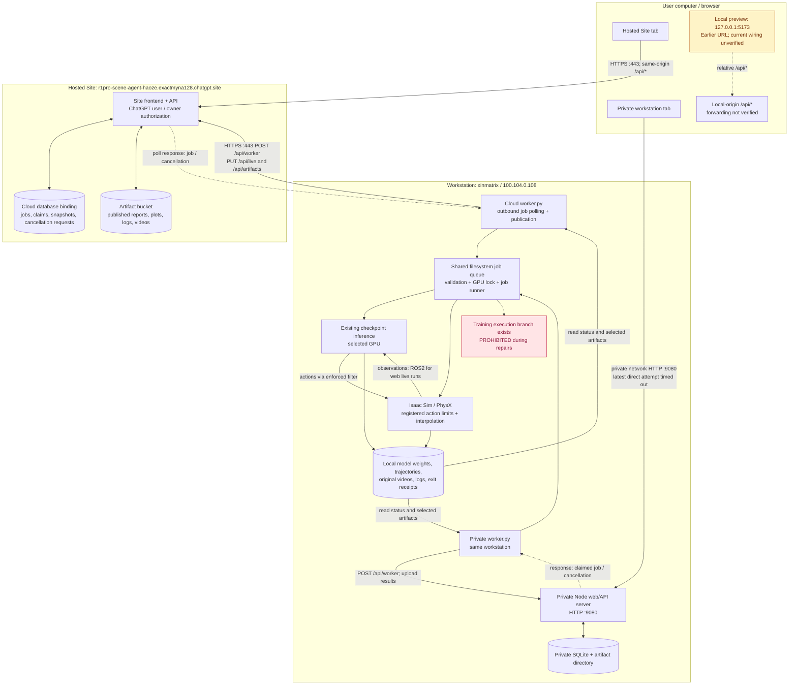

# Scene Studio network architecture

Source inspection: 2026-10-22. This describes the checked local source and earlier deployment receipts, not a fresh workstation health check. No server connection or training was performed for this document. Hosted Site v15 and workstation v17 are the last documented deployments; current remote process health is unverified.

The hosted webpage reaches the workstation through a **cloud job queue and an outbound polling worker**. The browser and workstation both contact the Site.

## Application connections

Arrows below describe HTTP request initiation, except explicitly labelled response arrows. The workstation is the HTTP client on the cloud bridge connection even though job instructions flow back to it.



The cloud and private servers have **separate databases and authentication modes**. They are not database mirrors. Their workstation workers enqueue into the same registered filesystem job area and observe workstation state; the common GPU lock serializes GPU jobs. There is no demonstrated automatic cross-site replication of every scene draft or browser session.

## Request and result sequence

```mermaid
sequenceDiagram
  participant B as Browser
  participant S as Hosted Site API
  participant D as Cloud queue / state
  participant W as Workstation outbound worker
  participant R as Local job runner
  participant I as Isaac + existing policy
  B->>S: POST /api/jobs (evaluation request)
  S->>D: Save owner-authorized queued job
  S-->>B: Job ID; queued
  W->>S: POST /api/worker (snapshot, updates, claim)
  S->>D: Atomically claim pending job
  S-->>W: Job payload in HTTP response
  W->>R: Validate and enqueue in independent run directory
  R->>I: Start after GPU lock is available
  I-->>R: Frames, contacts, errors, timing, outputs
  W->>S: Progress POST; live snapshot PUT; selected artifact PUT
  S->>D: Persist latest state
  B->>S: GET /api/live?jobId=... and bootstrap
  S-->>B: Stored snapshot and artifact links
  B->>S: POST /api/live (Stop policy)
  S->>D: Save cancellation request
  W->>S: Next worker poll
  S-->>W: Cancellation ID
  W->>R: Write stop_requested marker
  R->>I: Stop owned policy run and preserve outputs
  W->>S: Publish terminal state and exit evidence
```

The cloud API does not SSH into the workstation. A successful HTTP submission proves that a job was queued, not that the workstation received it or a GPU process started. Stop policy uses the same polling bridge; it requires the bridge to be functioning. In the checked code, this endpoint accepts only `evaluation.live` and `evaluation.vla`; it cannot stop `training.create`.

## Interfaces and observable behavior

| Connection | Interface | Access / behavior |
|---|---|---|
| Browser to hosted Site | HTTPS 443, `/api/jobs`, `/api/bootstrap`, `/api/live`, `/api/artifacts` | User identity for private state; owner checks for GPU operations; same-origin mutation checks |
| Workstation to hosted Site | HTTPS 443, POST `/api/worker` | Worker token plus Sites authorization header; worker initiates requests; credentials remain server-side |
| Workstation publication | PUT `/api/live`, PUT `/api/artifacts` | Worker authentication; artifact digest validation and 32 MiB upload cap per object |
| Browser to private workstation website | HTTP `100.104.0.108:9080` | Private network reachability required; offline mode has no visitor login |
| Private bridge to private API | HTTP to configured `STUDIO_HOST:9080` | Workstation-local worker token; local database and files |
| Browser local preview | HTTP `127.0.0.1:5173` | Loopback is the browser machine; URL alone does not prove a proxy, SSH tunnel, or remote GPU connection. No listening port 5173 was found in this inspection |
| Policy / simulation | Workstation-local ROS2 for web live runs; file transport supported for diagnostics | Not browser-to-robot networking; weights and execution remain on workstation |

Code timing: worker sleeps about 2 seconds between idle exchanges (1 second when an acknowledgement is pending), plus network/work time. The browser refreshes general state every 10 seconds and requests live state about 250 ms after each previous request completes. Publisher loop waits 0.5 seconds for cloud mode or 0.1 seconds for offline mode, plus publication work. These are polling settings, **not guaranteed end-to-end latency or video FPS**. GPU snapshots become stale after 45 seconds without a received update.

The browser 3D view is Three.js. Isaac/PhysX simulation and policy inference execute on the workstation. Live state is delivered as HTTP snapshots; the code inspected does not establish a WebRTC or WebSocket simulator stream. Selected videos and reports are uploaded for browser retrieval, while checkpoints and original run records stay on workstation disk.

## Evidence and limits

- [Worker request and polling loop](../../apps/scene-agent/gpu/worker.py): `exchange`, `main`.
- [Cloud worker API / queue claim](../../apps/scene-agent/app/api/worker/route.ts).
- [Job submission](../../apps/scene-agent/app/api/jobs/route.ts), [live telemetry and policy cancellation](../../apps/scene-agent/app/api/live/route.ts), [artifact storage](../../apps/scene-agent/app/api/artifacts/route.ts).
- [Authentication and freshness](../../apps/scene-agent/lib/server.ts).
- [Private HTTP server](../../apps/scene-agent/offline/server.ts), [supervisor and private worker configuration](../../apps/scene-agent/offline/supervisor.py), [SQLite/filesystem adapter](../../apps/scene-agent/offline/env.ts).
- [Local queue and cancellation constraints](../../apps/scene-agent/gpu/studio_backend.py), [job subprocess lifecycle](../../apps/scene-agent/gpu/studio_job_runner.py), [live publication](../../apps/scene-agent/gpu/live_publication.py).
- [Browser live request loop](../../apps/scene-agent/app/PolicyEvaluation.tsx), [bootstrap refresh](../../apps/scene-agent/app/page.tsx).

This document does not claim current cloud worker health, current training termination, a deployed training prohibition switch. The no-training rule is an operating instruction recorded in project decisions and automation; the existing application still contains a training execution branch.
